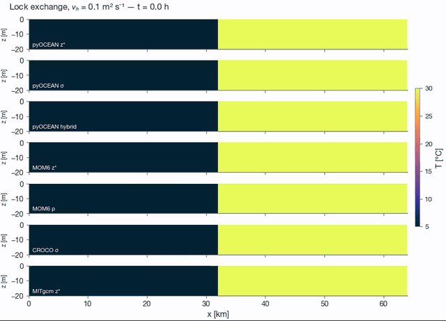
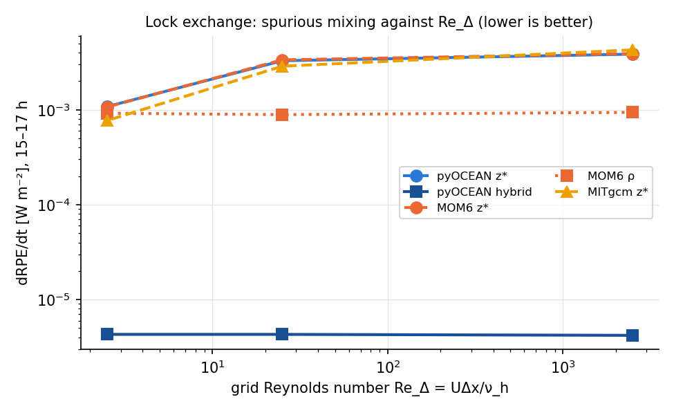
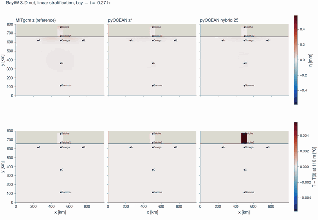
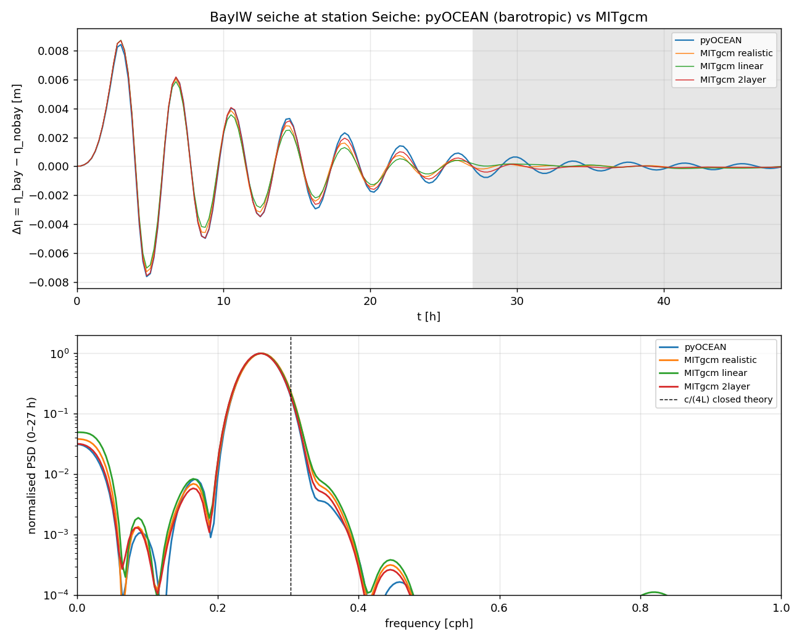
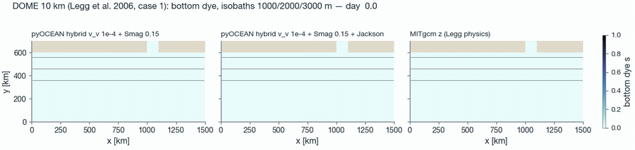
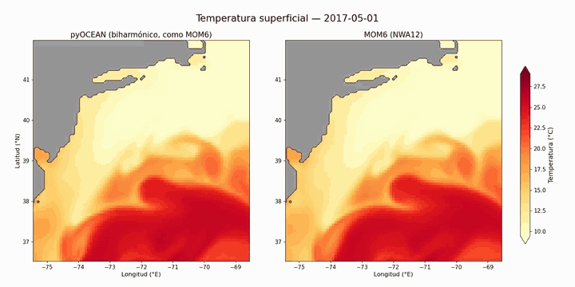
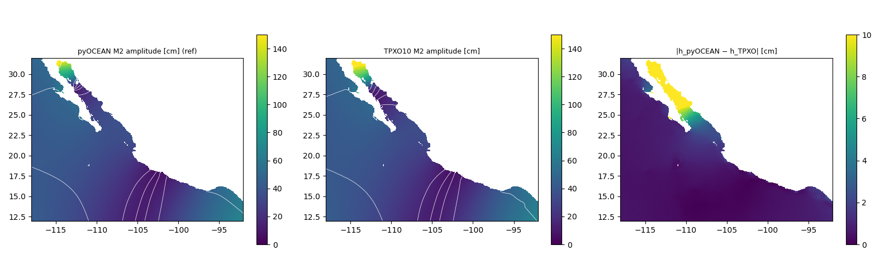
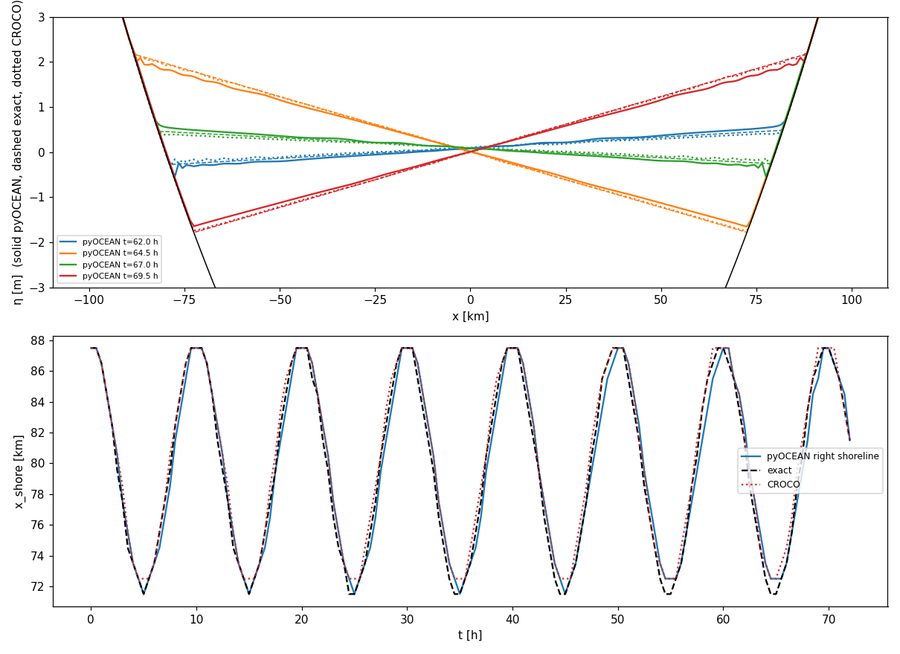

# pyOCEAN

A regional and coastal ocean model written from scratch in Python (NumPy + Numba), with z\*, σ and HYCOM-style hybrid vertical coordinates (ALE), validated against MOM6, MITgcm, CROCO, HYCOM and observations.

**Author:** Esteban Cruz Isidro, physical oceanographer, M.Sc. student at UNAM (Institute of Atmospheric Sciences and Climate Change)
**Contact:** estebanci96@gmail.com

---

## What it is

pyOCEAN solves the hydrostatic, Boussinesq primitive equations on an Arakawa C-grid (Cartesian, spherical or curvilinear from a MOM6 supergrid). It is not a wrapper: every scheme was written from the paper, compared with the source code of a production model (file:line references in the docstrings) and checked with tests.

The goal is a community regional/coastal model judged on four things: accuracy against observations, cost, robustness, and transparency. Every benchmark difference is put in one of four classes: our bug, missing physics, a numerical choice, or an error in the reference model. Only the first two change the model. Nothing is tuned to a single case.

**Status (November 2026):** about 2,400 tests in `pytest tests/`, 28 validation cases in `validation/`. Phase 1 (z-level core) and most of Phase 2 (forcing, tides, open boundaries, wetting and drying) are done. The work now is stage N of the roadmap: a modular core and a complete regional case.

---

## Main features

**Dynamics and numerics**
- Implicit free surface (θ-method), Flather radiation, wetting and drying (Casulli semi-implicit)
- σ-layer model and general ALE mode (Lagrangian step, then regrid and remap): z\*, σ and a HYCOM-style hybrid (z near the surface, isopycnal in the interior, σ in shallow water), with PCM/PLM/PPM_H4 remapping that matches MOM6 to round-off
- Finite-volume pressure gradient (Adcroft et al. 2008), bit for bit with compiled MOM6, plus the density-Jacobian scheme for σ
- Vector-invariant momentum (Sadourny energy-conserving PV flux), WENO5-Z tracer advection with FCT limiting, AB3 and SSP-RK3 time stepping
- Laplacian and biharmonic Smagorinsky viscosity (MOM6 stress-tensor form)
- Open boundaries: Flather, Orlanski, nudging, sponges, MOM6 tangential-velocity treatment, time-varying 3-D exterior data, periodic boundaries

**Physics**
- Equations of state: linear, Wright (full), and TEOS-10 (Roquet et al. 2015 polynomial). ρ, its derivatives and the PGF integral are bit for bit with MOM6
- Turbulence closures: GLS k-ε (port of CROCO), KPP (port of CVMix/MOM6), Jackson et al. (2008) interior shear mixing, drag-driven bottom-boundary-layer mixing
- Surface fluxes: NCAR (bit for bit with FMS), COARE 3.0 (bit for bit with CROCO), Kara (HYCOM), Jerlov shortwave, real freshwater flux, rivers
- Tides: TPXO10 boundaries, body tide, self-attraction and loading (SAL), internal-tide drag (JSL)
- Log-law bottom drag, salinity, passive tracers, 3-D interior sponges, atmospheric pressure

**Data and I/O**
- Forcing adapters: ERA5, WRF, GLORYS, HYCOM (z-level NetCDF and native `.a/.b`), TPXO10, GloFAS rivers, GEBCO bathymetry
- CF-1.8 / SGRID output in NetCDF4 or Zarr, bit-for-bit restarts, a pre-flight check that reports all configuration errors at once, a blow-up post-mortem, a domain checker
- Diagnostics: spurious mixing (RPE, variance decay), exact variance budgets, TEF, term-by-term momentum budgets, tide-gauge and observation quality control

---

## Validation (selection)

| Case | Compared with | Result |
|------|---------------|--------|
| BayIW bay seiche and internal waves (M.Sc. configurations) | MITgcm | seiche period and range within ±3 %, correlation 0.99–1.00 |
| Lock exchange, overflow, internal wave, seamount (Ilicak et al. 2012) | MOM6, MITgcm, CROCO | z\* RPE = MOM6 within ±1.6 %; hybrid mixes 250–1200× less than z\* |
| DOME overflow (Legg et al. 2006) | MITgcm, MOM6, Legg's non-hydrostatic results | buoyancy and plume transport closer to the non-hydrostatic truth with shear and BBL mixing |
| Idealized estuary (Lorenz et al. 2021) | GETM | exact mixing relation closed to 1e-10 |
| Single-column turbulence (Kato–Phillips, Ekman layers, diurnal cycle) | CROCO, MOM6/CVMix | mixed-layer depth within 0.1–1 % |
| Mexican Pacific barotropic tides | TPXO10, 31 TICON tide gauges | median error 1.95 cm (TPXO 1.87) |
| **NWA12 regional cut** (Mid-Atlantic Bight, May–Sep 2017) | MOM6 + SIS2 on the same grid, tide gauges, OISST, NDBC buoy, gliders, OOI moorings | M2 tide error 0.19 m (MOM6 0.24); grid bit for bit with MOM6; shelf SST still warmer than MOM6 (Gulf Stream water on the shelf, open) |

Each case has a README under `validation/` with its numbers, figures and open items. The full scorecard is in `docs/design/vision_roadmap.md` §7.

---

## Gallery

### Lock exchange: pyOCEAN against MOM6, CROCO and MITgcm

Temperature sections from the Ilicak et al. (2012) lock exchange, all models on the same case definition. pyOCEAN z\* and σ track MOM6 z\* and MITgcm. pyOCEAN's hybrid coordinate keeps a sharp front with almost no spurious mixing (right: rate of spurious mixing, lower is better).

<p align="center">
  
  
</p>

### Bay seiche and internal waves: pyOCEAN against MITgcm (M.Sc. thesis case)

A 3-D cut of the BayIW domain with linear stratification. Free-surface elevation (top) and internal-wave temperature anomaly at 110 m (bottom): MITgcm (left), pyOCEAN z\* (middle), pyOCEAN hybrid (right). Below, the barotropic seiche at the bay station: same period (3.83 h) and amplitude as MITgcm.

<p align="center">
  
</p>
<p align="center">
  
</p>

### DOME dense overflow (Legg et al. 2006)

Bottom dye of a dense plume sliding down a continental slope, 10 km grid, 45 days. Without interior shear mixing (left) the plume is too dense and spreads too far. With the Jackson et al. (2008) shear mixing ported from MOM6 (middle) it entrains and lightens, closer to MITgcm (right) and to Legg's non-hydrostatic reference.

<p align="center">
  
</p>

### Regional case: NWA12 cut (Mid-Atlantic Bight, 2017) against MOM6

Sea-surface temperature from 1 May to 25 August 2017 (one frame per day) on the same 1/12° grid, forcing and initial state: pyOCEAN (left) and MOM6 + SIS2 from the NOAA CEFI NWA12 setup (right). Both models run free inside the domain, so the Gulf Stream meanders differ.

<p align="center">
  
</p>

### Tides and wetting and drying

Left: M2 tide in the Mexican Pacific (pyOCEAN, TPXO10 and their difference). Right: the Thacker (1981) wetting-and-drying test against the exact solution and CROCO.

<p align="center">
  
  
</p>

---

## Project structure

```
pyOCEAN/
├── core/
│   ├── grid/          # C-grid, z/σ levels, bathymetry, MOM6 supergrid
│   ├── components/    # one component per role (EOS, PGF, momentum, closure, tracers, OBC, ...)
│   ├── model/         # fixed-order driver, variable registry, pre-flight, periodic halos
│   ├── dynamics/      # free surface, σ/ALE models, wetting-drying, viscosity
│   ├── vertical/      # ALE regrid, remap, face geometry, finite-volume PGF
│   └── restart.py     # bit-for-bit restarts
├── physics/           # EOS, mixing closures, bottom friction, tides, shortwave
├── forcing/           # adapters, interpolation, bulk formulae, tides, rivers
├── boundaries/        # open-boundary data
├── numerics/          # advection
├── diagnostics/       # output, budgets, mixing, TEF, tide gauges, QC
├── validation/        # 28 benchmark cases against models and observations
├── scripts/           # cost measurements, golden-hash generators, data download, literature search
├── prototypes/        # JAX vs Numba experiments for the differentiable backend (stage D)
├── docs/              # manual (Markdown, MkDocs layout), design notes, roadmap
├── tests/             # pytest suite
├── LICENSES/          # license texts of the third-party code (see THIRD_PARTY_NOTICES.md)
└── THIRD_PARTY_NOTICES.md
```

The 3-D model is `core.dynamics.sigma_baroclinic.SigmaBaroclinic` (σ-layers or ALE z\*/σ/hybrid). It is a facade over the components in `core/components/`, which the driver in `core/model/driver.py` runs in a fixed order. The Phase 1 z-level line (`core/state.py`, `core/timestepping/ab2.py`, `boundaries/obcs/`, `physics/mixing/kpp.py`) is kept and tested but is no longer developed.

---

## Running

```bash
git clone https://github.com/Estebanovich/pyOCEAN.git
cd pyOCEAN
conda env create -f environment.yml      # Python 3.12, numpy 1.26.4 (pinned for Numba 0.59)
conda activate pyocean
pytest tests/
python docs/manual/figures/quickstart_lock_exchange.py --coord zstar   # first run: a lock exchange
```

pyOCEAN is not a pip package yet: run from the repository root or add it to `PYTHONPATH`. For long runs set `OPENBLAS_NUM_THREADS=1 OMP_NUM_THREADS=1` so BLAS threads do not compete with the Numba threads.

A few tests need external data (MITgcm runs of the M.Sc. thesis, TPXO atlas) and fail or skip without it.

The manual is in `docs/manual/`, as Markdown that reads directly on GitHub: start with [installation](docs/manual/getting-started/installation.md), then the [quickstart](docs/manual/getting-started/quickstart.md). It has a MkDocs Material layout (`mkdocs.yml`) but has not been built or published as a website yet.

---

## Roadmap

| Stage | Content | Status |
|-------|---------|--------|
| Phase 1 | z-level core | ✅ |
| Phase 2 | forcing, tides, open boundaries, wetting and drying | mostly done |
| A | quality foundations (spurious mixing, restarts, CF output) | ✅ |
| B, C | 3-D σ physics; ALE hybrid coordinate | largely done |
| N | modular core, salinity, TEOS-10, bulk fluxes, closures, regional chain | in progress |
| next | cost reduction (now about 4× MOM6 on the regional case) | next |
| D | differentiable (JAX) backend | planned |
| E | internal waves: baroclinic tides, IW mixing (M.Sc. topic) | planned |
| F | operational forecasts, ML emulators, GPU | planned |

Details: `docs/design/vision_roadmap.md`.

---

## Tech stack

NumPy, Numba, SciPy, xarray, netCDF4/h5netcdf, Zarr, pandas, gsw, Matplotlib, pytest. Python only by design: no Fortran or C extensions, no MPI yet.

---

## Key references

- Adcroft, A., Hallberg, R. & Harrison, M. (2008). A finite volume discretization of the pressure gradient force using analytic integration. *Ocean Modelling*, 22, 106–113.
- Bleck, R. (2002). An oceanic general circulation model framed in hybrid isopycnic-Cartesian coordinates. *Ocean Modelling*, 4, 55–88.
- Ilicak, M. et al. (2012). Spurious dianeutral mixing and the role of momentum closure. *Ocean Modelling*, 45–46, 37–58.
- Large, W. G., McWilliams, J. C. & Doney, S. C. (1994). Oceanic vertical mixing: a review and a model with a nonlocal boundary layer parameterization. *Reviews of Geophysics*, 32, 363–403.
- Marshall, J. et al. (1997). A finite-volume, incompressible Navier–Stokes model for studies of the ocean on parallel computers. *JGR Oceans*, 102, 5753–5766.
- Roquet, F. et al. (2015). Accurate polynomial expressions for the density and specific volume of seawater using the TEOS-10 standard. *Ocean Modelling*, 90, 29–43.

## License

MIT (`LICENSE`), except `forcing/bulk_fms.py`, a port of NOAA-GFDL FMS code distributed under the LGPL-3.0-or-later. Code ported from MOM6, CVMix, CROCO/ROMS, MITgcm and HYCOM is listed with its original license in [`THIRD_PARTY_NOTICES.md`](THIRD_PARTY_NOTICES.md).
