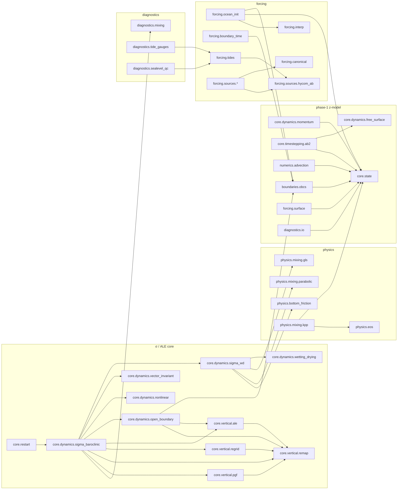

# Code map

Every package and module of the repository, what it is for, its main classes and functions, which model
line uses it, and whether it is active or legacy. pyOCEAN is not an installed package: the repository
root is put on `sys.path` (scripts do it explicitly; `pytest` does it because `tests/` is a package), and
modules are imported by their path, e.g. `from core.dynamics.sigma_baroclinic import SigmaBaroclinic`.

## The three model lines

| Line | Entry point | Status | Main modules |
|---|---|---|---|
| **σ / ALE 3-D core** (recommended) | `SigmaBaroclinic` | active, the unified core (`docs/design/unified_core.md`) | `core/dynamics/sigma_baroclinic.py`, `sigma_wd.py`, `wetting_drying.py`, `vector_invariant.py`, `open_boundary.py`, `nonlinear.py`; `core/vertical/*`; `core/restart.py`; `physics/mixing/gls.py`, `parabolic.py`, `physics/bottom_friction.py`; `diagnostics/*` |
| **2-D tidal free surface** | driver scripts in `validation/pacmex_tides/`, `validation/thacker/`, `validation/tidal_flat/` | active (barotropic tides, wetting–drying) | `core/dynamics/free_surface.py`, `wetting_drying.py`, `nonlinear.py`; `forcing/tides.py`, `forcing/sources/tpxo.py`; `physics/tides/drag.py`; `diagnostics/tide_gauges.py`, `sealevel_qc.py` |
| **Phase-1 z-level model** | `core.timestepping.ab2.ab2_step` with a user tendency | legacy (kept with its tests, not extended) | `core/state.py`, `core/grid/vertical.py`, `core/dynamics/pressure.py`, `momentum.py`, `core/timestepping/ab2.py`, `numerics/advection`, `physics/eos`, `physics/mixing/kpp.py`, `boundaries/obcs`, `forcing/surface.py`, `diagnostics/io.py` |

Shared by all lines: `core/grid/horizontal.py`, `core/grid/bathymetry.py`, the forcing tooling in
`forcing/`, and the diagnostics.

## Import graph

Derived from the `import` statements of the packages (internal imports only; `numpy`, `scipy`, `xarray`,
`numba` omitted). An arrow A → B means "A imports B".

Modules with no internal imports (leaves): `core.grid.*`, `core.dynamics.free_surface`,
`core.dynamics.pressure`, `core.dynamics.nonlinear`, `core.dynamics.vector_invariant`,
`core.vertical.remap`, `physics.bottom_friction`, `physics.eos`, `physics.mixing.gls`,
`physics.mixing.parabolic`, `physics.tides.drag`, `forcing.bulk`, `forcing.canonical`, `forcing.interp`,
`forcing.sources.tpxo`, `forcing.sources.hycom_ab`, `diagnostics.mixing`, `diagnostics.output`,
`diagnostics.postmortem`, `diagnostics.domain_check`. `diagnostics.output` and `diagnostics.postmortem` are
deliberately independent of the model classes: they take NumPy arrays.

## `core/` — grids, dynamics, vertical coordinate, state, restart

### `core/grid/`

| Module | Purpose | Main API | Line | Status |
|---|---|---|---|---|
| `horizontal.py` | Arakawa C horizontal grid as an `xarray.Dataset` (Cartesian, stretched Cartesian = MITgcm `delXFile`, spherical) | `create_cartesian_grid`, `create_cartesian_grid_stretched`, `create_spherical_grid`, `set_land_mask` | all | active |
| `bathymetry.py` | GEBCO loading, regridding to T-points, Hann 9-pt + Shapiro 5-pt smoothing, isolated cells, minimum depth | `load_gebco`, `regrid_to_model`, `smooth_bathymetry`, `fill_isolated_cells`, `apply_min_depth`, `build_bathymetry` | all | active |
| `sigma_levels.py` | Δσ_k fractions: Song & Haidvogel (1994) stretching, or from z-level thicknesses (MITgcm `delR`) | `stretched_sigma`, `sigma_from_thicknesses` | σ/ALE | active |
| `vertical.py` | z-levels with partial cells (hFac), k = 0 at the top | `create_z_grid`, `uniform_z_grid`, `stretched_z_grid`, `compute_hfac` | phase 1, 2-D tidal (`ImplicitFreeSurface` needs `v_grid` and `hfac`) | legacy, still used by the 2-D tidal model |
| `__init__.py` | re-exports of the grid functions | — | | |

### `core/dynamics/`

| Module | Purpose | Main API | Line | Status |
|---|---|---|---|---|
| `sigma_baroclinic.py` | **the 3-D model**: stratified σ-layer model with an ALE mode (z\*, σ, hybrid), wetting–drying, open boundaries, AB3, WENO5/FCT tracers, mixing diagnostic | `SigmaBaroclinic`, `SigmaState`, `set_threads`, `reference_profile`, `ReferenceProfile`, `ab3_combine` | σ/ALE | active |
| `sigma_wd.py` | homogeneous σ-layer wet–dry model (Casulli & Cheng 1992): implicit vertical viscosity + log-law bed stress per column, then the free surface; the vertical/barotropic engine of `SigmaBaroclinic` | `SigmaWetDry`, `vertical_implicit` | σ/ALE | active |
| `wetting_drying.py` | θ-implicit free surface with the upwind total depth (Casulli 1990), Flather faces, direct or CG + lagged-LU solve | `WetDryFreeSurface` | σ/ALE, 2-D W/D | active |
| `free_surface.py` | θ-implicit *linear* free surface (fixed matrix, factorised once), Flather, scalar SAL, open faces | `ImplicitFreeSurface`, `open_boundary_hfac` | 2-D tidal, phase 1 | active |
| `vector_invariant.py` | MOM6-style vector-invariant momentum terms: vorticity, PV, Sadourny energy PV flux with `BOUND_CORIOLIS`, kinetic energy (Arakawa/Godunov) and its gradient, CFL truncation | `vorticity_and_pv`, `coriolis_pv`, `kinetic_energy`, `ke_gradient`, `truncate_cfl` | ALE | active |
| `open_boundary.py` | time-varying exterior states for the 3-D core: validation, remap of exterior T and u′ onto the model layers, Flather targets | `validate_state`, `exterior_tracer`, `exterior_velocity`, `flather_targets`, `owned_by_state` | σ/ALE | active |
| `nonlinear.py` | shallow-water nonlinear terms: −∇·(ηu), momentum advection (centred / upwind3), Laplacian viscosity (incl. a 3-D Numba kernel) | `nonlinear_continuity`, `advection_u/v`, `laplacian_u/v`, `laplacian_3d`, `cell_to_faces` | 2-D tidal, σ (`ah`, `adv`) | active |
| `pressure.py` | hydrostatic pressure and PGF on z-levels; deprecated `surface_pressure_cg` | `hydrostatic_pressure`, `pressure_gradient_x/y`, `surface_pressure_cg` | phase 1 | legacy |
| `momentum.py` | z-level momentum tendencies (Coriolis, PGF, Laplacian), continuity, diagnostic w | `momentum_tendency`, `coriolis_u/v`, `eta_tendency`, `diagnose_w` | phase 1 | legacy |

### `core/model/` and `core/components/` — the component core (N1, 2026-10-28)

Since N1 `SigmaBaroclinic` is a facade with the same constructor: it builds one component per role and its
`step` runs the fixed ten-phase driver. The physics did not change (31 golden configurations bit for bit,
`tests/test_n1_golden.py`). The former private methods of `SigmaBaroclinic` remain as thin delegates.

| Module | Purpose | Main API | Status |
|---|---|---|---|
| `core/model/driver.py` | the ten phases of one step, the same in σ and ALE; per-step values passed as locals; `debug` phase hashes, `keep_terms` | `Driver`, `PHASES` | active |
| `core/model/contract.py` | component contract: roles, issues, documented parameters, single error report | `Role`, `Issue`, `param`, `Component`, `raise_issues`, `ConfigurationError`, `PyOceanConfigWarning` | active |
| `core/model/preflight.py` | all argument errors at once before building; warnings for arguments a mode ignores | `preflight` | active |
| `core/model/registry.py` | single variable registry (dims, C-grid location, units, CF name, kind) | `REGISTRY`, `VarSpec` | active |
| `core/model/threads.py` | thread count of the Numba kernels (one shared list) | `set_threads` | active |
| `core/components/eos.py`, `pgf.py`, `geometry.py` | linear EOS; Jacobian / two-term / finite-volume PGF with ρ_ref(z) | `LinearEOS`, `PressureGradient`, `LayerGeometry` | active |
| `core/components/momentum.py`, `time_stepper.py` | named explicit momentum terms and their fixed summation order; AB3 | `Momentum`, `sum_terms`, `AB3Momentum`, `ab3_combine` | active |
| `core/components/free_surface.py`, `bottom_drag.py` | wrapper of `SigmaWetDry.step` returning `BarotropicFluxes`; quadratic bbl drag | `FreeSurfaceVerticalViscosity`, `BarotropicFluxes`, `QuadraticBedDrag` | active |
| `core/components/open_boundary.py` | Flather targets, sponge and Orlanski on u′, inflow values, open-face transports; the exterior is returned, not stored | `OpenBoundary` | active |
| `core/components/layer_transport.py` | σ and ALE layer transports | `SigmaLayerTransport`, `ALELayerTransport`, `LayerFluxes` | active |
| `core/components/tracers.py` | SSP-RK3/'pc' WENO5 advection with FCT; along-layer K_h | `TracerAdvection`, `TracerDiffusion` | active |
| `core/components/vertical_coordinate.py`, `sponge.py` | ALE regrid/remap, face geometry (identity cache), velocity remap and CFL backstop; interior sponge | `ALECoordinate`, `InteriorSponge` | active |

### `core/vertical/` — the ALE toolkit

| Module | Purpose | Main API | Status |
|---|---|---|---|
| `remap.py` | conservative column remapping PCM / PLM / PPM_H4, = MOM6 `remapping_core_h` | `remap_column`, `remap_columns`, `reconstruct`, constants `PCM`, `PLM`, `PPM_H4` | active |
| `regrid.py` | grid rules z\*, σ, hybrid HYCOM1 (with `keep_isopycnal`, shallow σ window, z\* floor), initial snapping to density jumps | `regrid_columns`, `zstar_column`, `sigma_column`, `hycom1_column`, `target_densities`, `snap_to_jumps` | active |
| `ale.py` | ALE layer geometry on the C grid: face thicknesses (transport, mean, min, viscous), donor-cell and PPM layer fluxes consistent with the free surface, outflow limiter, Lagrangian continuity, thin-layer rules, open-face fluxes | `face_transport_thickness`, `ppm_transport_x`, `upwind_transport_x`, `limit_outflow`, `lagrangian_thickness`, `transport_velocity`, `face_fractions`, `baroclinic_split`, `zero_thin_bed_velocity`, `viscous_face_thickness`, `blend_thin_layers`, `open_face_transport`, `exterior_on_layers` | active |
| `pgf.py` | finite-volume pressure gradient (Adcroft et al. 2008; port of MOM6 `MOM_PressureForce_FV`) on any layers, with a reference profile | `fv_pgf` | active |

### Other `core/` modules

| Module | Purpose | Main API | Line | Status |
|---|---|---|---|---|
| `restart.py` | bit-for-bit float64 NetCDF restarts of `SigmaBaroclinic` (state, AB history, transports, GLS, exterior profile, lagged-LU matrix, configuration check) | `write_restart`, `read_restart` | σ/ALE | active |
| `state.py` | xarray `ModelState` with arithmetic | `ModelState` | phase 1 | legacy |
| `timestepping/ab2.py` | AB2 stepping of a `ModelState` tendency, with or without implicit free surface | `ab2_step`, `ab2_step_implicit_fs` | phase 1 | legacy |
| `thermodynamics/` | empty package (scaffold) | — | | placeholder |

## `physics/`

| Module | Purpose | Main API | Line | Status |
|---|---|---|---|---|
| `bottom_friction.py` | log-law drag: depth-mean C_d(D, z₀) (Soulsby 1997) and first-layer law of the wall | `log_law_cd`, `first_layer_cd` | σ (`z0`), 2-D | active |
| `mixing/gls.py` | GLS k–ε closure with Canuto A stability functions, column port of CROCO `gls_mixing.F` (shear only, no buoyancy yet) | `GLSKEpsilon` | σ (`closure="gls"`) | active |
| `mixing/parabolic.py` | parabolic eddy viscosity ν = κ u\* z (1 − z/D) | `parabolic_viscosity` | σ (`closure="parabolic"`) | active |
| `mixing/kpp.py` | KPP (Large et al. 1994) on z-levels | `obl_depth`, `interior_diffusivity`, `kpp_tendency` | phase 1 | legacy (to be ported to σ columns, `unified_core.md`) |
| `eos/__init__.py` | TEOS-10 (via `gsw`, optional import) and linear EOS on `ModelState` | `density_teos10`, `density_linear`, `compute_density` | phase 1 | legacy (`SigmaBaroclinic` has its own linear EOS in T) |
| `tides/drag.py` | Jayne & St. Laurent internal-tide drag as HYCOM `tiddrg=1` (`tidal.rh`) | `jsl_to_rh`, `regrid_bilinear`, `rh_at_faces`, `tidal_drag_rate`, `implicit_linear_drag` | 2-D tidal | active |

## `numerics/`

| Module | Purpose | Status |
|---|---|---|
| `advection/__init__.py` | first-order upwind tracer fluxes for `ModelState` (`upwind_flux_x/y/z`, `advect_tracer`, `tracer_tendency`) | legacy (the σ/ALE core has its own WENO5/UP3/FCT schemes inside `sigma_baroclinic.py`) |
| `diffusion/`, `solvers/` | empty packages (scaffold) | placeholder |

## `boundaries/`

| Module | Purpose | Main API | Status |
|---|---|---|---|
| `obcs/__init__.py` | `OBData` (exterior values at one edge, used by **all** lines) and the phase-1 Orlanski + sponge on `ModelState` | `OBData`, `sponge_tendency`, `apply_orlanski` | `OBData` active; the rest legacy |
| `surface/` | empty package | placeholder |

## `forcing/` — external data to model inputs

| Module | Purpose | Main API | Status |
|---|---|---|---|
| `canonical.py` | the canonical (source-independent) forcing contract: names, units, dims | `validate_canonical` | active |
| `interp.py` | canonical data → model grid, land fill, time interpolation, z-levels | `to_model_grid`, `fill_land`, `interp_time`, `to_model_levels` | active |
| `sources/base.py` | adapter interface and registry | `ForcingSource`, `BBox`, `register_source`, `get_source`, `available_sources` | active |
| `sources/era5.py` | ERA5 single-level adapter (CDS new and legacy layouts) | `ERA5Source` | active |
| `sources/wrf.py` | WRF `wrfout` adapter (Mercator / lat-lon) | `WRFSource` | active |
| `sources/hycom_z.py` | HYCOM ESPC-D-V02 / GOFS 3.1 z-level NetCDF adapter (in-situ → potential T with TEOS-10) | `HYCOMZSource` | active |
| `sources/hycom_ab.py` | native HYCOM `.a/.b` reader | `read_b`, `read_field`, `read_record`, `BFile` | active |
| `sources/hycom_archive.py` | HYCOM archv/archm hybrid layers → z levels | `HYCOMArchiveSource`, `remap_layers_to_z` | active |
| `sources/tpxo.py` | TPXO atlas reader (elevation and transport constants) | `read_tpxo` | active |
| `bulk.py` | bulk air–sea fluxes: NCAR/CORE (Large & Yeager 2004/2009) and Kara (HYCOM `flxflg=6`), radiation | `bulk_ncar`, `bulk_kara`, `radiative_fluxes`, `compute_surface_fluxes` | active (not yet coupled to `SigmaBaroclinic`) |
| `tides.py` | OTPS/TPXO tide prediction, nodal corrections, boundary tides, body tide, SAL | `predict`, `boundary_tides`, `boundary_tide_constants`, `boundary_tides_at`, `body_tide`, `body_force`, `read_sal_hycom` | active (2-D tidal) |
| `ocean_init.py` | initial state and `OBData` from canonical ocean data | `prepare_ocean`, `initial_state` (→ `ModelState`), `boundary_data` (→ `OBData`) | active, returns phase-1 `ModelState` |
| `boundary_time.py` | list of `{edge: OBData}` snapshots → `t → {edge: OBData}` (linear in time) | `interpolated_boundary` | active (σ/ALE `open_boundary_state`) |
| `surface.py` | phase-1 surface forcing tendencies (wind stress, heat, freshwater) on `ModelState` | `bulk_wind_stress`, `surface_tendency` | legacy |

## `diagnostics/`

| Module | Purpose | Main API | Status |
|---|---|---|---|
| `mixing.py` | spurious-mixing diagnostics: reference potential energy (Winters et al. 1995), variance decay (Burchard & Rennau 2008) | `reference_potential_energy`, `numerical_variance_decay` | active |
| `output.py` | CF-1.8 / SGRID output in Zarr (appending) or NetCDF4, σ `formula_terms` | `OutputWriter` | active (σ geometry; no ALE layer-thickness field) |
| `postmortem.py` | blow-up guard: NaN/limit detection with location, CFL, history and state dump | `BlowupGuard`, `BlowupError` | active |
| `domain_check.py` | pre-run checks: rx0/rx1, isolated water bodies, pits, isolated cells, CFL advice | `check_domain`, `rx0`, `rx1`, `DomainReport` | active |
| `tide_gauges.py` | TICON-3 gauge constants, model–gauge comparison, defect diagnosis | `load_ticon`, `diagnose_station`, `vector_difference` | active |
| `sealevel_qc.py` | raw sea-level QC (spikes, flat lines, datum steps, clock offsets, twin sensors) and harmonic analysis | `harmonic_analysis`, `flag_spikes`, `detect_steps`, `clock_offsets`, `compare_twins` | active |
| `io.py` | phase-1 NetCDF snapshots and a diagnostics writer of `ModelState` | `write_snapshot`, `read_snapshot`, `DiagnosticsWriter` | legacy |

## `scripts/`

| Script | Purpose |
|---|---|
| `scripts/profile_ale_step.py` | timing and cProfile of the ALE step (box case or BayIW); see [Performance](performance.md) |
| `scripts/litsearch.py` | full-text search of the local literature library (`--convert` makes `.md` copies with `pdftotext`) |

## `validation/` — benchmarks against truth and other models

Each folder has a runner, a comparison script and (mostly) a README with results; the READMEs are in
Spanish. See the [Validation](../validation/index.md) chapter.

| Folder | Case |
|---|---|
| `lock_exchange/` | lock exchange, front speed and spurious mixing vs CROCO `GRAV_ADJ` and Benjamin |
| `seamount/` | Beckmann & Haidvogel seamount, PGF error in σ |
| `internal_wave/` | MITgcm `internal_wave` (boundary-forced mode-1 wave) |
| `ilicak_benchmark/` | four-model benchmark part A (Ilicak 2012 cases + seamount) vs MOM6, CROCO, MITgcm, HYCOM; includes model writers/readers (`mom6.py`, `croco.py`, `mitgcm.py`, `hycom/`) |
| `mom6_lock_exchange/`, `mom6_ke_schemes/`, `mom6_column/`, `mom6_bayiw/` | comparisons with MOM6 (hybrid lock exchange, KE schemes, column regrid/remap vs Fortran, BayIW) |
| `bayiw_seiche/`, `bayiw_iw/`, `bayiw_2d/`, `bayiw_baroclinic/`, `bayiw_cut/` | the BayIW bay (barotropic seiche, internal waves, 2-D section, full 3-D, 3-D cut) vs MITgcm |
| `thacker/`, `tidal_flat/` | wetting–drying (Thacker exact solution, CROCO TIDAL_FLAT 2-D and 3-D) |
| `tides/`, `tide_gauges/`, `pacmex_tides/`, `hycom_ioa/` | tide prediction vs OTPS/pyTMD, TPXO and SAL files, gauge QC, the PAC_MEX tidal run, HYCOM-IOA comparison |
| `mitgcm_exf/`, `hycom_kara/` | bulk formulae vs MITgcm `exf` and compiled HYCOM |

## `tests/`

`pytest` suite, one file per module (`test_<module>.py`) plus benchmark tests (`test_bayiw_*.py`,
`test_ilicak_benchmark.py`, `test_internal_wave.py`, `test_mom6_bayiw.py`) that skip when the external
data are not mounted. `tests/data/` holds small reference files (OTPS tides, CROCO TIDAL_FLAT, HYCOM Kara
table, open-boundary and ALE performance fingerprints). `tests/conftest.py` caps Numba at 5 threads;
`tests/test_threads.py` checks it. 1350 tests are collected (2026-10-14).

## `prototypes/`

| File | Purpose |
|---|---|
| `jax_tracer_advection.py` | the WENO5 tracer advection RHS in JAX, for comparison with the Numba kernel |
| `bench_jax_vs_numba.py` | NumPy vs Numba vs JAX benchmark of that RHS ([Performance](performance.md)) |

## Other top-level items

| Item | Content |
|---|---|
| `docs/design/` | design documents (Spanish): vision and roadmap, unified core, forcing architecture, bulk comparison, validation suite, performance |
| `docs/superpowers/` | implementation plans and specs cited in docstrings (e.g. `specs/2026-10-14-hybrid-robustness`) |
| `docs/literature/reading_list.md` | papers to download for the local library |
| `docs/manual/` | this manual (MkDocs) |
| `bitacora.md` | development log (Spanish), one entry per session |
| `notebooks/`, `configs/` | empty except for placeholder subfolders |
| `HYCOM-src/`, `HYCOM-tools-master/` | external HYCOM sources for reference (git-ignored) |
| `environment.yml`, `mkdocs.yml`, `docs/requirements-docs.txt` | environments of the model and of this manual ([Installation](../getting-started/installation.md)) |
