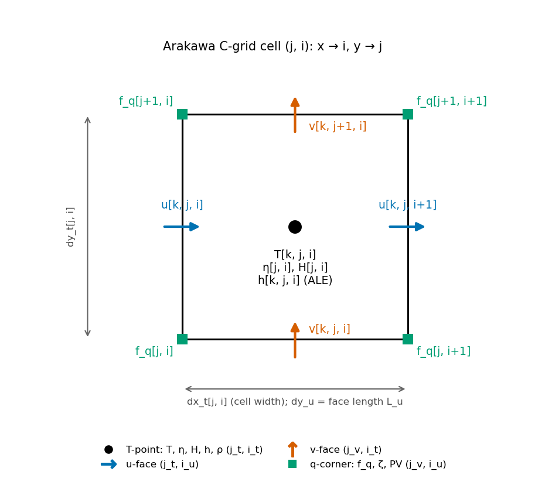
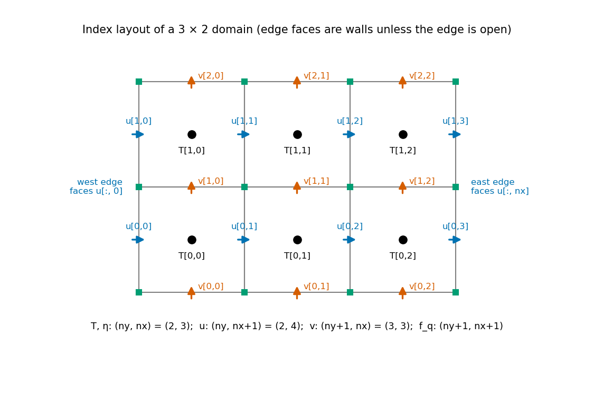
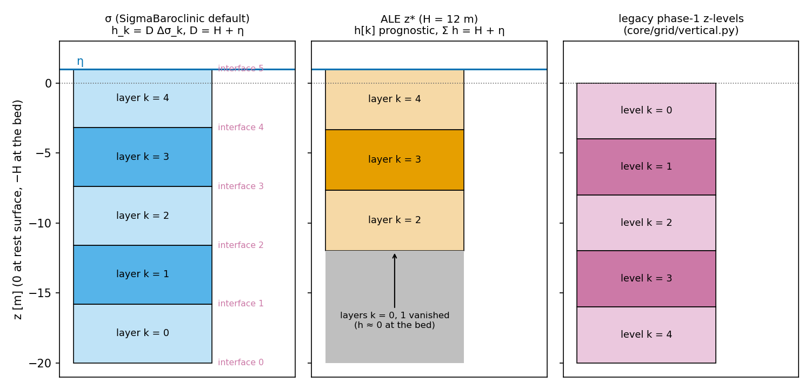

# Data structures and conventions

pyOCEAN keeps the model state inside the time step as **plain NumPy arrays** and uses **xarray only at
the I/O boundary** (grids, forcing, initial and boundary data, output, restarts). This is the decision
of 2026-10-11 recorded in `CLAUDE.md` and `docs/design/unified_core.md`, the same split as MITgcm, ROMS,
MOM6, Veros, Oceananigans and FESOM2-JAX; it keeps the arrays usable by Numba kernels and, later, by JAX.
This page lists every structure a user touches: the horizontal grid `xarray.Dataset`, the `SigmaState` of
the recommended core, the open-boundary `OBData`, the legacy phase-1 `ModelState`, and the units and
constants. Read it before writing initial conditions or post-processing output by hand.

## Index order and staggering

All 3-D arrays are indexed **(k, j, i)**: layer, row (y), column (x). 2-D arrays are (j, i).

*One T-cell (j, i). u[k, j, i] is on its west face and u[k, j, i+1] on its east face; v[k, j, i] on its
south face and v[k, j+1, i] on its north face; f_q[j, i] at its south-west corner.*

*A domain of nx = 3 by ny = 2 cells. u has nx + 1 columns and v has ny + 1 rows: the outermost faces are
the domain edges (walls, unless the edge is declared open).*

| Location | Variables | Shape | xarray dims (grid) |
|---|---|---|---|
| T-point (cell centre) | T, η, H, h, ρ, area_t | (ny, nx) or (N, ny, nx) | (j_t, i_t) |
| u-face (west face of cell i) | u, Qx, dx_u, dy_u | (ny, nx+1) or (N, ny, nx+1) | (j_t, i_u) |
| v-face (south face of cell j) | v, Qy, dx_v, dy_v | (ny+1, nx) or (N, ny+1, nx) | (j_v, i_t) |
| q-point (corner) | f_q, relative vorticity, PV | (ny+1, nx+1) | (j_v, i_u) |
| layer interface | ω, F_z, interface heights | (N+1, ny, nx) | — |

### Vertical index: k = 0 at the bed

*Left: σ-layers of `SigmaBaroclinic` — layer k = 0 sits on the bed, layer N − 1 at the surface;
interface 0 is the bed and interface N the free surface. Centre: an ALE z\* column shallower than the
nominal levels — the layers below the bed have vanished (h ≈ 0) and still exist in the arrays. Right: the
legacy phase-1 z-levels, numbered from the surface.*

| Model line | Layer 0 is | Interfaces | Source |
|---|---|---|---|
| `SigmaBaroclinic`, `SigmaWetDry` (σ and ALE) | the **bed** layer | 0 = bed (−H), N = surface (η) | `core/dynamics/sigma_baroclinic.py:113`, `core/vertical/ale.py` docstring |
| ALE regrid / remap kits | the bed layer | `zw[0] = −H`, `zw[N] = η` | `core/vertical/regrid.py` docstring |
| `OBData.zw` (exterior data) | the **surface** level | surface first, decreasing | `boundaries/obcs/__init__.py:146` |
| `regrid_params["dz_top"]` (z\* nominal levels) | the **surface** level | surface first (MITgcm `delR`) | `core/vertical/regrid.py` docstring |
| Phase-1 z-grid (`core/grid/vertical.py`), `ModelState` | the **top** level | `k_f = 0` = surface | `core/grid/vertical.py` docstring |
| `diagnostics/output.py` | follows `s_rho` (bed → surface for σ) | — | `diagnostics/output.py` |

!!! warning "Three vertical conventions"
    The bed-first convention of the core, the surface-first convention of `OBData` and `dz_top`, and the
    top-first convention of the phase-1 z-grid all coexist. When you build `h_src` and `T` for
    `initial_state(..., h_src=...)` from z-level data, reverse the data so that the bed is first (as
    `validation/ilicak_benchmark/run_pyocean.py:build` does with `[::-1]`).

Heights are measured upward with z = 0 at the rest surface, so the bed is at z = −H and the free surface
at z = η. The bathymetry `H` is **positive downward** (depth below the datum), negative on floodable land,
and **NaN on permanent walls**.

## The horizontal grid (`xarray.Dataset`)

Built by `create_cartesian_grid` (`core/grid/horizontal.py:48`), `create_cartesian_grid_stretched`
(`:163`, MITgcm `delXFile`/`delYFile`) or `create_spherical_grid` (`:246`), all assembled by
`_assemble_dataset` (`:414`). Every variable carries `units` and `long_name` attributes.

| Variable | Dims | Units | Meaning |
|---|---|---|---|
| `x_t`, `y_t` | (j_t, i_t) | m | T-point position (spherical: arc length from the SW corner) |
| `x_u`, `y_u` | (j_t, i_u) | m | u-point position |
| `x_v`, `y_v` | (j_v, i_t) | m | v-point position |
| `x_q`, `y_q` | (j_v, i_u) | m | corner (vorticity) position |
| `dx_t`, `dy_t` | (j_t, i_t) | m | width and height of the T-cell |
| `area_t` | (j_t, i_t) | m² | T-cell area (the A of every continuity equation) |
| `dx_u` | (j_t, i_u) | m | distance between the T-points on either side of the u-face (the Δx of ∂/∂x at u) |
| `dy_u` | (j_t, i_u) | m | length of the u-face (the L_u of the volume flux L_u D u) |
| `area_u` | (j_t, i_u) | m² | u-cell area |
| `dx_v` | (j_v, i_t) | m | length of the v-face (L_v) |
| `dy_v` | (j_v, i_t) | m | distance between the T-points on either side of the v-face |
| `area_v` | (j_v, i_t) | m² | v-cell area |
| `f_t` | (j_t, i_t) | s⁻¹ | Coriolis parameter at T-points |
| `f_q` | (j_v, i_u) | s⁻¹ | Coriolis parameter at corners (used by every Coriolis operator) |
| `mask_t` | (j_t, i_t) | 1 | ocean mask, 1 = ocean (all ones from the generators; `set_land_mask`, `:378`, replaces it) |
| `lon_*`, `lat_*` | as above | degrees | spherical grids only (t, u, v, q) |
| coords `i_t, j_t, i_u, j_v` | — | — | integer indices |

Attributes: `grid_type` (`"cartesian"` or `"spherical_polar"`), `nx`, `ny`, `dx`, `dy` (or `dlon`,
`dlat`), `x0`, `y0`, `f0`, `beta`, `staggering = "Arakawa C-grid"`.

!!! note "Masks in the σ/ALE core"
    `SigmaBaroclinic` and the free-surface solvers do **not** read `mask_t`: land is given by NaN in the
    bathymetry array. Internally `WetDryFreeSurface` builds `active = isfinite(H)` and the face depths
    `H_u = fmin(H_L, H_R)`, `H_v` (the higher bed of the two cells; NaN if either cell is a wall). The
    phase-1 z-model uses `mask_t` and the hFac fractions of `compute_hfac` (`core/grid/vertical.py:222`).

The model reads these grid variables: `dx_u, dy_u, dx_v, dy_v, area_t` (free surface,
`core/dynamics/wetting_drying.py:115–117`), `f_q` (Coriolis), and in ALE also `area_u, area_v, dx_t, dy_t`
(vector-invariant terms, PPM swept volume, CFL truncation; `_setup_ale`, `core/dynamics/sigma_baroclinic.py:1183`).

## `SigmaState` — the state of the recommended core

`SigmaState` (`core/dynamics/sigma_baroclinic.py:107`) is a dataclass of NumPy arrays. `N` = `n_layers`.
`model.initial_state(eta, T)` creates a resting state; `model.step(st)` returns a **new** `SigmaState`
(the old one is not modified).

| Field | Shape | Location | Units | Meaning |
|---|---|---|---|---|
| `eta` | (ny, nx) | T | m | free-surface height η above the rest level; on a dry cell η = −H |
| `u` | (N, ny, nx+1) | u-face | m s⁻¹ | layer velocity in x; 0 on dry and wall faces |
| `v` | (N, ny+1, nx) | v-face | m s⁻¹ | layer velocity in y |
| `T` | (N, ny, nx) | T | °C | temperature (the only tracer; the linear EOS uses it) |
| `h` | (N, ny, nx) or `None` | T | m | ALE layer thickness, bed first, Σ_k h = H + η in wet columns; `None` in σ mode (h = D Δσ_k) |
| `g_hist` | list of ≤ 3 tuples `(G_u, G_v)` | u-, v-face | m s⁻² | explicit momentum tendencies of the last steps, newest first (AB3 history) |
| `omega` | (N+1, ny, nx) or `None` | interfaces | m s⁻¹ | ω = F_z / A through the σ-interfaces; `None` in ALE |
| `mix_num` | (N, ny, nx) or `None` | T | °C² m³ s⁻¹ | volume-weighted numerical mixing of T (Burchard & Rennau 2008); `None` before the first step and with `mix_diagnostic=False` |
| `Qx` | (N, ny, nx+1) or `None` | u-face | m³ s⁻¹ | layer volume transports of the last step (the next step's momentum advection uses them) |
| `Qy` | (N, ny+1, nx) or `None` | v-face | m³ s⁻¹ | as `Qx` in y |
| `Fz` | (N+1, ny, nx) or `None` | interfaces | m³ s⁻¹ | volume flux through the layer interfaces, k = 0 bed; identically 0 in ALE |
| `time` | float | — | s | model time since the start |
| `n_trunc` | int | — | — | ALE: cumulative number of CFL velocity truncations at faces thicker than `h_thin_bed` |
| `n_limited` | int | — | — | ALE: cumulative number of cell-layers scaled by the outflow limiter |

Useful model methods on a state: `layer_heights(eta, h)` (layer-centre heights, `:1267`),
`layer_volumes(eta, h)` (`:1289`), `density(T)` (linear EOS, `:1285`), `tracer_content(st, power)`
(Σ V T^p, `:1296`), `rpe(st)` (reference potential energy, `:1300`).

### Model attributes that complete the state

Some state lives in the model object, not in `SigmaState`. `core/restart.py` writes it too
(see [Output, restarts and diagnostics](../user-guide/output-restart-diagnostics.md)):

| Attribute | Shape | Meaning |
|---|---|---|
| `model.T_ext`, `model.h_ext` | (N, ny, nx) | exterior temperature profile (inflow and sponge target); in ALE kept with its own layers h_ext ("in z") and remapped each step |
| `model.rho_ref` | `ReferenceProfile` or `None` | ρ_ref(z) table (`z`, `rho`) subtracted in the PGF and the diffusion (`"auto"` until `initial_state` is called) |
| `model.core.gls` | `GLSKEpsilon` | k, ε and ν at the interfaces (σ mode with `closure="gls"`) |
| `model.fs` | `WetDryFreeSurface` | lagged-LU preconditioner matrix; `last_wet_u/v`, `last_Du/Dv`, `last_open_Qu/Qv`, `last_open_Du/Dv`, `last_clip_volume`, `cg_iterations`, `lu_factorizations` of the last solve |
| `model.H`, `model.ds`, `model.sigma_c`, `model.area` | — | rest depth, σ fractions Δσ_k (bed first), σ at layer centres, cell areas |

## `OBData` — exterior values at an open boundary

`OBData` (`boundaries/obcs/__init__.py:124`) is a dataclass for one edge. In the σ/ALE core it is what the
`open_boundary_state(t)` provider returns, as a dict `{edge: OBData}`, and
`forcing.boundary_time.interpolated_boundary` interpolates a list of snapshots in time.

| Field | Shape | Units | Meaning |
|---|---|---|---|
| `side` | `"west"`, `"east"`, `"south"`, `"north"` | — | the edge |
| `T` | (nz, n_bdy) | °C | exterior temperature on the data's own levels |
| `S` | (nz, n_bdy) | PSU | exterior salinity (not used by `SigmaBaroclinic`, which has no salinity) |
| `u_normal` | (nz, n_bdy) | m s⁻¹ | exterior normal velocity (u for west/east, v for south/north) |
| `eta` | (n_bdy,) | m | exterior sea-surface height (Flather target) |
| `zw` | (nz+1, n_bdy) | m | interface heights of the data's levels, **surface first**, decreasing |
| `ubar` | (n_bdy,) | m s⁻¹ | exterior depth-mean normal velocity (Flather); `None` = 0 |

`n_bdy` = ny for west/east, nx for south/north. See [Open boundaries and nesting](../theory/open-boundaries.md).

## Legacy `ModelState` (phase-1 z-level model)

`ModelState` (`core/state.py:60`) holds xarray `DataArray`s and supports `+`, `*` so the AB2 stepper can
write `state + dt * tendency`. It is used only by the phase-1 modules (`core/dynamics/momentum.py`,
`pressure.py`, `physics/mixing/kpp.py`, `forcing/surface.py`, `numerics/advection`, `boundaries/obcs`,
`diagnostics/io.py`, `forcing/ocean_init.py`).

| Variable | Dims | Units | Location |
|---|---|---|---|
| `u` | (k, j_t, i_u) | m/s | u-face |
| `v` | (k, j_v, i_t) | m/s | v-face |
| `w` | (k_f, j_t, i_t) | m/s | T-column interfaces, **k_f = 0 at the surface** |
| `T` | (k, j_t, i_t) | degC | T-point |
| `S` | (k, j_t, i_t) | PSU | T-point |
| `eta` | (j_t, i_t) | m | T-column |
| `time` | float | s | |

`ModelState.from_grids(h_grid, v_grid, T_init=10, S_init=35)` builds a resting state; `to_dataset()`
exports it. The vertical grid comes from `create_z_grid` / `uniform_z_grid` / `stretched_z_grid`
(`core/grid/vertical.py`: `z_f`, `z_t`, `dz`, k = 0 topmost) and the partial cells from `compute_hfac`
(`hfac_t`, `hfac_u`, `hfac_v`, `dz_t`; MITgcm-style, `hfac_min` = 0.1).

## Units and constants

All quantities are SI except temperature (°C) and salinity (PSU). Time is in seconds from the start of
the run; the output writer converts it to CF `seconds since <start>`.

| Symbol | Value | Where | Note |
|---|---|---|---|
| g | 9.81 m s⁻² | `G` in `sigma_baroclinic.py:101`, `sigma_wd.py:48`, `wetting_drying.py:48`, `free_surface.py:71`, `pressure.py:71`, `forcing/bulk.py:66`, `physics/mixing/gls.py:40` | `SigmaBaroclinic(g=...)` overrides it |
| ρ₀ (σ/ALE core) | **1000 kg m⁻³** (default `rho0`) | `SigmaBaroclinic.__init__` | set it explicitly for realistic runs |
| ρ₀ (phase-1 modules) | 1025 kg m⁻³ | `RHO_0` in `core/dynamics/pressure.py:72`, `momentum.py:77`, `physics/mixing/kpp.py:100` | `CLAUDE.md` lists 1025 |
| α (thermal coefficient of the linear EOS) | 0.2 kg m⁻³ °C⁻¹ (default `t_coef`) | `SigmaBaroclinic` | ρ = ρ₀ − α (T − T₀), T₀ = `t_ref` = 0 °C |
| Ω | 7.2921e-5 rad s⁻¹ | `OMEGA`, `core/grid/horizontal.py:41` | |
| R | 6.371e6 m | `R_EARTH`, `core/grid/horizontal.py:40` | |
| κ (von Kármán) | 0.41 | `physics/bottom_friction.py:28`, `gls.py:39`, `parabolic.py:24` | 0.4 in `forcing/bulk.py:65` (LY04) and `kpp.py:107` |
| c_p (seawater) | 3996 J kg⁻¹ K⁻¹ | `physics/mixing/kpp.py:101` | phase-1 KPP only |
| `d_min` | 0.05 m | `SigmaBaroclinic`, `WetDryFreeSurface` | face total depth below which a face is dry |
| `H_THIN_BED` | 0.01 m | `core/vertical/ale.py:62` | default `h_thin_bed` |
| `DZ_FLOOR` | 1e-6 m | `core/vertical/ale.py:63` | smallest thickness in the implicit vertical solves |
| `H_MIN` | 1e-3 m | `core/vertical/regrid.py:41` | minimum layer thickness after regridding (MOM6 MIN_THICKNESS) |
| `H_PPM_MIN` | 2e-10 m | `core/vertical/ale.py:297` | PPM positive-definite floor (MOM6) |
| `H_VANISHED` | 0.01 m | `core/vertical/pgf.py:51` | vanished layers in the FV PGF mass weighting |

## References

- Arakawa, A. & Lamb, V.R. (1977). Computational design of the basic dynamical processes of the UCLA
    general circulation model. *Methods in Computational Physics* 17, 173–265.
- Burchard, H. & Rennau, H. (2008). Comparative quantification of physically and numerically induced mixing
    in ocean models. *Ocean Modelling* 20, 293–311. doi:10.1016/j.ocemod.2007.10.003
- Marshall, J., Adcroft, A., Hill, C., Perelman, L. & Heisey, C. (1997). A finite-volume, incompressible
    Navier–Stokes model for studies of the ocean on parallel computers. *J. Geophys. Res.* 102(C3), 5753–5766.
