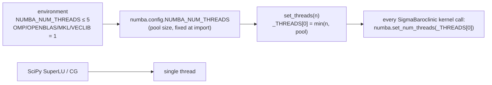

# Performance and parallelism

pyOCEAN runs on one shared-memory node. The hot loops of the σ/ALE core are **Numba kernels** compiled
on first use and parallelised over rows, layers or columns with `prange`; the glue between them is NumPy;
the free-surface system is solved with SciPy's SuperLU, directly or as the preconditioner of a conjugate
gradient. There is no MPI and no GPU backend yet. This page lists the kernels, explains the threading
model and the solvers, collects every measured cost in the repository, and ends with practical advice.

## Design rules

- **Correctness first, then speed** (`CLAUDE.md`). Every kernel keeps a **NumPy reference** (an
    "oracle", usually `<name>_numpy`) with the same arithmetic, and a test checks that the kernel matches
    it — bit for bit in most cases, to ≤ 1e-12 for the PPM thickness flux because of the order of the sums
    (`validation/bayiw_baroclinic/README.md`).
- **Fuse and avoid temporaries.** The measured lesson of `docs/design/performance.md` (and of
    Oceananigans, Veros and the MPAS/NEMO studies it cites) is that these solvers are memory-bandwidth bound:
    speed comes from fewer passes over memory, not from more arithmetic units.
- **Results do not depend on the thread count.** Rows/columns are independent in every kernel, so the
    results are bit-identical for any number of threads (`set_threads` docstring,
    `core/dynamics/sigma_baroclinic.py:166`).
- **Numba is the CPU production engine; JAX is not.** A JAX prototype of the tracer advection
    (`prototypes/jax_tracer_advection.py`, `prototypes/bench_jax_vs_numba.py`) was 0.304 s per call against
    0.177 s for the fused Numba kernel on 5 threads, and XLA could not be limited to the performance cores
    on the development Mac (`docs/design/performance.md` §4). JAX is kept for the differentiable stage D of
    the roadmap.

## Numba kernels

All kernels are `@njit(cache=True)` (compiled once and cached in `__pycache__`), most with
`parallel=True`. The first call of a run therefore pays the compilation (a few seconds); later runs load
the cache.

| Kernel | File:line | What it does | NumPy oracle / test |
|---|---|---|---|
| `_weno5_rows`, `_wval` | `core/dynamics/sigma_baroclinic.py:208`, `:176` | WENO5-Z/JS face values on rows | `_weno5_faces_numpy` (`:552`); `tests/test_sigma_baroclinic.py` |
| `_advect_faces_h`, `_advect_div` | `:237`, `:296` | fused flux-form tracer advection RHS (x, y, k), upstream values on open edges | `_rhs_numpy` (`:1789`); `test_advect_kernel_matches_numpy` |
| `_rk_stage` | `:837` | SSP-RK3 stage combination + safe division by the volume | `_advect_numpy` (`:1922`) |
| `_fct_stage`, `_fct_fluxes`, `_fct_coeff_kernel`, `_fct_final` | `:424`, `:443`, `:379`, `:486` | Zalesak FCT around SSP-RK3 WENO5 (ALE) | `_advect_fct_numpy` (`:1885`), `fct_coefficients_numpy` (`:338`) |
| `_flux_form_u_kernel` | `:627` | flux-form WENO5 momentum advection | `_flux_form_u_numpy` (`:714`) |
| `_diffuse_ale_kernel` | `:505` | along-layer Laplacian tracer diffusion (ALE) | `_diffuse_h_numpy` (`:1600`); `test_diffusion_kernel_matches_numpy` |
| `_interp_kernel` | `:801` | ρ_ref(z) interpolation with NumPy's `interp` arithmetic (≥ 1000 points) | `np.interp` |
| `_ab3_kernel` | `:859` | AB3 / AB2 combination of the tendencies | the NumPy expression |
| `_thomas_columns` | `core/dynamics/sigma_wd.py:53` | tridiagonal implicit vertical viscosity/diffusion per column | `_vertical_implicit_numpy` (`:99`); `tests/test_sigma_wd.py` |
| `_laplacian_3d_kernel` | `core/dynamics/nonlinear.py:200` | horizontal Laplacian of all layers | `laplacian_u/v` |
| `_vort_pv_kernel`, `_pv_kernel`, `_coriolis_kernel`, `_ke_kernel`, `_ke_grad_kernel`, `_truncate_kernel` | `core/dynamics/vector_invariant.py:215`, `:271`, `:306`, `:354`, `:189`, `:158` | vector-invariant terms and CFL truncation | `vorticity_q_numpy`, `pv_q_numpy`, `coriolis_pv_numpy`, `kinetic_energy_numpy`, `ke_gradient_numpy`, `truncate_cfl_numpy`; `tests/test_vector_invariant.py` |
| `_ftt_kernel`, `_viscous_face_kernel`, `_fractions_kernel`, `_split_kernel`, `_thin_bed_kernel`, `_transport_velocity_kernel` | `core/vertical/ale.py:178`, `:109`, `:876`, `:899`, `:926`, `:783` | ALE face geometry, depth-mean split, thin-bed rule, transport velocity | `*_numpy` versions in the same file; `tests/test_vertical_ale.py`, `tests/test_sigma_ale.py` |
| `_ppm_edges_kernel`, `_ppm_transport_kernel`, `_face_flux` | `core/vertical/ale.py:576`, `:644`, `:623` | MOM6 continuity_PPM layer fluxes with the Newton barotropic adjustment | `ppm_transport_x_numpy` (`:525`) |
| `_exceeds_kernel` | `core/vertical/ale.py:307` | fast check of the outflow limiter | `_outflow_numpy`; `test_outflow_check_kernel_matches_numpy` |
| `_regrid_columns` and column rules | `core/vertical/regrid.py:310` (`zstar_column` `:45`, `sigma_column` `:64`, `hycom1_column` `:204`, …) | ALE grid generation, parallel over columns | MOM6 Fortran (`tests/test_vertical_vs_mom6.py`, `validation/mom6_column/`) |
| `_remap_columns`, `remap_column`, `reconstruct` | `core/vertical/remap.py:401`, `:307`, `:235` | PCM/PLM/PPM_H4 conservative remap, parallel over columns | MOM6 `remapping_core_h` to ≤ 5e-12 (`CLAUDE.md`) |
| `_fv_pgf_x`, `_edges_columns` | `core/vertical/pgf.py:107`, `:83` | finite-volume pressure gradient | analytic cases, `tests/test_vertical_pgf.py` |

What is **not** compiled: the free-surface assembly and solve (SciPy), the open-boundary bookkeeping, the
regrid/remap wrappers, and the NumPy glue of `_step_ale` and `step`. The phase-1 z-model is pure NumPy.

## Threading model



- **Pool size.** `NUMBA_NUM_THREADS` must be set *before* Numba is imported; it fixes the maximum.
    `tests/conftest.py` caps it at 5 for the test session and `tests/test_threads.py` checks it.
- **`set_threads(n)`** (`core/dynamics/sigma_baroclinic.py:166`) sets the thread count used by the
    model's kernels (default 1). `SigmaBaroclinic` calls `numba.set_num_threads(_THREADS[0])` before every
    kernel group (e.g. `_step_ale`, `:1991`).
- **Kernels called directly** (outside a `SigmaBaroclinic` method, e.g. `remap_columns` in your own
    script) ignore `set_threads`: use `numba.set_num_threads` yourself.
- **BLAS/OpenMP.** Set `OMP_NUM_THREADS`, `OPENBLAS_NUM_THREADS`, `MKL_NUM_THREADS` and
    `VECLIB_MAXIMUM_THREADS` to 1: extra BLAS/OpenMP threads give no speed-up because SuperLU and the
    NumPy glue are single-threaded (`CLAUDE.md`, "Known issues"), and they compete with the Numba threads.
    All validation runners do this at the top of the script.
- **The development machine** is an Apple M3 Pro with 5 performance and 6 efficiency cores. The rule
    of the project is **≤ 5 compute threads in total, over all concurrent runs**, and never lowered
    priority (macOS would move the run to the efficiency cores). macOS has no core-affinity API, so this
    is best effort.

## Free-surface solvers

| Solver | Class / option | Matrix | Method | Where it is used |
|---|---|---|---|---|
| direct, factorised once | `ImplicitFreeSurface(solver="direct")` (`core/dynamics/free_surface.py:109`) | fixed (rest depth) | `scipy.sparse.linalg.factorized` (SuperLU) once, then back-substitution | 2-D tidal runs without drying |
| Jacobi CG | `ImplicitFreeSurface(solver="cg")` | fixed | CG with diagonal preconditioner | rarely |
| direct, every step | `WetDryFreeSurface(solver="direct")` (`core/dynamics/wetting_drying.py:51`) | rebuilt every step (total depth) | `spsolve` (SuperLU) | σ mode of `SigmaBaroclinic` (default), Thacker, TIDAL_FLAT |
| CG + lagged LU | `WetDryFreeSurface(solver="cg", precond="lu")` | rebuilt every step | CG preconditioned by the exact LU of a lagged matrix, refactorised when CG needs > 5 iterations; η recomputed from the final fluxes (exact conservation) | ALE mode of `SigmaBaroclinic` (default), Gulf of California nest |
| Jacobi CG | `WetDryFreeSurface(solver="cg", precond="jacobi")` | rebuilt every step | CG with diagonal preconditioner | comparison only |

Measured: on the 96 273-cell northern Gulf of California nest the lagged-LU CG needs 1–3 iterations and
7–19 ms per solve against 97–117 iterations and ~50 ms with Jacobi (factorisation 0.19 s)
(`WetDryFreeSurface` docstring, `core/dynamics/wetting_drying.py:84–87`); per step 0.053 against
0.079 s (`docs/design/vision_roadmap.md` §7). On BayIW 560 × 352 the CG solver takes the step from ≈ 1 s
to ≈ 0.1 s (`SigmaBaroclinic` docstring, `solver`). The lagged LU matrix is saved in restarts so that a
restarted run reproduces the CG iterates bit for bit (`WetDryFreeSurface.preconditioner_state`, `:203`).
In the 2-D PAC_MEX tidal run SuperLU is 65 % of the step and Numba `prange` on the rest gives ≤ 1.35×
overall (`CLAUDE.md`, `validation/pacmex_tides/bench_parallel.py`).

PyAMG is mentioned in the roadmap as an option for wetting–drying (`docs/design/vision_roadmap.md` §5,
§8) but is **not** used or installed.

## Measured costs

All on the Apple M3 Pro. "s/step" is wall time per time step; "s/h" is wall seconds per simulated hour.

### ALE step on BayIW (560 × 352, Δt = 120 s, open boundaries with a 30-cell sponge, 5 threads)

From `validation/bayiw_baroclinic/README.md` ("Rendimiento del paso ALE"), measured with
`scripts/profile_ale_step.py`:

| Stage of the optimisation | z\* (50 layers) | hybrid (25 layers) | box 200 × 120 × 30 |
|---|---|---|---|
| baseline (NumPy, direct free surface) | 8.48 | 4.77 | 0.59 |
| CG + lagged LU, exact conservation | 7.75 | | |
| face thickness kernel + identity cache | 7.15 | | |
| PPM thickness flux kernels | 4.94 | 2.41 | |
| advection: skip faces without flux | 4.86 | | |
| 3-D Laplacian with cached spacings | 4.58 | | |
| Coriolis PV, vorticity, KE kernels | 4.03 | | |
| face fractions, baroclinic split, thin layers kernels | 3.46 | | |
| no vertical advection pass in ALE | 3.40 | | |
| horizontal diffusion kernel, cached layer heights | **3.32** | **1.58** | **0.19** |
| same, `mix_diagnostic=False` | **2.72** | **1.44** | |

Final profile (z\*, no mixing diagnostic, 2.65 s/step under cProfile): advection 15 %, FV pressure
gradient 13 %, remap 9 %, `ascontiguousarray` copies 8 %, free surface 7.5 %, PPM 7.5 %, `cumsum` 7 %,
everything else < 5 % each. Against MITgcm (0.29 s/step with 8 MPI processes, Δt = 30 s → 35 s/h):
pyOCEAN z\* 82 s/h (2.3× slower), hybrid 25 layers 43 s/h (1.2×).

### BayIW 3-D cut (198 × 159 × 50, Δt = 120 s)

From `validation/bayiw_cut/README.md` ("Rendimiento"), timed without the profiler, 30 steps after 5 warm-up
steps (±3 % between repetitions):

| Case | baseline 1 / 5 threads | final 1 / 5 threads | speed-up 1 → 5 |
|---|---|---|---|
| z\* radiating | 0.749 / 0.385 | 0.740 / 0.303–0.305 | 2.42 |
| hybrid radiating | 0.379 / 0.197 | 0.368 / 0.160 | 2.30 |
| z\* nested | 0.958 / 0.539 | 0.784 / 0.328–0.338 | 2.32 |

Per simulated hour, z\* 9.1 s against MITgcm's 4.4 s on 5 processes; hybrid 4.8 s. The remaining time is
in memory-bound parallel kernels (remap ~41 ms, T advection ~26 ms, FV PGF ~26 ms, PPM flux ~21 ms per
step), which scale only 3.1–3.9× on 5 threads. Nesting adds 25–33 ms per step, mostly
`_evaluate_exterior` (`exterior_velocity` in the 30-cell sponge band). Cost of a 60-h run: MITgcm 4.4 min,
pyOCEAN z\* 11.2–11.9 min, hybrid 5.4–5.6 min (`validation/bayiw_cut/README.md`, phase 1, before part 2).

### Other measurements

| Case | Cost | Source |
|---|---|---|
| σ model, BayIW 560 × 352 × 50: NumPy → Numba WENO5 | 31 → 6.5 s/step (1 thread); 3.3 s/step with fused advection, compiled Thomas and lagged-LU CG | `docs/design/performance.md` §1 |
| per cell and step vs MITgcm | ~500 vs ~290 ns per core (but Δt 300 vs 30 s) | `docs/design/performance.md` §1 |
| Ilicak cases, largest stable Δt, 1 process (s/h) | lock exchange 0.049, overflow 0.45 (Δt 80 s; hybrid 1.01 with 40 s), internal wave 0.0019, seamount 0.22; MOM6 0.073 / 4.1 / 0.0024 / 0.18; CROCO 0.015 / 0.91 / 0.0008 / 0.12; MITgcm 0.101 / 4.5 / 0.0037 / 0.025; HYCOM overflow 5.41 | `docs/design/vision_roadmap.md` §7, `validation/ilicak_benchmark/README.md` |
| MOM6 on BayIW, same Δt | z\* 9.1 vs 9.0 s/h, hybrid 5.0 vs 4.7 | `docs/design/vision_roadmap.md` §7 (`validation/mom6_bayiw/README.md`) |
| 2-D PAC_MEX tides, 650 × 500, Δt = 120 s | 33 days in 11 min on one core | `CLAUDE.md` |
| free surface alone, 560 × 352 (`ImplicitFreeSurface`) | 0.14 s/step | `CLAUDE.md` |
| quick-start lock exchange, 128 × 1 × 20, 1 thread | σ 1.2, ALE z\* 1.9, ALE hybrid 2.1 ms/step | run for this manual ([Quick start](../getting-started/quickstart.md)) |

## Profiling

- `scripts/profile_ale_step.py` — timing and cProfile of the ALE step:

    ```bash
    NUMBA_NUM_THREADS=5 /opt/anaconda3/bin/python scripts/profile_ale_step.py --case box --coord zstar --steps 5 --profile
    ```

    `--case box` is a self-contained 200 × 120 × 30 z\* (or `--coord hybrid`) box with open boundaries and a
    10-cell sponge; `--case bayiw` needs the BayIW MITgcm inputs on the external volume. `--solver direct|cg`
    switches the free-surface solver, `--no-mix` the mixing diagnostic. Three warm-up steps absorb the JIT
    compilation and the first LU factorisation before timing.
- `validation/bayiw_cut/profile_step.py` — 1- and 5-thread timing of the BayIW cut plus the top
    self-time entries (outputs `profile_baseline.txt`, `profile_final.txt` in that folder).
- `prototypes/bench_jax_vs_numba.py` — NumPy, Numba and JAX versions of the tracer advection RHS.
- `validation/pacmex_tides/bench_parallel.py` — parts of the 2-D tidal step and Numba scaling.

## Practical advice

1. **Set the thread variables at the very top of your script**, before importing NumPy or Numba (see the
    [Quick start](../getting-started/quickstart.md) script), then call `set_threads(n)` with n ≤ the
    number of performance cores. On the M3 Pro: 5 for one run, or e.g. 2 + 2 for two concurrent runs.
2. **Benchmark before a long run**: time a few steps with 1 … 5 threads (and two concurrent runs) and
    launch the fastest configuration. Memory-bound kernels scale 2.3–3.9× on 5 threads, not 5×.
3. **Use the ALE defaults for 3-D runs**: CG + lagged LU (`solver="cg"`) is ~10× cheaper than the direct
    solve on large grids. In σ mode the direct solve is the default to keep old runs bit-identical; pass
    `solver="cg"` for speed.
4. **Switch off what you do not need**: `mix_diagnostic=False` saves 18 % (z\*) and 9 % (hybrid) on BayIW (3.32 → 2.72 s/step
    z\*, 1.58 → 1.44 hybrid) and halves the tracer work; `thickness_flux="upwind"` is 28 % cheaper than PPM
    (but needs more layers in density currents; class docstring).
5. **Fewer layers where they do nothing**: the hybrid coordinate with 25 layers cost about half of z\*
    with 50 on BayIW for comparable results (`validation/bayiw_cut/README.md`).
6. **Longer time steps**: the free surface is implicit; the limit is the baroclinic/advective CFL. The CFL
    truncation counter (`st.n_trunc`) and `limit_outflow` errors tell you when Δt is too long in ALE.
7. **Warm the JIT cache** with a short run after editing kernels; the first call compiles.
8. **Kill leftover MPI processes** of reference models (MOM6, HYCOM, MITgcm) before timing anything: orphaned
    MOM6 ranks once contaminated a whole cost ladder (`CLAUDE.md`, four-model benchmark row).

## References

- Häfner, D., Nuterman, R. & Jochum, M. (2021). Fast, cheap, and turbulent — global ocean modeling with GPU
    acceleration in Python. *JAMES*. doi:10.1029/2021MS002717
- Koldunov, N. et al. (2026). FESOM2-JAX v1.0. arXiv. doi:10.48550/arxiv.2608.01546
- Bishnu, S. et al. (2023). Comparing the performance of Julia on CPUs versus GPUs and Julia-MPI versus
    Fortran-MPI: a case study with MPAS-Ocean. *GMD* 16, 5539. doi:10.5194/gmd-16-5539-2023
- Briand, L. et al. (2025). Julia vs C++ Kokkos for Cartesian CFD. *IJHPCA*. doi:10.1177/10943420251341179
