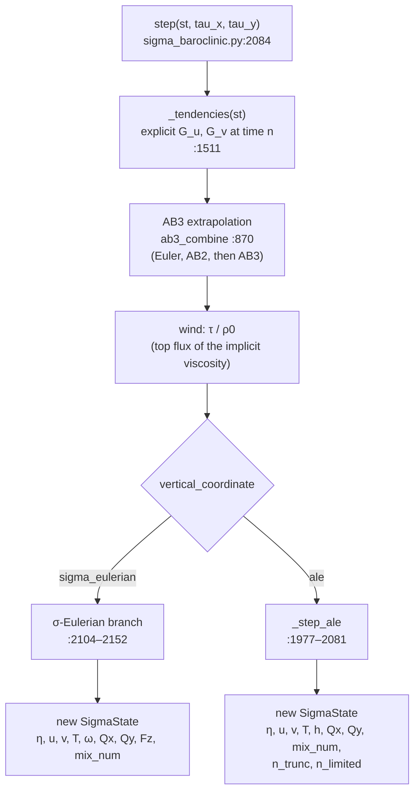
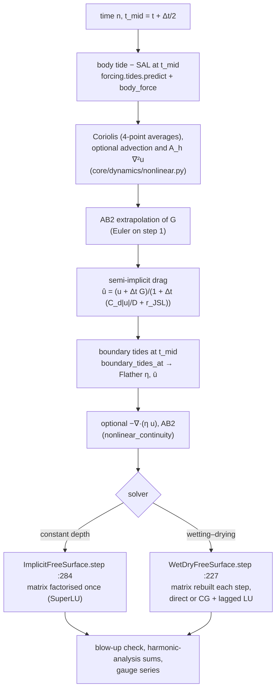
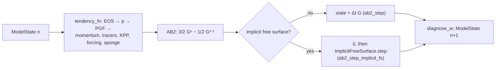

# The time step, flow diagrams

This page follows one call of `SigmaBaroclinic.step` from the first line to the returned state, in the
**σ-Eulerian** mode (the default, `vertical_coordinate="sigma_eulerian"`) and in the **ALE** mode
(`vertical_coordinate="ale"`, z\*, σ or hybrid layers). Every stage gives the function that does it and
its location in the source. Read it when you need to know *in which order* things happen — for example,
which velocity the tracers see, when the open-boundary values are applied, or which thickness the vertical
viscosity uses. The physics and the numerics of each stage are explained in the
[Theory and numerics](../theory/equations.md) chapter; this page is about the control flow.

At the end there are shorter diagrams for the 2-D tidal free-surface model and a note on the legacy
phase-1 AB2 z-level model.

!!! note "Line numbers"
    Line numbers refer to the source tree of 2026-10-14 (commit `0481616`). They drift; the function names
    do not.

## Since N1 (2026-10-28): ten phases and components

`SigmaBaroclinic.step` now calls `core.model.driver.Driver.step`, which runs the same ten phases in σ and ALE
(phases 8–9 do nothing in σ). The order is exactly the one described below — the diagrams name the former
methods of `SigmaBaroclinic`, which remain as delegates to the components listed here.

| # | Phase | Components |
|---|---|---|
| 1 | `prepare` | `OpenBoundary.evaluate` (exterior at tⁿ⁺¹); ALE: `ALECoordinate.transport_thickness`, face fractions |
| 2 | `explicit_momentum` | `PressureGradient`, `Momentum.terms` → `sum_terms` (pgf, coriolis \| vector_invariant, advection, hviscosity, vadvection) |
| 3 | `time_combine` | `AB3Momentum.combine`; τ/ρ₀ |
| 4 | `implicit_and_free_surface` | `FreeSurfaceVerticalViscosity.step` (wraps `SigmaWetDry.step`) → `BarotropicFluxes`; ALE: `QuadraticBedDrag.rates` |
| 5 | `boundary_velocity` | `OpenBoundary.relax_velocity`; ALE: thin bed layers, blending |
| 6 | `layer_transport` | `SigmaLayerTransport` \| `ALELayerTransport` → `LayerFluxes` |
| 7 | `tracers` | `TracerAdvection` (inflow stack as argument), `TracerDiffusion`, K_v, boundary sponge |
| 8 | `vertical_coordinate` | ALE: `ALECoordinate.regrid_remap` |
| 9 | `interior_sponge` | ALE: `InteriorSponge.apply` |
| 10 | `finalize` | ALE: `ALECoordinate.remap_faces`, `truncate`; the new `SigmaState` |

`model._driver.debug = True` records a hash of the arrays alive after each phase (`phase_hashes`), to locate
the first phase that departs from a reference run; `model._driver.keep_terms = True` keeps the named momentum
terms of the last step (`last_terms`).

## Since N2a (2026-10-29): salinity and the freshwater substep

Phase 7 (`tracers`) now advances a **stack** `[T, (T²), S, (S²), tr…]` (`Driver._stack_layout`): T² is carried in σ
always and in ALE with `mix_diagnostic` or `variance_budget`; S with `salinity`; S² with `variance_budget` or
`tef_face`; the passive tracers last. S follows the path of T at every stage (advection, `kh`, `kv`, sponge, ALE
remap). Inside the phase the order is:

1. advection of the stack on the layer fluxes (SSP-RK3 with WENO5, FCT in ALE);
2. **variance budget** (`variance_budget=True`): `VarianceBudget` records the numerical mixing of the advection,
   $V^{1}(\langle c^2\rangle - c^2)/\Delta t$, from the advected stack, *before* the freshwater substep;
3. **freshwater substep** (`apply_freshwater`, only with a surface flux $fw = P - E$): the volume of every layer
   changes from $V_{\rm adv}$ to $V_{\rm fw}$; salt-like members are rescaled at fixed content
   ($c_{\rm new} = c\,V_{\rm adv}/V_{\rm fw}$), T is unchanged (the water enters at the top-layer T). An
   evaporation deficit larger than the top layer takes the rest from the layers below (counted in `n_limited`);
4. `kh`, `kv` (implicit; with `gls_stratified` the tracer diffusivity is the GLS $\kappa_t$ instead of the constant),
   boundary sponge; in ALE the regrid–remap of the stack.

The free surface sees the same flux as a **volume source** in its continuity equation (phase 4), so the layer
thicknesses, the tracer volumes $V_{\rm fw}$ and η agree to round-off. In the stratified GLS mode (phase 4 → 7) the
buoyancy frequency $N^2$ comes from $\rho(T, S)$ of the current state. Optional `tef_face` and `tef_region` accumulate
the total exchange flow of a transect from the step's effective face fluxes. See
[Tracer transport](../theory/tracers.md#salinity-freshwater-and-the-variance-budget).

## Since N3 (2026-10-30): closures in ALE, heat flux, periodic boundaries

N3 (branch `n3-closures`; spec `docs/superpowers/specs/2026-10-29-n3-turbulence-closures-design.md`) changes the
phases of the table above as follows. Without the new arguments (`heat`, `periodic`, `closure='gls'|'kpp'` in ALE) every
configuration of the N1 golden matrix is bit for bit as before.

| Phase | What N3 adds |
|---|---|
| 3 | none |
| 4 `implicit_and_free_surface` | The closure is its own component (`core/components/closure.py`: `ConstantClosure`, `GLSClosure`, `KPPClosure`). `Closure.viscosity(st)` gives ν at the faces; for GLS `Closure.update(u, v, h, rho, ustar2_sfc, ustar2_bot, bflux)` follows the implicit step, with the bed u*² computed once (`ctx.ustar2_bot`) and shared by σ and ALE. In ALE with `z0`, `LogLawBedDrag.rates` gives per-layer implicit rates $r_k = C_d\,\lvert\mathbf U_b\rvert\,w_k$ over the bottom `hbbl` metres, with the **full bed speed** $\lvert\mathbf U_b\rvert=\sqrt{u_b^2+\bar v_b^2}$ (cross component by the 4-point mean of CROCO `get_vbc.F:517-526`; Task 9b, before it each face used its own component only) |
| 7 `tracers` | After the freshwater substep: `_heat_fluxes` sets `ctx.bflux` and `_heat_apply` adds the prescribed heat (non-solar $Q_{ns}$ in the top layer with mass, shortwave $Q_{sw}$ by the Paulson & Simpson 1977 profile, the part reaching the bed in the bottom layer). With `closure='kpp'` `_kpp_update` runs before the heat is applied (MOM6 diabatic order) and `_kpp_nonlocal` adds the explicit non-local term after $K_h$. Tracer diffusivity $\kappa_t$ is the closure's (floor `kv`) for T, S and passive tracers |
| 8 `vertical_coordinate` | After the regrid, `Closure.remap(h_src, h_dst)`: GLS remaps $k$ and $\varepsilon$ (below). KPP carries only $\nu$ (`akv`) by interface index, as MOM6 does (`MOM.F90:1964-1965`) |

**Surface heat flux** (`step(..., heat={"Q_ns": ..., "Q_sw": ...})`, `physics/surface/shortwave.py`). A prescribed flux
(positive into the ocean, W m⁻²), not a bulk formula. Exact heat content to round-off (relative error < 1e-13 of the
change, σ and z*); vanished layers receive nothing; land and dry columns are ignored. See
[Air–sea fluxes](../theory/air-sea-fluxes.md).

**Periodic boundaries** (`SigmaBaroclinic(..., periodic=("x",), ("y",) or ("x", "y"))`, `core/model/periodic.py`). With
`"x"`, u-face columns 0 and nx are one physical face stored twice; stencil kernels get wrapped halos (pad–crop) and pair
operators use cells n−1 and 0 natively. `periodic` with an open edge on the same axis is a configuration error. Used for
the single-column cases (5×5 doubly periodic) and for Lorenz-type channels.

**GLS in ALE** (`closure='gls'`, `gls_stratified=True`). The $k$–$\varepsilon$ state lives at the interfaces. Two ALE-specific
pieces:

1. **Thin-layer merge.** Layers thinner than $h_{thin} = \min(10\ \mathrm{cm},\ \max(1\ \mathrm{mm},\ 1\,\%\,D/N))$
   per column (`thin_layer_threshold`) are merged with the nearest layer with mass above them (a top cluster forms its
   own surface layer when it holds at least 1 mm) as MOM6 `eliminate_massless` (`MOM_kappa_shear.F90:254-307`, top cluster
   `:256-265`); the k-ε step runs on the merged column and the result is interpolated back onto every interface. Columns
   with no thin layer take the same arithmetic as σ (σ ≡ ALE to 4e-13 with fixed layers); columns with thin layers go
   to the Numba kernel `physics/mixing/gls_merged.py` (NumPy path kept as oracle, equal bit for bit). The relative
   threshold keeps uniform σ columns unmerged and caps at HYCOM's 10 cm; a Δt form like MOM6's was too small (0.77–2.4 mm).
2. **Remap of $k$ and $\varepsilon$.** Each interface owns the dual cell $w_i=\tfrac12(h_{i-1}+h_i)$; after the regrid the
   interface values are remapped as cell means of the dual grid with the model's conservative remap (PPM_H4 by
   default), so $\sum w\,k$ is conserved to round-off, then floored ($k\ge 10^{-10}$, $\varepsilon\ge 10^{-12}$) and
   limited by Galperin et al. (1988) with the $N^2$ of the last update.

`gls_production='energy'` (option) uses the Burchard (2002) energy-conserving shear production; the default `'croco'`
keeps the CROCO arithmetic.

**KPP** (`closure='kpp'`, `physics/mixing/kpp_cvmix.py`, `KPPClosure`). The CVMix/MOM6 K-profile parameterization
(bulk-Richardson boundary-layer search per column, shape functions, enhanced diffusion, non-local term), constants of
CVMix (no tuning), no background diffusivity by default (`KPPParams.kappa_bg = nu_bg = 0`). The surface buoyancy flux
includes the shortwave absorbed above the trial depth, $B_f(d)=B_{ns}+B_{sw}(1-F_{sw}(z_{bot}(d)))$, as MOM6
(`MOM_forcing_type.F90:1113, 1143-1147`). Interior Richardson mixing is not part of `'kpp'`.

## The model object and the state

A run is a loop over

```python
st = model.step(st, tau_x=None, tau_y=None)
```

where `model` is a `SigmaBaroclinic` (`core/dynamics/sigma_baroclinic.py:933`) and `st` a `SigmaState`
(`core/dynamics/sigma_baroclinic.py:107`) — plain NumPy arrays, see
[Data structures](data-structures.md). `SigmaBaroclinic` owns:

| Attribute | Class | Role in the step |
|---|---|---|
| `model.core` | `SigmaWetDry` (`core/dynamics/sigma_wd.py:143`) | implicit vertical viscosity + bed stress per column, then the free-surface solve, then the uniform barotropic correction |
| `model.fs` = `model.core.fs` | `WetDryFreeSurface` (`core/dynamics/wetting_drying.py:51`) | θ-implicit free surface with the *upwind total depth* at the faces (Casulli 1990); returns η, ū and the face depths and wet flags used by the layer transports |
| `model.core.gls` | `GLSKEpsilon` (`physics/mixing/gls.py:90`), only with `closure="gls"` (σ mode) | k–ε turbulence state, advanced after the free surface |

The step is a **fractional step** (Casulli & Cheng 1992): explicit momentum tendencies (AB3), an implicit
vertical step, an implicit barotropic step, a uniform barotropic correction, layer transports consistent
with the free-surface flux, and tracer transport with those frozen transports. The ALE mode adds a
Lagrangian layer-thickness update, a regrid and a conservative remap.

## Overview: one call of `step`



### Stage 0 — explicit tendencies, `_tendencies` (`core/dynamics/sigma_baroclinic.py:1511`)

Computed from the state at time *n* and identical in both modes except where noted.

1. **Wet faces.** `SigmaWetDry.face_depths(η)` (`core/dynamics/sigma_wd.py:246`) gives the total depth
    at u- and v-faces (mean of the two cells); a face is wet if its rest depth is finite and the total
    depth exceeds `d_min` (default 0.05 m).
2. **Baroclinic pressure gradient** `_baroclinic_pgf` (`:1381`): the density-Jacobian form of Song (1998)
    (`pgf="jacobian"`, default), the two-term form (`"twoterm"`), or the finite-volume form of Adcroft et
    al. (2008) through `_fv_pgf` (`:1455`) → `core.vertical.pgf.fv_pgf` (`core/vertical/pgf.py:165`). The
    density anomaly is taken with respect to `rho_ref(z)` when a reference profile is set
    (`rho_ref="auto"` builds it from the initial state).
3. **Coriolis and momentum advection.**
    - σ mode (`momentum="flux"`, the only choice there): energy-conserving C-grid Coriolis `_coriolis`
        (`:1467`, Sadourny 1975) plus the **flux-form WENO5 momentum advection** `_flux_form_u`
        (`:706`, kernel `_flux_form_u_kernel` `:627`) with the layer transports `Qx, Qy, Fz` *of the last
        step* (stored in the state). On the very first step `st.Qx` is `None`, so there is no momentum
        advection on step 1.
    - ALE mode, default `momentum="vector_invariant"`: `_vector_invariant` (`:1483`) — relative
        vorticity and potential vorticity at the corners (`vector_invariant.vorticity_and_pv`), the PV flux
        `coriolis_pv` with `bound=True` (MOM6 `BOUND_CORIOLIS`), and minus the kinetic-energy gradient
        (`kinetic_energy`, `ke_gradient`; `ke_scheme` `"arakawa"` default or `"gudonov"`). The transports are
        again those of the last step (on the first step `L u h̄`).
    - ALE with `momentum="flux"`: the flux form with the vanished-cell limiter (`dt` passed to
        `_flux_form_u`).
    - `adv="upwind3"` or `"centred"` (σ only): advective form from `core/dynamics/nonlinear.py`, plus the
        centred vertical advection `_vertical_advection` (`:1503`) with the ω of the last step.
4. **Horizontal viscosity** `A_h ∇²u` with `laplacian_3d` (`core/dynamics/nonlinear.py:224`) when `ah > 0`
    (free slip; spacings cached on first use).
5. The tendencies are zeroed on dry faces.

The surface pressure gradient −g∇η is *not* in these tendencies: it is implicit, in the free-surface solve.

### Stage 1 — Adams–Bashforth (`step`, `:2091–2099`)

The new tendency is pushed onto `st.g_hist` (newest first, at most three levels). The combination is
done by the fused kernel `ab3_combine` (`:870`):

| Step | Combination |
|---|---|
| 1 | $G^{n}$ (forward Euler) |
| 2 | $\tfrac32 G^{n} - \tfrac12 G^{n-1}$ (AB2) |
| ≥ 3 | $\tfrac{23}{12} G^{n} - \tfrac{16}{12} G^{n-1} + \tfrac{5}{12} G^{n-2}$ (AB3, Durran 2010) |

The AB history is part of the restart, so a restart during the start-up reproduces the continuous run
(`core/restart.py`). The wind stress is divided by ρ₀ and passed separately (`tu, tv`); it is **not**
extrapolated: it enters as the top-boundary flux of the implicit vertical viscosity.

## σ-Eulerian mode

```mermaid
flowchart TD
    A["G_ab from AB3, τ/ρ0"] --> X{"open_boundary_state?"}
    X -- yes --> X1["_evaluate_exterior(t+Δt) :1717<br/>Flather targets, exterior u′<br/>_exterior_T → T_in"]
    X -- no --> F
    X1 --> F
    subgraph CORE ["SigmaWetDry.step  (sigma_wd.py:258)"]
      F["face_depths(η)"] --> F2["GLS ν at faces<br/>(closure='gls')"]
      F2 --> F3["column_step u, v :187<br/>û = (I − Δt ∂z ν ∂z + bed drag)⁻¹ (u + Δt G_ab)<br/>vertical_implicit (Thomas) :88"]
      F3 --> F4["depth means ūⁿ = Σ Δσ uⁿ, û̄ = Σ Δσ û"]
      F4 --> FS["WetDryFreeSurface.step :227<br/>upwind face depth, SPD matrix,<br/>direct (σ default) or CG + lagged LU,<br/>Flather faces, positivity guard"]
      FS --> F5["uⁿ⁺¹ = û + (ūⁿ⁺¹ − û̄) on wet faces"]
      F5 --> F6["GLS update (closure='gls')"]
    end
    F6 --> O["_open_velocity :1694<br/>sponge on u′, Orlanski on u′ at open edges"]
    O --> Q["layer transports Qx, Qy :2114–2130<br/>depth mean with θ, u′ with θ_bc<br/>open faces: Δσ × Flather flux + u′ part"]
    Q --> W["Fz from layer continuity :2131–2135<br/>Fz[0] = 0 (bed), Fz[N] = 0 (surface)"]
    W --> T["_advect :1951 on the stack [T, T²]<br/>SSP-RK3 (or 'pc'), WENO5 x, y, k<br/>kernel _advect_div :296"]
    T --> M["mix_num = V1 (A(T²) − (A T)²)/Δt"]
    M --> D1["K_h along σ: _diffuse_h :1578<br/>K_v implicit: vertical_implicit"]
    D1 --> SP["tracer sponge toward T_ext"]
    SP --> R["ω = Fz / A; return SigmaState"]
```



Step by step (`SigmaBaroclinic.step`, `core/dynamics/sigma_baroclinic.py:2104–2152`):

1. **Time-varying exterior** (only with `open_boundary_state`): `_evaluate_exterior(t + Δt)` (`:1717`)
    calls the user's provider, validates it (`core.dynamics.open_boundary.validate_state`), and prepares the
    Flather targets (η, ū), the exterior baroclinic velocity u′ on the face layers (open faces and sponge
    band), and the exterior temperature on the current σ-layers (`_exterior_T`, `:1745`) used for inflow
    and the tracer sponge.
2. **Vertical and barotropic step**, `SigmaWetDry.step` (`core/dynamics/sigma_wd.py:258`):
    1. `column_step` (`:187`) for u and v: the explicit increment `u + Δt G_ab` is diffused implicitly in
        the vertical with the viscosity of the closure (`"constant"` default ν = `nu_const` = 1e-4 m² s⁻¹ in
        `SigmaBaroclinic`; `"parabolic"`; `"gls"`; `"none"`), the linearised log-law bed stress
        $r = C_d \lvert u_0\rvert$ with $C_d = [\kappa/\ln(\Delta z_0/2z_0)]^2$ (`first_layer_cd`,
        `physics/bottom_friction.py:48`; only if `z0` is set) and the wind as top flux. Tridiagonal solve
        in `vertical_implicit` (`:88`, Numba kernel `_thomas_columns` `:53`).
    2. Depth means with the σ fractions: $\bar u^n = \sum_k \Delta\sigma_k u_k^n$,
        $\hat{\bar u} = \sum_k \Delta\sigma_k \hat u_k$.
    3. `WetDryFreeSurface.step` (`core/dynamics/wetting_drying.py:227`): θ-method (default θ = 0.6) with
        the upwind total depth $D_f = \max(0, H_f + \eta_{up})$ at each face; faces with $D_f \le$ `d_min`
        are dry. The SPD system for η^{n+1} is assembled (`_matrix`, `:182`) and solved with `spsolve`
        (`solver="direct"`, the σ default) or with CG preconditioned by the LU factorisation of a lagged
        matrix (`solver="cg"`, refactorised when CG needs more than 5 iterations). Flather faces add their
        radiation flux to the diagonal and right-hand side. With CG, η^{n+1} is recomputed from the
        divergence of the final transports (exact volume conservation, as MITgcm `exactConserv`). Negative
        depths are clipped (`last_clip_volume` reports the volume). The solve also stores
        `last_wet_u/v`, `last_Du/Dv` (the upwind face depth), and the Flather fluxes `last_open_Qu/Qv` and
        depths `last_open_Du/Dv` — the next stages use them.
    4. Uniform barotropic correction $u_k^{n+1} = \hat u_k + (\bar u^{n+1} - \hat{\bar u})$ on wet faces,
        0 on dry faces (`:293–296`).
    5. With `closure="gls"`, the k–ε state is advanced with the new velocities (`_gls_update`, `:314`).
3. **Open boundaries on the velocity**, `_open_velocity` (`:1694`): the flow-relaxation sponge on the
    baroclinic part u′ (implicit; the depth mean is untouched so the Flather flux is kept; toward the
    exterior u′ when a provider is given), then Orlanski (1976) radiation of u′ at each open edge
    (`_radiate`, `:1645`), with CROCO-style nudging (`obc_tau_in`, `obc_tau_out`) in `"radiating"` mode or
    the exterior value in `"clamped"` mode.
4. **Layer volume transports** (`:2114–2122`): with the free-surface θ for the depth mean and
    `theta_bc` (default ½) for the baroclinic part,

    $$
    u^\theta_k = \theta_{bc} u_k^{n+1} + (1-\theta_{bc}) u_k^{n} + (\theta - \theta_{bc})\,(\bar u^{n+1} - \bar u^{n}),
    \qquad Q_k = L_u D_u \Delta\sigma_k\, u^\theta_k ,
    $$

    with $D_u$ the upwind face depth of the free-surface solve, so $\sum_k Q_k$ is exactly the volume flux
    of the continuity equation. On open faces (`:2123–2130`) $Q_k = \Delta\sigma_k Q_{Flather} + L D \Delta\sigma_k
    (\theta_{bc} u'^{n+1}_k + (1-\theta_{bc}) u'^{n}_k)$.
5. **Vertical flux through the σ-interfaces** (`:2131–2135`): from layer continuity, accumulated from the
    bed, $F_{z,k+1/2} = F_{z,k-1/2} - [(V_k^{n+1}-V_k^n)/\Delta t + \nabla_h\cdot Q_k]$, with $F_z = 0$ at the
    bed and the surface value (round-off only) set to 0. ω = F_z/A is stored for the diagnostics and the
    advective momentum option.
6. **Tracer transport**, `_advect` (`:1951`) on the stack `[T, T²]`: layer volumes vary linearly from
    V⁰ to V¹ during the step and the transports are frozen.
    - `tracer_time="ssprk3"` (default): three SSP-RK3 stages (Shu & Osher 1988) combined by the kernel
        `_rk_stage` (`:837`); each right-hand side is the fused flux-form kernel `_advect_div` (`:296`) with
        WENO5-Z face values (Borges et al. 2008; `"weno5js"` for Jiang & Shu 1996) in x, y **and** k,
        WENO3 / first-order upwind next to walls, and upstream values on open faces (`_open_faces` logic:
        exterior T on inflow, the boundary cell on outflow).
    - `tracer_time="pc"`: predictor (centred 6th order, half step) and corrector (WENO at mid-step, full
        step), as CROCO (`_advect_numpy`, `:1922`).
    - `tracer_scheme="upwind3"` / `"upwind1"` use the NumPy reference path `_rhs_numpy` (`:1789`).
    - The FCT limiter is not available in σ mode (it raises).
7. **Numerical-mixing diagnostic** (`:2139`): $M_{num} = V^1(\mathcal A(T^2) - \mathcal A(T)^2)/\Delta t$
    (Burchard & Rennau 2008), stored in `st.mix_num` [°C² m³ s⁻¹]. In σ mode it is always computed.
8. **Explicit diffusion and implicit vertical diffusion**: `_diffuse_h` (`:1578`, NumPy path
    `_diffuse_h_numpy` `:1600`) along σ-surfaces with `kh` (on T − T_ref(z) when a reference profile is
    set), then `vertical_implicit` with a constant `kv` (`:2142–2146`).
9. **Tracer sponge** toward `T_ext` (or the provider's exterior) with the MITgcm OBCS profile
    (`_sponge_rates`, `:906`), if `sponge_tracer` (default True) and `sponge_cells > 0`.
10. A new `SigmaState` is returned with `omega`, `mix_num`, `Qx, Qy, Fz` and `time + Δt` (`:2151`).

## ALE mode, `_step_ale`

`_step_ale` (`core/dynamics/sigma_baroclinic.py:1977`) is entered after Stage 0 and Stage 1. It follows
the spec's four steps: (1) a **Lagrangian** step with no flux through the layer interfaces, (2) vertical
physics on the Lagrangian layers h†, (3) **regrid** with the chosen rule, (4) **remap** of T (and T²) and
of the face velocities.

```mermaid
flowchart TD
    A["G_ab, τ/ρ0, layers hⁿ"] --> B["_transport_thickness(hⁿ) :1344<br/>donor thicknesses q_E, q_W, q_N, q_S<br/>(clipped at the shallower bed in z*/hybrid)"]
    B --> C["mean face thickness h̄ = (q_E+q_W)/2<br/>face_fractions w = h̄ / Σ h̄"]
    C --> D["_evaluate_exterior(t+Δt)<br/>(open_boundary_state)"]
    D --> E{"thin_layer_coupling"}
    E -- "mom6 (default)" --> E1["viscous_face_thickness<br/>upwind-biased (MOM6)"]
    E -- none --> E2["mean thickness h̄"]
    E1 --> FS
    E2 --> FS
    FS["SigmaWetDry.step(wu, wv, hu, hv, ...)<br/>implicit viscosity, ū = Σ w u,<br/>free surface (CG + lagged LU default)"] --> O["_open_velocity (weights w)"]
    O --> Z["zero_thin_bed_velocity<br/>(h < h_thin_bed at the bed)"]
    Z --> BL{"thin_layer_cutoff > 0?"}
    BL -- yes --> BL1["blend_thin_layers (HYCOM)"]
    BL -- no --> TV
    BL1 --> TV
    TV["transport_velocity :804<br/>u^θ and Q_bt"] --> TF{"thickness_flux"}
    TF -- "ppm (default)" --> P["ppm_transport_x :736<br/>MOM6 continuity_PPM"]
    TF -- upwind --> U["upwind_transport_x :233"]
    P --> OF["_open_face_transports :1770"]
    U --> OF
    OF --> LIM["limit_outflow :331<br/>no layer loses more than it holds"]
    LIM --> LAG["lagrangian_thickness :278<br/>h† = hⁿ − Δt ∇·Q_k / A"]
    LAG --> TR{"tracer_limiter"}
    TR -- "fct (default)" --> FCT["_advect_fct :1850<br/>SSP-RK3 WENO5 + Zalesak FCT"]
    TR -- none --> ADV["_advect :1951 (Fz = 0)"]
    FCT --> PH["mix_num (advection part)<br/>K_h, K_v, tracer sponge on h†"]
    ADV --> PH
    PH --> RG["_regrid_remap :1327<br/>regrid_columns (rule) + remap_columns<br/>T and T² → h_new"]
    RG --> MR["mix_num += remap part"]
    MR --> RV["_remap_faces :1367<br/>u, v from face layers of h† to those of h_new<br/>+ zero_thin_bed_velocity"]
    RV --> TC["truncate_cfl (MOM6 vertvisc_limit_vel)<br/>count → n_trunc; error above max_truncations"]
    TC --> R["SigmaState(h = h_new, ...)"]
```



Step by step:

1. **Face thicknesses of hⁿ** (`:1993–1995`). `_transport_thickness` (`:1344`, kernel
    `face_transport_thickness`, `core/vertical/ale.py:212`) returns, at every u-face, the thickness of the
    layer in the east and west cells (`q_e`, `q_w`; v-faces on swapped axes), **clipped at the shallower
    bed** for z\* and hybrid (HYCOM `cnuity`), not for σ. The mean $\bar h = (q_E+q_W)/2$ gives the face
    fractions $w_k = \bar h_k / \sum_j \bar h_j$ (`face_fractions`, `core/vertical/ale.py:888`), the weights
    of the depth mean $\bar u = \sum_k w_k u_k$. Both arrays are cached by identity (`_tt_cache`) because
    h_new of one step is hⁿ of the next.
2. **Exterior state** at t + Δt (`_evaluate_exterior`), as in σ mode but on the face layers.
3. **Thickness for the vertical viscosity** (`:1997–2004`): with `thin_layer_coupling="mom6"` (default in
    ALE) the upwind-biased thickness of MOM6 (`viscous_face_thickness`, `core/vertical/ale.py:82`: harmonic
    where water leaves the thinner side, arithmetic where thick water advances; Hallberg & Rhines 1996);
    the bed-drag thickness `hu_drag` and the depth-mean thickness `hu_mean` are passed separately so that
    `column_step` restores the depth-mean balance with a uniform correction δ
    (`core/dynamics/sigma_wd.py:237–243`). With `"none"`, the mean thickness. All floored at
    `DZ_FLOOR` = 1e-6 m.
4. **Vertical + barotropic step**, `self.core.step(...)` with the ALE weights (`:2005`): the same
    `SigmaWetDry.step` as in σ mode, with $\bar u = \sum_k w_k u_k$. Since N3 ALE accepts `z0` (law-of-the-wall bed
    drag on the bottom `hbbl` metres, `LogLawBedDrag`) and `closure ∈ {"constant", "none", "gls", "kpp"}`; the
    older sentence "ALE has no bed stress and no GLS" no longer holds (see the N3 section above). The default
    solver in ALE is CG with the lagged-LU preconditioner.
5. **Open boundaries** on u′ with the face fractions (`_open_velocity`, `:2007`).
6. **Thin bed layers carry no velocity** (`zero_thin_bed_velocity`, `core/vertical/ale.py:950`, HYCOM
    `hybgen.F90:1757-1764`): the run of face layers thinner than `h_thin_bed` (0.01 m) that starts at the bed
    gets u = 0, and the removed momentum is spread over the other layers so ū is unchanged.
7. **Optional HYCOM thin-layer blending** (`blend_thin_layers`, only if `thin_layer_cutoff > 0`; default
    0 because it locks advancing fronts).
8. **Transport velocity** `transport_velocity` (`core/vertical/ale.py:804`): the same θ / θ_bc split as
    in σ mode, $u^\theta_k$ and the free-surface volume flux $Q_{bt} = L D \sum_k w_k u^\theta_k$.
9. **Layer volume fluxes** (`:2021–2028`):
    - `thickness_flux="ppm"` (default): `ppm_transport_x` (`core/vertical/ale.py:736`) — MOM6
        `continuity_PPM`: positive-definite PPM edge thicknesses, the mean thickness of the volume swept in
        Δt, and a uniform velocity correction per face column found by Newton iteration so that
        $\sum_k Q_k = Q_{bt}$; the remaining residual is shared like HYCOM. Only the fluxes change, not u.
    - `thickness_flux="upwind"`: donor cell, `upwind_transport_x` (`core/vertical/ale.py:233`), with
        HYCOM's upstream barotropic correction.
    - Open faces: `_open_face_transports` (`:1770`) → `open_face_transport` (`core/vertical/ale.py:834`),
        interior thickness weights.
10. **Outflow limiter**, `limit_outflow` (`core/vertical/ale.py:331`): no layer of a cell may send out
    more than it holds in Δt; the cut flux goes to the other layers of the same face so $\sum_k Q_k$ is
    unchanged. The number of limited cell-layers is accumulated in `n_limited`. A fast fused check
    returns immediately when nothing exceeds.
11. **Lagrangian thickness** `lagrangian_thickness` (`core/vertical/ale.py:278`):
    $h^\dagger_k = h^n_k - \Delta t\,\nabla\cdot Q_k / A$. It raises if a layer would be emptied beyond
    round-off (time step too long).
12. **Tracer transport with no vertical flux** (`:2035–2044`): V⁰ = hⁿA, V¹ = h†A, `Fz = 0`. Inflow T on
    open faces from the exterior profile on hⁿ (`_exterior_T`). With `tracer_limiter="fct"` (default in
    ALE with SSP-RK3 and WENO5) `_advect_fct` (`:1850`): the three SSP-RK3 WENO5 stages give the
    high-order flux $F_H = (F_0+F_1)/6 + 2F_2/3$; the donor-cell flux $F_L$ gives the bounded low-order
    solution; the antidiffusive flux $A = F_H - F_L$ is limited with Zalesak (1979) coefficients whose
    bounds include the x, y neighbours and the layers k ± 1 (kernels `_fct_stage`, `_fct_fluxes`,
    `_fct_coeff_kernel`, `_fct_final`, `:379–501`; NumPy oracle `_advect_fct_numpy`, `:1885`). With
    `"none"`, `_advect`. With `mix_diagnostic=False` only T is advected (no T² stack, `mix_num` is `None`).
13. **Vertical physics on h†** (`:2045–2053`): along-layer diffusion `_diffuse_h` with the Numba kernel
    `_diffuse_ale_kernel` (`:505`; face thickness min(h_L, h_R)), implicit vertical diffusion with `kv`,
    and the tracer sponge toward the exterior profile remapped to h†.
14. **Regrid and remap**, `_regrid_remap` (`:1327`): `_regrid` (`:1334`) →
    `core.vertical.regrid.regrid_columns` (`core/vertical/regrid.py:345`) builds the new interfaces with
    the rule (`"zstar"`, `"sigma"`, `"hybrid"` = HYCOM1 of MOM6 with `keep_isopycnal`), then
    `core.vertical.remap.remap_columns` (`core/vertical/remap.py:418`) remaps T and T² conservatively with
    `remap_scheme` (`"ppm_h4"` default, `"plm"`, `"pcm"`). The hybrid rule uses the density of T on h†.
15. **Mixing diagnostic, remap part** (`:2056–2057`): $V^{new}(\mathcal R(T^2) - \mathcal R(T)^2)/\Delta t$ is
    added to the advection part, so `mix_num` measures the spurious mixing of advection **and** remapping.
16. **Velocity remap** (`:2058–2062`): `_remap_faces` (`:1367`) remaps u and v from the face layers of h†
    to the face layers of h_new *in fraction space* (same column total), so the depth mean — and the
    free-surface flux — is conserved exactly; then the thin-bed rule again.
17. **CFL truncation backstop** (`:2063–2079`): `vector_invariant.truncate_cfl` (MOM6
    `vertvisc_limit_vel`) sets $u = \pm 0.9\,c\,\Delta x_{donor}/\Delta t$ wherever
    $\lvert u\rvert \Delta t/\Delta x_{donor} > c$ with $c = 0.5$ ($\Delta x_{donor}$ = width of the cell the
    water comes from), and counts the truncations at faces thicker than `h_thin_bed`; the count accumulates in `st.n_trunc`, and the step raises
    `RuntimeError` with the location once it exceeds `max_truncations` (default 1000).
18. The returned `SigmaState` carries `h = h_new`, `omega = None`, `Fz = 0`, the transports of this step
    (used by the next step's momentum terms), `n_trunc` and `n_limited`.

### What each velocity and thickness is used for (ALE)

| Quantity | Where it comes from | Used by |
|---|---|---|
| donor thickness `q_e, q_w` (hⁿ) | `face_transport_thickness` | PPM/upwind fluxes, PV, `viscous_face_thickness` |
| mean thickness h̄ = (q_e + q_w)/2 | `_mean_face_thickness` | depth-mean weights w, bed drag thickness, thin-bed rule, remap of u |
| viscous thickness | `viscous_face_thickness` | implicit vertical viscosity (`thin_layer_coupling="mom6"`) |
| min(h_L, h_R) | `face_thickness` | along-layer tracer diffusion |
| transport velocity u^θ | `transport_velocity` | layer fluxes Q_k |
| u^{n+1} on h† face layers | free-surface step + OBC + thin-bed rule | remapped to h_new → state |

## Shared pieces

- **Threads.** Every Numba kernel runs with `numba.set_num_threads(_THREADS[0])`, set once per run with
    `set_threads(n)` (`:166`). See [Performance](performance.md).
- **Errors that stop a step.** `lagrangian_thickness` (layer emptied), `limit_outflow` (barotropic CFL),
    the CFL truncation count, CG non-convergence in `WetDryFreeSurface.step`. For a post-mortem with the
    location of NaNs and limits, wrap the loop with `diagnostics.postmortem.BlowupGuard` (see
    [Output, restarts and diagnostics](../user-guide/output-restart-diagnostics.md)).
- **What the step does not do (yet).** Bulk (formula-based) air–sea fluxes (the heat flux is prescribed), tidal
    forcing inside `SigmaBaroclinic`, a horizontal-viscosity safeguard for AB3 + WENO5 flux-form momentum, and the
    remap of the AB3 history after the ALE regrid. See
    [Limitations and roadmap](../roadmap.md).

## The 2-D tidal free-surface model

There is no 2-D model class: the tidal runs are short driver scripts that call one of the two free-surface
solvers each step. The PAC_MEX driver `validation/pacmex_tides/run_tides.py` (constant-depth operator,
`ImplicitFreeSurface`, `core/dynamics/free_surface.py:109`) and the wetting–drying drivers
(`validation/pacmex_tides/run_tides_wd.py`, `validation/thacker/run_thacker.py`,
`validation/tidal_flat/run_tidal_flat.py`, all with `WetDryFreeSurface`) follow the same loop:



`ImplicitFreeSurface` assembles its SPD matrix once for the rest depth (with partial cells, Flather faces
and the scalar SAL factor `sal_beta`) and factorises it (`factorized`) or solves it with
Jacobi-preconditioned CG; its `step` (`core/dynamics/free_surface.py:284`) accepts an explicit
`eta_tendency` for the nonlinear continuity term. `WetDryFreeSurface` rebuilds the matrix each step from
the upwind total depth. Details and the drag, SAL and JSL options are in
[Tides and the 2-D tidal model](../user-guide/tidal-model.md).

## Legacy phase-1 z-level model (AB2)

The phase-1 model is kept with its tests as a historical reference and is not extended
(`docs/design/unified_core.md`). Its state is the xarray-based `ModelState` (`core/state.py:60`) and its
time stepping is in `core/timestepping/ab2.py`:

- `ab2_step` (`:68`): fully explicit AB2 (forward Euler on the first step) of a user-supplied
    `tendency_fn(state) → ModelState` built from `physics.eos.compute_density`,
    `core.dynamics.pressure.hydrostatic_pressure` and `pressure_gradient_x/y`,
    `core.dynamics.momentum.momentum_tendency`, `numerics.advection.tracer_tendency`,
    `physics.mixing.kpp.kpp_tendency`, `forcing.surface.surface_tendency` and
    `boundaries.obcs.sponge_tendency`; `w` is diagnosed afterwards with `momentum.diagnose_w`.
- `ab2_step_implicit_fs` (`:157`): AB2 of all tendencies except −g∇η, then the θ-method
    `ImplicitFreeSurface.step` (Marshall et al. 1997 splitting).



## References

- Adcroft, A., Hallberg, R. & Harrison, M. (2008). A finite volume discretization of the pressure gradient
    force using analytic integration. *Ocean Modelling* 22, 106–113. doi:10.1016/j.ocemod.2008.02.001 **[verify]**
- Borges, R., Carmona, M., Costa, B. & Don, W.S. (2008). An improved weighted essentially non-oscillatory
    scheme for hyperbolic conservation laws. *J. Comput. Phys.* 227, 3191–3211. doi:10.1016/j.jcp.2007.11.038
- Burchard, H. & Rennau, H. (2008). Comparative quantification of physically and numerically induced mixing
    in ocean models. *Ocean Modelling* 20, 293–311. doi:10.1016/j.ocemod.2007.10.003
- Casulli, V. (1990). Semi-implicit finite difference methods for the two-dimensional shallow water
    equations. *J. Comput. Phys.* 86, 56–74. doi:10.1016/0021-9991(90)90091-E
- Casulli, V. & Cheng, R.T. (1992). Semi-implicit finite difference methods for three-dimensional shallow
    water flow. *Int. J. Numer. Meth. Fluids* 15, 629–648. doi:10.1002/fld.1650150602
- Durran, D.R. (2010). *Numerical Methods for Fluid Dynamics*, 2nd ed. Springer.
- Hallberg, R. & Rhines, P. (1996). Buoyancy-driven circulation in an ocean basin with isopycnals
    intersecting the sloping boundary. *J. Phys. Oceanogr.* 26, 913–940. **[verify]**
- Jiang, G.-S. & Shu, C.-W. (1996). Efficient implementation of weighted ENO schemes. *J. Comput. Phys.*
    126, 202–228. doi:10.1006/jcph.1996.0130
- Marshall, J., Adcroft, A., Hill, C., Perelman, L. & Heisey, C. (1997). A finite-volume, incompressible
    Navier–Stokes model for studies of the ocean on parallel computers. *J. Geophys. Res.* 102(C3), 5753–5766.
- Orlanski, I. (1976). A simple boundary condition for unbounded hyperbolic flows. *J. Comput. Phys.* 21,
    251–269.
- Sadourny, R. (1975). The dynamics of finite-difference models of the shallow-water equations.
    *J. Atmos. Sci.* 32, 680–689.
- Shu, C.-W. & Osher, S. (1988). Efficient implementation of essentially non-oscillatory shock-capturing
    schemes. *J. Comput. Phys.* 77, 439–471.
- Song, Y.T. (1998). A general pressure gradient formulation for ocean models. Part I: Scheme design and
    diagnostic analysis. *Mon. Weather Rev.* 126, 3213–3230. **[verify]**
- Zalesak, S.T. (1979). Fully multidimensional flux-corrected transport algorithms for fluids.
    *J. Comput. Phys.* 31, 335–362.
