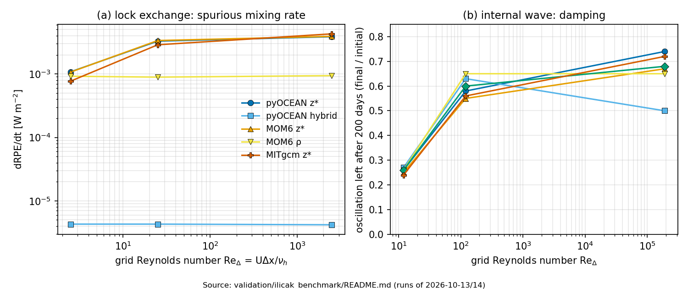
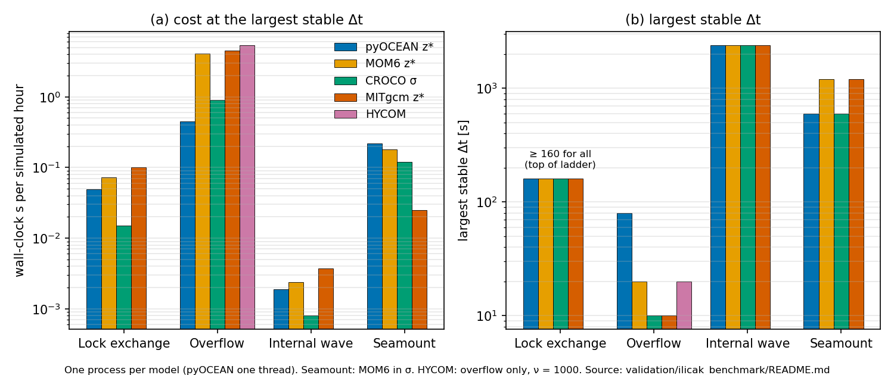
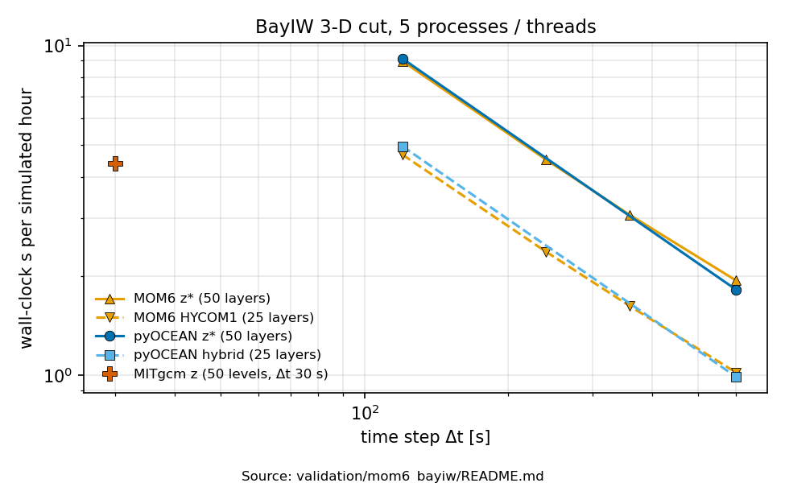

# Comparison with other models

This page places pyOCEAN next to the four models its users most likely know: MITgcm, MOM6, CROCO/ROMS and
HYCOM. It has four parts:

1. a feature and numerics matrix (what each model solves and how);
2. the algorithms that pyOCEAN ports from one of these models, with the original `file:line`, and where it
    deliberately differs;
3. the head-to-head benchmark results (accuracy and cost), summarised from the validation READMEs;
4. a migration guide: how the usual namelist and `MOM_input` entries map onto pyOCEAN options.

pyOCEAN has three model lines. They do not share a time step:

- **the stratified core `SigmaBaroclinic`** (`core/dynamics/sigma_baroclinic.py:933`), either with Eulerian
    σ-layers (`vertical_coordinate="sigma_eulerian"`, the default) or in ALE mode (`"ale"`, with the z\*, σ
    and hybrid grid rules). Unless stated otherwise, "pyOCEAN" below means this core;
- **the 2-D tidal model**, assembled from `ImplicitFreeSurface` (`core/dynamics/free_surface.py:109`) or
    `WetDryFreeSurface` (`core/dynamics/wetting_drying.py:51`) plus the tide tools in `forcing/tides.py`, as in
    `validation/pacmex_tides/run_tides.py`;
- **the legacy phase-1 z-level model** (`core/state.py:60`, `core/timestepping/ab2.py`), kept as a reference
    and not extended (`docs/design/unified_core.md`).

Several capabilities exist only in one line (for example tides
only in the 2-D model). The matrix says where. The plan to bring them into the core is in
[Limitations and roadmap](roadmap.md).

!!! note "How to read the citations"
    pyOCEAN citations are `path:line` in this repository. Citations of the other models refer to the local
    copies used for the benchmarks: MOM6 commit 0e9a561 in `~/pyOCEAN_refs/MOM6/src/`, CROCO 2.1.3 in
    `~/pyOCEAN_refs/croco/`, MITgcm in `~/pyOCEAN_refs/MITgcm/`, HYCOM 2.3 in `HYCOM-src/`. Statements about the
    other models that were not checked in that source or in a validation README are marked **[verify]**.

## 1. Feature and numerics matrix

### 1.1 Grids, coordinates and time stepping

| Topic | pyOCEAN | MITgcm | MOM6 | CROCO / ROMS | HYCOM |
|---|---|---|---|---|---|
| Vertical coordinate | σ with fixed fractions Δσ_k (uniform, Song & Haidvogel stretching, or MITgcm `delR`; `core/grid/sigma_levels.py:33`, `:47`); or ALE with the rules `zstar`, `sigma`, `hybrid` (HYCOM1-type with a z\* floor, optional shallow σ window, `keep_isopycnal`) (`core/vertical/regrid.py:45`, `:64`, `:204`, `:263`) | z or p levels with partial cells (`hFacMin`), optional r\*/z\* (`select_rStar`) | General ALE: z\*, σ, ρ, HYCOM1, adaptive and others (`REGRIDDING_COORDINATE_MODE`, `ALE/MOM_ALE.F90:1736`), or pure Lagrangian layers | Terrain-following s-coordinate (θ_s, θ_b, h_c; Vtransform 1 or 2) | Hybrid isopycnal–σ–z, regridded by `hybgen` (`hybgen.F90`) |
| Horizontal grid | Arakawa C; uniform or stretched Cartesian, or spherical lat–lon (`core/grid/horizontal.py:48`, `:163`, `:246`); no curvilinear grids; periodic boundaries in x and/or y in `SigmaBaroclinic` since N3 (`periodic=`, `core/model/periodic.py:43`) | C; Cartesian, spherical, curvilinear, cubed sphere | C; general orthogonal curvilinear (incl. tripolar) | C; orthogonal curvilinear | C; orthogonal curvilinear **[verify]** |
| Free surface / barotropic mode | θ-implicit free surface, one solve per step (θ = 0.6 default in the σ core); sparse direct LU (`solver="direct"`, σ default) or CG preconditioned with the LU of a lagged matrix (`"cg"`, ALE default) (`core/dynamics/wetting_drying.py:51`; `core/dynamics/sigma_baroclinic.py:1076`); **no split-explicit mode** | Implicit free surface solved with CG (`implicitFreeSurface`, `implicSurfPress` = θ, default 1) | Split-explicit barotropic subcycling (`DTBT`, `core/MOM_barotropic.F90:5917`) | Split-explicit with a filtered fast mode (Shchepetkin & McWilliams 2005) | Split-explicit barotropic mode (`batrop`, `blkdat.F90:633`) |
| Momentum time stepping | AB3 on the explicit tendencies (`AB3`, `core/dynamics/sigma_baroclinic.py:102`; `ab3_combine`, `:870`) + implicit vertical viscosity and bed stress (`SigmaWetDry.column_step`, `core/dynamics/sigma_wd.py:187`) | AB2 (AB3 optional) **[verify]** | Split RK2 predictor–corrector (`core/MOM_dynamics_split_RK2.F90`) | LF-AM3 predictor–corrector | Leapfrog with Asselin filter (`mod_asselin.F90`) |
| Tracer time stepping | SSP-RK3 (default) or predictor (centred 6th order) / corrector (WENO) `tracer_time="pc"`, on frozen transports (`SigmaBaroclinic._advect`, `:1951`) | AB2 or direct space–time schemes (e.g. OS7MP) | Forward, PPM/PLM swept fluxes (`TRACER_ADVECTION_SCHEME`, `tracer/MOM_tracer_advect.F90:1293`) | LF-AM3 predictor–corrector | Leapfrog **[verify]** |
| Baroclinic layer transport | Time-centred u′ (`theta_bc` = ½), depth mean with the free-surface θ (`core/dynamics/sigma_baroclinic.py:2117-2122`; `core/vertical/ale.py:804`) | — (z levels) | Layer fluxes consistent with the barotropic flux (`MOM_continuity_PPM.F90`) | Barotropic–baroclinic coupling of the split mode | Upstream barotropic correction (`cnuity.F90:585-620`) |
| Non-hydrostatic | No | Yes (`nonHydrostatic`) | No | Yes, CROCO-NBQ (`OCEAN/nbq.h`) | No |

### 1.2 Momentum, pressure and tracers

| Topic | pyOCEAN | MITgcm | MOM6 | CROCO / ROMS | HYCOM |
|---|---|---|---|---|---|
| Momentum form | σ: flux form with WENO5 faces, as CROCO `GRAV_ADJ` (`adv="flux"`, `_flux_form_u`, `core/dynamics/sigma_baroclinic.py:706`), or advective `upwind3`/`centred`; ALE: vector-invariant (default) or flux form (`momentum`) | Flux form or vector-invariant (`vectorInvariantMomentum`) | Vector-invariant | Flux form, UP3 horizontal (`UV_HADV_UP3`), splines vertical | Vector-invariant (`momtyp` 2 or 4) |
| Coriolis | σ: energy-conserving C-grid average (`_coriolis`, `:1467`); ALE: Sadourny (1975) energy PV flux with `BOUND_CORIOLIS` (`coriolis_pv`, `core/dynamics/vector_invariant.py:338`) | Several options (energy/enstrophy) | `CORIOLIS_SCHEME`, `BOUND_CORIOLIS` (`core/MOM_CoriolisAdv.F90:2082`, `:2163`) | Flux-form Coriolis with curvature terms | PV form **[verify]** |
| Kinetic-energy gradient | `ke_scheme="arakawa"` (default, energy conserving) or `"gudonov"` (upwind) (`kinetic_energy`, `core/dynamics/vector_invariant.py:371`) | `selectKEscheme` | `KE_SCHEME` (`core/MOM_CoriolisAdv.F90:2169`) | n/a (flux form) | **[verify]** |
| Pressure gradient | σ: density Jacobian (Song 1998, default), two-term, or finite volume (`pgf="fv"`, Adcroft et al. 2008); optional reference profile `rho_ref="auto"` subtracted before the integral (`_baroclinic_pgf`, `:1381`; `fv_pgf`, `core/vertical/pgf.py:165`) | Hydrostatic integral on z levels (no σ error) | Finite volume with PLM/PPM reconstruction (`ANALYTIC_FV_PGF`, `core/MOM_PressureForce.F90:103`) | Density Jacobian (Shchepetkin & McWilliams 2003) in `prsgrd.F` **[verify]** | Montgomery potential in layers **[verify]** |
| Tracer advection | WENO5-Z (default), WENO5-JS, UP3, first-order upwind; vertical WENO in layer-index space (σ) (`_weno5_faces`, `:535`) | Many (2nd order, DST3, OS7MP flux-limited, …; `tempAdvScheme`) | PPM:H3 or PLM (`TRACER_ADVECTION_SCHEME`) | `TS_HADV_RSUP3` (REGIONAL default; with biharmonic diffusion), UP3, WENO5; `TS_VADV_SPLINES` | FCT / MPDATA **[verify]** |
| Tracer limiter | Zalesak (1979) FCT around the three SSP-RK3 WENO5 stages, bounds over x, y and k ± 1 (`tracer_limiter="fct"`, default in ALE; `_advect_fct`, `:1850`) | Flux limiter of the chosen scheme | Monotonic PPM/PLM | WENO5 is non-oscillatory; RSUP3 is not limited | FCT **[verify]** (`mod_tsadvc.F90:877-905`) |
| Equation of state (core) | Linear (T, S) (default), Wright full (= MOM6 `WRIGHT_FULL`) and the Roquet et al. 2015 TEOS-10 polynomial (= MOM6 `ROQUET_RHO`) in the 3-D core since 2026-11-01 (`eos=`, `core/components/eos.py`; [Equation of state](theory/equation-of-state.md)); the legacy z model keeps `physics/eos` (`gsw`) | Linear, JMD95, MDJWF, TEOS-10 (`eosType`) | Linear, Wright, TEOS-10, others (`EQN_OF_STATE`) | Linear or `NONLIN_EOS` | σ₀/σ₂ polynomials, thermobaricity (`kapref`) |
| Spurious-mixing diagnostics | Online: Burchard & Rennau (2008) numerical variance decay of T every step (`mix_num`), RPE (`diagnostics/mixing.py:52`) | Offline | Offline (budget diagnostics) | Offline | Offline |

### 1.3 Physics, boundaries and coast

| Topic | pyOCEAN | MITgcm | MOM6 | CROCO / ROMS | HYCOM |
|---|---|---|---|---|---|
| Vertical mixing | σ: constant ν, parabolic ν = κu\*z(1 − z/D), or GLS k-ε Canuto-A port of CROCO `gls_mixing.F`, stratified by default (buoyancy production, N² from ρ(T, S), κ_t for T and S; N2a 8c) (`GLSKEpsilon`, `physics/mixing/gls.py:177`; `GLSClosure`, `core/components/closure.py:204`). ALE (since N3): constant, none, GLS (k/ε remap on the dual grid, thin-layer merge with `thin_layer_threshold`, `closure.py:52`) or KPP (CVMix/MOM6 port, `KPPClosure`, `closure.py:597`; `kpp_column`, `physics/mixing/kpp_cvmix.py:746`; no background diffusivity by default, no interior Ri mixing). The legacy z model keeps `physics/mixing/kpp.py` | KPP, GGL90, MY82, PP81 (`useKPP`, `useGGL90`, …) | ePBL, KPP via CVMix (`ENERGETICS_SFC_PBL`, `USE_KPP`) | KPP (`LMD_MIXING`), GLS (`GLS_MIXING`) | KPP, GISS, MY-2.5, KT/PWP |
| Bottom drag | σ: first-layer law of the wall C_d = [κ / ln(Δz₁/2z₀)]² (`first_layer_cd`, `physics/bottom_friction.py:48`; used at `core/dynamics/sigma_wd.py:219`). **ALE (since N3):** law of the wall over the bottom `hbbl` metres with the full bed speed √(u² + v̄²) (`LogLawBedDrag`, `core/components/bottom_drag.py:88`; cross component `cross_velocity_at_faces`, `physics/bottom_friction.py:65`) or the quadratic `hbbl` drag (`QuadraticBedDrag`, `bottom_drag.py:44`). 2-D: constant quadratic C_d or depth-dependent log law `log_law_cd` (`physics/bottom_friction.py:31`) | Linear / quadratic (`bottomDragQuadratic`) | Quadratic `CDRAG` with a bottom boundary layer (`BOTTOMDRAGLAW`) | Linear, quadratic or log-law (z₀) | Quadratic `cb` (+ tidal drag) |
| Open boundaries | Flather on the depth mean (to (η, ū)ₑₓₜ); Orlanski on the baroclinic u′ with CROCO-style nudging (τ_in 1 d, τ_out 10 d); flow-relaxation sponge with the MITgcm OBCS profile; `'clamped'` Dirichlet edges; time-varying exterior remapped from its own z grid (`open_boundary_state`, `core/dynamics/open_boundary.py`) | OBCS: prescribe, Orlanski, sponge, Stevens, balance, tides (`pkg/obcs/OBCS_PARAMS.h`) | Segments: Flather, Orlanski, oblique, nudged, specified (`OBC_NUMBER_OF_SEGMENTS`, `core/MOM_open_boundary.F90:565`) | Characteristic/Flather 2-D, Orlanski/specified 3-D with nudging (`u3dbc.F`), sponge | `lbflag` (Browning–Kreiss, Flather, clamped) + relaxation zone |
| Nesting | One-way, offline, through `open_boundary_state` (BayIW cut phase 2); no two-way | One-way via OBCS files | One-way via OBC files | AGRIF two-way online, or offline | One-way offline (`nestfq`, `bnstfq`) |
| Wetting and drying | Casulli semi-implicit, mass conserving, in 2-D and 3-D σ (`WetDryFreeSurface`; `SigmaWetDry`); ALE σ or hybrid with a shallow σ zone over floodable cells (`:1169`) | No **[verify]** | No (ALE without W/D, `docs/design/vision_roadmap.md` §3a) | `WET_DRY` (`OCEAN/wetdry.F`) | No |
| Tides | **2-D model only:** TPXO boundary forcing through Flather, body tide with Love numbers, scalar SAL `sal_beta` and per-constituent SAL from HYCOM `tidal.salReIm`, JSL internal-tide drag (`forcing/tides.py:209`, `:393`, `:421`, `:437`; `core/dynamics/free_surface.py:155`; `physics/tides/drag.py:102`). Not in the 3-D core yet | OBCS tides (`useOBCStides`); tidal potential through EXF `tidePot` (`pkg/exf/exf_getffields.F:393`) | Astronomical forcing with SAL (`TIDES`, `SAL_SCALAR_VALUE`), wave drag (`BT_LINEAR_WAVE_DRAG`, `core/MOM_barotropic.F90:5820`) | `SSH_TIDES`, `UV_TIDES`, `POT_TIDES` | `tidflg`, `tidcon`, `tidsal`, `tiddrg` (`blkdat.F90:1796-1801`) |
| Surface fluxes | `bulk_ncar` (LY04/LY09, = MITgcm EXF) and `bulk_kara` (= HYCOM `flxflg=6`) in `forcing/bulk.py:236`, `:560`; ERA5, WRF, HYCOM readers. **The core takes only wind stress** (`SigmaBaroclinic.step(st, tau_x, tau_y)`, `:2084`); heat and freshwater fluxes are pending | EXF bulk formulae | Coupler or data override | `BULK_FLUX`, `ONLINE` interpolation | `flxflg` options incl. Kara |
| Domain preparation | Integrated: GEBCO load/regrid/smooth (`core/grid/bathymetry.py:379`), domain checker rx0/rx1, pits, isolated basins, CFL advice (`diagnostics/domain_check.py:178`) | External tools | External (e.g. regional-mom6) | External (croco_tools) | External (HYCOM-tools) |

### 1.4 Software

| Topic | pyOCEAN | MITgcm | MOM6 | CROCO / ROMS | HYCOM |
|---|---|---|---|---|---|
| Restarts | Bit-for-bit float64 NetCDF: AB3 history, transports, GLS state, ALE h, exterior profile, lagged-LU preconditioner; configuration checked on reading (`core/restart.py:89`, `:134`) | Pickup files | Restart files (issues #975, #208, #508 report non-reproducible restarts; `docs/design/vision_roadmap.md` §3b) | Restart file | Restart files |
| Output | CF-1.8 + SGRID, Zarr (appendable) or NetCDF4, float64 (`OutputWriter`, `diagnostics/output.py:49`); σ `formula_terms`; ALE layer thickness not yet an output field | MDS binary or NetCDF per tile | FMS diag_manager NetCDF | NetCDF (XIOS optional) | `.a/.b` archives |
| Blow-up post-mortem | Location, lat/lon, depth, CFL, history and state dump (`BlowupGuard`, `diagnostics/postmortem.py:35`); ALE truncation error names layer and face (`:2069-2079`) | Monitor output | Truncation log | Blow-up message | `neg. dp` message |
| Parallelism | Shared-memory Numba threads (`set_threads`, `core/dynamics/sigma_baroclinic.py:166`; ≤ 5 on the development Mac); no MPI, no GPU | MPI (+ OpenMP) | MPI (+ OpenMP) | MPI / OpenMP | MPI (+ OpenMP) |
| Language, installation | Python 3 + NumPy/Numba/xarray, conda `environment.yml`; nothing to compile (Numba JIT) | Fortran 77/90, `genmake2` | Fortran 90, FMS, autoconf/mkmf | Fortran + cpp keys, `jobcomp` | Fortran 90, `Make.csh` |
| Differentiability | None yet (stage D plan: JAX backend) | Adjoint with TAF/Tapenade (`pkg/autodiff`, `pkg/ctrl`) | None **[verify]** | ROMS: 4D-Var tangent/adjoint; CROCO: no **[verify]** | None |

### 1.5 Other models named in the roadmap

The roadmap (`docs/design/vision_roadmap.md` §2) also uses three other models as references:

- **Oceananigans** (Julia): native GPU design, WENO advection and a vorticity-WENO option (Silvestri et
    al. 2024); judged the most usable (scripts and examples). It fuses each tendency into one kernel per cell
    (`docs/design/performance.md` §2b).
- **Veros** (Python + JAX): the closest relative of pyOCEAN in language. With JAX it matches its Fortran parent
    on CPU and runs on GPU (Häfner et al. 2021). Its lesson for pyOCEAN: keep the kernels functional (no in-place
    writes) so a JAX backend stays possible.
- **SCHISM** (unstructured, semi-implicit): the reference for robust coastal wetting and drying, together with
    D-Flow FM and ADCIRC.

## 2. Where pyOCEAN ports or follows another model

pyOCEAN reads the production source of the reference models before implementing a scheme (`CLAUDE.md`,
"Reference model source code"). The table lists every algorithm whose docstring cites a source file, with
the citation as it appears in the code. "Same?" says whether pyOCEAN reproduces the original or differs on
purpose.

### 2.1 From MOM6

| pyOCEAN | Original (MOM6 0e9a561) | Same? Why it differs |
|---|---|---|
| Column remapping PCM/PLM/PPM_H4, `remap_column` (`core/vertical/remap.py:307`) | `MOM_remapping.F90` `remapping_core_h`; `PPM_functions.F90:23-120`; `regrid_edge_values.F90:215-350`; `PLM_functions.F90:22-68`, `:122-158`, `:186-262`; H4 end values `regrid_edge_values.F90:636-749` (`_end_values_h4`, `:101`); Hallberg trick `MOM_remapping.F90:942-961` | Equal to ≤ 5e-12 on 120 columns (`validation/mom6_column/README.md`). **Differs:** the order is lowered by the number of *active* cells (1 → PCM, ≤ 3 → PLM); MOM6 counts all cells (`MOM_remapping.F90:453-460`). Dry columns keep their values |
| z\* and σ grid rules, `zstar_column`, `sigma_column` (`core/vertical/regrid.py:45`, `:64`) | `coord_zlike.F90:90`, `:137-143`; `coord_sigma.F90:76-81` | Equal to ≤ 3e-14 m. **Differs:** σ uses min(h_min, D/N) as z\* does, and the minimum thickness is enforced from the top as well as the bed (MOM6 inflates from the bed only), which fixed a negative top layer with stretched σ in very shallow water |
| Hybrid rule `hycom1_column` (`:204`) | HYCOM1: `coord_hycom.F90:218` (monotonised densities), `:255-267` (z\* floor), `:270-279` (max thickness); P1M_H2 `P1M_functions.F90:29-61`, `regrid_interp.F90:378-511` | P1M interpolation bit-for-bit. **Differs:** `keep_isopycnal` (default) keeps interfaces between layers already in their density brackets (White et al. 2009), and massless layers take the density of the layer with mass above (HYCOM fill, below). The full `build_hycom1_column` was not compared |
| Initial state remapped from the data levels, `initial_state(..., h_src=...)` (`core/dynamics/sigma_baroclinic.py:1190`, `:1222`) | `MOM_state_initialization.F90:2928-2935` (`Z_INIT_ALE_REMAPPING`), `:271`, `REGRID_ACCELERATE_INIT` `:488-507` | Same idea; pyOCEAN regrids once on the source levels and then iterates `init_iterations` passes |
| Layer thickness flux `ppm_transport_x` (`core/vertical/ale.py:736`) | `MOM_continuity_PPM.F90`: positive-definite edges `:2827-2942`, `:3184-3226`; `flux_elem` `:1111-1202`; barotropic adjustment `zonal_flux_adjust` `:1368-1546`; floor `:534` | Same algorithm. **Differs:** the residual left after the Newton iteration is shared like HYCOM (`cnuity.F90:585-620`) so Σ_k Q_k equals the free-surface flux exactly (MOM6 keeps a small mismatch, `:783-874`) |
| Vector-invariant momentum: vorticity, PV, Sadourny energy PV flux, `BOUND_CORIOLIS`, KE (`core/dynamics/vector_invariant.py:257`, `:338`, `:371`) | `MOM_CoriolisAdv.F90:337`, `:364-367`, `:429-437`, `:595-610` (free slip), `:625-629`, `:818-823`, `:1071-1076`, gradKE `:1377-1535` | Same. KE default is Arakawa, as MOM6 production; Godunov is the option MOM6 uses only in `lock_exchange`, `adjustment2d` and `external_gwave` (`validation/mom6_ke_schemes/README.md`) |
| CFL velocity truncation `truncate_cfl` (`core/dynamics/vector_invariant.py:172`) | `vertvisc_limit_vel`, `MOM_vert_friction.F90:2555-2715` | Same role (backstop); pyOCEAN stops after `max_truncations` with the layer and face named |
| Upwind-biased viscous face thickness `viscous_face_thickness` (`core/vertical/ale.py:82`) | `MOM_vert_friction.F90:1519-1533` (Hallberg & Rhines 1996) | **Differs:** applied through the whole column; MOM6 uses it near the bed only (`:1446-1535`). A test of the bed-only variant is pending (`validation/ilicak_benchmark/README.md`, item 4c) |
| Finite-volume PGF `fv_pgf` (`core/vertical/pgf.py:165`) | `MOM_PressureForce_FV.F90:1146-1198`, `:2124-2149`; `MOM_density_integrals.F90:579-623`, `:642-751`, `:652-685`; PLM `MOM_ALE.F90:1512-1596`, `PLM_functions.F90:22-183` | **Differs:** PLM is applied to the anomaly T − T_ref(z), so a reference profile is exact (MOM6 reconstructs T and subtracts a constant ρ₀); bottom mass weighting only next to vanished layers |
| Exterior data on its own z axis, remapped onto the layers (`core/dynamics/open_boundary.py`; `exterior_on_layers`, `core/vertical/ale.py:857`) | `MOM_open_boundary.F90:1188-1204` | Same idea |

### 2.2 From CROCO / ROMS

| pyOCEAN | Original | Same? Why it differs |
|---|---|---|
| GLS k-ε, Canuto-A stability functions, minimum values (`GLSKEpsilon`, `physics/mixing/gls.py:177`) | CROCO `gls_mixing.F` (`GLS_KEPSILON` + `CANUTO_A`) | Column port. **Differs:** no horizontal terms (buoyancy production is on by default with `gls_stratified=True`, since N2a 8c; `False` gives the old neutral closure); the 3-D TIDAL_FLAT matches CROCO to 1.2 cm (`validation/tidal_flat/README.md`) |
| Bed stress for GLS (`SigmaWetDry._gls_update`, `core/dynamics/sigma_wd.py:314`) | CROCO `gls_mixing.F` | Same |
| WENO5-Z weights (`_weno5_faces`, `core/dynamics/sigma_baroclinic.py:535`), upwinding once in the corrector (`:1938`) | CROCO `step3d_t.F` (Borges et al. 2008) | Same weights; time stepping SSP-RK3 by default instead of CROCO's LF-AM3 predictor–corrector (`tracer_time="pc"` imitates it) |
| Flux-form momentum advection (`adv="flux"`) | CROCO `GRAV_ADJ` choice (WENO5 momentum) | Same form; lock-exchange fronts equal CROCO within one cell (`validation/lock_exchange/README.md`) |
| Orlanski + nudging toward the exterior, τ_in on inflow, τ_out on outflow (`SigmaBaroclinic._radiate`, `:1645`) | CROCO `u3dbc.F:111-155` (`:119-127`, `:144-152`) | Same; defaults τ_in = 1 d, τ_out = 10 d |
| Stretched σ (`stretched_sigma`, `core/grid/sigma_levels.py:33`) | Song & Haidvogel (1994), the ROMS/SCRUM S-coordinate with h_c = 0 | **Differs:** no h_c and no Vtransform 2; fractions are the same in every column |
| Linear EOS form ρ = ρ₀ − α(T − T₀) | CROCO `lin_EOS_cff` | Same |
| Wet–dry threshold `d_min` | CROCO `Dcrit` / `D_wetdry` | Analogue (`core/dynamics/wetting_drying.py:51`) |

### 2.3 From HYCOM

| pyOCEAN | Original (HYCOM 2.3) | Same? Why it differs |
|---|---|---|
| Donor-cell layer transport clipped at the shallower bed (`face_transport_thickness`, `core/vertical/ale.py:212`) | `cnuity.F90:252-256` | Same (z\* and hybrid; not σ) |
| Upstream barotropic correction of the layer fluxes (`upwind_transport_x`, `:233`; residual of the PPM flux) | `cnuity.F90:585-620` | Same |
| Zero velocity in thin bed layers (`zero_thin_bed_velocity`, `:950`, `H_THIN_BED` = 0.01 m) | `hybgen.F90:1757-1764` | Same rule |
| Thin-layer blending `blend_thin_layers` (`:122`) | `mod_momtum.F90:3055-3065` (cutoff 0.5 m, `:1256`) | **Off by default** (`thin_layer_cutoff = 0`): it holds back an advancing gravity-current nose (0.70 U); when on, it uses the donor thickness, not HYCOM's mean |
| Massless layers take the density of the layer with mass above (`core/vertical/regrid.py:216`) | `hybgen.F90:904-925` | Same fill |
| FCT around the high-order tracer step (`_advect_fct_numpy`, `core/dynamics/sigma_baroclinic.py:1885`) | `mod_tsadvc.F90:877-905` | Same principle, around WENO5 + SSP-RK3 |
| `bulk_kara` (`forcing/bulk.py:560`) | `thermf.F90` (`flxflg=6`), `mod_momtum.F90` (`cd_coarep`) | Matches compiled HYCOM to 1e-10 (`validation/hycom_kara`) |
| Scalar SAL `sal_beta`, per-constituent SAL `read_sal_hycom` (`forcing/tides.py:437`) | `tidsal`, `tidal.salReIm` (`mod_tides`, `mod_barotp`) | Same; the real PAC_MEX file holds −η_SAL (`CLAUDE.md`, phase 2 item 7b) |
| JSL internal-tide drag `jsl_to_rh`, `tidal_drag_rate` (`physics/tides/drag.py:42`, `:102`) | `tiddrg=1`, `drgscl`, `thkdrg` | Same; regenerated `tidal.rh` matches HYCOM-tools to 4e-8 |
| `.a/.b` reader, archive → z (`forcing/sources/hycom_ab.py`, `hycom_archive.py`) | HYCOM file formats | Validated on synthetic files only |
| **Not ported:** `hybgen` itself | `hybgen.F90` | Decision of 2026-10-11: pyOCEAN uses the MOM6 HYCOM1 rule inside a general ALE step; compared column by column in `validation/mom6_column/README.md` |

### 2.4 From MITgcm

| pyOCEAN | Original | Same? Why it differs |
|---|---|---|
| Sponge profile (`_sponge_rates`, `core/dynamics/sigma_baroclinic.py:906`) | `obcs_sponge.F` (`useLinearSponge = .FALSE.`) | Same profile; pyOCEAN relaxes u′ and the tracer anomaly toward the exterior |
| `'clamped'` open boundary | OBCS prescribe (`obcs_apply_uv.F:205`, `obcs_apply_ts.F:205`) | **Differs:** pyOCEAN keeps Flather on the depth mean; MITgcm fixes the total transport |
| Partial z\* layer at a face (mean thickness), min thickness for along-layer diffusion (`face_thickness`, `core/vertical/ale.py:66`) | `hFacW`, `model/src/ini_masks_etc.F:250-252` | Same idea |
| `bulk_ncar` (`forcing/bulk.py:236`) | `pkg/exf/exf_bulkformulae.F` (`ALLOW_BULK_LARGEYEAGER04`), `exf_radiation.F` | Median difference 0.2–0.3 % for U ≥ 0.5 m/s (`docs/design/validation_suite.md` §4); `n_iter = 2` kept on purpose |
| Exact volume conservation with CG (`solver="cg"`) | `exactConserv` | Same idea: η recomputed from the divergence of the final transports |
| Legacy z model: KPP (`physics/mixing/kpp.py`; the core's KPP is `closure='kpp'`, `closure.py:597`), Orlanski OBCS (`boundaries/obcs/__init__.py:306`) | `pkg/kpp/kpp_routines.F`; `pkg/obcs/obcs_calc.F` | Legacy line only |
| AB3 of the momentum tendencies | MITgcm AB3 (Adcroft et al. 2004 **[verify]**) | Same coefficients (23, −16, 5)/12 |

## 3. Head-to-head results

All numbers below come from the validation READMEs named in each row. Each difference was classified there as
(a) pyOCEAN bug, (b) missing physics, (c) numerical choice, (d) reference-model error. Details and plots are
in [Idealised benchmarks](validation/idealised.md) and [BayIW](validation/bayiw.md).

### 3.1 Accuracy

| Case | pyOCEAN | Reference model(s) | Reading | Source |
|---|---|---|---|---|
| Lock exchange, spurious mixing, z\* (Ilicak 2012, ν_h = 0.1/10/100) | ΔRPE/RPE₀ 6.67e-5 / 5.73e-5 / 1.90e-5 | MOM6 z\* 6.75e-5 / 5.81e-5 / 1.87e-5; MITgcm z\* 6.89e-5 / 5.14e-5 / 1.37e-5 | pyOCEAN z\* = MOM6 z\* within 1.6 % | `validation/ilicak_benchmark/README.md` |
| Lock exchange, hybrid | ΔRPE/RPE₀ 6.2e-8–7.5e-8; fronts 0.94–1.06 U | MOM6 ρ 1.4e-5–1.6e-5, light body 0.44–0.94 U | 250–1200× less mixing than z\*, ~200× less than MOM6 ρ | same |
| Lock exchange vs CROCO `GRAV_ADJ` (σ, WENO5-Z) | fronts 0.463/0.486 m/s; ΔRPE/RPE₀ 3.22e-5 | CROCO 0.463/0.486 m/s; 2.19e-5 | Fronts identical; pyOCEAN mixes 1.3–1.5× more (momentum side, open) | `validation/lock_exchange/README.md` |
| Hybrid lock exchange vs MOM6 (21 layers, PPM thickness flux) | nose/body 1.05/0.98 U; max speed 0.74 m/s; RPE gain 8.8e5 J | MOM6 RHO 1.05/0.98 U, 0.56 m/s, 4.5e7 J | Fronts equal; pyOCEAN faster inside the current | `validation/mom6_lock_exchange/README.md`, `CLAUDE.md` |
| Overflow, z\*, ν_h = 100/1000 | dRPE/dt 1.86/0.61 W m⁻²; cold centroid 150 km/1760 m (ν = 1000) | MITgcm z\* 1.44/0.52, 148 km/1720 m; MOM6 z\* 4.36/1.66 | pyOCEAN z\* ≈ MITgcm; MOM6 z\* mixes 2.3–2.7× more | `validation/ilicak_benchmark/README.md` |
| Overflow robustness, ν_h = 1 | z\*, σ complete; hybrid stops in 4 of 5 trajectories | MOM6 z\* and CROCO complete; MITgcm stops (~11 h); MOM6 ρ stops at ν ≤ 100; HYCOM stops at ν = 100 (`neg. dp`) | Hybrid vanished-layer slab at the east wall: (a), open | same |
| Internal wave damping, ν_h = 0.01/15/150 (oscillation left after 200 d) | z\* 0.74/0.58/0.26; hybrid 0.50/0.63/0.27 | MOM6 z\* 0.67/0.55/0.25; MOM6 ρ 0.65/0.65/0.26; CROCO 0.68/0.60/0.26; MITgcm 0.72/0.56/0.24 | z\* in range since `theta_bc` = ½ (2026-10-14); hybrid at ν = 0.01 still damped, (a) open | same |
| New tracer extrema | ≤ 1.5e-8 °C in all cases (FCT) | CROCO REGIONAL schemes up to 14 °C out of range (lock), MITgcm ≤ 0.09 °C | CROCO RPE not comparable | same |
| Seamount (Beckmann & Haidvogel 1993), max speed at 10 d | σ + FV + ρ_ref 0.21 cm/s; z\* 0.08 cm/s | CROCO σ 36 cm/s (growing); MOM6 σ 154 cm/s (growing); MITgcm z\* 0 (exact); MOM6 z\* truncates from day 1 (configuration unexplained) | The ρ_ref option is the advantage (c); all pyOCEAN configurations share a mode that doubles every ~2 days (`validation/seamount/README.md`) | `validation/ilicak_benchmark/README.md` |
| MITgcm `internal_wave` (mode-1 wave up a slope) | mode 1 on the flat part: Arakawa u 0.91–1.01, T′ 0.98–1.08; 50 % of the energy flux lost at 4.53–4.85 km | MITgcm 4.61 km | Equal with Arakawa; Godunov KE damps u to 0.83–0.99 (c) | `validation/internal_wave/README.md` |
| BayIW 2-D section (60 h) | z\* = MOM6 z\* in every metric; realistic case: pyOCEAN hybrid Seiche2 V110 0.99 | MOM6 HYCOM1 Seiche2 V110 2.60; interface thickness 28 m vs pyOCEAN 8 m (MITgcm 8.1 m) | Two-layer hybrid ζ 1.17–1.65 vs MOM6 1.02–1.15: candidate (a) | `validation/mom6_bayiw/README.md` |
| BayIW 3-D cut vs MITgcm (60 h) | z\*: seiche period −1.8 % (one spectral bin), range ±1 %, linear T110/V110 0.98–1.07 | MITgcm, same cut, Orlanski only | z\* ✅; nested η at the stations 0.03–0.11 vs MITgcm nested 0.05–0.17 | `validation/bayiw_cut/README.md`, `CLAUDE.md` |
| TIDAL_FLAT 3-D (wetting–drying) | σ + GLS k-ε: η rms 1.2 cm, shoreline within 1 km | CROCO 3-D with GLS | Equal | `validation/tidal_flat/README.md` |
| Thacker parabolic bowl | η rms 4.6 cm, shoreline 0.8 km | CROCO 2.0 cm, 0.6 km | Behind (front momentum loss ~1 %/period vs 0.2 %); strict `xfail` | `docs/design/validation_suite.md` |
| Mexican Pacific tides (31 TICON gauges) | median RSS 1.44 cm (drag ensemble) | TPXO10 1.79 cm | Ahead; Gulf of California still 11–12.5 cm (TPXO 5.1) | `CLAUDE.md`, `vision_roadmap.md` §7 |
| Tidal band vs IOC gauges, PAC_MEX | 5.1 cm | HYCOM-IOA 4.9 cm | Similar; both fail alike in the Gulf of California | `docs/design/validation_suite.md` §4 |
| Bulk formulae | `bulk_kara` = HYCOM to 1e-10; `bulk_ncar` median 0.2–0.3 % | HYCOM compiled; MITgcm EXF | Equal | same |

*(a) Lock exchange: pyOCEAN z\* lies on top of MOM6 z\* and close to MITgcm; the hybrid mixes three orders
of magnitude less than any z\* model and less than MOM6 ρ. (b) Internal wave: all models damp alike at
ν_h ≥ 15; at the lowest viscosity the pyOCEAN hybrid (0.50) is the outlier.*

### 3.2 Cost

The four-model benchmark measured wall-clock seconds per simulated hour at the largest stable Δt of each
model, all on one process (`validation/ilicak_benchmark/README.md`, "Costo", re-measured 2026-10-14):

| Case | pyOCEAN z\* | MOM6 z\* | CROCO σ | MITgcm z\* | HYCOM |
|---|---|---|---|---|---|
| Lock exchange: Δt max [s] / s per hour | ≥ 160 / 0.049 | ≥ 160 / 0.073 | ≥ 160 / 0.015 | ≥ 160 / 0.101 | — |
| Overflow | 80 / 0.45 | 20 / 4.10 | 10 / 0.91 | 10 / 4.51 | 20 / 5.41 (ν = 1000) |
| Internal wave | 2400 / 0.0019 | 2400 / 0.0024 | 2400 / 0.0008 | 2400 / 0.0037 | — |
| Seamount (MOM6: σ) | 600 / 0.22 | 1200 / 0.18 | 600 / 0.12 | 1200 / 0.025 | — |

*(a) Cost and (b) largest stable time step. pyOCEAN is cheaper than MOM6 and MITgcm in the 2-D cases and
takes the largest overflow Δt (80 s); CROCO is 1.9–3.3× cheaper except in the overflow; MITgcm is 8.8× cheaper
in the seamount, where pyOCEAN's Δt is half of MITgcm's.*

At the *same* Δt in these small 2-D cases, CROCO is 3–5.5× faster than pyOCEAN on one thread, and five
threads do not help on such small grids: pyOCEAN loses on fixed cost per step, not on physics (same README,
item 11). The hybrid costs 1.01 s/h in the overflow at its Δt max of 40 s.

On a real 3-D grid (BayIW cut, 198 × 159, five processes or threads) the two ALE models cost the same at equal
Δt (`validation/mom6_bayiw/README.md`):

*At equal Δt pyOCEAN and MOM6 are within ±10 % (z\* 9.13 vs 8.97 s/h at 120 s; hybrid 4.95 vs 4.67). Both are
stable for ~6 h at Δt = 600 s; the accuracy at Δt > 120 s has not been evaluated. MITgcm needs Δt = 30 s
(4.4 s/h).*

Where the time goes on the BayIW cut (same README): MOM6 spends 18.6–22.8 % of the step in ALE regrid and remap,
pyOCEAN ~13.5 % in remapping; the WENO5 + three-stage SSP-RK3 tracer advection costs pyOCEAN ~11 % against
4.8 % for MOM6's one-stage PLM. More in [Performance and parallelism](architecture/performance.md).

### 3.3 Summary: strengths and weaknesses

| pyOCEAN is ahead | pyOCEAN is level | pyOCEAN is behind or open |
|---|---|---|
| Hybrid spurious mixing (250–1200× below z\*), tracer extrema (FCT), seamount with ρ_ref, overflow Δt, Mexican Pacific tides vs TPXO, bit-for-bit restarts | z\* lock exchange and overflow (= MOM6 / MITgcm), internal waves (Arakawa KE), TIDAL_FLAT 3-D, BayIW cost (= MOM6) | Lock-exchange mixing 1.3–1.5× CROCO; Thacker front; hybrid IW at ν = 0.01; hybrid overflow at ν = 1; fixed cost per step in 2-D; no salinity, heat fluxes, tides, GLS buoyancy or KPP in the 3-D core |

## 4. Migrating from another model

pyOCEAN has no namelist yet: a run is a Python script that builds the grid, the bathymetry and a
`SigmaBaroclinic` object with keyword arguments (configuration files are step 3 of the unified-core plan,
`docs/design/unified_core.md`). The tables map the most common entries; every pyOCEAN option is described in
the [Configuration reference](user-guide/configuration-reference.md).

!!! warning "Units and sign conventions that bite"
    - **Layer index:** k = 0 is the **bed** in pyOCEAN (`SigmaState`, `core/dynamics/sigma_baroclinic.py:107`);
        MITgcm, MOM6 and HYCOM count from the surface, ROMS/CROCO from the bed.
    - **`dz_top` and `delR` are surface first**, but `dsigma` is bed first.
    - **Linear EOS:** pyOCEAN `t_coef` is α in kg m⁻³ °C⁻¹ in ρ = ρ₀ − α (T − T₀). MITgcm `tAlpha` is in
        K⁻¹, so `t_coef = rhoNil * tAlpha`.
    - **θ of the free surface:** pyOCEAN default 0.6; MITgcm `implicSurfPress` default 1.

### 4.1 From MITgcm

| MITgcm (`data`, `data.obcs`, `data.pkg`) | pyOCEAN | Notes |
|---|---|---|
| `delR` | z\*: `regrid_params={"dz_top": delR}`; σ: `dsigma=sigma_from_thicknesses(delR)` (`core/grid/sigma_levels.py:47`) | MITgcm rounds the bed to a level interface with `hFacMin = 1`; use the effective depth to compare (`validation/bayiw_2d/README.md`) |
| `hFacMin` | none; z\* layers below the bed collapse to `h_min` (1e-3 m) and the deepest active layer is truncated | `core/vertical/regrid.py:45` |
| `select_rStar`, z\* | `vertical_coordinate="ale", regrid="zstar"` | |
| `viscAh` | `ah` | Laplacian, free slip |
| `viscAz` / `viscAr` | `closure="constant", nu_const=...` | |
| `diffKhT`, `diffKzT` / `diffKrT` | `kh`, `kv` | Along-layer and implicit vertical |
| `implicitFreeSurface`, `implicSurfPress` | always implicit; `theta` (½ … 1, default 0.6) | |
| `exactConserv` | `solver="cg"` (ALE default) recomputes η from the transport divergence | |
| `rhoNil`, `tAlpha`, `tRef` | `rho0`, `t_coef = rhoNil*tAlpha`, `t_ref` (scalar) | No `sBeta`: no salinity in the core |
| `f0`, `beta` | `create_cartesian_grid(..., f0=..., beta=...)` (`core/grid/horizontal.py:48`) | |
| `vectorInvariantMomentum`, `selectKEscheme` | `momentum="vector_invariant"` (ALE only), `ke_scheme` | |
| `tempAdvScheme` (e.g. 33, 7) | `tracer_scheme="weno5"` (WENO5-Z), `"weno5js"`, `"upwind3"`, `"upwind1"` | No flux-limited DST/OS7MP; FCT in ALE |
| `bottomDragQuadratic` | σ: `z0` (log law); 2-D runner: constant `--cd` | No drag in ALE |
| `useOBCS`, `OB_Iwest`, … | `open_boundaries=("west", ...)` | Whole edges only |
| `useOrlanskiWest`, … | default `'radiating'` mode (Flather + Orlanski), `orlanski_cmax` | CMAX 0.45 in the BayIW runs |
| `useOBCSprescribe` | `open_boundary_state=f(t)` + `open_boundary_mode={"west": "clamped"}` | Flather kept on the depth mean |
| `useOBCSsponge`, `spongeThickness`, `Urelaxobcsinner`, `Urelaxobcsbound` | `sponge_cells`, `sponge_tau=(tau_inner, tau_bound)` (default (1200, 60) s) | Same profile (`obcs_sponge.F`) |
| `useOBCSbalance` | none (Flather closes the budget) | It reflected the barotropic pulse in BayIW (class d, `validation/bayiw_2d/README.md`) |
| `useEXF` | `forcing/bulk.bulk_ncar` → wind stress only into the core; prescribed heat flux `heat=` with Paulson & Simpson shortwave (`layer_heating`, `physics/surface/shortwave.py:113`; `Driver._heat_fluxes`, `core/model/driver.py:279`) | Bulk heat fluxes pending (N2b) |
| `useKPP`, `useGGL90` | `closure='kpp'` (`KPPClosure`, `core/components/closure.py:597`), `closure='gls'` (`GLSClosure`, `closure.py:204`) | KPP without interior Ri mixing and without background diffusivity; no GGL90 |
| `nonHydrostatic` | none | Stage E option |

### 4.2 From CROCO / ROMS

| CROCO (`croco.in`, `cppdefs.h`) | pyOCEAN | Notes |
|---|---|---|
| `N`, `THETA_S`, `THETA_B` | `n_layers`, `dsigma=stretched_sigma(n, theta_s, theta_b)` | Song & Haidvogel (1994) with h_c = 0; `Hc`/Vtransform 2 not supported |
| `NEW_S_COORD` | none | |
| `dt`, `NDTFAST` | `dt`; no fast mode (implicit free surface) | |
| `UV_HADV_UP3` / `UV_HADV_WENO5` | `adv="upwind3"` / `adv="flux"` (WENO5 flux form) in σ | |
| `TS_HADV_WENO5`, `TS_HADV_RSUP3`, `TS_HADV_UP3` | `tracer_scheme="weno5"`, — , `"upwind3"` | RSUP3 not available |
| `UV_VIS2`, `VISC2` | `ah` | |
| `GLS_MIXING`, `GLS_KEPSILON`, `CANUTO_A` | `closure="gls"` | σ and ALE (since N3); stratified by default |
| `LMD_MIXING` | none in the core | |
| `RDRG2` / `Zob` | 2-D: `--cd`; σ: `z0` | Log law on the first layer, as CROCO 3-D |
| `OBC_M2FLATHER` / `OBC_M2CHARACT` | Flather on every open edge | For `OBC_REDUCED_PHYSICS` see `validation/tidal_flat/README.md` |
| `OBC_M3ORLANSKI`, `tau_in`, `tau_out` | `'radiating'`, `obc_tau_in`, `obc_tau_out` | Same nudging (`u3dbc.F:111-155`) |
| `M3_FRC_BRY` (specified) | `'clamped'` | |
| `SPONGE` | `sponge_cells`, `sponge_tau` | MITgcm profile, not CROCO's |
| `WET_DRY`, `D_wetdry` | wetting–drying is built in; `d_min` (default 0.05 m) | |
| `rho0`, `Tcoef`, `T0` (`lin_EOS_cff`) | `rho0`, `t_coef`, `t_ref` | |
| `SALINITY`, `NONLIN_EOS` | not in the core | |
| `TIDES` (`SSH_TIDES`, `UV_TIDES`, `POT_TIDES`) | 2-D model only (`forcing/tides.py`) | 3-D tides pending |
| `AGRIF` | none | One-way nesting only |

### 4.3 From MOM6

| MOM6 (`MOM_input`) | pyOCEAN | Notes |
|---|---|---|
| `USE_REGRIDDING = True` | `vertical_coordinate="ale"` | |
| `REGRIDDING_COORDINATE_MODE = "ZSTAR"` / `"SIGMA"` / `"HYCOM1"` | `regrid="zstar"` / `"sigma"` / `"hybrid"` | `"RHO"` (pure isopycnal) ≈ `"hybrid"` with `keep_isopycnal` and a z\* floor at the bed |
| `ALE_COORDINATE_CONFIG` (dz list) | `regrid_params["dz_top"]` | Give the hybrid floor the full depth (the model warns otherwise) |
| target densities (`HYBRID_TARGET_DENSITY`, OM4 light layers) **[verify]** | `regrid_params["rho_target"]`, `target_densities(rho, n, n_light)` (`core/vertical/regrid.py:292`) | |
| `REMAPPING_SCHEME` | `remap_scheme="pcm"`, `"plm"`, `"ppm_h4"` (default) | |
| `MIN_THICKNESS` | `regrid_params["h_min"]` (default 1e-3 m) | |
| `REGRID_ACCELERATE_INIT`, `Z_INIT_ALE_REMAPPING` | `init_iterations` (default 10), `initial_state(eta, T, h_src=...)` | |
| `KE_SCHEME = "KE_ARAKAWA"` / `"KE_GUDONOV"` | `ke_scheme="arakawa"` / `"gudonov"` | Same spelling |
| `CORIOLIS_SCHEME`, `BOUND_CORIOLIS` | fixed: Sadourny energy with bounding | |
| `CONTINUITY_SCHEME = "PPM"` **[verify]** | `thickness_flux="ppm"` (default) or `"upwind"` | |
| `ANALYTIC_FV_PGF`, `PRESSURE_RECONSTRUCTION_SCHEME` | `pgf="fv"` (PLM of T − T_ref) | |
| `KH`, `KV` | `ah`, `nu_const` | |
| `KHTR`, `KVML`/`KD` | `kh`, `kv` | |
| `THICKNESSDIFFUSE`, `KHTH` | none | No GM / interface-height diffusion |
| `BOTTOMDRAGLAW`, `CDRAG` | none in ALE | |
| `SPLIT`, `DTBT` | none (implicit free surface) | |
| `OBC_SEGMENT_00x` | `open_boundaries`, `open_boundary_mode`, `open_boundary_state` | |
| `TIDES`, `SAL_SCALAR_VALUE` | 2-D model: `sal_beta` | |
| `USE_KPP` | `closure='kpp'` (`core/components/closure.py:597`), column-compared with MOM6/CVMix to ≤ 0.3 % in OBL depth | No interior Ri mixing |
| `ENERGETICS_SFC_PBL` | none in the core | |

### 4.4 From HYCOM

| HYCOM (`blkdat.input`) | pyOCEAN | Notes |
|---|---|---|
| `kdm`, `nhybrd`, `nsigma` | `n_layers`; hybrid with a shallow σ window: `regrid_params["d_sigma"]`, `["d_hybrid"]` | |
| `dp0k`, `ds0k` | `regrid_params["dz_top"]` (z\* floor) | |
| `sigma` (target densities) | `regrid_params["rho_target"]` | Interface targets, surface first |
| `isotop` | none **[verify]** | |
| `qhybrlx` | none (regrid every step, no relaxation) | |
| `thkbot` | `h_thin_bed` (default 0.01 m) | |
| `baclin`, `batrop` | `dt`; no barotropic subcycling | |
| `veldf2`, `thkdf4`, `temdf2` | `ah` (constant viscosity, not a velocity scale), —, `kh` | |
| `cb`, `cbar` | 2-D runner `--cd` | |
| `lbflag` (Flather, clamped) | Flather by default; `'clamped'` | |
| `nestfq`, `bnstfq` | `open_boundary_state` with sponge time scales `sponge_tau` | |
| `flxflg = 6` | `forcing.bulk.bulk_kara` | Wind stress only into the core |
| `tidflg`, `tidcon`, `tidsal`, `tiddrg`, `drgscl`, `thkdrg` | 2-D model: `forcing.tides`, `sal_beta`, `physics.tides.drag` (`drgscl` argument of `tidal_drag_rate`) | |
| `mlflag` (KPP, GISS, …) | KPP and GLS in the core (`closure=`); no GISS | |

## References

- Adcroft, A., Hallberg, R. & Harrison, M. (2008). A finite volume discretization of the pressure gradient force
    using analytic integration. *Ocean Modell.* 22, 106–113. [10.1016/j.ocemod.2008.02.001](https://doi.org/10.1016/j.ocemod.2008.02.001) **[verify]**
- Adcroft, A. et al. (2019). The GFDL global ocean and sea ice model OM4.0. *JAMES* 11, 3167–3211.
    [10.1029/2019MS001726](https://doi.org/10.1029/2019MS001726)
- Beckmann, A. & Haidvogel, D. B. (1993). Numerical simulation of flow around a tall isolated seamount. *J. Phys.
    Oceanogr.* 23.
- Borges, R., Carmona, M., Costa, B. & Don, W. S. (2008). An improved weighted essentially non-oscillatory scheme
    for hyperbolic conservation laws. *J. Comput. Phys.* 227, 3191–3211.
- Burchard, H. & Rennau, H. (2008). Comparative quantification of physically and numerically induced mixing in
    ocean models. *Ocean Modell.* 20, 293–311.
- Häfner, D., Nuterman, R. & Jochum, M. (2021). Fast, cheap, and turbulent: global ocean modeling with GPU
    acceleration in Python. *JAMES*. [10.1029/2021MS002717](https://doi.org/10.1029/2021ms002717)
- Hallberg, R. & Rhines, P. (1996). Buoyancy-driven circulation in an ocean basin with isopycnals intersecting
    the sloping boundary. *J. Phys. Oceanogr.* 26. **[verify]**
- Ilicak, M., Adcroft, A. J., Griffies, S. M. & Hallberg, R. W. (2012). Spurious dianeutral mixing and the role of
    momentum closure. *Ocean Modell.* 45–46, 37–58. [10.1016/j.ocemod.2011.10.003](https://doi.org/10.1016/j.ocemod.2011.10.003)
- Sadourny, R. (1975). The dynamics of finite-difference models of the shallow-water equations. *J. Atmos. Sci.*
    32, 680–689.
- Shchepetkin, A. F. & McWilliams, J. C. (2003). A method for computing horizontal pressure-gradient force in an
    oceanic model with a nonaligned vertical coordinate. *J. Geophys. Res.* 108(C3), 3090.
- Shchepetkin, A. F. & McWilliams, J. C. (2005). The regional oceanic modeling system (ROMS). *Ocean Modell.* 9,
    347–404.
- Song, Y. (1998). A general pressure gradient formulation for ocean models. Part I. *Mon. Wea. Rev.* 126.
    **[verify]**
- Song, Y. & Haidvogel, D. (1994). A semi-implicit ocean circulation model using a generalized
    topography-following coordinate system. *J. Comput. Phys.* 115, 228–244.
- White, L., Adcroft, A. & Hallberg, R. (2009). High-order regridding–remapping schemes for continuous isopycnal
    and generalized coordinates in ocean models. *J. Comput. Phys.* 228, 8665–8692.
- Zalesak, S. T. (1979). Fully multidimensional flux-corrected transport algorithms for fluids. *J. Comput. Phys.*
    31, 335–362. [10.1016/0021-9991(79)90051-2](https://doi.org/10.1016/0021-9991(79)90051-2)

The full bibliography of the manual is in [References](references.md).
