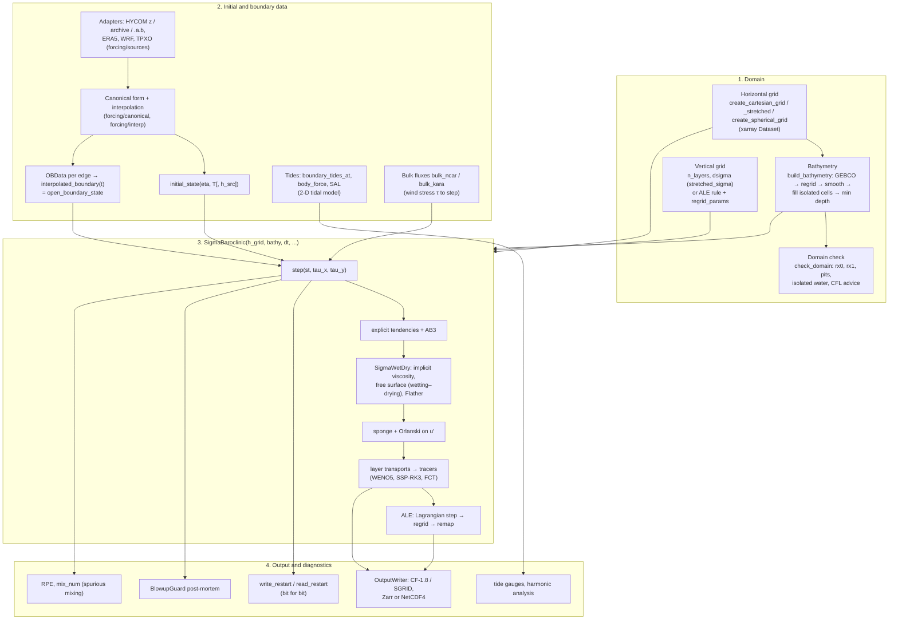

# Model overview in one page

pyOCEAN solves the hydrostatic primitive equations under the Boussinesq approximation on an Arakawa C
grid, with a free surface that can wet and dry. Its recommended core, `SigmaBaroclinic`, discretises the
water column into N layers that are either terrain-following σ-layers or, in the ALE mode, layers that
move with the flow and are regridded each step to z\*, σ or a HYCOM-like hybrid (isopycnal) target. This
page summarises the equations, the three model lines in the repository, how the components connect, and
every physical and numerical choice with its default and its reference. Each item links to the chapter
that explains it in full.

## Equations

For each layer k (thickness h_k, horizontal velocity **u**_k = (u_k, v_k), temperature T_k), the 3-D core
solves, in the Boussinesq hydrostatic limit (Vallis 2006),

$$
\frac{\partial \mathbf u_k}{\partial t} + (\mathbf u\cdot\nabla)\mathbf u + f\,\hat{\mathbf z}\times\mathbf u
= -g\nabla\eta - \frac{1}{\rho_0}\nabla p' + \frac{\partial}{\partial z}\Big(\nu\frac{\partial \mathbf u}{\partial z}\Big)
+ A_h \nabla^2 \mathbf u ,
$$

$$
\frac{\partial h_k}{\partial t} + \nabla\cdot(h_k \mathbf u_k) + \big[\omega\big]_{k-1/2}^{k+1/2} = 0,
\qquad
\frac{\partial \eta}{\partial t} + \nabla\cdot\sum_k h_k \mathbf u_k = 0,
$$

$$
\frac{\partial (h_k T_k)}{\partial t} + \nabla\cdot(h_k T_k \mathbf u_k) + \big[\omega T\big]_{k-1/2}^{k+1/2}
= \nabla\cdot(K_h h_k \nabla T_k) + \frac{\partial}{\partial z}\Big(K_v \frac{\partial T}{\partial z}\Big),
$$

$$
\frac{\partial p'}{\partial z} = -g\,\rho', \qquad \rho = \rho_0 - \alpha\,(T - T_0),
$$

with η the free surface, p′ the baroclinic pressure from ρ′ = ρ − ρ_ref(z), ω the volume flux through the
layer interfaces per unit area (diagnosed from continuity in σ mode, zero during the Lagrangian step of
the ALE mode), ν, K_v the vertical viscosity and diffusivity, A_h, K_h the horizontal ones. The bed stress
and the wind stress are the lower and upper boundary conditions of the vertical viscosity. The present core
carries **temperature only**, with a **linear** equation of state; salinity, TEOS-10, surface heat and
freshwater fluxes are on the roadmap (`docs/design/unified_core.md`). Full derivations:
[Governing equations](../theory/equations.md).

## Three model lines

| Line | What it is | When to use it | Status |
|---|---|---|---|
| **`SigmaBaroclinic`** (`core/dynamics/sigma_baroclinic.py`) | stratified 3-D model; σ-Eulerian mode (default) or ALE mode (z\*, σ, hybrid); wetting–drying, open boundaries with nesting, restarts, CF output | **any 3-D run** — this is the recommended core | active, validated against analytic solutions, CROCO, MITgcm, MOM6 |
| **2-D tidal free-surface model** (`ImplicitFreeSurface`, `WetDryFreeSurface` + driver scripts) | depth-averaged shallow water with tides (TPXO boundaries, body tide, SAL, JSL drag), optional nonlinear terms and wetting–drying | barotropic tides over large regions (PAC_MEX) and intertidal flats | active, validated against tide gauges, TPXO, CROCO, Thacker |
| **Phase-1 z-level model** (`ModelState`, `ab2_step`) | z-levels with partial cells, TEOS-10 or linear EOS, KPP, upwind tracers | not for new work; kept with its tests as a reference | legacy |

The homogeneous 3-D σ model `SigmaWetDry` (`core/dynamics/sigma_wd.py`) is both a model of its own
(CROCO TIDAL_FLAT 3-D) and the vertical/barotropic engine inside `SigmaBaroclinic`. Details in the
[Code map](../architecture/code-map.md).

## Components and data flow

!!! note "What is connected today"
    `SigmaBaroclinic` takes the grid, the bathymetry, an initial T, an optional `open_boundary_state`
    provider and the wind stress per step. The tides, the bulk heat/freshwater fluxes and the canonical
    ocean initialisation (`forcing/ocean_init.initial_state`, which returns a phase-1 `ModelState`) are
    implemented and validated but are **not yet coupled** to `SigmaBaroclinic`; the user passes NumPy arrays
    (`docs/design/unified_core.md`, items 4, 6, 7). The tides drive the 2-D tidal model.

The order of operations inside `step` is drawn in detail in [The time step](../architecture/time-step.md).

## Choices, defaults and references

Defaults of `SigmaBaroclinic.__init__` (`core/dynamics/sigma_baroclinic.py:1005`) unless stated. "σ" =
`vertical_coordinate="sigma_eulerian"`, "ALE" = `vertical_coordinate="ale"`. The full option list is the
[Configuration reference](../user-guide/configuration-reference.md).

### Grid and vertical coordinate

| Choice | Option | Default | Reference | Theory |
|---|---|---|---|---|
| horizontal grid | Arakawa C, Cartesian (uniform or stretched) or spherical | — | Arakawa & Lamb (1977) | [Grids](../theory/grids.md) |
| vertical coordinate | `vertical_coordinate` `"sigma_eulerian"` / `"ale"` | `"sigma_eulerian"` | — | [Vertical coordinates and ALE](../theory/vertical-ale.md) |
| σ fractions | `dsigma` | uniform; `stretched_sigma` (Song & Haidvogel 1994) or `sigma_from_thicknesses` (MITgcm `delR`) | Song & Haidvogel (1994) | [Grids](../theory/grids.md) |
| ALE grid rule | `regrid` `"zstar"` / `"sigma"` / `"hybrid"` | `"sigma"` (pass it explicitly) | Adcroft & Campin (2004); Bleck (2002); Adcroft et al. (2019) | [Vertical coordinates and ALE](../theory/vertical-ale.md) |
| hybrid rule details | `regrid_params`: `dz_top` (z\* floor), `rho_target`, `max_h_top`, `d_sigma`, `d_hybrid`, `h_min` (1e-3 m), `keep_isopycnal` (True) | — | MOM6 HYCOM1; White et al. (2009) | |
| remapping | `remap_scheme` `"pcm"` / `"plm"` / `"ppm_h4"` | `"ppm_h4"` | White & Adcroft (2008); MOM6 `remapping_core_h` | |
| initial hybrid grid | `init_iterations` regrid–remap passes; or `initial_state(..., h_src=...)` | 10 | MOM6 `REGRID_ACCELERATE_INIT`, `Z_INIT_ALE_REMAPPING` | |

### Momentum and free surface

| Choice | Option | Default | Reference | Theory |
|---|---|---|---|---|
| free surface | θ-implicit, upwind total depth, wetting–drying (`theta`, `d_min`) | θ = 0.6, d_min = 0.05 m | Casulli (1990); Casulli & Cheng (1992) | [Free surface and time stepping](../theory/free-surface-time-stepping.md) |
| free-surface solver | `solver` `"direct"` / `"cg"` (CG + lagged-LU preconditioner) | σ `"direct"`, ALE `"cg"` | MITgcm `exactConserv` | [Performance](../architecture/performance.md) |
| explicit time stepping | AB3 of the explicit tendencies (Euler, AB2 at start-up) | always | Durran (2010) | [Free surface and time stepping](../theory/free-surface-time-stepping.md) |
| baroclinic transport time weight | `theta_bc` | ½ | — (time-centred) | |
| momentum form | `momentum` `"flux"` / `"vector_invariant"` | σ `"flux"` (only option); ALE `"vector_invariant"` | Shchepetkin & McWilliams (2005); Sadourny (1975); MOM6 | [Momentum](../theory/momentum.md) |
| momentum advection in σ | `adv` `"flux"` (WENO5-Z flux form) / `"upwind3"` / `"centred"` | `"flux"` | Shchepetkin & McWilliams (2005); Borges et al. (2008) | [Momentum](../theory/momentum.md) |
| kinetic energy (vector invariant) | `ke_scheme` `"arakawa"` / `"gudonov"` | `"arakawa"` | Arakawa & Lamb (1981) **[verify]**; MOM6 | [Momentum](../theory/momentum.md) |
| Coriolis | energy-conserving (σ); PV flux with `BOUND_CORIOLIS` (ALE) | — | Sadourny (1975) | [Momentum](../theory/momentum.md) |
| baroclinic pressure gradient | `pgf` `"jacobian"` / `"twoterm"` / `"fv"`; `rho_ref` `None` / `"auto"` / callable | `"jacobian"`, `None` | Song (1998); Adcroft et al. (2008); Haney (1991) | [Pressure gradient](../theory/pressure-gradient.md) |
| horizontal viscosity | `ah` (Laplacian, free slip) | 0 | — | [Momentum](../theory/momentum.md) |
| CFL truncation backstop (ALE) | `max_truncations` | 1000 | MOM6 `vertvisc_limit_vel` | |

!!! warning "Use `pgf=\"fv\"` in ALE"
    The default pressure gradient is the density Jacobian in both modes. All ALE validation runs
    (BayIW, Ilicak benchmark, seamount) use the finite-volume form, `pgf="fv"`, often with `rho_ref="auto"`.

### Tracers

| Choice | Option | Default | Reference | Theory |
|---|---|---|---|---|
| advection scheme | `tracer_scheme` `"weno5"` (Z) / `"weno5js"` / `"upwind3"` / `"upwind1"` | `"weno5"` | Borges et al. (2008); Jiang & Shu (1996); Leonard (1979) | [Tracers](../theory/tracers.md) |
| time stepping | `tracer_time` `"ssprk3"` / `"pc"` | `"ssprk3"` | Shu & Osher (1988); CROCO | [Tracers](../theory/tracers.md) |
| limiter | `tracer_limiter` `"fct"` / `"none"` | ALE with SSP-RK3 + WENO5: `"fct"`; otherwise `"none"` | Zalesak (1979) | [Tracers](../theory/tracers.md) |
| explicit diffusion | `kh` along layers (on T − T_ref), `kv` implicit | 0, 0 | MITgcm `diffKhT` | [Tracers](../theory/tracers.md) |
| spurious-mixing diagnostic | `mix_diagnostic` (T² advected and remapped) | True | Burchard & Rennau (2008); Winters et al. (1995) | [Tracers](../theory/tracers.md) |
| equation of state | linear in T: `rho0`, `t_coef`, `t_ref` | 1000 kg m⁻³, 0.2 kg m⁻³ °C⁻¹, 0 °C | Vallis (2006) | [Governing equations](../theory/equations.md) |

### Turbulence and friction

| Choice | Option | Default | Reference | Theory |
|---|---|---|---|---|
| vertical viscosity | `closure` `"constant"` / `"parabolic"` / `"gls"` / `"none"`; `nu_const` | `"constant"`, 1e-4 m² s⁻¹ (ALE: `"constant"` or `"none"` only) | Umlauf & Burchard (2003); Canuto et al. (2001); CROCO `gls_mixing.F` | [Turbulence and bottom friction](../theory/turbulence-friction.md) |
| bed stress | `z0` (first-layer law of the wall) | `None` = no bed stress (ALE requires `None`) | Soulsby (1997) | [Turbulence and bottom friction](../theory/turbulence-friction.md) |
| thin layers at faces (ALE) | `thin_layer_coupling` `"mom6"` / `"none"`; `thin_layer_cutoff`; `h_thin_bed` | `"mom6"`, 0 m, 0.01 m | Hallberg & Rhines (1996); HYCOM `hybgen`, `mod_momtum` | [Vertical coordinates and ALE](../theory/vertical-ale.md) |
| ALE layer thickness flux | `thickness_flux` `"ppm"` / `"upwind"` | `"ppm"` | MOM6 `continuity_PPM`; HYCOM `cnuity` | [Vertical coordinates and ALE](../theory/vertical-ale.md) |

### Open boundaries

| Choice | Option | Default | Reference | Theory |
|---|---|---|---|---|
| open edges | `open_boundaries` subset of west/east/south/north | none (closed walls) | — | [Open boundaries](../theory/open-boundaries.md) |
| barotropic | Flather radiation toward (η, ū)ₑₓₜ | with any open edge | Flather (1976) | [Open boundaries](../theory/open-boundaries.md) |
| baroclinic | Orlanski radiation on u′ (`orlanski_cmax` 1.0), CROCO nudging (`obc_tau_in` 1 d, `obc_tau_out` 10 d) or `"clamped"` | `"radiating"` | Orlanski (1976); Marchesiello et al. (2001) | [Open boundaries](../theory/open-boundaries.md) |
| sponge | `sponge_cells`, `sponge_tau` (inner, boundary), `sponge_tracer` | 0 cells, (1200 s, 60 s), True | Martinsen & Engedahl (1987); MITgcm OBCS profile | [Open boundaries](../theory/open-boundaries.md) |
| exterior state | `open_boundary_state(t) → {edge: OBData}` | `None` = resting exterior with the initial T | Chapman (1985); Marsaleix et al. (2006) | [Open boundaries](../theory/open-boundaries.md) |

### 2-D tidal model (separate line)

| Choice | Default / options | Reference | Chapter |
|---|---|---|---|
| free surface | `ImplicitFreeSurface` θ = 1 default (runs use 0.6), linear; or `WetDryFreeSurface` | Dukowicz & Smith (1994); Casulli (1990) | [Tidal model](../user-guide/tidal-model.md) |
| tides | 8 constituents, OTPS/TPXO conventions, Flather with TPXO10, body tide − SAL | Egbert & Erofeeva (2002); Foreman et al. (1993) | [Tides](../theory/tides.md) |
| drag | quadratic C_d (2.5e-3) or log-law; JSL internal-tide drag | Soulsby (1997); Jayne & St. Laurent (2001) | [Turbulence and bottom friction](../theory/turbulence-friction.md) |

## How far each piece is validated

A short guide (details and numbers in the [Validation](../validation/index.md) chapter):

- **Validated against truth or another model:** σ lock exchange (= CROCO), z\* lock exchange (= MOM6),
    hybrid lock exchange (= MOM6 with 21 layers), seamount (z\* 0.08 cm s⁻¹, σ + FV + ρ_ref 0.22 cm s⁻¹),
    mode-1 internal wave (analytic ±5 %; MITgcm `internal_wave` 0.91–1.01), BayIW seiche and linear internal
    waves vs MITgcm, Ekman transport (0.045 %), open-boundary mode-1 channel, CROCO TIDAL_FLAT 2-D/3-D,
    PAC_MEX tides vs 31 gauges, bit-for-bit restarts.
- **Open or experimental:** hybrid two-layer phase in 3-D BayIW, hybrid overflow at very low viscosity,
    Thacker front (strict `xfail`), lock-exchange mixing 1.3–1.5× CROCO in σ mode.

## References

- Adcroft, A. & Campin, J.-M. (2004). Rescaled height coordinates for accurate representation of
    free-surface flows in ocean circulation models. *Ocean Modelling* 7, 269–284.
- Adcroft, A., Hallberg, R. & Harrison, M. (2008). A finite volume discretization of the pressure gradient
    force using analytic integration. *Ocean Modelling* 22, 106–113. **[verify]**
- Adcroft, A. et al. (2019). The GFDL global ocean and sea ice model OM4.0. *JAMES* 11, 3167–3211.
    doi:10.1029/2019MS001726
- Arakawa, A. & Lamb, V.R. (1977). Computational design of the basic dynamical processes of the UCLA
    general circulation model. *Methods in Computational Physics* 17, 173–265.
- Arakawa, A. & Lamb, V.R. (1981). A potential enstrophy and energy conserving scheme for the shallow water
    equations. *Mon. Weather Rev.* 109, 18–36. **[verify]**
- Bleck, R. (2002). An oceanic general circulation model framed in hybrid isopycnic-Cartesian coordinates.
    *Ocean Modelling* 4, 55–88.
- Borges, R., Carmona, M., Costa, B. & Don, W.S. (2008). *J. Comput. Phys.* 227, 3191–3211.
- Burchard, H. & Rennau, H. (2008). *Ocean Modelling* 20, 293–311.
- Canuto, V.M., Howard, A., Cheng, Y. & Dubovikov, M.S. (2001). Ocean turbulence. Part I. *J. Phys.
    Oceanogr.* 31, 1413–1426. **[verify]**
- Casulli, V. (1990). *J. Comput. Phys.* 86, 56–74.
- Casulli, V. & Cheng, R.T. (1992). *Int. J. Numer. Meth. Fluids* 15, 629–648.
- Chapman, D.C. (1985). Numerical treatment of cross-shelf open boundaries in a barotropic coastal ocean
    model. *J. Phys. Oceanogr.* 15, 1060–1075.
- Dukowicz, J.K. & Smith, R.D. (1994). Implicit free-surface method for the Bryan–Cox–Semtner ocean model.
    *J. Geophys. Res.* 99(C4), 7991–8014.
- Durran, D.R. (2010). *Numerical Methods for Fluid Dynamics*, 2nd ed. Springer.
- Egbert, G.D. & Erofeeva, S.Y. (2002). Efficient inverse modeling of barotropic ocean tides. *J. Atmos.
    Oceanic Technol.* 19, 183–204.
- Flather, R.A. (1976). A tidal model of the north-west European continental shelf. *Mém. Soc. R. Sci.
    Liège* 6(10), 141–164.
- Foreman, M.G.G., Henry, R.F., Walters, R.A. & Ballantyne, V.A. (1993). A finite element model for tides
    and resonance along the north coast of British Columbia. *J. Geophys. Res.* 98, 2509–2531. **[verify]**
- Hallberg, R. & Rhines, P. (1996). *J. Phys. Oceanogr.* 26, 913–940. **[verify]**
- Haney, R.L. (1991). On the pressure gradient force over steep topography in sigma coordinate ocean
    models. *J. Phys. Oceanogr.* 21, 610–619.
- Jayne, S.R. & St. Laurent, L.C. (2001). Parameterizing tidal dissipation over rough topography.
    *Geophys. Res. Lett.* 28, 811–814.
- Jiang, G.-S. & Shu, C.-W. (1996). *J. Comput. Phys.* 126, 202–228.
- Leonard, B.P. (1979). A stable and accurate convective modelling procedure based on quadratic upstream
    interpolation. *Comput. Methods Appl. Mech. Eng.* 19, 59–98.
- Marchesiello, P., McWilliams, J.C. & Shchepetkin, A. (2001). Open boundary conditions for long-term
    integration of regional oceanic models. *Ocean Modelling* 3, 1–20.
- Marsaleix, P., Auclair, F. & Estournel, C. (2006). *J. Atmos. Oceanic Technol.* 23, 1604–1613.
- Martinsen, E.A. & Engedahl, H. (1987). *Coastal Eng.* 11, 603–627.
- Orlanski, I. (1976). *J. Comput. Phys.* 21, 251–269.
- Sadourny, R. (1975). *J. Atmos. Sci.* 32, 680–689.
- Shchepetkin, A.F. & McWilliams, J.C. (2005). The regional oceanic modeling system (ROMS).
    *Ocean Modelling* 9, 347–404.
- Shu, C.-W. & Osher, S. (1988). *J. Comput. Phys.* 77, 439–471.
- Song, Y. & Haidvogel, D. (1994). A semi-implicit ocean circulation model using a generalized topography-
    following coordinate system. *J. Comput. Phys.* 115, 228–244.
- Song, Y.T. (1998). *Mon. Weather Rev.* 126, 3213–3230. **[verify]**
- Soulsby, R.L. (1997). *Dynamics of Marine Sands*. Thomas Telford.
- Umlauf, L. & Burchard, H. (2003). A generic length-scale equation for geophysical turbulence models.
    *J. Mar. Res.* 61, 235–265.
- Vallis, G.K. (2006). *Atmospheric and Oceanic Fluid Dynamics*. Cambridge University Press.
- White, L. & Adcroft, A. (2008). A high-order finite volume remapping scheme for nonuniform grids: the
    piecewise quartic method (PQM). *J. Comput. Phys.* 227, 7394–7422.
- White, L., Adcroft, A. & Hallberg, R. (2009). *J. Comput. Phys.* 228, 8665–8692.
- Winters, K.B., Lombard, P.N., Riley, J.J. & D'Asaro, E.A. (1995). *J. Fluid Mech.* 289, 115–128.
- Zalesak, S.T. (1979). *J. Comput. Phys.* 31, 335–362.
