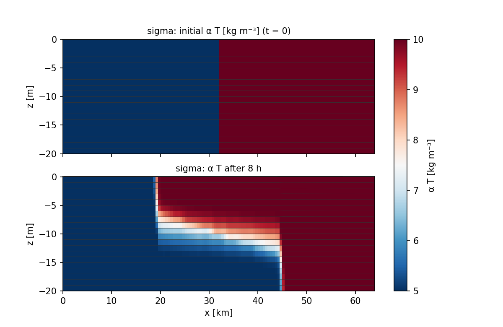
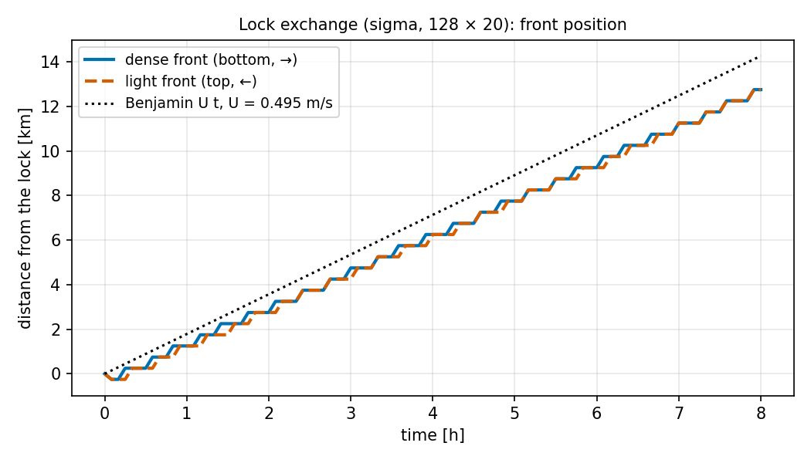
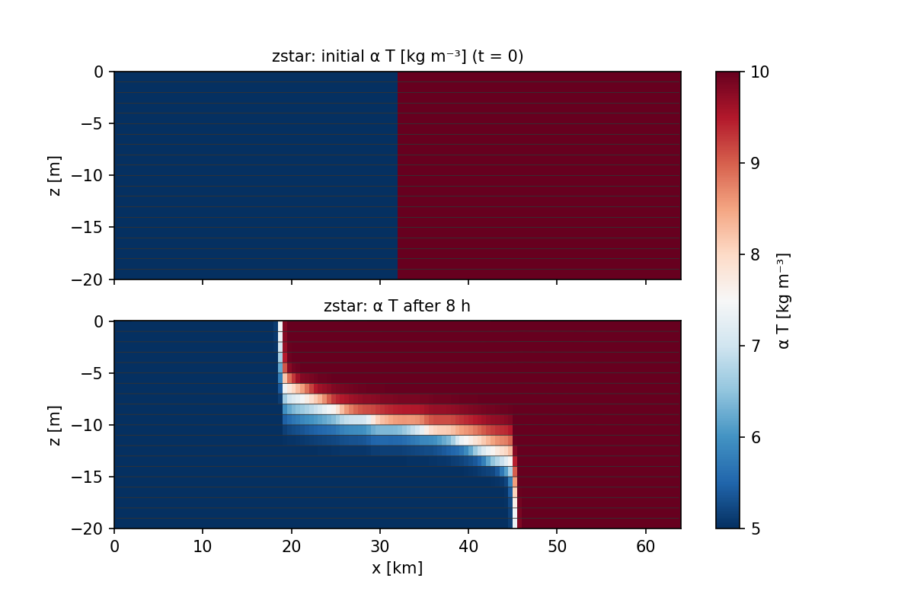
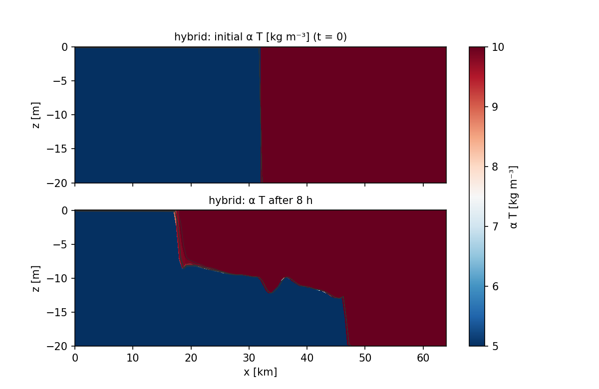
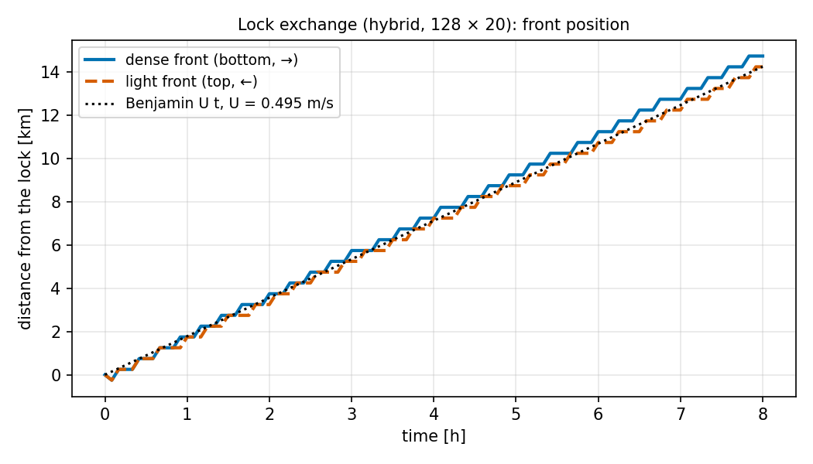

# Quick start: a first complete run

This page runs a complete simulation from scratch: a **lock exchange**, the classic gravity-current test
of Ilicak et al. (2012). A 64 km long, 20 m deep channel holds dense (cold) water on the left and light
(warm) water on the right. At t = 0 the vertical "lock" between them is removed; the dense water slides
under the light water to the right and the light water spreads over it to the left. After a short
acceleration both fronts move at the speed predicted by Benjamin (1968),

$$
U = \tfrac12 \sqrt{g' H}, \qquad g' = g\,\frac{\Delta\rho}{\rho_0},
$$

which for Δρ = 5 kg m⁻³, ρ₀ = 1000 kg m⁻³ and H = 20 m is U = 0.495 m s⁻¹. You get a known answer, see
how the model is built and stepped, and learn the diagnostics to look at. The run uses the recommended
3-D core, `SigmaBaroclinic`, first in its default σ-layer mode and then in the ALE z\* and hybrid modes. It
needs only the [installation](installation.md); no external data.

The script is `docs/manual/figures/quickstart_lock_exchange.py`. It is a coarser and shorter version
(128 × 20 cells, 8 h) of the benchmark `validation/lock_exchange/run_lock_exchange.py` (128 × 40, 17 h,
compared with CROCO), and runs in a few seconds on one thread.

## Run it

From the repository root, with the base environment:

```bash
/opt/anaconda3/bin/python docs/manual/figures/quickstart_lock_exchange.py                 # σ-layers
/opt/anaconda3/bin/python docs/manual/figures/quickstart_lock_exchange.py --coord zstar   # ALE z*
/opt/anaconda3/bin/python docs/manual/figures/quickstart_lock_exchange.py --coord hybrid  # ALE hybrid
```

The first call compiles the Numba kernels (a few seconds; they are cached afterwards). The σ run prints:

```text
coord = sigma: 96 samples, 2880 steps in 3.4 s (1.2 ms/step)
  heat content drift   : -8.26e-14
  RPE gain             : 4.978e+08 J  (8.00e-06 of RPE0)
  T range              : 5.0000 – 10.0000 (initial 5 – 10)
  max |u|              : 0.743 m/s;  max |eta| 2.66e-02 m
  front speed 2–6 h    : dense 0.451, light 0.451 m/s = 0.91 / 0.91 U_Benjamin (0.495 m/s)
```

and writes two figures to `docs/manual/img/quickstart/`.



*Temperature (shown as α T, the density deficit) at t = 0 and after 8 h, drawn on the actual layers (thin
lines are the σ-interfaces). Look at the two noses: the dense one along the bed at x ≈ 45 km, the light
one along the surface at x ≈ 19 km, and the mixed interface between them.*



*Distance of the fronts from the lock against time, with Benjamin's U t. The staircase is the 500 m cell
size; the slope after ~1 h is the front speed.*

## The script, line by line

```python
#!/usr/bin/env python
"""
Quick-start run of the pyOCEAN manual: a small lock exchange with SigmaBaroclinic.

A 64 km × 20 m channel holds cold (dense) water on the left and warm (light) water on the right,
separated by a vertical "lock" at x = 32 km.  At t = 0 the lock is removed: the dense water slides
under the light water as a gravity current whose front speed, after the initial acceleration, is
Benjamin's (1968) U = ½ √(g′ H).  The full benchmark (128 × 40 cells, 17 h, against CROCO) is
validation/lock_exchange/run_lock_exchange.py; this version is coarser (128 × 20 cells) and short (8 h)
so it runs in well under a minute on one thread.

Usage (from the repository root, base conda env):
    /opt/anaconda3/bin/python docs/manual/figures/quickstart_lock_exchange.py              # σ-layers
    /opt/anaconda3/bin/python docs/manual/figures/quickstart_lock_exchange.py --coord zstar
    /opt/anaconda3/bin/python docs/manual/figures/quickstart_lock_exchange.py --coord hybrid
Output: docs/manual/img/quickstart/lock_<coord>_sections.png and lock_<coord>_fronts.png
"""

from __future__ import annotations

import os

# 1. One thread for everything: Numba kernels, BLAS and OpenMP (must be set before importing numpy/numba).
for _v in ("NUMBA_NUM_THREADS", "OMP_NUM_THREADS", "OPENBLAS_NUM_THREADS", "MKL_NUM_THREADS",
           "VECLIB_MAXIMUM_THREADS"):
    os.environ.setdefault(_v, "1")

import argparse  # noqa: E402
import sys  # noqa: E402
import time  # noqa: E402
import warnings  # noqa: E402
from pathlib import Path  # noqa: E402

import matplotlib  # noqa: E402

matplotlib.use("Agg")
import matplotlib.pyplot as plt  # noqa: E402
import numpy as np  # noqa: E402

# 2. pyOCEAN is not an installed package: put the repository root on the import path.
ROOT = Path(__file__).resolve().parents[3]
sys.path.insert(0, str(ROOT))

from core.dynamics.sigma_baroclinic import SigmaBaroclinic, set_threads  # noqa: E402
from core.grid.horizontal import create_cartesian_grid  # noqa: E402

# 3. Case parameters (SI units).
L, H = 64e3, 20.0                 # channel length and depth [m]
NX, NZ = 128, 20                  # cells along the channel, layers
DT, HOURS = 10.0, 8.0             # time step [s], run length [h]
RHO0, TCOEF = 1000.0, 0.28        # reference density [kg m-3], thermal coefficient α [kg m-3 °C-1]
T_COLD, T_WARM = 5.0 / TCOEF, 10.0 / TCOEF        # Δρ = α ΔT = 5 kg m-3
G_PRIME = 9.81 * 5.0 / RHO0                       # reduced gravity g′ = g Δρ/ρ0 [m s-2]
U_BENJAMIN = 0.5 * np.sqrt(G_PRIME * H)           # Benjamin front speed [m s-1] ≈ 0.495
OUT = ROOT / "docs" / "manual" / "img" / "quickstart"


def build(coord: str) -> tuple[SigmaBaroclinic, object]:
    """The model and its resting initial state for coord ∈ {'sigma', 'zstar', 'hybrid'}."""
    # 4. Horizontal grid: uniform Cartesian C-grid, one row (a 2-D x–z section), no rotation.
    hg = create_cartesian_grid(nx=NX, ny=1, dx=L / NX, dy=L / NX, f0=0.0)
    bathy = np.full((1, NX), H)                                    # rest depth H (j, i) [m], positive down
    common = dict(dt=DT, n_layers=NZ, rho0=RHO0, t_coef=TCOEF, z0=None, closure="constant")
    if coord == "sigma":
        # 5a. σ-Eulerian mode (the default vertical coordinate): fixed fractions of the column.
        m = SigmaBaroclinic(hg, bathy, nu_const=1e-6, **common)
    elif coord == "zstar":
        # 5b. ALE z*: nominal level thicknesses dz_top (surface first) that sum to the depth.
        m = SigmaBaroclinic(hg, bathy, nu_const=1e-6, vertical_coordinate="ale", regrid="zstar",
                            regrid_params=dict(dz_top=np.full(NZ, H / NZ)), ke_scheme="gudonov", **common)
    elif coord == "hybrid":
        # 5c. ALE hybrid (HYCOM1 rule): NZ + 1 interface target densities spanning both water masses,
        #     a 1 cm z* floor (so the interior is isopycnal), MOM6 lock-exchange viscosities.
        #     The model warns that this floor (Σ dz_top = 0.2 m) stops above the bed: intended here, the two
        #     homogeneous water masses should each sit in an isopycnal layer, so the warning is silenced.
        warnings.filterwarnings("ignore", message="hybrid z\\* floor")
        rho_l, rho_d = RHO0 - TCOEF * T_WARM, RHO0 - TCOEF * T_COLD
        params = dict(dz_top=np.full(NZ, 0.01), rho_target=np.linspace(rho_l - 1.0, rho_d + 1.0, NZ + 1))
        m = SigmaBaroclinic(hg, bathy, nu_const=1e-4, ah=0.01, vertical_coordinate="ale", regrid="hybrid",
                            regrid_params=params, ke_scheme="gudonov", **common)
    else:
        raise ValueError(coord)
    # 6. Initial temperature (k, j, i): cold left of the lock, warm right, in every layer; η = 0.
    T0 = np.where(np.arange(NX) < NX // 2, T_COLD, T_WARM)[None, None, :].repeat(NZ, axis=0)
    st = m.initial_state(np.zeros((1, NX)), T0)
    return m, st


def layer_thickness(m: SigmaBaroclinic, st) -> np.ndarray:
    """Layer thicknesses (k, j, i) [m] in either mode: volume / cell area."""
    return m.layer_volumes(st.eta, st.h) / m.area[None]


def fronts(m: SigmaBaroclinic, st, x: np.ndarray, thick: float = 1.0) -> tuple[float, float]:
    """Distance from the lock [m] of the dense (rightward) and light (leftward) fronts: last column where
    more than ``thick`` metres of that water mass remain."""
    half = 0.5 * (T_COLD + T_WARM)
    h = layer_thickness(m, st)[:, 0]
    dense = np.where(st.T[:, 0] < half, h, 0.0).sum(0)
    light = np.where(st.T[:, 0] > half, h, 0.0).sum(0)
    return x[dense > thick].max() - L / 2, L / 2 - x[light > thick].min()


def section(ax, m: SigmaBaroclinic, st, title: str):
    """α T on the actual layer geometry (cells drawn between their interfaces)."""
    h = layer_thickness(m, st)[:, 0]
    zw = -H + np.concatenate([np.zeros((1, NX)), np.cumsum(h, axis=0)])        # interfaces, bed first
    xe = np.linspace(0.0, L, NX + 1) / 1e3
    Xe = np.repeat(xe[None], NZ + 1, axis=0)
    Ze = np.concatenate([zw, zw[:, -1:]], axis=1)                                # pad the last column
    pc = ax.pcolormesh(Xe, Ze, TCOEF * st.T[:, 0], cmap="RdBu_r", vmin=TCOEF * T_COLD, vmax=TCOEF * T_WARM,
                       shading="flat")
    for k in range(NZ + 1):                                                      # layer interfaces
        ax.plot((np.arange(NX) + 0.5) * L / NX / 1e3, zw[k], color="0.2", lw=0.4)
    ax.set_title(title, fontsize=10)
    ax.set_ylabel("z [m]")
    return pc


def main() -> None:
    ap = argparse.ArgumentParser()
    ap.add_argument("--coord", default="sigma", choices=("sigma", "zstar", "hybrid"))
    args = ap.parse_args()
    OUT.mkdir(parents=True, exist_ok=True)
    set_threads(1)                                   # 7. threads of the compiled kernels (≤ NUMBA_NUM_THREADS)

    m, st = build(args.coord)
    x = (np.arange(NX) + 0.5) * L / NX
    st0 = st
    c0 = m.tracer_content(st)                        # Σ V T, conserved in a closed basin
    rpe0 = m.rpe(st)                                 # reference potential energy [J]

    # 8. Time loop: one call to step() per Δt; diagnostics every 30 steps (5 min).
    every = 30
    t, fr = [0.0], [(0.0, 0.0)]
    tic = time.time()
    for n in range(int(round(HOURS * 3600 / DT))):
        st = m.step(st)
        if (n + 1) % every == 0:
            t.append(st.time)
            fr.append(fronts(m, st, x))
    wall = time.time() - tic
    t, fr = np.array(t), np.array(fr)

    # 9. Report: conservation, mixing, front speed between 2 and 6 h.
    i2, i6 = np.argmin(abs(t - 2 * 3600)), np.argmin(abs(t - 6 * 3600))
    speed = (fr[i6] - fr[i2]) / (t[i6] - t[i2])
    print(f"coord = {args.coord}: {len(t) - 1} samples, {int(HOURS * 3600 / DT)} steps in {wall:.1f} s "
          f"({1e3 * wall / (HOURS * 3600 / DT):.1f} ms/step)")
    print(f"  heat content drift   : {m.tracer_content(st) / c0 - 1:+.2e}")
    print(f"  RPE gain             : {m.rpe(st) - rpe0:.3e} J  ({(m.rpe(st) - rpe0) / rpe0:.2e} of RPE0)")
    print(f"  T range              : {TCOEF * st.T.min():.4f} – {TCOEF * st.T.max():.4f} (initial 5 – 10)")
    print(f"  max |u|              : {np.abs(st.u).max():.3f} m/s;  max |eta| {np.abs(st.eta).max():.2e} m")
    print(f"  front speed 2–6 h    : dense {speed[0]:.3f}, light {speed[1]:.3f} m/s "
          f"= {speed[0] / U_BENJAMIN:.2f} / {speed[1] / U_BENJAMIN:.2f} U_Benjamin ({U_BENJAMIN:.3f} m/s)")
    if m.ale:
        print(f"  ALE: CFL truncations {st.n_trunc}, outflow-limited cell-layers {st.n_limited}")

    # 10. Figures.
    fig, ax = plt.subplots(2, 1, figsize=(8, 5.2), sharex=True)
    section(ax[0], m, st0, f"{args.coord}: initial α T [kg m⁻³] (t = 0)")
    pc = section(ax[1], m, st, f"{args.coord}: α T after {HOURS:.0f} h")
    ax[1].set_xlabel("x [km]")
    fig.colorbar(pc, ax=ax, label="α T [kg m⁻³]")
    fig.savefig(OUT / f"lock_{args.coord}_sections.png", dpi=150)
    plt.close(fig)

    fig, ax = plt.subplots(figsize=(7, 4))
    ax.plot(t / 3600, fr[:, 0] / 1e3, color="#0072B2", lw=2, label="dense front (bottom, →)")
    ax.plot(t / 3600, fr[:, 1] / 1e3, color="#D55E00", lw=2, ls="--", label="light front (top, ←)")
    ax.plot(t / 3600, U_BENJAMIN * t / 1e3, "k:", label=f"Benjamin U t, U = {U_BENJAMIN:.3f} m/s")
    ax.set_xlabel("time [h]")
    ax.set_ylabel("distance from the lock [km]")
    ax.set_title(f"Lock exchange ({args.coord}, {NX} × {NZ}): front position", fontsize=10)
    ax.grid(alpha=0.3)
    ax.legend(fontsize=9)
    fig.tight_layout()
    fig.savefig(OUT / f"lock_{args.coord}_fronts.png", dpi=150)
    plt.close(fig)


if __name__ == "__main__":
    main()
```

What each numbered block does:

1. **Threads first.** The thread variables must be set before NumPy and Numba are imported. `NUMBA_NUM_THREADS=1`
    fixes Numba's thread pool at one thread; the BLAS/OpenMP variables keep SciPy and NumPy single-threaded.
    `setdefault` lets you override them from the shell (e.g. `NUMBA_NUM_THREADS=5`). See
    [Installation → Thread settings](installation.md#thread-settings).
2. **Import path.** pyOCEAN is not an installed package: the script puts the repository root on
    `sys.path` and imports the two things it needs, the model class `SigmaBaroclinic` with the thread setter
    `set_threads` (`core/dynamics/sigma_baroclinic.py`), and the grid generator `create_cartesian_grid`
    (`core/grid/horizontal.py`).
3. **Parameters.** Everything is SI. The model's default equation of state is linear in temperature (nonlinear options:
    [Equation of state](../theory/equation-of-state.md)),
    ρ = ρ₀ − α (T − T₀), so the two water masses are given as temperatures 5/α and 10/α °C, which makes
    Δρ = α ΔT = 5 kg m⁻³ exactly, as in the CROCO `GRAV_ADJ` case.
4. **Horizontal grid.** `create_cartesian_grid(nx, ny, dx, dy, f0)` returns an `xarray.Dataset` with the
    Arakawa C-grid metrics (`dx_u`, `dy_u`, `area_t`, `f_q`, …; see
    [Data structures](../architecture/data-structures.md)). One row (`ny=1`) makes an x–z section; `f0=0`
    switches rotation off. The bathymetry is an `(ny, nx)` array of rest depths **positive downward**; a
    NaN would be a wall, a negative value floodable land. The domain edges are closed walls because no
    `open_boundaries` are given. `z0=None` means no bed stress, and `closure="constant"` a constant vertical
    viscosity `nu_const`.
5. **The model.**
    - **(a) σ-layers**, the default `vertical_coordinate="sigma_eulerian"`: N layers that are fixed
        fractions Δσ of the water column (uniform here), with a diagnosed vertical velocity ω. All other
        options keep their defaults: flux-form WENO5 momentum advection with energy-conserving Coriolis,
        WENO5-Z tracers with SSP-RK3, the density-Jacobian pressure gradient, AB3, θ = 0.6 free surface
        solved directly. The viscosity 1e-6 m² s⁻¹ is that of the reference case.
    - **(b) ALE z\***: `vertical_coordinate="ale", regrid="zstar"` and the nominal level thicknesses
        `dz_top` (listed **surface first**, summing to the depth). The layers move with the flow during the
        step (Lagrangian step), then are regridded back to the z\* levels and the fields remapped
        conservatively. ALE defaults: vector-invariant momentum, PPM layer-thickness fluxes, WENO5 + Zalesak
        FCT tracers, PPM_H4 remapping, CG free-surface solver. `ke_scheme="gudonov"` (the model's spelling of
        Godunov) is the kinetic-energy discretisation the class docstring recommends for density currents;
        the default `"arakawa"` is better for internal waves.
    - **(c) ALE hybrid**: the HYCOM1 rule of MOM6. `rho_target` holds the N + 1 interface target
        densities (surface first, increasing downward) that span the two water masses with a 1 kg m⁻³
        margin; `dz_top` is the minimum z\* thickness near the surface — here only 1 cm, so the interior is
        purely isopycnal and each water mass ends up in its own layers, which have vanished on the other side
        of the lock. Because the floor stops 19.8 m above the bed, the model warns that homogeneous deep
        water would be one slab layer; that is the intent here, so the script silences the warning. The
        viscosities (`nu_const=1e-4`, `ah=0.01`) are those of the MOM6 lock-exchange example
        (`tests/test_sigma_ale.py`, `_hybrid_lock`).
6. **Initial state.** `initial_state(eta, T)` returns a resting `SigmaState` (u = v = 0) with the given
    free surface `eta` `(ny, nx)` and temperature `T` `(N, ny, nx)`. The layer index k = 0 is the **bed**
    layer; here every layer has the same temperature, so the order does not matter. In hybrid mode
    `initial_state` starts from σ-layers and makes `init_iterations` (default 10) regrid–remap passes to
    build the isopycnal grid.
7. **Threads of the kernels.** `set_threads(1)` sets how many Numba threads `SigmaBaroclinic` uses
    (default 1; at most `NUMBA_NUM_THREADS`).
8. **The time loop.** `st = m.step(st)` advances one Δt and returns a **new** state; nothing is modified in
    place. `st.time` is the model time in seconds. Every 30 steps the script locates the two fronts: the
    last column that still holds more than 1 m of the dense (or light) water. `layer_volumes(eta, h) / area`
    gives the layer thicknesses in both modes (σ: D Δσ_k; ALE: the prognostic `st.h`). The flow of one
    `step` is drawn in [The time step](../architecture/time-step.md).
9. **Diagnostics.** `tracer_content` (Σ V T) must be conserved to round-off in a closed basin; `rpe` is the
    reference potential energy (Winters et al. 1995), whose growth measures the irreversible —
    here purely numerical — mixing; the temperature range must stay within the initial 5–10 (no new
    extrema); the front speed between 2 and 6 h is compared with Benjamin's. In ALE the step also counts CFL
    velocity truncations (`st.n_trunc`) and cell-layers limited by the outflow limiter (`st.n_limited`);
    both should stay 0.
10. **Figures.** The sections are drawn on the true interface heights, so ALE layers that thin out or
    vanish are visible.

## The same case in ALE z\* and hybrid



*ALE z\*: the levels stay horizontal (thin lines) and the interface between the water masses is spread
over a few cells, as in σ.*



*ALE hybrid: the layer interfaces follow the density interface, which stays sharp. The many lines bunched
at the bed on the right and at the surface on the left are layers that have vanished (h ≈ 0).*



*Hybrid front positions: both fronts follow Benjamin's line.*

The three runs side by side (printed by the script, M3 Pro, one thread):

| Run | Front speed 2–6 h (dense / light) | RPE gain after 8 h (fraction of RPE₀) | T range | Heat drift | Cost |
|---|---|---|---|---|---|
| σ (default) | 0.451 / 0.451 m s⁻¹ = 0.91 U | 4.98e8 J (8.0e-6) | 5–10 | −8e-14 | 1.2 ms/step |
| ALE z\* | 0.486 / 0.486 m s⁻¹ = 0.98 U | 3.11e8 J (5.0e-6) | 5–10 | +3e-13 | 1.9 ms/step |
| ALE hybrid | 0.521 / 0.521 m s⁻¹ = 1.05 U | 6.39e5 J (1.0e-8) | 5–10 | +4e-13 | 2.1 ms/step |

## What to look at

- **Conservation.** The heat content changes by ~1e-13 relative: the flux-form tracer transport and the
    layer transports that add up exactly to the free-surface flux conserve to round-off in every mode.
- **No new extrema.** T stays in [5/α, 10/α]: WENO5 in σ and WENO5 with the FCT limiter in ALE do not
    create water denser or lighter than the initial water masses. An unlimited third-order scheme (UP3)
    overshot by ~50 % at the nose in the full benchmark (`validation/lock_exchange/README.md`).
- **Front speed.** All three runs are within 10 % of Benjamin's speed. This quick run is coarser in the
    vertical than the reference and measures the front with a 1 m thickness threshold, so its numbers are
    not the benchmark's: the full σ benchmark (40 layers, 17 h) gives 0.463 / 0.486 m s⁻¹, identical to
    CROCO (`validation/lock_exchange/README.md`), and the hybrid lock exchange with 21 layers gives
    1.05 / 0.98 U against MOM6's 1.05 U (`CLAUDE.md`, `validation/mom6_ke_schemes/README.md`).
- **Spurious mixing.** The RPE gain is the numerical mixing of the run (there is no explicit tracer
    diffusion). z\* mixes a little less than σ here, and the hybrid run mixes ~500 times less than z\*,
    because its isopycnal layers exchange almost no water across the density interface. The same contrast
    appears in the Ilicak benchmark (hybrid 250–1200× less mixing than z\*, `CLAUDE.md`). The
    per-cell numerical mixing of the last step is in `st.mix_num` [°C² m³ s⁻¹].
- **Free surface.** max |η| ≈ 2 cm: the implicit free surface carries the small barotropic adjustment.

## Saving output and restarting

The quick-start script keeps everything in memory. A real run writes CF output and restarts. This snippet
(σ mode, the same model `m` and state `st` as above) was checked to run and to restart bit for bit:

```python
from diagnostics.output import OutputWriter
from core.restart import write_restart, read_restart

w = OutputWriter("lock.zarr", hg, bathy, n_layers=NZ, dsigma=m.ds)      # CF-1.8 / SGRID, Zarr
for n in range(360):
    st = m.step(st)
    if (n + 1) % 180 == 0:                                              # every 30 min
        w.write(st.time, eta=st.eta, u=st.u, v=st.v, T=st.T, mix_num=st.mix_num)
w.close()

write_restart("lock_restart.nc", m, st)        # state + AB3 history + transports + solver state
st = read_restart("lock_restart.nc", m2)       # m2: a model built with the same configuration
```

`xarray.open_zarr("lock.zarr")` then gives `eta (time, yh, xh)`, `u (time, s_rho, yh, xq)`,
`v (time, s_rho, yq, xh)`, `T` and `mix_num (time, s_rho, yh, xh)` with σ coordinates `s_rho`, `s_w` and
the bathymetry `h`. See [Output, restarts and diagnostics](../user-guide/output-restart-diagnostics.md).

## Things to try

- Change `NZ`, `NX` or `DT` and see how the front speed and the RPE gain respond; the full benchmark is
    `validation/lock_exchange/run_lock_exchange.py --ah 0 1 10 100`.
- Add a horizontal viscosity (`ah=10.0` m² s⁻¹): in the benchmark the spurious mixing drops when the grid
    Reynolds number U Δx / A_h falls below ~10, as Ilicak et al. (2012) found.
- Try `regrid="sigma"` in ALE (σ-layers moved by the Lagrangian step and regridded), and
    `ke_scheme="arakawa"` in z\* or hybrid.
- Run on more threads: `NUMBA_NUM_THREADS=5 ... ` and `set_threads(5)` (a run this small may not get
    faster: there is little work per kernel call to share).

Next: [the model on one page](overview.md), then
[Building a model](../user-guide/building-a-model.md) and the
[Configuration reference](../user-guide/configuration-reference.md).

## References

- Benjamin, T.B. (1968). Gravity currents and related phenomena. *J. Fluid Mech.* 31, 209–248.
    doi:10.1017/S0022112068000133
- Ilicak, M., Adcroft, A.J., Griffies, S.M. & Hallberg, R.W. (2012). Spurious dianeutral mixing and the
    role of momentum closure. *Ocean Modelling* 45–46, 37–58. doi:10.1016/j.ocemod.2011.10.003
- Winters, K.B., Lombard, P.N., Riley, J.J. & D'Asaro, E.A. (1995). Available potential energy and mixing
    in density-stratified fluids. *J. Fluid Mech.* 289, 115–128. doi:10.1017/S002211209500125X
