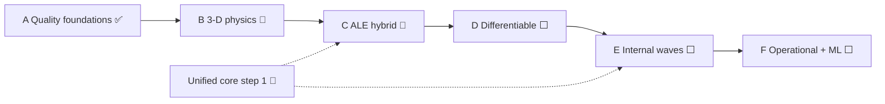
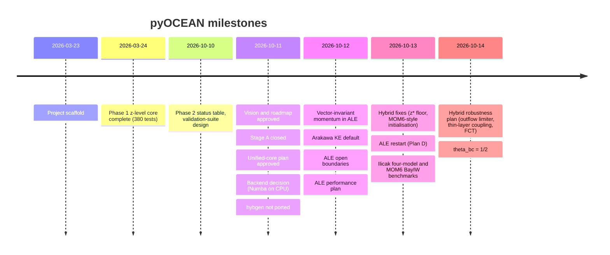

# Limitations and roadmap

This page says where pyOCEAN stands today (14 October 2026), what it does not do yet, and what comes next.
It is built from the approved design documents — `docs/design/vision_roadmap.md` (vision and stages,
approved 2026-10-11) and `docs/design/unified_core.md` (unified 3-D core, approved 2026-10-11), both in
Spanish — from the status tables in `CLAUDE.md`, and from the "what pyOCEAN should improve" lists of the
validation READMEs. Every limitation below was checked against the code; the evidence is cited as
`path:line`.

Read it before you plan a run: several capabilities exist in one model line only (see
[Comparison with other models](comparison.md), introduction), and the stratified core still lacks salinity,
heat fluxes and tides.

## 1. Goal and how progress is measured

The stated goal is that pyOCEAN becomes the best community regional and coastal model, not a model tailored to
one user (`vision_roadmap.md` §1). "Best" is measured on four axes:

1. **Accuracy against the truth:** exact solutions, laboratory data and observations. Resembling other models
    is not enough.
2. **Cost:** wall-clock time per simulated day at equal error.
3. **Robustness:** no blow-ups with real bathymetry, wetting and drying, or open boundaries.
4. **Usability and transparency:** installation without compiling, integrated domain preparation, every
    equation with its reference and its test, bit-for-bit reproducible results.

Every benchmark classifies each difference as (a) a pyOCEAN bug, (b) missing physics, (c) a numerical choice
or (d) an error of the reference model. Only (a) and (b) change the model, and an improvement counts only if it
is general physics that helps more than one case; nothing is tuned to a single case. Each benchmark ends with a
"what pyOCEAN should improve" list and a row in the scorecard (`vision_roadmap.md` §7; summarised in
[Validation: strategy and scorecard](validation/index.md)).

## 2. Stages and current status

The roadmap reorganises the old phases of `CLAUDE.md` into six stages, A–F (`vision_roadmap.md` §8). A stage
closes when its scorecard rows are ✅ or the difference is explained. Phase 1 (the z-level core) is complete and
Phase 2 (forcing, tides, open boundaries, wetting and drying) is largely done (`CLAUDE.md`).

Status legend: ✅ done · 🔶 partly done or open issues · ⬜ not started.

| Stage | Content (roadmap) | Status | Evidence and what is open |
|---|---|---|---|
| **A — Quality foundations** | Spurious-mixing diagnostics, bit-for-bit restarts, AB3 or LF-AM3, LU reuse / PyAMG, CF/Zarr output, domain checker and blow-up post-mortem, log-law drag in regional runs | ✅ closed 2026-10-11 | RPE and online variance decay (`diagnostics/mixing.py:52`; `mix_num` in every step); restart (`core/restart.py:89`); AB3 (`core/dynamics/sigma_baroclinic.py:102`); lagged-LU CG (`core/dynamics/wetting_drying.py:51`); output (`diagnostics/output.py:49`); `check_domain` (`diagnostics/domain_check.py:178`); `BlowupGuard` (`diagnostics/postmortem.py:35`); log law in `validation/pacmex_tides/run_tides_wd.py --z0`. **Open:** restart and CF output not wired into the tidal 2-D runners; lock-exchange RPE 1.3–1.5× CROCO. LF-AM3 and PyAMG were *not* implemented (AB3 and lagged-LU CG instead) |
| **B — 3-D physics** | Vertical advection and stratification in 3-D σ; finite-volume PGF with the seamount test; vector-invariant momentum; Casulli subgrid W/D + Stelling–Duinmeijer fronts; sponge that relaxes only the low frequencies; BayIW baroclinic seiche vs MITgcm | 🔶 | ✅ stratified σ core with ω and flux-form tracers (`SigmaBaroclinic`, `:933`); ✅ FV PGF (`core/vertical/pgf.py:165`) and seamount; ✅ vector-invariant momentum (`core/dynamics/vector_invariant.py`); ✅ BayIW 2-D section and 3-D cut vs MITgcm (`validation/bayiw_2d/`, `validation/bayiw_cut/`). ⬜ subgrid W/D and momentum-conserving fronts (no code; Thacker still a strict `xfail`, `tests/test_wetting_drying.py:118`); ⬜ low-frequency-only sponge |
| **C — ALE hybrid** (old Phase 3) | General ALE: Lagrangian step + regrid + PPM/PQM remap; targets z\*, σ, z̃, HYCOM hybrid, adaptive; split-explicit barotropic mode; DOME overflow and seamount as entry tests | 🔶 (done ahead of the unified-core steps) | ✅ ALE step with z\*, σ, hybrid (`_step_ale`, `core/dynamics/sigma_baroclinic.py:1977`), PCM/PLM/PPM_H4 remap = MOM6 (`core/vertical/remap.py:307`), hybrid robustness plan (2026-10-14), Ilicak overflow and seamount in four models (`validation/ilicak_benchmark/`). ⬜ PQM, z̃ and adaptive targets (no code); ⬜ split-explicit barotropic mode; ⬜ DOME itself; 🔶 HYCOM comparison only for cost and per column (`validation/mom6_column/`) |
| **D — Differentiable** | JAX backend of the 2-D tidal model with custom derivatives for the free-surface solve and Thomas; inversion against tide gauges; adjoint sensitivity maps; then 3-D and GLS | ⬜ | Only a backend prototype (`prototypes/bench_jax_vs_numba.py`, `docs/design/performance.md` §4). Decision of 2026-10-11: Numba stays the CPU engine; JAX only for gradients and NVIDIA GPUs |
| **E — Internal waves and baroclinic tides** (old Phase 4) | Internal tide in PAC_MEX instead of the JSL drag; KPP without background diffusivity; optional non-hydrostatic | ⬜ | JSL drag exists in the 2-D model (`physics/tides/drag.py:102`); KPP only in the legacy z model (`physics/mixing/kpp.py:555`) |
| **F — Operational and ML** (old Phase 5) | Forecast cycle vs HYCOM-IOA with independent observations; regional emulator or learned boundaries (Anemoi, ACE); NVIDIA GPU via JAX | ⬜ | HYCOM-IOA comparison exists only for the tidal band (`validation/hycom_ioa`) |

*Stage order of `vision_roadmap.md` §8. The unified-core plan (§5 below) adds the missing physics to the
stratified core; in practice the ALE work of stage C was done before most of it.*

### 2.1 Dated milestones

Only dates written in `CLAUDE.md`, the design documents or the git history are used.

## 3. Gaps that pyOCEAN targets

### 3.1 Technical gaps of the field (`vision_roadmap.md` §3a)

| Gap | pyOCEAN today |
|---|---|
| No code combines ALE + wetting–drying + tides + coast-to-basin scales (MOM6 has ALE without W/D; SCHISM and D-Flow FM have W/D without ALE; HYCOM has neither) | ALE σ and hybrid accept floodable columns (`core/dynamics/sigma_baroclinic.py:1169`); W/D in 2-D and 3-D σ; tides only in the 2-D model. The three are not yet combined in one run |
| 3-D baroclinic wetting–drying is open everywhere (collapsing layers, mixing of drying water) | Homogeneous 3-D σ W/D validated (TIDAL_FLAT 3-D, 1.2 cm); stratified W/D not benchmarked |
| Spurious mixing is almost never diagnosed routinely | Online `mix_num` (Burchard & Rennau 2008) every step, RPE diagnostic |
| No differentiable 3-D regional–coastal model exists | Stage D, not started |
| Open boundaries are tuned by hand; no public reflection or mass-balance benchmarks | Mode-1 channel test (closed 0.82 / Orlanski 0.16 / sponge 0.015 interior error); reflection metric λ = F_r/F_in pending (unified core piece 8) |
| No shared, versioned test suites | `validation/` cases with a common definition (`validation/ilicak_benchmark/cases.py`) |

### 3.2 What users ask for (`vision_roadmap.md` §3b, in order of frequency)

| Request | pyOCEAN today |
|---|---|
| 1. Regional domain preparation | GEBCO load/regrid/smooth, domain checker, forcing readers (ERA5, WRF, HYCOM z and `.a/.b`, TPXO), `initial_state`/`boundary_data` (`forcing/ocean_init.py:86`, `:123`); no configuration file yet |
| 2. Open-boundary instabilities | Flather + Orlanski + nudging + sponge, `'clamped'`; time-varying exterior |
| 3. Tide + low-frequency parent at the boundary without the sponge killing the tide | ⬜ low-frequency-only sponge; tides not in the 3-D core |
| 4. Installation and compilation | Python + conda, nothing to compile |
| 5. Wetting–drying blow-ups | Casulli semi-implicit, positivity and mass conservation by construction |
| 6. Non-reproducible restarts | Bit-for-bit restart in CI (`tests/test_restart.py`) |
| 7. Output and diagnostics | CF-1.8/SGRID, Zarr or NetCDF4 |
| 8. PGF error on steep topography | Jacobian / FV with reference profile; z\* + FV |
| 9. Δt choice and locating a blow-up | Domain checker CFL advice; `BlowupGuard`; ALE truncation messages |
| 10. Nesting | One-way offline only |
| 11. Documentation and examples | This manual |
| 12. Reproducibility and CI | Bit-for-bit restarts, regression references in `tests/data/` |
| 13. Coupling (biogeochemistry, waves, ice) | Not planned early |
| 14. GPU | Stage F, via JAX |
| 15. Data assimilation and ML | Stages D and F |

### 3.3 Positioning (`vision_roadmap.md` §4)

> The regional and coastal model that installs with `pip`, prepares its own domain, does not blow up at the
> coast, measures its own numerical mixing, restarts bit for bit and gives gradients of everything with
> respect to everything.

Differentiators, in order of value over effort: (1) integrated domain preparation with readable diagnostics;
(2) tidal boundary + parent model with a low-frequency sponge and public reflection benchmarks; (3) robust
wetting–drying with public benchmarks; (4) bit-for-bit restarts and regression CI; (5) CF/xarray/SGRID and Zarr
output compatible with anemoi-datasets; (6) differentiability by design; (7) spurious mixing measured online.
Not to take on early: a massive GPU port, two-way nesting and full wave/ice coupling, which large teams
(Oceananigans, Veros, MOM6) already cover.

!!! note "Installation"
    The positioning says `pip`; today the environment is a conda `environment.yml` and there is no installable
    package metadata in the repository. See [Installation](getting-started/installation.md).

## 4. Numerical decisions (`vision_roadmap.md` §5)

| Topic | Decision | Status in the code |
|---|---|---|
| Vertical coordinate | General ALE: Lagrangian step, regrid, PPM/PQM remap (White & Adcroft 2008); z\*, σ, z̃, HYCOM hybrid and adaptive (Hofmeister et al. 2010) as target functions | z\*, σ, hybrid with PCM/PLM/PPM_H4 ✅; PQM, z̃, adaptive ⬜ |
| Pressure gradient | Finite volume of Adcroft et al. (2008), seamount test and a PAC_MEX rest test in CI | FV ✅ (`pgf="fv"`); Jacobian remains the σ default; PAC_MEX rest test ⬜; strict FV-vs-Jacobian xfail over the seamount pending (`tests/test_sigma_ale.py:116`) |
| Time stepping | Replace AB2 with AB3 or LF-AM3; split-explicit barotropic mode in stage C; keep θ-implicit for W/D and validation | AB3 ✅; LF-AM3 ⬜; split-explicit ⬜ |
| Advection | UP3 base; WENO5 for tracers; vector-invariant momentum with energy-conserving Coriolis; vorticity WENO (Silvestri et al. 2024) as option | WENO5-Z/JS + FCT ✅; vector-invariant ✅ (ALE); vorticity WENO ⬜ |
| Wetting–drying | Casulli (2009) subgrid + Stelling & Duinmeijer (2003) front | ⬜ |
| Non-hydrostatic | Optional in stage E, only if Δx ≲ H | ⬜ |
| Elliptic solver | Reuse the LU when the matrix is fixed; PyAMG + warm-started CG when the mask changes; later split-explicit in Numba/JAX | LU reuse ✅; CG preconditioned with a lagged LU instead of PyAMG ✅ (1–3 iterations on the northern Gulf nest); PyAMG not used |
| Turbulence | GLS k-ε ported from CROCO; add k-ω and Mellor–Yamada with the same interface (GOTM style); KPP without the background diffusivity that suppresses the internal-wave spectrum (Thakur et al. 2022) | GLS k-ε ✅ without buoyancy; k-ω, MY ⬜; KPP in σ ⬜ |

## 5. The unified 3-D core (`docs/design/unified_core.md`)

In October 2026 pyOCEAN had three model lines that did not talk to each other:

| Line | Has | Lacks |
|---|---|---|
| Phase-1 z model (`core/state.py`, `core/dynamics/{pressure,momentum}.py`, `physics/mixing/kpp.py`, `forcing/surface.py`, `boundaries/obcs`) | T/S, TEOS-10 or linear EOS, KPP, surface forcing, Orlanski OBC | W/D, modern implicit free surface, regional validation |
| 2-D tidal model (`core/dynamics/{free_surface,wetting_drying}.py`, `forcing/tides.py`, `validation/pacmex_tides`) | TPXO tides + potential + SAL, Flather, W/D, log-law drag, domain checker | Stratification |
| Stratified σ (`core/dynamics/{sigma_wd,sigma_baroclinic}.py`) | Jacobian + ρ_ref, WENO5, Coriolis, wind, OBC + sponge, stretched σ, diffusion, restart, Numba (and since then ALE) | Salinity, nonlinear EOS, heat and freshwater fluxes, GLS buoyancy, KPP, tides, parent-model boundaries |

**Decision:** the core is the σ model (`SigmaBaroclinic`). The phase-1 z model stays as a historical reference
with its tests and is not extended. The agreed order is (1) unify the 3-D core, (2) choose the backend,
(3) configuration files and documentation, (4) stage C.

| Step | Status |
|---|---|
| 1. Unify the 3-D core (eight pieces below) | 🔶 none of the eight pieces is in the code yet; the ALE work (stage C) came first |
| 2. Backend decision | ✅ 2026-10-11: fused Numba on CPU (3.6× less CPU than JAX/XLA in the prototype; XLA could not be limited to one thread on the Mac); JAX later for gradients and NVIDIA GPUs (`docs/design/performance.md` §4) |
| 3. Configuration by file and documentation | 🔶 this manual; `configs/` is empty; the variable registry is not written |
| 4. Stage C | 🔶 see §2 |

**The eight pieces of step 1**, in the agreed order (what BayIW and PAC_MEX need first):

| # | Piece | Source | Validation planned | Status |
|---|---|---|---|---|
| 1 | Generic tracer stack (T, S, passive), variance per tracer | new | Constancy and conservation per tracer; lock exchange with S | ⬜ `SigmaState` holds only T (`core/dynamics/sigma_baroclinic.py:107-122`) |
| 2 | Linear (T, S) EOS and TEOS-10 with p ≈ −ρ₀ g z | `physics/eos` | Exact rest PGF with ρ_ref(z) of (T, S); seamount with TEOS-10 | ⬜ core EOS linear in T (`:1285`) |
| 3 | Buoyancy in GLS: B = −K_ρ N², tracer diffusivity K_t with Canuto-A stability functions | CROCO `gls_mixing.F` | Kato–Phillips against the empirical solution and GOTM/CROCO | ⬜ N² = 0 (`physics/mixing/gls.py:14`, `:175-177`) |
| 4 | Surface fluxes: Q_net, penetrating shortwave (Paulson & Simpson), E − P on S, stress from `bulk_ncar`/`bulk_kara` | `forcing/bulk.py`, `forcing/surface.py` | Exact column heat budget; convection by cooling | ⬜ the core takes wind stress only (`:2084`) |
| 5 | KPP in σ columns (alternative to GLS) | `physics/mixing/kpp_cvmix.py`, `KPPClosure` | Kato–Phillips; thesis: KPP + internal-wave spectra | ✅ N3 (2026-10-30; vs MOM6/CVMix ≤ 0.3 %) |
| 6 | 3-D tides: Flather with TPXO η/ū, potential + SAL as a barotropic force | `forcing/tides.py` | PAC_MEX homogeneous 3-D = 2-D (to the round-off of the drag); then stratified (stage E) | ⬜ |
| 7 | Parent-model boundary: time-dependent T/S/ū/u′ from HYCOM/ESPC as `T_ext` and sponge target; tide + low frequency in Flather | `forcing/ocean_init.boundary_data` | Gulf of California nest vs HYCOM-IOA | 🔶 the time-varying exterior (`open_boundary_state`) exists and was validated nested in MITgcm runs (BayIW cut phase 2); the HYCOM feed and a 3-D exterior across the sponge band are missing |
| 8 | Internal-wave reflection metric λ = F_r/F_in (Siyanbola et al. 2023) and a "pretty good sponge" variant (Lavelle & Thacker 2008) | new | Mode-1 channel | ⬜ |

**Variable registry (step 3).** A module `core/variables.py` with one entry per model variable (name,
dimensions, C-grid location t/u/v/w, units, CF standard name, description), the equivalent of MOM6's
`register_diag_field` and the Veros variable registry. `diagnostics/output.py` (its own `FIELDS` table),
`core/restart.py` (`_FIELDS`/`_OPTIONAL`) and `diagnostics/postmortem.py` would take their metadata from it. A
test would require that every `SigmaState` variable is registered and that output and restart are CF-valid.
Status: ⬜ (the file does not exist).

## 6. Differentiability, adjoint and ML (`vision_roadmap.md` §6)

**Technical route:** JAX kernels (a second backend) plus a few hand-written derivatives — not a hand-written
adjoint (two models to maintain) and not Enzyme (needs Julia or MLIR).

- **Design now:** kernels in functional style, no in-place array updates (the lesson of Veros). Today's tests
    (tolerances 1e-9 to 1e-10) become equivalence tests between the NumPy/Numba and JAX backends.
- **Implicit free surface:** the backward pass solves with the transpose; the matrix is SPD, so it is the
    same stored LU. Alternative: `jax.lax.custom_linear_solve` with CG or Lineax. By the implicit-function theorem
    the iterations are not stored.
- **Tridiagonal (Thomas) solver:** a custom derivative whose backward pass is another Thomas solve with the
    transposed coefficients, O(N).
- **Wetting–drying and `max`/`min`:** the forward pass keeps the hard thresholds (bit for bit the validated
    model); only the gradient uses smoothed versions (softplus, sigmoid).
- **Memory:** checkpointing with `jax.checkpoint` or Diffrax `RecursiveCheckpointAdjoint` (Revolve).
- **Hardware:** jax-metal is experimental and Apple GPUs have no FP64. Locally JAX runs on CPU with x64; at
    scale, NVIDIA GPUs. (This replaces the MLX plan of the old Phase 5.)

**Applications, in order of value over effort:**

1. Zarr export with xgcm/CF metadata (done: `diagnostics/output.py`).
2. A JAX 2-D tidal kernel to invert spatial C_d, the JSL `drgscl`, boundary constants and bathymetry corrections
    against the 31 PAC_MEX tide gauges — the Guaymas error that uniform C_d sweeps did not fix.
3. Differentiable wetting–drying, validated against finite differences on TIDAL_FLAT.
4. Tangent-linear and adjoint sensitivities: which boundary or bathymetry cells control M2 at Guaymas (the
    ROMS "observation impact" equivalent).
5. Differentiable Thomas solver and GLS, to calibrate the 3-D model.
6. A neural correction term trained through the solver, NeuralGCM style.
7. A regional emulator or learned boundary with anemoi-training or the ACE/Samudra code, trained on HYCOM-IOA
    of the Gulf of Mexico.

Anemoi (Apache-2.0, incubating) has no ocean yet and assumes atmospheric conventions (lat/lon point cloud,
6-hour steps, no open lateral boundaries); the reusable parts are anemoi-datasets (Zarr), anemoi-graphs and
anemoi-training.

## 7. Known limitations

Each row was checked in the code. "Class" follows the benchmark classification where a README gives one.

### 7.1 Missing physics in the stratified core

| Limitation | Evidence | Plan |
|---|---|---|
| One active tracer (T); no salinity, no passive tracers | `SigmaState` (`core/dynamics/sigma_baroclinic.py:107-122`); module docstring `:57` | Unified core piece 1 |
| EOS linear in T: ρ = ρ₀ − α (T − T₀); no TEOS-10, no thermobaricity | `SigmaBaroclinic.density` (`:1285`) | Piece 2 |
| Only wind stress at the surface: no heat, freshwater or shortwave fluxes | `SigmaBaroclinic.step(st, tau_x, tau_y)` (`:2084`) | Piece 4 |
| GLS k-ε has no buoyancy term and acts on momentum only; tracers use a constant `kv` | `physics/mixing/gls.py:14`, `:175-177`; `:2047`, `:2142` | Piece 3 |
| ~~KPP is not available in the core~~ Resolved in N3: `closure='kpp'` in σ and ALE (`core/components/closure.py`); no interior Ri mixing | `physics/mixing/kpp_cvmix.py` | Piece 5 (done) |
| No tides in the 3-D core (no body force, SAL or tidal boundary) | `step` signature (`:2084`) | Piece 6 |
| ~~ALE mode: closure `constant` or `none` only, and no bottom drag~~ Resolved in N3: GLS and KPP in ALE, law-of-the-wall drag with `z0` (`hbbl`) | `core/components/closure.py`, `core/components/bottom_drag.py` | done |
| No horizontal tracer diffusion of the GM / thickness-diffusion type | — | Not planned |
| Hydrostatic only | — | Stage E option |

### 7.2 Grids, boundaries and coast

| Limitation | Evidence | Plan |
|---|---|---|
| No curvilinear grids and no periodic boundaries | `core/grid/horizontal.py:48`, `:163`, `:246`; `validation/bayiw_2d/README.md` ruling 1 | — |
| UP3/WENO face interpolation assumes uniform spacing | module docstring (`core/dynamics/sigma_baroclinic.py:55`) | — |
| σ fractions are the same in every column; no h_c / Vtransform 2 | `:55-57`; `core/grid/sigma_levels.py:33` | — |
| Open boundaries are whole edges; ALE does not accept floodable (H ≤ 0) cells at an open edge | `:1030`, `:1177-1179` | — |
| The sponge toward a time-varying exterior copies the edge profile along the normal (as MITgcm OBCS); a 3-D exterior across the band is needed to nest in HYCOM (class b) | `validation/internal_wave/README.md` item 2; `validation/bayiw_cut/README.md` phase 2 | Piece 7 |
| No sponge that relaxes only the low frequencies | no code | Stage B |
| No two-way nesting | — | Not planned early |
| Wetting–drying front loses ~1 % of the amplitude per period (CROCO 0.2 %); Thacker kept as a strict `xfail` | `tests/test_wetting_drying.py:118` | Stage B: Casulli subgrid + Stelling–Duinmeijer |
| In `SigmaWetDry`, the implicit friction does not see the pressure increment of the same step (fractional step, first order in Δt) | `core/dynamics/sigma_wd.py:23-25`; `validation/tidal_flat/README.md` item 7 | Measure at large Δt |

### 7.3 Numerics: open issues from the benchmarks

| Issue | Class | Source |
|---|---|---|
| Lock exchange (σ, WENO5-Z): 1.3–1.5× the RPE of CROCO; candidates on the momentum side (AB3 vs LF-AM3, barotropic coupling, ω at u-faces) | open | `validation/lock_exchange/README.md` |
| Seamount: in every configuration a mode doubles every ~2 days (σ + Jacobian 9 cm/s at 20 d); FV vs Jacobian in σ pending (`xfail`) | (a) or (c), open | `validation/seamount/README.md`; `tests/test_sigma_ale.py:116` |
| Hybrid internal wave at ν_h = 0.01: oscillation 0.50 vs 0.65–0.72 in the other models | (a) | `validation/ilicak_benchmark/README.md` item 4a |
| Hybrid overflow: thin faces up to 1.9× (ν = 1000) and 2.0× (ν = 100) the speed of thick ones; candidate: share δ ∝ `visc_rem` as MOM6 | (a) | same, item 4b |
| Hybrid overflow at ν_h = 1 stops in 4 of 5 trajectories (vanished-layer slab at the east wall) | (a) | same, item 4d |
| Hybrid lock-exchange fronts 2–5 % slower at ν = 0.1 with the thin-layer coupling; try MOM6's bed-only coupling | open | same, item 4c |
| BayIW two-layer hybrid: interface displacement ζ 1.17–1.65 of MITgcm's (MOM6 HYCOM1 1.02–1.15); 3-D phase lag 1.5–3 h at the shelf edge; linear hybrid in the shallow bay (T110 2.5–5.6×) | (a) candidate | `validation/mom6_bayiw/README.md`; `vision_roadmap.md` §7 |
| Hybrid lock exchange (10 layers): max speed 0.94 m/s inside the dense current vs 0.56 in MOM6; with 10 layers + PPM the dense body runs at 1.26 U (21 layers needed) | open | `validation/mom6_lock_exchange/README.md`; `CLAUDE.md` |
| z\* diffuses a sharp interface about twice as much as MITgcm (T110 1.4–3.5×) | (c) | `validation/bayiw_cut/README.md` |
| RPE diagnostic interpolates linearly in volume: 1.5× too large with a two-point hypsometry; exact integration pending | (a) diagnostic | `validation/ilicak_benchmark/README.md` item 5 |
| `ke_scheme="gudonov"` damps progressive internal waves ~9 % per 5 km at dx = 100 m; the default is now `"arakawa"`, but density-current runs before 2026-10-12 used Godunov | (c) | `validation/internal_wave/README.md` |

### 7.4 Performance and software

| Limitation | Evidence | Plan |
|---|---|---|
| Shared-memory threads only (Numba, ≤ 5 on the development Mac); no MPI, no GPU | `set_threads` (`core/dynamics/sigma_baroclinic.py:166`) | GPU via JAX in stage F |
| No split-explicit barotropic mode; in the 2-D tidal model SuperLU is ~65 % of the step | `CLAUDE.md`, phase 2 item 8 | Stage C |
| Fixed cost per step: CROCO is 3–5.5× faster at the same Δt in small 2-D cases; MITgcm 8.8× cheaper in the seamount (pyOCEAN's Δt max is half) | `validation/ilicak_benchmark/README.md` item 11 | Reduce fixed work; choose threads by grid size |
| WENO5 + three SSP-RK3 stages cost ~11 % of a BayIW step vs 4.8 % for MOM6's PLM | `validation/mom6_bayiw/README.md` | One-stage PPM/PLM option, judged by spurious mixing |
| Accuracy at Δt > 120 s not evaluated on BayIW (stable at 600 s) | same | Evaluate before recommending |
| No configuration files (`configs/` is empty) and no variable registry (`core/variables.py` absent) | repository | Unified-core step 3 |
| Output: the σ `formula_terms` assume σ-layers; the ALE layer thickness is not an output field | `diagnostics/output.py:35-44`, `:97-103` | Variable registry |
| Restart: `open_boundary_state` is a function and must be passed again; restart/CF output not yet in the tidal runners | `core/restart.py` docstring; `vision_roadmap.md` §8 | — |
| Not installable with `pip` yet (conda environment) | repository root | — |
| Not differentiable | — | Stage D |

## 8. What comes next

In the order of `docs/design/unified_core.md` and the open items above:

1. **Unified core, step 1:** tracers and salinity → EOS (linear T/S, TEOS-10) → GLS buoyancy → surface heat and
    freshwater fluxes → 3-D tides → parent-model boundary (HYCOM/ESPC, 3-D exterior in the sponge band) → KPP in
    σ columns → reflection metric. Each piece closes with its benchmark and a scorecard row.
2. **Configuration files and the variable registry** (`core/variables.py`), feeding output, restart and the
    post-mortem.
3. **Hybrid open items** (Ilicak 4a–4d, BayIW two-layer ζ and phase).
4. **Stage B leftovers:** Casulli subgrid wetting–drying with Stelling–Duinmeijer fronts (Thacker `xfail` →
    pass), low-frequency-only sponge.
5. **Stage C leftovers:** split-explicit barotropic mode, PQM/z̃/adaptive targets, DOME.
6. **Performance:** less fixed work per step, a one-stage tracer option, accuracy at large Δt.
7. **Stages D–F:** JAX 2-D tidal kernel and inversion against the PAC_MEX gauges; internal tides and KPP without
    background diffusivity; forecast cycle and ML.

For Esteban, outside pyOCEAN (from the READMEs): run CROCO with WENO5 in the Ilicak cases so its RPE is
comparable; clarify the MOM6 z\* seamount configuration; report the HYCOM 2.3 crash without tides
(`hnudge`/`salfac` unallocated) to its developers (`validation/ilicak_benchmark/README.md`).

## References

- Adcroft, A., Hallberg, R. & Harrison, M. (2008). A finite volume discretization of the pressure gradient force
    using analytic integration. *Ocean Modell.* 22, 106–113. **[verify]**
- Blayo, E. & Debreu, L. (2005). Revisiting open boundary conditions from the point of view of characteristic
    variables. *Ocean Modell.* 9, 231–252. **[verify]**
- Burchard, H. & Rennau, H. (2008). Comparative quantification of physically and numerically induced mixing in
    ocean models. *Ocean Modell.* 20, 293–311.
- Casulli, V. (2009). A high-resolution wetting and drying algorithm for free-surface hydrodynamics. *Int. J.
    Numer. Meth. Fluids* 60, 391–408. **[verify]**
- Häfner, D., Nuterman, R. & Jochum, M. (2021). Fast, cheap, and turbulent: global ocean modeling with GPU
    acceleration in Python. *JAMES*. [10.1029/2021MS002717](https://doi.org/10.1029/2021ms002717)
- Hofmeister, R., Burchard, H. & Beckers, J.-M. (2010). Non-uniform adaptive vertical grids for 3D numerical
    ocean models. *Ocean Modell.* 33, 70–86. **[verify]**
- Ilicak, M., Adcroft, A. J., Griffies, S. M. & Hallberg, R. W. (2012). Spurious dianeutral mixing and the role of
    momentum closure. *Ocean Modell.* 45–46, 37–58. [10.1016/j.ocemod.2011.10.003](https://doi.org/10.1016/j.ocemod.2011.10.003)
- Koldunov, N. et al. (2026). FESOM2-JAX v1.0. arXiv. [10.48550/arxiv.2608.01546](https://doi.org/10.48550/arxiv.2608.01546)
- Lavelle, J. W. & Thacker, W. C. (2008). A pretty good sponge: dealing with open boundaries in limited-area
    ocean models. *Ocean Modell.* 20, 270–292. **[verify]**
- Lemarié, F., Debreu, L., Madec, G., Demange, J., Molines, J.-M. & Honnorat, M. (2015). Stability constraints for
    oceanic numerical models: implications for the formulation of time and space discretizations. *Ocean Modell.*
    92, 124–148. **[verify]**
- Silvestri, S. et al. (2024). A new WENO-based momentum advection scheme for simulations of ocean mesoscale
    turbulence. *JAMES*. **[verify]**
- Siyanbola, O. Q. et al. (2023). Remote internal wave forcing of regional ocean simulations near the U.S. West
    Coast. *Ocean Modell.* **[verify]**
- Stelling, G. S. & Duinmeijer, S. P. A. (2003). A staggered conservative scheme for every Froude number in
    rapidly varied shallow water flows. *Int. J. Numer. Meth. Fluids* 43, 1329–1354. **[verify]**
- Thakur, R., Arbic, B. K., Menemenlis, D. et al. (2022). Impact of vertical mixing parameterizations on internal
    gravity wave spectra in regional ocean models. *Geophys. Res. Lett.* **[verify]**
- White, L. & Adcroft, A. (2008). A high-order finite volume remapping scheme for nonuniform grids: the piecewise
    quartic method (PQM). *J. Comput. Phys.* 227, 7394–7422.

The full bibliography of the manual is in [References](references.md).
