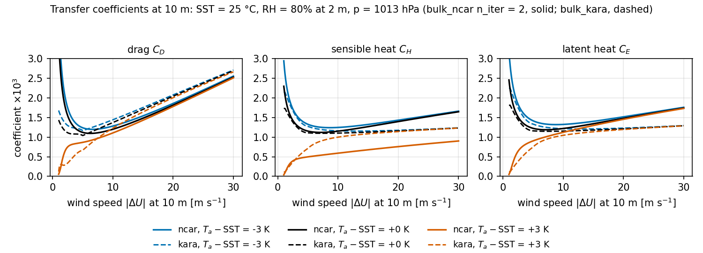
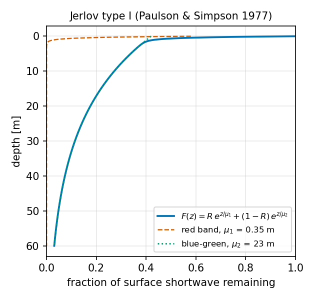
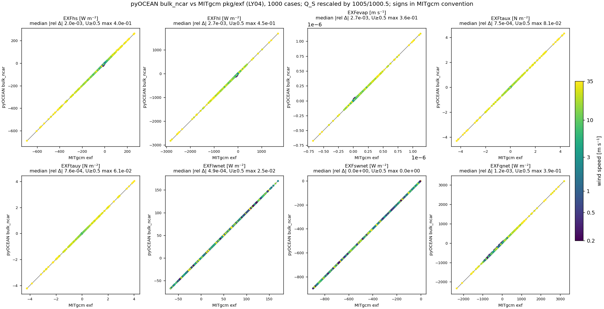

# Air–sea fluxes

pyOCEAN turns a near-surface atmospheric state (10 m wind, 2 m temperature and humidity, sea-level
pressure, downwelling radiation, precipitation) plus the model sea-surface temperature, salinity and
current into the surface fluxes of momentum, heat and fresh water. Two bulk algorithms are implemented in
`forcing/bulk.py`: **`bulk_ncar`**, the NCAR/CORE formulae of Large & Yeager (2004, 2009) as used by
MITgcm `pkg/exf` and HYCOM `flxflg = 5`, and **`bulk_kara`**, the polynomial fits of Kara et al. (2005)
to COARE 3.0, identical to HYCOM `flxflg = 6` / `wndflg = 4` (the setting of the HYCOM-IOA operational
system). `forcing/surface.py` converts fluxes into tendencies of the top model layer.

!!! warning "Which model line uses which flux today"
    The flux *computation* is complete, but only the **wind stress** is consumed by the production model
    lines. Read [Which model line consumes each flux](#which-model-line-consumes-each-flux) before planning
    a run with heat or freshwater forcing.

## Physics

### Sign convention

All fluxes are positive **downward, into the ocean** (`forcing/canonical.py:16`,
`forcing/bulk.py:21`): $Q > 0$ warms the ocean, $\tau_x > 0$ accelerates it eastward. Evaporation $E$ is
positive when water leaves the ocean, and the freshwater flux handed to the model is $E - P$ [m s⁻¹]
(positive = net evaporation = salinity increase).

### Turbulent fluxes (both schemes)

With the wind relative to the surface current $\Delta\mathbf U = \mathbf U_{10} - \mathbf u_o$
(LY04 eq. 4):

$$
\boldsymbol\tau = \rho_a C_D \lvert\Delta\mathbf U\rvert\,\Delta\mathbf U ,\qquad
Q_S = \rho_a c_{pa} C_H \lvert\Delta\mathbf U\rvert(\theta_a - T_s),\qquad
F_E = \rho_a C_E \lvert\Delta\mathbf U\rvert (q_a - q_s),\qquad
Q_L = L_v F_E ,
$$

with $\tau$ [N m⁻²], $Q_S, Q_L$ [W m⁻²], $F_E$ [kg m⁻² s⁻¹] (positive = condensation) and
$E = -F_E/\rho_{fw}$ [m s⁻¹]. The two schemes differ in the transfer coefficients $C_D$, $C_H$
(Stanton), $C_E$ (Dalton), in the saturation humidity $q_s$ and in the air density $\rho_a$.

### Radiation

`radiative_fluxes` (`forcing/bulk.py:688`):

$$
Q_{SW} = (1-\alpha)\,SW_\downarrow ,\qquad Q_{LW} = \varepsilon\left(LW_\downarrow - \sigma_{SB}\,T_s^4\right),
$$

with $T_s$ in K ($T_s$[°C] + 273.15), default albedo $\alpha = 0.066$ (LY04) and emissivity
$\varepsilon = 0.97$ (MITgcm `ocean_emissivity`). The emissivity multiplies both terms: the ocean absorbs
$\varepsilon LW_\downarrow$ and reflects $(1-\varepsilon)LW_\downarrow$ (Kirchhoff), as MITgcm
`exf_radiation.F`; CROCO and HYCOM (`lwflag = -1`, $\varepsilon = 1$) do not reflect
(`docs/design/era5_bulk_comparison.md` §1). A latitude-dependent albedo is available,

$$
\alpha(\varphi) = 0.069 - 0.011\cos 2\varphi \qquad (\text{LY09; HYCOM } \texttt{albflg}=2),
$$

`albedo_large_yeager` (`forcing/bulk.py:675`), 5.8 % at the equator and 8 % at the poles.

The net heat flux is assembled by `compute_surface_fluxes` (`forcing/bulk.py:734`):

$$
Q_{net} = Q_{SW} + Q_{LW} + Q_S + Q_L,\qquad (E-P) = E - P_{rate}.
$$

## The NCAR/CORE scheme, `bulk_ncar`

`bulk_ncar` (`forcing/bulk.py:236`) follows LY04 §2.1, eqs. 4–10.

**Thermodynamics.**

- Air density from the ideal gas law with virtual temperature (Wallace & Hobbs 2006, eq. 3.16), unless
    `rho_air` is given (`air_density`, `forcing/bulk.py:107`):
    $\rho_a = p / [R_d\,\theta\,(1 + 0.608\,q)]$, with $p$ = `msl`. MITgcm uses a constant 1.2 kg m⁻³ and
    LY04 1.22 kg m⁻³; pass `rho_air=1.2` or `1.22` to reproduce them.
- Saturation humidity over fresh water (LY04 eq. 5; `qsat_ly04`, `forcing/bulk.py:83`), reduced by 0.98
    over sea water (Kraus 1972):
    $q_s = 0.98 \cdot (640380\ \mathrm{kg\,m^{-3}}/\rho_a)\,\exp(-5107.4\ \mathrm K / T_s)$.
- Potential temperature of the air $\theta = T_a + \Gamma z_t$, $\Gamma$ = `gamma` = 0.0098 K m⁻¹.

**Neutral coefficients** at the neutral 10 m wind $U_{10N}$ (LY04 eq. 6; `cd_neutral_ly04`,
`forcing/bulk.py:167`):

$$
C_{DN} = 10^{-3}\left(\frac{2.7}{U_{10N}} + 0.142 + \frac{U_{10N}}{13.09}\right),\qquad
C_{EN} = 34.6\times10^{-3}\sqrt{C_{DN}},\qquad
C_{HN} = \begin{cases}18.0\times10^{-3}\sqrt{C_{DN}} & \zeta>0\\ 32.7\times10^{-3}\sqrt{C_{DN}} & \zeta\le 0\end{cases}
$$

With `high_wind=True` the LY09 form levels off in tropical-cyclone winds (LY09 eq. 11):
$C_{DN} = 10^{-3}(2.7/U + 0.142 + U/13.09 - 3.14807\times10^{-10}U^6)$ for $U < 33$ m s⁻¹ and
$C_{DN} = 2.34\times10^{-3}$ above.

**Stability iteration** (`forcing/bulk.py:374-407`). Wind speed $U = \max(\lvert\Delta\mathbf U\rvert,
u_{min})$, $u_{min}$ = 0.5 m s⁻¹. First guess: neutral coefficients at $U_{10N} = U$ (the Stanton branch
chosen by the sign of $\Delta\theta$), scales $u_* = \sqrt{C_D}\,U$, $\theta_* = (C_H/\sqrt{C_D})\Delta\theta$,
$q_* = (C_E/\sqrt{C_D})\Delta q$ (eq. 7). Then, `n_iter` times:

1. Stability parameter at the wind height (eq. 8a), clipped to $\lvert\zeta\rvert \le 10$ as in MITgcm,
    CESM and HYCOM:
    $\zeta_u = \dfrac{\kappa g z_u}{u_*^2}\left[\dfrac{\theta_*}{\theta_v} + \dfrac{q_*}{q + 1/0.608}\right]$,
    $\theta_v = \theta(z_u)(1 + 0.608\,q(z_u))$, and $\zeta_t = \zeta_u z_t/z_u$.
    $\theta_v$ and $q$ are taken **at $z_u$** from the previous pass, so 2 m and profile-consistent 10 m
    inputs give identical fluxes (a deliberate difference from MITgcm; `forcing/bulk.py:37`).
2. Integrated stability functions (eq. 8b, 8c; Paulson 1970; `psi_m_ly04`, `psi_h_ly04`,
    `forcing/bulk.py:130,150`): for $\zeta\ge0$, $\psi_m = \psi_h = -5\zeta$; for $\zeta<0$, with
    $X = (1-16\zeta)^{1/4}$,
    $\psi_m = 2\ln\frac{1+X}{2} + \ln\frac{1+X^2}{2} - 2\arctan X + \frac{\pi}{2}$,
    $\psi_h = 2\ln\frac{1+X^2}{2}$.
3. Neutral wind (eq. 9a): $U_{10N} = \max\{U\,[1 + \frac{\sqrt{C_{DN}}}{\kappa}(\ln\frac{z_u}{10} - \psi_m)]^{-1},\,u_{min}\}$.
4. Shift $\theta$ and $q$ from $z_t$ to $z_u$ (eq. 9b, 9c):
    $\theta(z_u) = \theta(z_t) - \frac{\theta_*}{\kappa}[\ln\frac{z_t}{z_u} + \psi_h(\zeta_u) - \psi_h(\zeta_t)]$, same for $q$.
5. Neutral coefficients at the new $U_{10N}$, then shifted to $z_u$ and stability (eq. 10a–c):
    $C_D = C_{DN}\,[1 + \frac{\sqrt{C_{DN}}}{\kappa}(\ln\frac{z_u}{10} - \psi_m)]^{-2}$,
    $C_H = C_{HN}\sqrt{C_D/C_{DN}}\,[1 + \frac{C_{HN}}{\kappa\sqrt{C_{DN}}}(\ln\frac{z_u}{10} - \psi_h)]^{-1}$,
    $C_E$ likewise with $C_{EN}$.
6. Update $u_*, \theta_*, q_*$ (eq. 7).

Fluxes then use LY04 eq. 4 with $c_{pa}$ = 1000.5 J kg⁻¹ K⁻¹ and $L_v$ = 2.5×10⁶ J kg⁻¹.

!!! note "Why `n_iter = 2` is kept on purpose"
    Two iterations are part of the operational definition of the scheme (LY04; CORE/OMIP; CESM
    `shr_flux_atmOcn`; MITgcm `niter_bulk = 2`). A convergence tolerance was evaluated and rejected
    (`docs/design/era5_bulk_comparison.md` §7). In a sweep of 297 cases (U 0.5–20 m s⁻¹, ΔT −8…+6 K,
    RH 0.6–0.95, SST 27 °C) against 200 iterations, two iterations leave a maximum latent-heat error of
    47 W m⁻² and a 95th-percentile total error of 4.4 W m⁻². But:

    1. **18 of the 297 cases (6 %) have no fixed point.** In warm but dry air ($\Delta\theta > 0$,
        $\Delta\theta_v \approx 0$) the Stanton number jumps between 18.0 and 32.7 ×10⁻³ $\sqrt{C_{DN}}$
        at $\zeta = 0$ (eq. 6c) and the iteration alternates between the two branches at any wind speed:
        $Q_S$ = 21 or 37 W m⁻² at U = 20 m s⁻¹, ΔT = +1 K, RH 0.8, depending on the parity of `n_iter`.
        A tolerance is never met there; the result would be decided by the iteration cap.
    2. **In weak wind and strongly stable air the fixed point sits on the $\lvert\zeta\rvert = 10$ clip**,
        because the linear stable functions $\psi = -5\zeta$ shut turbulence down too fast (Cheng &
        Brutsaert 2005; Yagüe et al. 2006). Converging does not make the flux more realistic.
    3. Changing the iteration count breaks the equivalence with MITgcm that was validated.

    The planned fix for weak-wind/stable regimes is a COARE 3.0 scheme (`bulk_coare30`, not yet
    implemented), with levelling-off stable functions and no Stanton jump.

## The Kara et al. (2005) scheme, `bulk_kara` (HYCOM `flxflg = 6`)

`bulk_kara` (`forcing/bulk.py:560`) reproduces HYCOM `thermf.F90` (`flxflg = 6`) and `mod_momtum.F90`
(`cd_coarep`) to round-off. It has **no stability iteration**: the coefficients are closed-form
polynomials in a virtual air–sea temperature difference and in the wind speed. Temperature and humidity are
used at their measurement height (2 m) without any height adjustment, as HYCOM does, and there is **no
minimum wind** in the fluxes (calm air gives zero turbulent fluxes).

**Inputs and HYCOM constants** (`forcing/bulk.py:471-475`): $T_a$ is converted to °C with 273.15 (as the
HYCOM-IOA forcing preprocessing), while HYCOM uses $T_0$ = 273.16 internally; $R$ = 287.1 J kg⁻¹ K⁻¹,
$c_{pa}$ = 1005.7 J kg⁻¹ K⁻¹, $L_v$ = 2.47×10⁶ J kg⁻¹, $\rho_{ref}$ = 1000 kg m⁻³. Sea-level pressure
(`p`, HYCOM `mslprf = 1`) and sea-surface salinity (`sss`) are **required**.

$$
\begin{aligned}
r &= q/(1-q) &&\text{mixing ratio (HYCOM vapmix)}\\
\rho_a &= p / [R\,(T_a + 273.16)(1 + 0.608\,r)]\\
\tau_v &= (T_a - T_s) - 0.608\,(T_a + 273.16)\,[r_{sat}(T_a, p) - r], &&\tau_v \in [-8, 7]\ ^\circ\mathrm C\\
C_L &= \mathrm{fit}(\tau_v, V_a),\ V_a \in [1.2, 34]; \quad C_S = 0.9554\,C_L; \quad C_D = \mathrm{fit}(\tau_v, V_a),\ V_a\in[1, 34]\\
f_S &= 1 - (0.001/1.805)\max(S - 0.03,\,0) &&\text{(Sud \& Walker 1997)}\\
Q_L &= -L_v\,\rho_a C_L\,\lvert\Delta\mathbf U\rvert\,[r_{sat}(T_s, p, f_S) - r]\\
Q_S &= -c_{pa}\,\rho_a C_S\,\lvert\Delta\mathbf U\rvert\,(T_s - T_a)\\
E &= -Q_L/(L_v\,\rho_{ref})
\end{aligned}
$$

The saturation mixing ratio is $r_{sat} = 0.622\,f e_s/(p - f e_s)$ (HYCOM `qsatur6`;
`_hycom_qsat_mixing`, `forcing/bulk.py:554`) with the Lowe (1977) polynomial
$e_s = 100\sum_{k=0}^{6} a_k T^k$ [Pa], $T$ in °C (`_hycom_satvpr`, `forcing/bulk.py:543`).

**The fits** (`_kara_poly`, `_kara_blend`, `_kara_coefficient`, `forcing/bulk.py:478-540`). Each
coefficient is evaluated separately for low wind ($V_a \le 5$ m s⁻¹, tables `*0`) and high wind
(tables `*5`), each with a stable (`s`), unstable (`u`) and neutral (`n`) fit:

$$
C = \sum_{i=0}^{2}\Big(\sum_j c_{ij}\,x_i^j\Big)\,\tau_v^{\,i},
\qquad x_0 = V_a,\quad x_{1,2} = \begin{cases}V_a & C_L\ \text{low wind}\\ 1/V_a & \text{otherwise}\end{cases}
$$

($C_L$: 3×3 coefficients, dimensionless; $10^3 C_D$: 3×4 coefficients; neutral fits are polynomials in
$V_a$ alone). The regimes are blended across $\tau_v$:

| $\tau_v$ [°C] | value used |
|---|---|
| $\ge 0.75$ | stable fit |
| $\le -0.75$ | unstable fit |
| $[-0.098, 0.75)$ | $(1-w)\,C_s(0.75) + w\,C_n$ |
| $(-0.75, -0.098)$ | $(1-w)\,C_u(-0.75) + w\,C_n$ |

with weights $w = ((\tau_v - 0.75)/0.848)^2$ or $((\tau_v + 0.75)/0.652)^2$ for $C_L$, and
$w = 1 - (\tau_v + 0.098)/0.848$ or $1 - (-\tau_v - 0.098)/0.652$ for $C_D$; both are continuous at
$\pm 0.75$. The full coefficient tables are in `forcing/bulk.py:435-468` (`_CL`, `_CD`).

The returned `TurbulentFluxes` holds $C_L$ in `ce` and $C_S$ in `ch`; `u10n` and `zeta` are `None`.
For the relative wind HYCOM (`amoflg`, `ocnscl = 1`) averages the top `thkcdw` = 3 m plus the barotropic
velocity; in pyOCEAN pass whatever surface current you want as `u_ocean`, `v_ocean`.

*Transfer coefficients of the two schemes from the real functions (`docs/manual/figures/make_fluxes.py`):
SST 25 °C, RH 80 % at 2 m. Look at the stable case (orange): `bulk_ncar` (solid) keeps $C_H$ on the
18.0×10⁻³ Stanton branch and is far below `bulk_kara` (dashed); in near-neutral and unstable air the two
agree within ~20 % for C_D, while `bulk_ncar` gives larger C_H and C_E above ~10 m s⁻¹. Kara drops to zero
in calm air (no minimum wind), NCAR rises (U floored at 0.5 m s⁻¹, $2.7/U_{10N}$ term).*

## Applying the fluxes: `forcing/surface.py`

`surface_tendency(state, v_grid, *, tau_x, tau_y, Q_net, Q_sw, E_P)` (`forcing/surface.py:188`) returns a
`ModelState` tendency for the phase-1 z-level model. All inputs are 2-D T-point arrays (ny, nx); missing
ones are zero.

- **Wind stress** → top layer only. τ is averaged from T-points to the interior u/v faces (`_t_to_u`,
    `_t_to_v`; the domain-edge faces stay zero), then
    $\partial_t u\rvert_{k=0} = \tau_x / (\rho_0\,\Delta z_0)$, $\rho_0$ = 1025 kg m⁻³.
- **Heat** → the non-penetrating part $Q_{net} - Q_{SW}$ heats the top layer,
    $\partial_t T\rvert_0 = (Q_{net} - Q_{SW})/(\rho_0 c_p \Delta z_0)$, $c_p$ = 3996 J kg⁻¹ K⁻¹; the
    shortwave is spread with the Jerlov type I double exponential (Paulson & Simpson 1977, Table 2;
    `_sw_profile`, `forcing/surface.py:129`):

    $$
    F(z) = R\,e^{z/\mu_1} + (1-R)\,e^{z/\mu_2},\qquad R = 0.58,\ \mu_1 = 0.35\ \mathrm m,\ \mu_2 = 23\ \mathrm m,
    $$

    $\partial_t T\rvert_k = Q_{SW}\,[F(z_{f,k}) - F(z_{f,k+1})]/(\rho_0 c_p \Delta z_k)$.
    If `Q_sw` is None, all of $Q_{net}$ goes into the top layer.
- **Fresh water** → virtual salt flux on the top layer,
    $\partial_t S\rvert_0 = S_0\,(E-P)/\Delta z_0$ (`forcing/surface.py:298`; positive $E-P$ raises S).
    There is no volume (real freshwater) flux into η.

`bulk_wind_stress(u10, v10, rho_a=1.225, Cd=1.3e-3)` (`forcing/surface.py:153`) is a constant-coefficient
stress $\tau = \rho_a C_D\lvert\mathbf U_{10}\rvert\mathbf U_{10}$ for idealised runs.

*Fraction of the surface shortwave left at depth z. The red band (58 %) is absorbed in the top metre; the
blue-green part still carries ~5 % of the surface flux at 60 m.*

## Prescribed heat flux in the σ/ALE model (N3)

`SigmaBaroclinic.step(st, tau_x, tau_y, fw=None, heat=None)` accepts `heat={"Q_ns": ..., "Q_sw": ...}` [W m⁻², positive
into the ocean, per cell] (`core/model/driver.py`, `physics/surface/shortwave.py`; constructor arguments `cp` = 3985
J kg⁻¹ K⁻¹ and `jerlov` = "I"). It is a prescribed flux, not a bulk formula, and it is applied in phase 7 after the
freshwater substep:

- The non-solar part $Q_{ns}$ (sensible, latent, net longwave) enters from the top. A layer thinner than the forcing
    depth $D_f$ = 1 mm takes the fraction $\min(1, h_k/D_f)$ of what is left and passes the rest down, as MOM6
    `applyBoundaryFluxesInOut` (`MOM_diabatic_aux.F90:1101-1118`, `MINIMUM_FORCING_DEPTH`); for a top layer thicker
    than 1 mm this is "all of $Q_{ns}$ in the top layer".
- The shortwave $Q_{sw}$ is distributed by the Paulson & Simpson (1977) two-band profile
    $F(z)=R\,e^{z/\mu_1}+(1-R)\,e^{z/\mu_2}$ (types I, IA, IB, II, III; coefficients as CROCO `lmd_swfrac.F:47-51`, formula
    `:76-88`; no $e^{-20}$ cutoff). Layer $k$ gets $Q_{sw}(F_{k+1}-F_k)$ with $F$ at the layer interfaces.
- The part reaching the bed, $Q_{sw}F(-D)$, is **spread over the column in proportion to the layer thickness**, as
    MOM6 `absorbRemainingSW` with `absorbAllSW` (`MOM_opacity.F90:813-816, 824-860`): weight $h_k$, reduced to
    $2h_k-2h_{min}$ for $h_{min}<h_k<2h_{min}$ and zero below. CROCO keeps it in the bottom layer
    (`step3d_t.F:567, 578-586`); that rule heated a 1 mm z\* bed layer to 206 °C in 4 h (final-review fix C1), so
    pyOCEAN uses MOM6's in every coordinate. In a σ column this differs from CROCO only by $Q_{sw}F(-D)$ (5 % of
    $Q_{sw}$ at 50 m in type I water). The old `surface_tendency` of the legacy z-level model instead lets that part
    leave the column.
- Layers thinner than $h_{min}$ = 1e-6 m (the floor of the vertical solvers, `DZ_FLOOR`; MOM6 uses 2 Å) get no heat;
    their shortwave joins the bed remainder.
- Land and dry columns are ignored. The heat content changes by exactly
    $\sum Q A\,\Delta t/(\rho_0 c_p)$ (relative error < 1e-13), and the variance budget of T gains a surface term, so
    it still closes to 5e-10.
- `driver.last_bflux` and `ctx.bflux` (`Q_ns`, `Q_sw`, `sw_frac_iface`) feed the KPP closure's buoyancy flux
    ([Turbulence closures](turbulence-friction.md#gls-in-ale-and-kpp-as-model-closures-n3)). Without `heat` the step is
    bit for bit as before.

## Which model line consumes each flux

| Flux | Computed by | Consumed by | Notes |
|---|---|---|---|
| Wind stress $\tau_x, \tau_y$ | `compute_surface_fluxes`, `bulk_ncar`, `bulk_kara`, `bulk_wind_stress` | **`SigmaBaroclinic.step(st, tau_x, tau_y)`** (`core/dynamics/sigma_baroclinic.py:2084`): stress at the **u- and v-faces**, shapes (ny, nx+1), (ny+1, nx), N m⁻²; τ/ρ₀ enters as the top boundary flux of the implicit vertical viscosity (as ROMS/CROCO `sustr/svstr`), not through AB3. `SigmaWetDry.step(..., tau_u, tau_v)` (`core/dynamics/sigma_wd.py:258`) takes the kinematic stress τ/ρ₀ [m² s⁻²]. Phase-1 line: `surface_tendency`. | The bulk functions return τ at **T-points**: average to faces yourself (example in the [Surface forcing guide](../user-guide/surface-forcing.md)). Validated: Ekman transport τ/ρ₀f to 0.05 % (`core/dynamics/sigma_baroclinic.py:37`). |
| Net heat $Q_{net}$, penetrating $Q_{SW}$ | `compute_surface_fluxes` | Only `surface_tendency` (phase-1 `ModelState` line). **Not used by `SigmaBaroclinic`, `SigmaWetDry` or the 2-D tidal models.** | `SigmaBaroclinic` carries one tracer T with a linear EOS $\rho = \rho_0 - \alpha(T - T_0)$ (`core/dynamics/sigma_baroclinic.py:1285`) and has no surface tracer flux argument. |
| Fresh water $E - P$ | `compute_surface_fluxes` | Only `surface_tendency` (virtual salt flux). | No salinity in `SigmaBaroclinic`; no volume flux in any free surface. |
| Sea-level pressure `msl` | adapters | Used only inside the bulk formulae ($\rho_a$, $q_s$). | No inverse-barometer / atmospheric pressure gradient in any model line. |

Note that no driver in the repository calls `surface_tendency`; it is meant to be added inside the
`tendency_fn` of `ab2_step` / `ab2_step_implicit_fs` (`core/timestepping/ab2.py`). The BayIW runs force
`SigmaBaroclinic` with MITgcm's wind stress only (`validation/bayiw_cut/cut.py`).

## Options and defaults

| Function / option | Values | Default | Meaning | Where |
|---|---|---|---|---|
| `compute_surface_fluxes(atm, sst, u_sfc, v_sfc, scheme=…)` | `'ncar'`, `'kara'` | `'ncar'` | bulk algorithm | `forcing/bulk.py:734` |
| `albedo` | float or array | 0.066 | shortwave albedo (LY04); `albedo_large_yeager(lat)` for LY09/HYCOM `albflg=2` | `forcing/bulk.py:741` |
| `emissivity` | float | 0.97 | longwave emissivity | `forcing/bulk.py:742` |
| `**scheme_kwargs` | | | passed to the bulk function (e.g. `n_iter`, `high_wind`, `sss`) | |
| `bulk_ncar(..., p=None, rho_air=None)` | | ρ_a from p | air density; one of the two is required | `forcing/bulk.py:236` |
| `u_ocean`, `v_ocean` | array or float | 0 | surface current for relative wind | both schemes |
| `z_u`, `z_t` | m | 10, 2 | heights of wind and of T/q | `bulk_ncar` |
| `n_iter` | int | 2 | stability iterations (keep 2) | `bulk_ncar` |
| `gamma` | K m⁻¹ | 0.0098 | lapse rate T → θ | `bulk_ncar` |
| `u_min` | m s⁻¹ | 0.5 | minimum wind speed (LY04) | `bulk_ncar` |
| `high_wind` | bool | False | LY09 drag cap above 33 m s⁻¹ | `bulk_ncar` |
| `bulk_kara(..., p, sss)` | | required | MSLP [Pa] and SSS [psu] | `forcing/bulk.py:560` |

**Constants of `bulk_ncar`** (`forcing/bulk.py:65-76`): κ = 0.4, g = 9.81 m s⁻², $c_{pa}$ = 1000.5 J kg⁻¹ K⁻¹,
$L_v$ = 2.5×10⁶ J kg⁻¹, $\rho_{fw}$ = 1000 kg m⁻³, $R_d$ = 287.04 J kg⁻¹ K⁻¹,
$\sigma_{SB}$ = 5.670374419×10⁻⁸ W m⁻² K⁻⁴ (CODATA 2018), $T_0$ = 273.15 K, Γ = 0.0098 K m⁻¹,
$z_{ref}$ = 10 m, $\lvert\zeta\rvert_{max}$ = 10.
**Constants of `surface_tendency`**: $\rho_0$ = 1025 kg m⁻³, $c_p$ = 3996 J kg⁻¹ K⁻¹.

**Output** `TurbulentFluxes` (`forcing/bulk.py:203`): `tau_x`, `tau_y` [N m⁻²], `q_sens`, `q_lat` [W m⁻²],
`evap` [m s⁻¹], `cd`, `ch`, `ce` [–], `rho_air` [kg m⁻³], `ustar` [m s⁻¹], `u10n`, `zeta` (NCAR only).
`compute_surface_fluxes` returns a dict with `tau_x`, `tau_y`, `Q_net`, `Q_sw`, `E_P`, matching the
keyword arguments of `surface_tendency`.

## Validation

- **`bulk_kara` vs compiled HYCOM.** `validation/hycom_kara/make_reference.sh` extracts `cd_coarep`
    (`mod_momtum.F90`) and the `flxflg = 6` block of `thermf.F90` verbatim from the HYCOM source, compiles
    them and writes `tests/data/hycom_kara6_reference.csv`. `tests/test_bulk_kara.py` matches $C_D$, $C_L$,
    $C_S$ and $\rho_a$ to a relative 1e-10 and the fluxes (latent, sensible, τ, E) to 1e-9, over 616 cases
    (`docs/design/validation_suite.md` §4).
- **`bulk_ncar` vs MITgcm `pkg/exf`.** `validation/mitgcm_exf/` runs MITgcm with
    `ALLOW_BULK_LARGEYEAGER04` (and LY09) on 1000 cases and compares point by point: median relative
    difference 0.2–0.3 % for U ≥ 0.5 m s⁻¹; every larger difference has a documented cause ($c_{pa}$ 1005 vs
    1000.5; MITgcm uses the unclipped speed below 0.5 m s⁻¹; two iterations do not converge in weak stable
    wind) (`docs/design/validation_suite.md` §4). Reproduce with `./build_and_run.sh all && python compare.py all`.

*`bulk_ncar` against MITgcm `exf` for 1000 cases, coloured by wind speed (copy of
`validation/mitgcm_exf/compare.png`); all points sit on the 1:1 line, and the panel titles give the median
relative difference (≤ 0.3 %).*

See also [Forcing and column checks](../validation/components.md).

## Known limitations

- **The bulk formulae are not coupled to the σ/ALE model.** `SigmaBaroclinic` takes a *prescribed* freshwater flux
    (N2a) and, since N3, a prescribed heat flux (below); computing them from ERA5/WRF with `bulk_ncar`/`bulk_kara` is
    the N2b work.
- No COARE 3.0 scheme yet: `bulk_ncar` is unreliable in weak wind with strongly stable air and has no fixed
    point for warm dry air (see the note above).
- No gustiness, no wave-dependent roughness, no stress cap (MITgcm caps at ±2 N m⁻²; HYCOM caps $C_D$ at
    34 m s⁻¹, which `bulk_kara` reproduces through the $V_a$ clip).
- `surface_tendency` uses full cell thicknesses (no partial cells) and the shortwave that reaches the
    bottom interface, $Q_{SW} F(z_{bottom})$, leaves the column (it is not deposited in the last layer).
    Its edge faces receive no wind stress (walls).
- No inverse-barometer or atmospheric pressure gradient; no river input; no E−P balancing (HYCOM `empbal`).
- `_kara_*` uses 273.15 to convert the input temperature and 273.16 inside the formulae on purpose, to
    match HYCOM-IOA's preprocessing + HYCOM.

## References

- Cheng, Y. & Brutsaert, W. (2005). Flux-profile relationships for wind speed and temperature in the stable
    atmospheric boundary layer. *Boundary-Layer Meteorol.* 114, 519–538. doi:10.1007/s10546-004-1425-4 **[verify]**
- Fairall, C.W., Bradley, E.F., Hare, J.E., Grachev, A.A. & Edson, J.B. (2003). Bulk parameterization of
    air–sea fluxes: updates and verification for the COARE algorithm. *J. Climate* 16, 571–591.
    doi:10.1175/1520-0442(2003)016<0571:BPOASF>2.0.CO;2 **[verify]**
- Kara, A.B., Hurlburt, H.E. & Wallcraft, A.J. (2005). Stability-dependent exchange coefficients for
    air–sea fluxes. *J. Atmos. Oceanic Technol.* 22, 1080–1094. doi:10.1175/JTECH1747.1 **[verify]**
- Large, W.G. & Yeager, S.G. (2004). Diurnal to decadal global forcing for ocean and sea-ice models: the
    data sets and flux climatologies. NCAR Tech. Note NCAR/TN-460+STR. doi:10.5065/D6KK98Q6 **[verify]**
- Large, W.G. & Yeager, S.G. (2009). The global climatology of an interannually varying air–sea flux data
    set. *Clim. Dyn.* 33, 341–364. doi:10.1007/s00382-008-0441-3 **[verify]**
- Lowe, P.R. (1977). An approximating polynomial for the computation of saturation vapor pressure.
    *J. Appl. Meteor.* 16, 100–103. **[verify]**
- Paulson, C.A. (1970). The mathematical representation of wind speed and temperature profiles in the
    unstable atmospheric surface layer. *J. Appl. Meteor.* 9, 857–861. **[verify]**
- Paulson, C.A. & Simpson, J.J. (1977). Irradiance measurements in the upper ocean. *J. Phys. Oceanogr.*
    7, 952–956. doi:10.1175/1520-0485(1977)007<0952:IMITUO>2.0.CO;2 **[verify]**
- Sud, Y.C. & Walker, G.K. (1997), as cited in HYCOM `thermf.F90` (salinity factor of the vapour pressure). **[verify]**
- Wallace, J.M. & Hobbs, P.V. (2006). *Atmospheric Science*, 2nd ed., Academic Press, §3.1.
- Yagüe, C., Viana, S., Maqueda, G. & Redondo, J.M. (2006). Influence of stability on the flux-profile
    relationships for wind speed, φm, and temperature, φh, for the stable atmospheric boundary layer.
    *Nonlin. Processes Geophys.* 13, 185–203. **[verify]**
