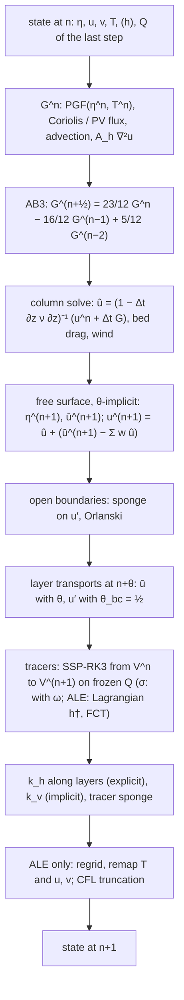
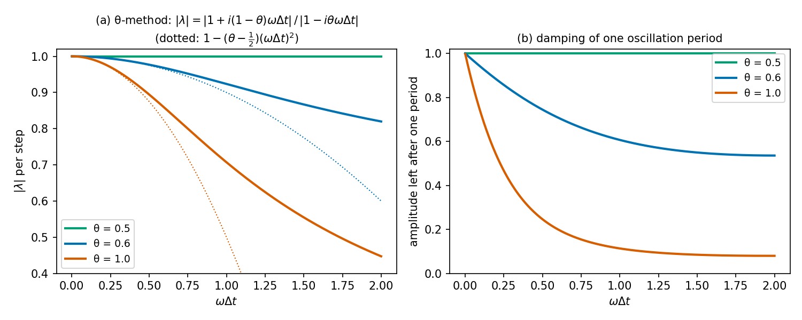
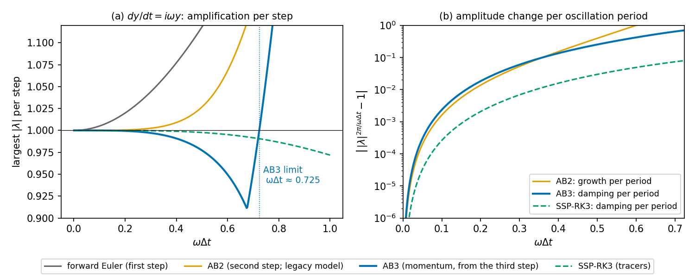

# Free surface and time stepping

pyOCEAN advances the fast external (barotropic) mode implicitly and everything else explicitly. One step of the
stratified model `SigmaBaroclinic` combines four schemes: Adams–Bashforth 3 for the explicit momentum tendencies,
a backward-Euler column solve for the vertical viscosity, a θ-implicit free surface with wetting and drying for
the depth mean, and SSP-RK3 for the tracers on frozen layer transports. This page gives each scheme, how the depth
mean and the layers are coupled (including the time weight `theta_bc` of the baroclinic transport), the stability
limits, and the time steps used in the benchmarks. The full call graph of a step is on
[The time step, flow diagrams](../architecture/time-step.md); here we stay at the level of time levels.

## Time levels of one step

The baroclinic PGF uses $\eta^n$ and $T^n$; the momentum advection of the flux form and the PV flux of the
vector-invariant form use the layer transports $Q$ of the previous step (centred at $n - \tfrac12$), as MOM6 uses
the `uh` of its last continuity call.

## Implicit free surface with wetting and drying

The baroclinic models (`SigmaWetDry`, `SigmaBaroclinic`) and the 2-D wet–dry tidal runs use
`WetDryFreeSurface` (`core/dynamics/wetting_drying.py:51`): the θ-method of Casulli (1990) with the **total**
water depth at the faces. For each face $f$ (length $L_f$, centre-to-centre distance $\delta_f$) and cell $i$
(area $A_i$):

$$
\eta_i^{n+1} = \eta_i^n - \frac{\Delta t}{A_i}\sum_f s_f\,L_f\,D_f\big[\theta\,\bar u_f^{n+1} + (1-\theta)\,\bar u_f^n\big],
$$

$$
\bar u_f^{n+1} = \bar u^*_f - g\,\theta\,\Delta t\,\frac{\eta_R^{n+1} - \eta_L^{n+1}}{\delta_f},
\qquad
\bar u^*_f = \hat{\bar u}_f - g\,(1-\theta)\,\Delta t\,\frac{\eta_R^n - \eta_L^n}{\delta_f},
$$

$$
D_f = \max\big(0,\ H_f + \eta_{up}\big),\qquad H_f = \min(H_L, H_R),
$$

with $\eta_{up}$ the surface of the upwind cell for $\bar u^n_f$ (the higher one when $\bar u^n_f = 0$;
`_face_depth`, `:158`) and $s_f = \pm 1$ the outward sign. A face with $D_f \le d_{min}$ (`d_min`, default 0.05 m) is
dry: $\bar u_f = 0$ and no flux. Here $\hat{\bar u}$ is the depth mean of the velocities after the explicit
tendencies and the column solve. Substituting $\bar u^{n+1}$ gives the symmetric positive-definite system

$$
A_i\,\eta_i^{n+1} + \sum_f c_f\big(\eta_i^{n+1} - \eta_{nb}^{n+1}\big)
= A_i\,\eta_i^n - \Delta t\sum_f s_f L_f D_f\big[\theta\,\bar u^*_f + (1-\theta)\,\bar u^n_f\big],
\qquad
c_f = \frac{g\,\theta^2\,\Delta t^2\,L_f\,D_f}{\delta_f}
$$

(`step`, `:227`; matrix `_matrix`, `:182`; coefficients `:269-271`). Dry cells reduce to
$A_i\eta_i = A_i\eta_i^n$, so the matrix stays SPD. The flux form conserves volume exactly; the upwind total depth
makes the scheme mass-positive (Casulli & Cheng 1992; Casulli 2009); a dry cell keeps $\eta = -H$, so a lake at
rest next to emerged land stays at rest. A positivity guard sets $\eta = -H$ where $H + \eta < 0$ and reports the
clipped volume in `last_clip_volume` (it should stay 0). Wetting and drying: [Wetting and drying](wetting-drying.md).

**Flather rows** (domain-edge faces in `flather_u`, `flather_v`; Flather 1976). The outward transport through an
open face next to cell $c$ is

$$
Q_{out} = L\,D\,\bar u_{ext,out} + L\sqrt{gD}\,\big(\eta_c - \eta_{ext}\big),\qquad D = H_c + \eta_c^n ,
$$

θ-weighted between $n$ and $n+1$: $\Delta t\,\theta\,L\sqrt{gD}$ goes on the diagonal of cell $c$ (SPD kept) and
the known part on the right-hand side (`:252-267`). The model stores the θ-weighted open-face flux
(`last_open_Qu/Qv`) so that the layer transports at open faces add up to it exactly. Details:
[Open boundaries and nesting](open-boundaries.md).

### Solvers

| `solver` | Method | Default for | Notes |
|---|---|---|---|
| `"direct"` | `scipy.sparse.linalg.spsolve` of the assembled matrix every step | σ mode (bit-identical history) | the matrix changes every step with $D_f$ |
| `"cg"` | conjugate gradients warm-started from $\eta^n$, `cg_rtol` = 1e-10, preconditioner `precond="lu"` | ALE mode | ≈ 1 s → ≈ 0.1 s per step on BayIW 560 × 352 (`SigmaBaroclinic` docstring, `:967-968`) |

**Lagged-LU preconditioner** (`:275-295`): the exact SuperLU factorisation of a *lagged* matrix (the one of the
step when it was last factorised) is still the inverse of an SPD matrix close to the current one. It is
refactorised when CG needs more than `refactor_iterations` (default 5). On the 96 273-cell northern Gulf of
California nest: 1–3 iterations and 7–19 ms per solve, against 97–117 iterations and ~50 ms with Jacobi
(factorisation 0.19 s; class docstring, `:84-87`). For bit-for-bit restarts the factorised matrix is saved and
restored (`preconditioner_state`, `:203`).

**Exact conservation with CG** (MITgcm `exactConserv`; `:322-336`): after the solve, $\eta^{n+1}$ is recomputed
from the divergence of the final θ-weighted transports and Flather fluxes,

$$
\eta_i^{n+1} = \eta_i^n - \frac{\Delta t}{A_i}\sum_f s_f\,L_f D_f\big[\theta\,\bar u^{n+1}_f + (1-\theta)\,\bar u^n_f\big],
$$

so the CG tolerance does not leak into the volume and tracer budgets. The positivity guard is applied to this
final $\eta$.

### `ImplicitFreeSurface`: linear free surface on fixed depth

The 2-D tidal model (`validation/pacmex_tides/run_tides.py`), the barotropic BayIW seiche and the legacy z model use
`ImplicitFreeSurface` (`core/dynamics/free_surface.py:109`), the MITgcm θ-method (Marshall et al. 1997 §2; Campin
et al. 2004; `implicSurfPress` = `implicDiv2DFlow` = θ) on the **rest** depth with partial cells:

$$
\mathbf u^{n+1} = \hat{\mathbf u} - g'\Delta t\big[\theta\nabla\eta^{n+1} + (1-\theta)\nabla\eta^n\big],\qquad
\eta^{n+1} = \eta^n - \Delta t\,\nabla\cdot\Big\{\textstyle\sum_k \Delta z_k h_{Fac}\big[\theta\,\mathbf u^{n+1} + (1-\theta)\,\mathbf u^n\big]\Big\},
$$

$$
A_c\,\eta_c^{n+1} + g'\theta^2\Delta t^2\sum_f c_f\big(\eta_c^{n+1} - \eta_{nb}^{n+1}\big)
= A_c\,\eta_c^n - \Delta t(1-\theta)\,\mathcal D(\mathbf u^n) - \Delta t\,\theta\,\mathcal D(\mathbf u^{**}),
\qquad c_f = \frac{H_f\,\Delta y_f}{\Delta x_f}
$$

(Dukowicz & Smith 1994, eq. 21, in finite-volume form; module docstring `:1-47`). Differences from the wet–dry
solver:

- **SAL**: `sal_beta` = β scales the surface-pressure gravity, $g' = g(1-\beta)$ (HYCOM `tidsal`; `:166`); the
    Flather rows keep $g$. See [Tides](tides.md).
- Default `theta = 1` (MITgcm default; damps gravity waves); θ = ½ is neutral.
- The matrix is assembled once and factorised once (`factorized`, `:260`), or solved with Jacobi-preconditioned CG
    (`solver="cg"`, `cg_rtol` = 1e-12). On BayIW 560 × 352: 0.14 s per step (`CLAUDE.md`, item 6).
- Closed faces have $H_f = 0$ (Neumann: seiche antinodes sit on walls); prescribed open faces (`open_u/open_v`)
    keep the normal velocity of $\hat{\mathbf u}$; Flather faces add $\Delta t\,\theta\,\Delta y\sqrt{gH}$ to the
    diagonal and set the depth mean from the Flather relation at $n+1$, keeping the baroclinic part of
    $\hat{\mathbf u}$ (`:353-360`).
- `eta_tendency` adds an explicit source to continuity, e.g. the nonlinear flux $-\nabla\cdot(\eta\mathbf u)$
    (`nonlinear_continuity`, `core/dynamics/nonlinear.py:60`).

Validation: the exact discrete seiche mode to 1e-9 and Merian's period; BayIW seiche period 3.83 h against
MITgcm 3.81–3.83 h (`CLAUDE.md`, items 6 and 6b; [Tides and sea level](../validation/tides-sealevel.md)).

## Coupling the depth mean and the layers

### Momentum (`SigmaWetDry.step`, `core/dynamics/sigma_wd.py:258`)

1. **Column solve** for every face column: $\hat u_k = (\text{vertical viscosity + bed drag})^{-1}(u^n_k + \Delta t\,G_k)$
    plus the wind as a top flux (`column_step`, `:187`; [Momentum](momentum.md#vertical-viscosity-implicit-one-tridiagonal-per-column)).
2. **Depth mean** with the layer weights $w_k$: $\Delta\sigma_k$ in σ, the face fractions of the mean face thickness
    in ALE (`face_fractions`, `core/vertical/ale.py:888`):
    $\bar u^n = \sum_k w_k u^n_k$, $\hat{\bar u} = \sum_k w_k\hat u_k$.
3. **Free surface** (above) → $\eta^{n+1}$, $\bar u^{n+1}$.
4. **Uniform barotropic correction**: $u^{n+1}_k = \hat u_k + (\bar u^{n+1} - \hat{\bar u})$ on wet faces, 0 on dry ones
    (`:295-296`).

The vertical shear comes from the explicit $G$ and the column solve; the barotropic pressure gradient only shifts
the column. Splitting the pressure correction from the implicit friction lags the friction by one step on the
pressure-driven increment (first order in $\Delta t$; module docstring `:23-27`). It keeps the free-surface system
identical to the 2-D one, so mass conservation and positivity are inherited. With large $\Delta t$ this lag has
not been measured (`validation/tidal_flat/README.md`, item 7).

### Layer transports: θ for the depth mean, `theta_bc` for the baroclinic part {#layer-transports}

The tracer and thickness equations need layer volume transports whose vertical sum is exactly the free-surface flux.
The transport velocity of layer $k$ is (σ: `SigmaBaroclinic.step`, `core/dynamics/sigma_baroclinic.py:2117-2122`;
ALE: `transport_velocity`, `core/vertical/ale.py:804`, oracle `:760`)

$$
u^\theta_k = \theta_{bc}\,u^{n+1}_k + (1-\theta_{bc})\,u^n_k + (\theta - \theta_{bc})\big(\bar u^{n+1} - \bar u^n\big),
$$

so that its depth mean is $\theta\bar u^{n+1} + (1-\theta)\bar u^n$, the velocity of the free-surface flux, while the
baroclinic part $u'_k = u_k - \bar u$ is weighted by $\theta_{bc}$. Then

$$
Q^x_k = L_u\,D_f\,\Delta\sigma_k\,u^\theta_k\quad(\sigma),\qquad
Q^x_k = \text{PPM or donor-cell layer flux of } u^\theta_k,\ \text{corrected so } \textstyle\sum_k Q^x_k = L_u D_f\sum_k w_k u^\theta_k\quad(\text{ALE}).
$$

$u^n = 0$ on faces that carried no flow in the free-surface step. The open-face transports follow the same rule
(`open_face_transport`, `core/vertical/ale.py:834`).

!!! note "Why `theta_bc` = ½ (history)"
    Until 2026-10-13 the baroclinic part took the free-surface θ = 0.6 too: $u^\theta_k = \theta u^{n+1}_k + (1-\theta)u^n_k$.
    The momentum tendency is AB3, centred at $n+\tfrac12$; an off-centred transport damps an oscillation of
    frequency ω at a rate of about $(\theta - \tfrac12)\,\omega^2\Delta t$ (figure below). In the Ilicak et al. (2012)
    internal wave (200 days, $\nu_h$ = 0.01) pyOCEAN kept 0.45 of the oscillation against 0.65–0.72 in MOM6, CROCO
    and MITgcm. A one-variant-at-a-time diagnosis (z*, kinetic energy of days 40–60 over days 0–5) gave: base 0.58;
    θ = ½ 0.90; θ = 1 0.37; $\Delta t$ 150 s 0.65 and 600 s 0.50; KE Godunov 0.35; flux-form momentum 0.52;
    tracer scheme, continuity upwind or UP3 no effect (0.58) — only θ and $\Delta t$ mattered. With `theta_bc` = ½,
    z* and σ keep 0.74 / 0.58 / 0.26 at $\nu_h$ = 0.01 / 15 / 150, within the other models' 0.65–0.72 / 0.55–0.65 /
    0.24–0.26 (`validation/ilicak_benchmark/README.md`, item 9). The hybrid kept θ until 2026-10-14 because its
    near-vanished layers blew up with ½ (Ilicak IW, day ~113); since the outflow limiter and the thin-layer
    coupling it uses ½ too: 0.50 / 0.63 / 0.27 (at $\nu_h$ = 0.01 still damped, open). Test:
    `test_internal_wave_is_not_damped_by_the_free_surface_theta` (`tests/test_sigma_ale.py:1218`).

The depth mean keeps θ (default 0.6): with $\theta = \tfrac12$ the free surface is neutral and external gravity
waves and wet–dry fronts are not damped.

*Amplification of the θ-method for $dy/dt = i\omega y$: $|\lambda| = |1 + i(1-\theta)\omega\Delta t|/|1 - i\theta\omega\Delta t|$.
θ = ½ is neutral; θ = 0.6 loses $\approx(\theta-\tfrac12)(\omega\Delta t)^2$ per step (dotted), which is why the
baroclinic transport uses ½ while the free surface keeps 0.6 to damp the fastest external waves.*

### Vertical flux in σ mode {#vertical-flux}

In σ mode the volume flux through each interface follows from continuity of each layer with the actual volumes
$V^n_k = D^n\Delta\sigma_k A$ and $V^{n+1}_k$ (`:2131-2135`):

$$
F^z_{k+\frac12} = F^z_{k-\frac12} - \Big[\frac{V^{n+1}_k - V^n_k}{\Delta t} + \nabla_h\cdot Q_k\Big],\qquad F^z_{-\frac12} = 0\ \text{(bed)},
$$

where $\nabla_h\cdot Q_k$ is the net horizontal outflow of the cell-layer [m³ s⁻¹]

and $\omega = F^z/A$. Because $\sum_k Q_k$ is the free-surface flux, $F^z$ vanishes at the surface (only round-off
remains and is set to 0), and a uniform tracer stays uniform. In ALE $F^z \equiv 0$ during the Lagrangian step
([Vertical coordinates and ALE](vertical-ale.md)).

## Momentum: Adams–Bashforth 3

`SigmaBaroclinic.step` (`core/dynamics/sigma_baroclinic.py:2084-2099`) keeps the last three explicit tendencies in
`SigmaState.g_hist` and extrapolates them to $n + \tfrac12$:

$$
G^{n+\frac12} = \tfrac{23}{12}G^n - \tfrac{16}{12}G^{n-1} + \tfrac{5}{12}G^{n-2}
$$

(`AB3`, `:102`; `ab3_combine`, `:870`, a fused Numba kernel with the NumPy arithmetic; Durran 2010 §2.4). Start-up:

| Step | Scheme |
|---|---|
| 1 | forward Euler, $G = G^0$ (`len(hist) == 1`) |
| 2 | AB2, $\tfrac32 G^1 - \tfrac12 G^0$ |
| ≥ 3 | AB3 |

The history is part of the restart file, so restarts are bit for bit. AB3 is the scheme of MITgcm's AB3 option
(Adcroft et al. 2004 [verify]); CROCO uses LF-AM3 (one of the candidates for the 1.3–1.5× extra lock-exchange mixing,
`validation/lock_exchange/README.md`).

*Largest root $|\lambda|$ for $dy/dt = i\omega y$. AB2 amplifies weakly for any $\omega\Delta t$ (the legacy model);
AB3 damps weakly and is stable up to $\omega\Delta t \approx 0.72$ (computed by the script); SSP-RK3 is shown for
reference. Right: amplitude change per oscillation period.*

## Tracers: SSP-RK3 or predictor–corrector on frozen transports {#tracer-time-stepping}

The tracers are advanced after the free surface with the transports $Q$ of the step frozen and the layer volumes
varying linearly from $V^n$ to $V^{n+1}$ (`_advect`, `:1951`; stage kernel `_rk_stage`, `:837`; Shu & Osher 1988):

$$
\begin{aligned}
q^{(1)} &= V^n c^n + \Delta t\,R(c^n), & c^{(1)} &= q^{(1)}/V^{n+1},\\
q^{(2)} &= \tfrac34 V^n c^n + \tfrac14\big[q^{(1)} + \Delta t\,R(c^{(1)})\big], & c^{(2)} &= q^{(2)}/\big(\tfrac12(V^n + V^{n+1})\big),\\
q^{(3)} &= \tfrac13 V^n c^n + \tfrac23\big[q^{(2)} + \Delta t\,R(c^{(2)})\big], & c^{n+1} &= q^{(3)}/V^{n+1},
\end{aligned}
$$

with $R(c) = -\nabla\cdot(Qc)$ (horizontal and, in σ, vertical). These stage volumes make a uniform tracer stay
uniform exactly. Where a volume is zero the step keeps the initial value ("safe" rule). `tracer_time="pc"`
(predictor–corrector, CROCO style) does a half step with centred 6th-order faces, then a full step from $n$ with the
upwind faces of the mid-step tracer (`_advect_numpy`, `:1936-1941`). In ALE with WENO5 the three stages are wrapped
by the Zalesak FCT (`tracer_limiter="fct"`). Schemes and limiter: [Tracers](tracers.md).

## Legacy AB2

The phase-1 z model uses `core/timestepping/ab2.py`:

- `ab2_step` (`:68`): $\mathbf s^{n+1} = \mathbf s^n + \Delta t\big(\tfrac32 F^n - \tfrac12 F^{n-1}\big)$, forward Euler on
    the first step (Durran 2010, eq. 2.132), on a whole `ModelState` (u, v, T, S, η) with explicit free surface.
- `ab2_step_implicit_fs` (`:157`): AB2 on all tendencies except the surface-pressure gradient, then
    `ImplicitFreeSurface.step` from $(\eta^n, u^n, \hat u)$ with $\hat u = u^n + \Delta t\,G^{n+\frac12}$; T and S are
    stepped with the same AB2 tendency. The tendency function must exclude $-g\nabla\eta$ (pressure with η = 0) and
    `dt` must equal the operator's.

AB2 is weakly unstable for pure oscillations (figure above), so the legacy model needs some dissipation.

## Stability and the choice of Δt

The barotropic gravity wave, the vertical viscosity and the vertical diffusion are implicit and impose no limit.
The explicit limits are:

| Process | Limit | Source |
|---|---|---|
| Horizontal advection (tracers, WENO5 + SSP-RK3) | $u\,\Delta t/\Delta x \lesssim 1$; target 0.5 | `check_domain`, `diagnostics/domain_check.py:22-28` |
| ALE Lagrangian step | no layer may lose more than it holds: enforced by `limit_outflow` (`core/vertical/ale.py:331`); a negative $h^\dagger$ after it raises "barotropic CFL" | `lagrangian_thickness`, `:278` |
| ALE layer velocities | donor Courant ½ (truncation backstop, counted, `max_truncations`) | [Momentum](momentum.md#cfl-velocity-truncation-backstop) |
| Oscillatory explicit terms (AB3): Coriolis, internal waves | $\omega\Delta t < 0.72$; inertial $f\Delta t \lesssim 1$ for accuracy | figure above; `check_domain` |
| Internal gravity waves (explicit baroclinic PGF) | $\sqrt{g'H}\,\Delta t/\Delta x_{min}$ (reported by `check_domain` when `gprime_h` is given) | `check_domain` |
| Explicit damping terms (AB3): $A_h\nabla^2$ | $\lambda\Delta t < 6/11$ on the negative real axis | `_flux_form_u_numpy` docstring, `:731` |
| Explicit along-layer diffusion `kh` | forward Euler: $K_h\Delta t\,(1/\Delta x^2 + 1/\Delta y^2) \le \tfrac12$ (our estimate, not checked by the code) | `_diffuse_h`, `:1578` |

`check_domain` (`diagnostics/domain_check.py:176`) prints the advective, external-wave (only for an explicit free
surface), internal-wave and inertial numbers for a proposed $\Delta t$.

### Time steps used in the benchmarks

| Case | Grid | Δt | Source |
|---|---|---|---|
| Lock exchange (CROCO GRAV_ADJ) | Δx = 500 m, 20 m deep | 10 s | `validation/lock_exchange/README.md` |
| Ilicak lock exchange / overflow / internal wave / seamount (results) | see README | 10 / 10 / 300 / 600 s | `validation/ilicak_benchmark/README.md` |
| Same, largest stable Δt (z*) | | ≥ 160 / 80 / 2400 / 600 s (MOM6 z* ≥ 160 / 20 / 2400 / 1200 s) | same |
| Mode-1 internal wave vs MITgcm | dx = 100 m | 500 s | `validation/internal_wave/README.md` |
| BayIW 2-D section | | 30 s (as MITgcm) | `validation/bayiw_2d/README.md` |
| BayIW 3-D cut and full BayIW | 560 × 352, 50 layers | 120 s (MITgcm: 30 s); stable ~6 h at 600 s, accuracy not evaluated | `validation/bayiw_cut/README.md`, `validation/mom6_bayiw/README.md` |
| PAC_MEX barotropic tides (2-D) | 650 × 500 | 120 s, θ = 0.6 | `CLAUDE.md`, item 8 |
| Thacker basin / CROCO TIDAL_FLAT (wet–dry) | | 60 s / 15 s | `validation/thacker/README.md`, `validation/tidal_flat/README.md` |

## Options and defaults

| Option | Values | Default | Meaning | Where |
|---|---|---|---|---|
| `dt` | [s] | — | time step | `SigmaBaroclinic` |
| `theta` | [0.5, 1] | 0.6 (`SigmaBaroclinic`, `SigmaWetDry`, `WetDryFreeSurface`); 1.0 (`ImplicitFreeSurface`) | implicit weight of the free surface and of the depth-mean transport | `WetDryFreeSurface`, `:94` |
| `theta_bc` | float or `None` | `None` = ½ | time weight of the baroclinic part of the layer transport | `SigmaBaroclinic`, `:1047` |
| `solver` | `"direct"`, `"cg"` | `"direct"` in σ, `"cg"` in ALE | free-surface solver | `:1076-1077` |
| `d_min` | [m] | 0.05 | dry-face threshold | `WetDryFreeSurface` |
| `tracer_time` | `"ssprk3"`, `"pc"` | `"ssprk3"` | tracer time scheme | `:1024` |
| `sal_beta` (`ImplicitFreeSurface`) | [0, 1) | 0 | scalar SAL factor | `free_surface.py:163` |
| `cg_rtol`, `precond`, `refactor_iterations` (`WetDryFreeSurface`) | | 1e-10, `"lu"`, 5 | CG settings | `:90-93` |

## Known limitations

- The friction–pressure splitting is first order in $\Delta t$; not measured at large $\Delta t$.
- No split-explicit barotropic mode (roadmap stage C); the implicit solve costs a sparse factorisation or CG per step
    (65 % of the PAC_MEX tidal step is SuperLU, `CLAUDE.md`).
- AB3 has no time filter; CROCO's LF-AM3 damps high frequencies differently (open candidate in the lock exchange).
- The hybrid internal wave at $\nu_h$ = 0.01 is still damped (0.50 vs 0.65–0.72).

## References

- Adcroft, A., Campin, J.-M., Hill, C. & Marshall, J. (2004). Implementation of an atmosphere–ocean general
    circulation model on the expanded spherical cube. *Mon. Wea. Rev.* 132. [verify] (cited for MITgcm's AB3)
- Campin, J.-M., Adcroft, A., Hill, C. & Marshall, J. (2004). Conservation of properties in a free-surface model.
    *Ocean Modell.* 6, 221–244.
- Casulli, V. (1990). Semi-implicit finite difference methods for the two-dimensional shallow water equations.
    *J. Comput. Phys.* 86, 56–74.
- Casulli, V. & Cheng, R.T. (1992). Semi-implicit finite difference methods for three-dimensional shallow water
    flow. *Int. J. Numer. Meth. Fluids* 15, 629–648. doi:[10.1002/fld.1650150602](https://doi.org/10.1002/fld.1650150602) [verify]
- Casulli, V. (2009). A high-resolution wetting and drying algorithm for free-surface hydrodynamics.
    *Int. J. Numer. Meth. Fluids* 60, 391–408. doi:[10.1002/fld.1896](https://doi.org/10.1002/fld.1896)
- Dukowicz, J.K. & Smith, R.D. (1994). Implicit free-surface method for the Bryan–Cox–Semtner ocean model.
    *J. Geophys. Res.* 99(C4), 7991–8014.
- Durran, D.R. (2010). *Numerical Methods for Fluid Dynamics*, 2nd ed. Springer.
- Flather, R.A. (1976). A tidal model of the north-west European continental shelf. *Mém. Soc. R. Sci. Liège*
    6(10), 141–164.
- Ilicak, M., Adcroft, A.J., Griffies, S.M. & Hallberg, R.W. (2012). Spurious dianeutral mixing and the role of
    momentum closure. *Ocean Modell.* 45–46, 37–58. doi:[10.1016/j.ocemod.2011.10.003](https://doi.org/10.1016/j.ocemod.2011.10.003)
- Marshall, J., Adcroft, A., Hill, C., Perelman, L. & Heisey, C. (1997). A finite-volume, incompressible
    Navier–Stokes model for studies of the ocean on parallel computers. *J. Geophys. Res.* 102(C3), 5753–5766.
- Shu, C.-W. & Osher, S. (1988). Efficient implementation of essentially non-oscillatory shock-capturing schemes.
    *J. Comput. Phys.* 77, 439–471.
