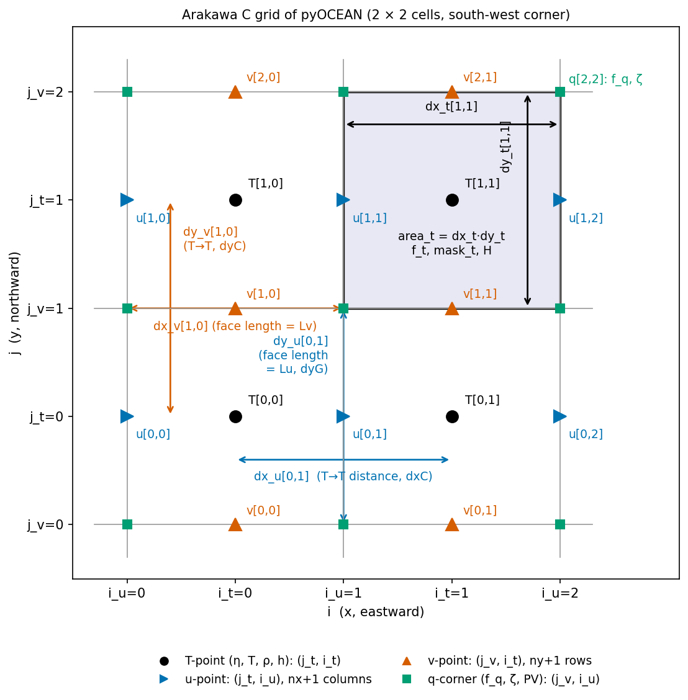
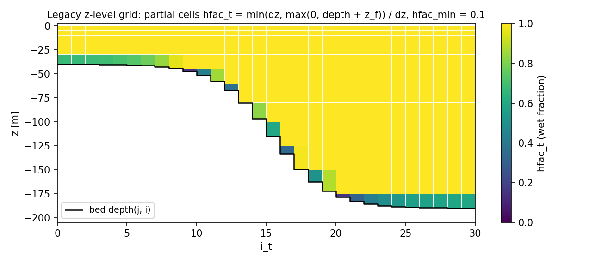
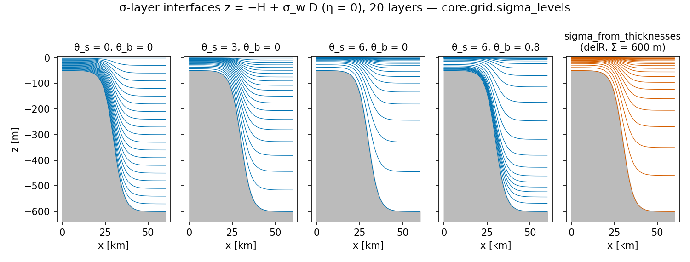
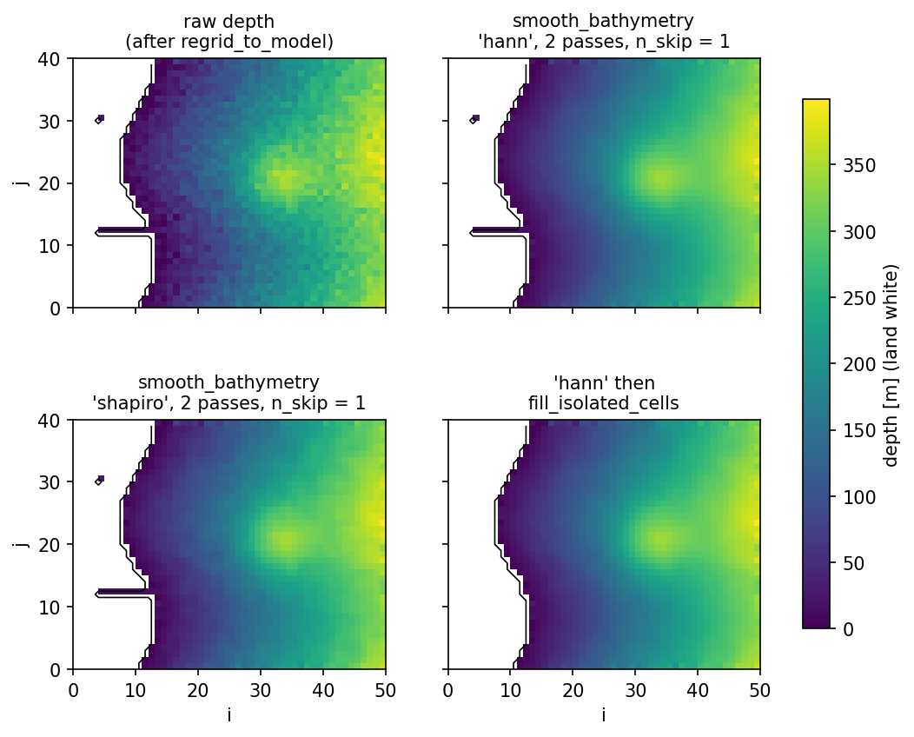
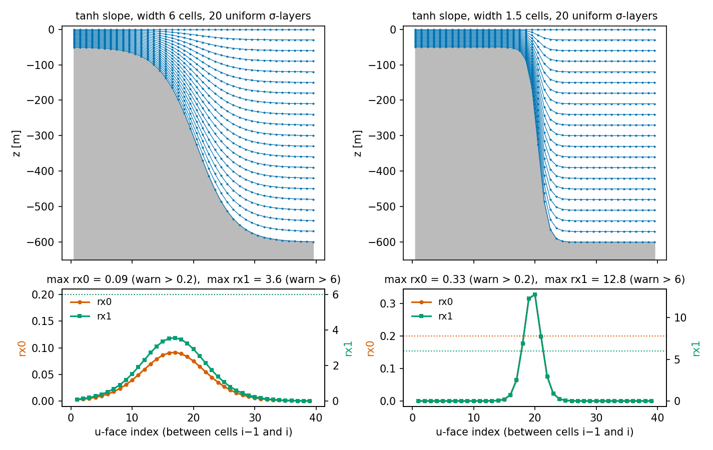

# Grids and bathymetry

This page describes where every variable lives and how the grid metrics are defined: the horizontal
Arakawa C grid (Cartesian, stretched Cartesian, spherical), the vertical grids (legacy z-levels with partial
cells, σ-layers with optional stretching), the bathymetry pipeline from GEBCO to model depth, and the
slope checks run before a σ or ALE simulation. Read it before setting up a regional domain
([Regional setup](../user-guide/regional-setup.md)). The moving ALE grids are on
[Vertical coordinates and ALE](vertical-ale.md).

## Horizontal grid: the Arakawa C grid

### Staggering and index conventions

All models use the C grid of Arakawa & Lamb (1977), with the MITgcm/MOM6/ROMS convention
(`core/grid/horizontal.py:8-23`):

| Point | Variables | Location | Dimensions | Shape |
|---|---|---|---|---|
| T | η, T, ρ, h, H, cell area | cell centre | (`j_t`, `i_t`) | (ny, nx) |
| u | u, zonal transports | **western** face of cell i | (`j_t`, `i_u`) | (ny, nx+1) |
| v | v, meridional transports | **southern** face of cell j | (`j_v`, `i_t`) | (ny+1, nx) |
| q | f_q, ζ, potential vorticity | cell corner (south-west of cell (j, i)) | (`j_v`, `i_u`) | (ny+1, nx+1) |

So `u[..., j, i]` sits between cells `i−1` and `i`; `u[..., j, 0]` and `u[..., j, nx]` are the western and
eastern domain edges. In 3-D arrays the layer index comes first: T-arrays are (N, ny, nx), u-arrays
(N, ny, nx+1), v-arrays (N, ny+1, nx), with k = 0 at the bed in the σ and ALE models
([Data structures](../architecture/data-structures.md)).

*Two by two cells of the C grid with the variable locations and the metric names of the grid Dataset.
Note that `dx_u` is the distance between the two T-points across a u-face, while `dy_u` is the length of
the face.*

### The grid Dataset

The grid is an `xarray.Dataset` built by `_assemble_dataset` (`core/grid/horizontal.py:414`). It is used
at the I/O boundary and read once into NumPy arrays by the dynamical cores.

| Variable | Dims | Units | Meaning | Used as |
|---|---|---|---|---|
| `x_t, y_t` | (j_t, i_t) | m | T-point position | output, forcing interpolation |
| `x_u, y_u`, `x_v, y_v`, `x_q, y_q` | at u, v, q | m | positions of the other points | output |
| `dx_t, dy_t` | (j_t, i_t) | m | zonal width and meridional height of the T-cell | CFL checks, PPM swept volume (`dx_t` of the donor cell), `truncate_cfl` |
| `area_t` | (j_t, i_t) | m² | T-cell area `dx_t·dy_t` | divergence of fluxes, volumes $V_k = h_k A$ |
| `dx_u` | (j_t, i_u) | m | distance between the two T-points across a u-face (MITgcm `dxC`) | x-gradients at u-faces (`fs.du`), vorticity circulation |
| `dy_u` | (j_t, i_u) | m | length of the u-face (MITgcm `dyG`) | zonal volume fluxes $Q = L\,u\,h$ with $L$ = `fs.Lu` |
| `area_u` | (j_t, i_u) | m² | `dx_u·dy_u` | kinetic energy (`vi.kinetic_energy`) |
| `dx_v` | (j_v, i_t) | m | length of the v-face (`dxG`) | meridional fluxes, $L$ = `fs.Lv` |
| `dy_v` | (j_v, i_t) | m | distance between the two T-points across a v-face (`dyC`) | y-gradients at v-faces (`fs.dv`) |
| `area_v` | (j_v, i_t) | m² | `dx_v·dy_v` | kinetic energy |
| `f_t` | (j_t, i_t) | s⁻¹ | Coriolis parameter at T-points | domain checker (inertial limit) |
| `f_q` | (j_v, i_u) | s⁻¹ | Coriolis parameter at corners | Coriolis terms of the stratified core |
| `mask_t` | (j_t, i_t) | 1 | ocean mask, all ones when created (`set_land_mask` replaces it) | legacy model |
| `lon_*, lat_*` | at t, u, v, q | degrees | geographic coordinates (spherical grid only) | forcing, bathymetry, output |

The free-surface solvers read `Lu = dy_u`, `du = dx_u`, `Lv = dx_v`, `dv = dy_v` and `area_t`
(`WetDryFreeSurface.__init__`, `core/dynamics/wetting_drying.py:90`). The vector-invariant terms of the ALE
core also build a corner area from the face spacings,

$$
A_q[J, I] = \tfrac12(\Delta x_{u}[J-1, I] + \Delta x_{u}[J, I])\cdot\tfrac12(\Delta y_{v}[J, I-1] + \Delta y_{v}[J, I])
$$

(one-sided at the domain edges; `corner_area`, `core/dynamics/vector_invariant.py`), and a corner mask that
is true only where the four surrounding cells are wet (`corner_mask`).

!!! note "Land and walls in the dynamical cores"
    The stratified core and the 2-D models do not use `mask_t`. Walls are cells whose depth `bathy` is
    **NaN**; a cell with `H ≤ 0` is *floodable land* and is part of the domain (`fs.active =
    isfinite(H)`, `core/dynamics/wetting_drying.py`). Faces between an active cell and a NaN cell are
    closed.

### Uniform Cartesian grid

`create_cartesian_grid(nx, ny, dx, dy, x0=0, y0=0, f0=1e-4, beta=0)` (`core/grid/horizontal.py:48`):

$$
x_T[i] = x_0 + (i+\tfrac12)\Delta x,\qquad y_T[j] = y_0 + (j+\tfrac12)\Delta y,\qquad
x_u[i] = x_0 + i\,\Delta x,\qquad y_v[j] = y_0 + j\,\Delta y ,
$$

all spacings equal to Δx or Δy, and the β-plane Coriolis parameter (Vallis 2006, eq. 2.34)

$$
f = f_0 + \beta\,y ,
$$

evaluated at T-points (`f_t`) and corners (`f_q`), with $y$ the absolute position. $f_0$ is therefore the
value at $y = 0$, which is the southern boundary only for the default $y_0 = 0$ (the docstring calls it the
value at $y_0$). The attributes store `dx`, `dy`, `Lx = nx·dx`, `Ly = ny·dy`, `f0`, `beta`.

### Stretched Cartesian grid (MITgcm `delXFile`/`delYFile`)

`create_cartesian_grid_stretched(dx, dy, x0, y0, f0, beta)` (`core/grid/horizontal.py:163`) takes the
cell widths `dx[i]` (nx values) and heights `dy[j]` (ny values), the MITgcm `dxF`/`dyF`:

$$
x_u[i] = x_0 + \sum_{m<i}\Delta x_m,\qquad x_T[i] = x_u[i] + \tfrac12\Delta x_i ,
$$

and the gradient spacing at the u-faces is the distance between the neighbouring T-points (MITgcm `dxC`;
Marshall et al. 1997):

$$
\texttt{dx\_u}[i] = x_T[i] - x_T[i-1] = \tfrac12(\Delta x_{i-1} + \Delta x_i),\quad 1\le i\le nx-1;
\qquad \texttt{dx\_u}[0] = \Delta x_0,\ \texttt{dx\_u}[nx] = \Delta x_{nx-1} .
$$

The face lengths are `dy_u[j] = dy[j]` and `dx_v[i] = dx[i]`, and `dy_v` is built like `dx_u`. The grid
has no scalar `dx`/`dy` attribute, so code that assumes uniform spacing fails instead of running silently
(docstring). This constructor is not re-exported by `core/grid/__init__.py`; import it from
`core.grid.horizontal`.

### Spherical-polar grid

`create_spherical_grid(nx, ny, dlon, dlat, lon0=0, lat0=0)` (`core/grid/horizontal.py:246`) places the
points at regular longitude and latitude increments (degrees) and computes the metrics by arc length
(Vallis 2006, §1.2):

$$
\Delta x = R\cos\varphi\,\Delta\lambda,\qquad \Delta y = R\,\Delta\varphi,\qquad f = 2\Omega\sin\varphi ,
$$

with $R$ = 6.371e6 m and $\Omega$ = 7.2921e-5 s⁻¹. Each metric is evaluated at the latitude of its own
point:

| Metric | Formula |
|---|---|
| `dx_t`, `dy_t` | $R\cos\varphi_T\,\Delta\lambda$, $R\Delta\varphi$ |
| `dx_u`, `dy_u` | $R\cos\varphi_u\,\Delta\lambda$ with $\varphi_u = \varphi_T$ (equal to the T-to-T distance on a regular grid), $R\Delta\varphi$ |
| `dx_v`, `dy_v` | $R\cos\varphi_v\,\Delta\lambda$ (length of the v-face at its own latitude), $R\Delta\varphi$ |
| `area_*` | `dx_*·dy_*` (midpoint rule; exact area $R^2\Delta\lambda(\sin\varphi_n-\sin\varphi_s)$ differs by $O(\Delta\varphi^2)$) |
| `f_t`, `f_q` | $2\Omega\sin\varphi_T$, $2\Omega\sin\varphi_q$ |

The positions `x_*`, `y_*` are arc lengths from the south-west corner computed with $\cos\varphi_0$ of the
southern boundary; they are for plotting and compatibility only, the metrics above are what the solvers
use. Real-bathymetry runs on the HYCOM-IOA grid read the native `regional.grid` instead
(`forcing/sources/hycom_ab.py`; [Regional setup](../user-guide/regional-setup.md)).

## Vertical grid of the legacy z-level model

### Levels

`create_z_grid(nz, dz)` (`core/grid/vertical.py:63`) takes layer thicknesses from the surface down and
builds the interfaces and centres (z ≤ 0, k = 0 at the top):

$$
z_f[0] = 0,\qquad z_f[k] = -\sum_{m<k}\Delta z_m,\qquad z_t[k] = \tfrac12(z_f[k] + z_f[k+1]) .
$$

`uniform_z_grid(nz, dz_uniform)` (line 122) repeats one thickness. `stretched_z_grid(nz, dz_surface,
total_depth)` (line 147) uses a geometric progression $\Delta z_k = \Delta z_{\rm surf}\,r^k$, with $r$
found by Brent's method from $\Delta z_{\rm surf}(r^{nz}-1)/(r-1) =$ `total_depth`; the last layer
absorbs the round-off so that $\sum\Delta z_k$ equals the total depth exactly. It raises if
`nz·dz_surface > total_depth`.

### Partial cells (hFac)

`compute_hfac(z_grid, depth, hfac_min=0.1)` (`core/grid/vertical.py:222`) gives the wet fraction of each
cell (MITgcm manual §2.10; Marshall et al. 1997):

$$
\mathrm{hFac}_T[k,j,i] = \frac{\min\big(\Delta z_k,\ \max(0,\ \mathrm{depth}[j,i] + z_f[k])\big)}{\Delta z_k},
$$

set to 0 where it is below `hfac_min` (MITgcm default 0.1). Face depths are the shallower of the two cells
and zero on the domain edges (closed walls),

$$
\mathrm{depth}_u[j,i] = \min(\mathrm{depth}[j,i-1],\ \mathrm{depth}[j,i]),\quad 1\le i\le nx-1;\qquad
\mathrm{depth}_u[j,0] = \mathrm{depth}_u[j,nx] = 0 ,
$$

and `hfac_u`, `hfac_v` follow from the same formula with the face depth. The Dataset also holds
`dz_t = Δz·hfac_t`, `depth_t`, `depth_u`, `depth_v`. Open edges are re-opened with `open_boundary_hfac`
(`core/dynamics/free_surface.py:74`).

*A 12-level grid over a shelf break: the bottom cell of each column is partial. Thin bottom cells
(< 10 % of Δz) are removed; that is why the drawn bed (black) and the wet cells do not always match.*

## σ-layers

### Fractions

In the σ model the column of total depth $D = H + \eta$ is split into N layers with fixed fractions
$\Delta\sigma_k$ (k = 0 at the bed):

$$
h_k = D\,\Delta\sigma_k,\qquad \sigma_{k+\frac12} = \sum_{m\le k}\Delta\sigma_m,\qquad
z_{k+\frac12} = -H + D\,\sigma_{k+\frac12},\qquad z_k = -H + D\,\tfrac12(\sigma_{k-\frac12}+\sigma_{k+\frac12}) .
$$

`SigmaWetDry` checks that `dsigma` has N positive entries that sum to 1 within 1e-12 and uses
$\Delta\sigma_k = 1/N$ by default (`core/dynamics/sigma_wd.py:172-179`). The layer heights are
`SigmaBaroclinic.layer_heights` (`core/dynamics/sigma_baroclinic.py:1267`). In very shallow cells the total
depth is floored at `d_min` (0.05 m), so layers thin out but never vanish
([Wetting and drying](wetting-drying.md)). The same fractions are the σ rule of the ALE regridding and
the shallow-water σ zone of the hybrid rule ([Vertical coordinates and ALE](vertical-ale.md)).

### Stretched layers

`core/grid/sigma_levels.py` builds $\Delta\sigma_k$ in two ways.

**Song & Haidvogel (1994) stretching**, `stretched_sigma(n, theta_s, theta_b=0)` (line 33), the
S-coordinate of SCRUM/ROMS with $h_c = 0$ (pure σ), as written by Shchepetkin & McWilliams (2003,
eq. 4.3). With $s$ uniform at the interfaces, $s_m = -1 + m/n$ (m = 0 at the bed),

$$
C(s) = (1-\theta_b)\frac{\sinh(\theta_s s)}{\sinh\theta_s}
+ \theta_b\Big[\frac{\tanh\big(\theta_s(s+\tfrac12)\big)}{2\tanh(\theta_s/2)} - \tfrac12\Big],
\qquad -1\le s\le 0 ,
$$

$\sigma_w = 1 + C(s)$, and $\Delta\sigma_k$ is the difference of consecutive $\sigma_w$, renormalised to
sum to 1. $\theta_s$ (0 to about 8) refines the surface, $\theta_b \in [0, 1]$ also refines the bed
(the function raises outside this range), and $\theta_s = 0$ gives uniform layers.

**From z-level thicknesses**, `sigma_from_thicknesses(dz_top_first)` (line 47): $\Delta\sigma_k$
proportional to a list of thicknesses given from the surface down (MITgcm `delR`), reversed to bed first.
The σ-layers then coincide with those z-levels where $D = \sum\Delta z$ and are compressed proportionally
in shallower water. The BayIW comparisons with MITgcm use this (CLAUDE.md).

*Interfaces of 20 σ-layers over a 50 → 600 m slope: uniform, surface-stretched (θ_s = 3, 6),
surface-and-bed stretched (θ_b = 0.8), and fractions taken from a 600 m `delR` list.*

!!! warning "No ROMS-style h_c yet"
    The fractions are the same in every column: there is no critical depth $h_c$ and no
    `Vtransform = 2` (module docstring of `core/dynamics/sigma_baroclinic.py:55-58`). In deep water a
    surface-refined σ grid therefore also refines the surface of shallow columns proportionally.

## Bathymetry pipeline

`core/grid/bathymetry.py` turns a GEBCO-format file into model depths at T-points. Sign conventions:
GEBCO elevation is negative in the ocean; the pipeline returns **depth ≥ 0, positive down, 0 = land**.

| Step | Function | What it does | Defaults |
|---|---|---|---|
| 1 | `load_gebco(path, lon_bounds, lat_bounds)` (line 64) | reads `elevation` (or `z`), renames the dimensions to `lon`/`lat`, clips to the domain plus a 0.5° margin | — |
| 2 | `regrid_to_model(raw, lon_t, lat_t, method)` (line 146) | `RegularGridInterpolator` onto the T-points; outside the data → elevation +1 m (land); $\text{depth} = \max(0, -\text{elevation})$ | `method="linear"` (or `"nearest"`) |
| 3 | `smooth_bathymetry(depth, n_passes, mask, kernel, n_skip)` (line 221) | low-pass filter of the ocean cells, see below | `n_passes=1`, `kernel="hann"`, `n_skip=0` |
| 4 | `fill_isolated_cells(depth, min_ocean_neighbors)` (line 304) | sets to land every ocean cell with fewer than 2 ocean neighbours (N, S, E, W), repeated until nothing changes (HYCOM `topo_zthin.f`) | `min_ocean_neighbors=2` |
| 5 | `apply_min_depth(depth, min_depth)` (line 351) | raises ocean cells shallower than `min_depth` to `min_depth`; land stays 0 | — |
| all | `build_bathymetry(h_grid, source_path, ...)` (line 379) | chains 1–5 on a spherical grid (needs `lon_t`, `lat_t`) | `min_depth=10`, `n_smooth_passes=2`, `n_skip=1`, `kernel="hann"`, `method="linear"` |

**Hann kernel** (default; HYCOM `topo_smooth_skip.f`): the 9-point weights

$$
\frac{1}{16}\begin{pmatrix}1&2&1\\2&4&2\\1&2&1\end{pmatrix},
$$

where a land neighbour (or a point outside the domain) contributes the **centre cell's** depth, so the
filter does not pull coastal depths towards zero (`_smooth_hann`, line 492).

**Shapiro kernel** (`kernel="shapiro"`; Shapiro 1970): a 5-point filter that excludes land neighbours,

$$
d'_{j,i} = (1-\alpha)\,d_{j,i} + \frac{\alpha}{n_{\rm ocn}}\sum_{\text{ocean nbrs}} d_{\rm nbr},\qquad \alpha = 0.5
$$

(`_smooth_shapiro`, line 531).

**`n_skip`** (HYCOM `nskip`) leaves unsmoothed every ocean cell within `n_skip` cells of land: the ocean mask
is eroded `n_skip` times with the 4-neighbour minimum (`_erode_mask`, line 452). Land cells always stay 0.

*Synthetic coastal bathymetry before and after the smoothers (with a one-cell land buffer) and after the
removal of isolated cells: the one-cell-wide inlet and the isolated pond on the left disappear.*

!!! warning "From pipeline depth to model `bathy`"
    The pipeline marks land with depth **0**, but the dynamical cores read `H ≤ 0` as *floodable land that
    is part of the domain* and only NaN as a wall (`WetDryFreeSurface`). Before passing a pipeline result to
    `SigmaBaroclinic` or `WetDryFreeSurface`, set the permanent land to NaN, e.g.
    `bathy = np.where(depth > 0, depth, np.nan)`, unless those cells are meant to flood.
    The legacy `compute_hfac` takes the pipeline depth directly (0 = land).

## Slope parameters and the domain checker

### rx0 and rx1

Terrain-following layers give pressure-gradient errors that grow with the bed slope relative to the
grid. Two standard measures are computed on every face between two wet cells
(`diagnostics/domain_check.py:13-20`):

**Beckmann–Haidvogel slope factor** (Beckmann & Haidvogel 1993), `rx0(H)` (line 64):

$$
r_{x0} = \frac{\lvert H_1 - H_2\rvert}{H_1 + H_2} .
$$

**Haney number** (Haney 1991), `rx1(H, sigma_w, eta=None)` (line 82), for σ-interfaces
$z_k = \sigma_k(H+\eta) + \eta$ with $\sigma_k \in [-1, 0]$ listed from the bed:

$$
r_{x1} = \max_k \frac{\lvert z_{1,k} - z_{2,k} + z_{1,k-1} - z_{2,k-1}\rvert}
{\lvert z_{1,k} + z_{2,k} - z_{1,k-1} - z_{2,k-1}\rvert} .
$$

Both return the values on all x- and y-faces and the location `(j, i, axis)` of the maximum. Only faces
where both cells have $H > 0$ are counted. For uniform σ-layers the maximum of rx1 is reached in the bed
layer and equals $(2N-1)\,r_{x0}$, so rx1 grows with the number of layers.

*rx0 and rx1 over a smooth and a steep shelf break with 20 uniform σ-layers. The steep one exceeds both
warning limits of `check_domain` (dotted).*

The usual limits are $r_{x0} \lesssim 0.2$ and $r_{x1} \lesssim 3$–7 with the Shchepetkin & McWilliams
(2003) pressure gradient (module docstring). pyOCEAN's z\* and hybrid ALE grids, with the finite-volume
pressure gradient, are much less sensitive than σ ([Pressure gradient](pressure-gradient.md)).

### `check_domain`

`check_domain(h_grid, H, dt, u_max=1.0, sigma_layers=None, implicit_free_surface=True, gprime_h=None,
cfl_target=0.5, rx0_max=0.2, rx1_max=6.0, g=9.81)` (`diagnostics/domain_check.py:178`) runs all checks
on a bathymetry `H` (> 0 water, ≤ 0 floodable land, NaN wall) and returns a `DomainReport` with `errors`,
`warnings`, `info`, `dt_max_advective` and `summary()`:

| Check | Formula / rule | Error | Warning |
|---|---|---|---|
| Advective CFL | $u_{\max}\Delta t/\Delta x_{\min}$; also gives $\Delta t_{\max} = c_{\rm target}\Delta x_{\min}/u_{\max}$ | > 1 | > `cfl_target` |
| External gravity wave (only if `implicit_free_surface=False`) | $\sqrt{gH_{\max}}\,\Delta t\sqrt{1/\Delta x^2 + 1/\Delta y^2}$ | > 1 | — |
| Internal wave (if `gprime_h` = $g'H$ is given) | $\sqrt{g'H}\,\Delta t/\Delta x_{\min}$ | > 1 | > `cfl_target` |
| Inertial | $f_{\max}\Delta t$ | — | > 1 |
| rx0 | above | — | max > `rx0_max` |
| rx1 (if `sigma_layers` is given) | above, with **uniform** σ: `np.linspace(-1, 0, N+1)` | — | max > `rx1_max` |
| Isolated water bodies | 4-connected components of $H > 0$ other than the largest (`isolated_water_bodies`) | — | any |
| Pits | wet cells deeper than 3 × the median of their wet 8 neighbours **and** by more than 20 m (`find_pits(H, ratio=3, min_excess=20)`) | — | any |
| Isolated cells | wet cells with fewer than 2 wet lateral neighbours (`isolated_cells`; HYCOM `topo_zthin`) | — | any |

$\Delta x_{\min}$ is the smallest of `dx_t` and `dy_t`. The checks come from the forum experience of other
models that setup problems appear later as blow-ups or silent artefacts (module docstring; e.g. a GEBCO pit
in Guaymas bay that gave a 0 cm M2 gauge in a nested run).

## Validation

| Module | Tests (CLAUDE.md, Build Status) |
|---|---|
| Horizontal grid (incl. stretched) | `tests/test_grid_horizontal.py`, 28 + 8 |
| z-levels and hFac | `tests/test_grid_vertical.py`, 37 |
| Stretched σ-levels | `tests/test_sigma_levels.py`, 6 |
| Bathymetry pipeline | `tests/test_bathymetry.py`, 38 |
| Domain checker | `tests/test_domain_check.py`, 7 |

The stretched σ formula was checked against Shchepetkin & McWilliams (2003, eq. 4.3)
(`docs/literature/reading_list.md`). The BayIW and Ilicak benchmarks run on stretched Cartesian and σ grids
built with these functions ([Validation](../validation/index.md)).

## Known limitations

- No curvilinear (rotated or conformal) grids: Cartesian, stretched Cartesian and regular spherical only;
    curvilinear WRF or ROMS grids are not supported as model grids.
- Spherical cell areas use the midpoint rule.
- σ fractions are the same in every column (no $h_c$).
- `check_domain` computes rx1 for uniform σ, not for the model's own (possibly stretched) fractions.
- The bathymetry pipeline does not produce NaN walls; see the warning above.

## References

- Arakawa, A. & Lamb, V. R. (1977). Computational design of the basic dynamical processes of the UCLA general
    circulation model. *Methods Comput. Phys.* 17, 173–265. **[verify]**
- Beckmann, A. & Haidvogel, D. B. (1993). Numerical simulation of flow around a tall isolated seamount.
    *J. Phys. Oceanogr.* 23, 1736–1753. doi:10.1175/1520-0485(1993)023<1736:NSOFAA>2.0.CO;2
- GEBCO Compilation Group (2023). GEBCO 2023 Grid. doi:10.5285/f98b053b-0cbc-6c23-d9da-7de7d696a50d
- Haney, R. L. (1991). On the pressure gradient force over steep topography in sigma coordinate ocean models.
    *J. Phys. Oceanogr.* 21, 610–619. doi:10.1175/1520-0485(1991)021<0610:OTPGFO>2.0.CO;2 **[verify]**
- Marshall, J., Adcroft, A., Hill, C., Perelman, L. & Heisey, C. (1997). A finite-volume, incompressible
    Navier–Stokes model for studies of the ocean on parallel computers. *J. Geophys. Res.* 102(C3), 5753–5766. **[verify]**
- Shapiro, R. (1970). Smoothing, filtering, and boundary effects. *Rev. Geophys. Space Phys.* 8(2), 359–387.
- Shchepetkin, A. F. & McWilliams, J. C. (2003). A method for computing horizontal pressure-gradient force in an
    oceanic model with a nonaligned vertical coordinate. *J. Geophys. Res.* 108(C3), 3090. doi:10.1029/2001JC001047
- Song, Y. & Haidvogel, D. (1994). A semi-implicit ocean circulation model using a generalized
    topography-following coordinate system. *J. Comput. Phys.* 115, 228–244. doi:10.1006/jcph.1994.1189
- Vallis, G. K. (2006). *Atmospheric and Oceanic Fluid Dynamics.* Cambridge University Press.
- HYCOM-tools `topo/src/topo_smooth_skip.f` and `topo_zthin.f` (smoothing with a land buffer, thin-cell removal).
- MITgcm manual (2023), §2.10, partial-step topography (hFac).
