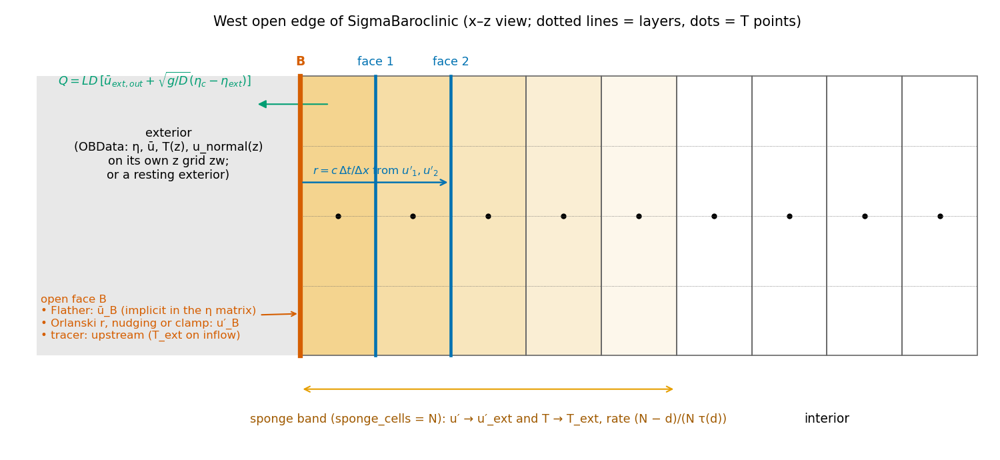
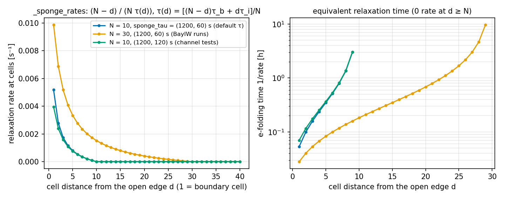
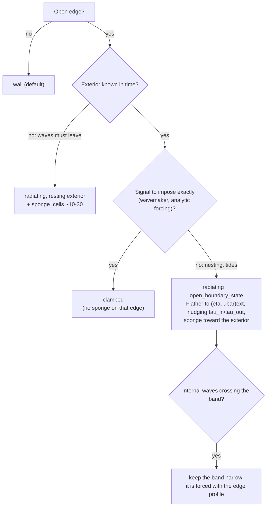

# Open boundaries and nesting

A regional model needs lateral boundaries that let waves and eddies leave, let the exterior ocean (tides, a parent
model) come in, and keep volume and tracer budgets exact. pyOCEAN splits the boundary problem by characteristic
(Chapman 1985; Marsaleix et al. 2006): the **depth mean** (barotropic mode) radiates with Flather (1976), implicitly
inside the free-surface matrix; the **baroclinic velocity** $u' = u - \bar u$ radiates with Orlanski (1976) and is
nudged toward the exterior; **tracers** take upstream values at the open face; an optional **sponge band** relaxes
$u'$ and $T$ toward the exterior. The exterior can be at rest, or time varying (`open_boundary_state`, e.g. a parent
run), with two modes per edge: `'radiating'` and `'clamped'`. This page covers all of that, plus the boundary options
of the 2-D tidal free surfaces and the legacy z-model OBCS module.

*West open edge of `SigmaBaroclinic`: the open face B carries the Flather depth mean and the radiated/nudged
baroclinic velocity; faces 1 and 2 give the Orlanski phase speed; the shaded band is the sponge, strongest at the edge.*

## Where each piece lives

| Model line | Barotropic | Baroclinic | Tracers | Sponge | Exterior |
|---|---|---|---|---|---|
| `SigmaBaroclinic` (σ and ALE) | Flather, implicit, total depth (`WetDryFreeSurface`) | Orlanski + nudging, or clamped | upstream at the face | $u'$ and $T$ (MITgcm profile) | resting, or `open_boundary_state(t)` |
| `SigmaWetDry` (homogeneous σ) | Flather (`flather_u/v`) | — (layers get the uniform barotropic correction) | — | — | caller passes `flather_eta`, `flather_ubar/vbar` |
| 2-D wet–dry tidal model (`WetDryFreeSurface`) | Flather, total depth | — | — | — | caller (tides, parent) |
| 2-D linear free surface (`ImplicitFreeSurface`) | Flather, rest depth; or prescribed normal velocity (`open_u/v`) | baroclinic part of $\hat u$ kept at Flather faces | — | — | caller (TPXO via `forcing/tides.py`) |
| Legacy z model (`boundaries/obcs`) | — | Orlanski on any field | Orlanski / prescribed inflow | quadratic-profile nudging tendency | `OBData` |

The legacy module is not called by any current time stepper; it is exercised by `tests/test_surface_forcing.py`
(see [Legacy module](#legacy-z-model-obcs-boundariesobcs)).

## Barotropic mode: Flather radiation

### Equation

At an open face with outward unit normal, the depth-mean outward velocity is

$$
\bar u_{\rm out} = \bar u_{\rm ext,out} + \sqrt{\frac{g}{D}}\,\left(\eta_c - \eta_{\rm ext}\right),
$$

where $\eta_c$ is the sea level of the adjacent interior cell, $D$ its water depth, and $(\eta_{\rm ext},
\bar u_{\rm ext})$ the exterior state (Flather 1976; Carter & Merrifield 2007). For a resting exterior it is a
radiation condition for a shallow-water wave of speed $\sqrt{gD}$; with a tide or parent model it lets the external
signal in while the model's own perturbation leaves.

### Implicit θ-form in the free-surface matrix

Both free surfaces apply it with the same θ as the rest of the barotropic step. The outward volume flux of a Flather
face of length $L$ is

$$
Q_{\rm out} = L D\,\bar u_{\rm ext,out} + L\sqrt{gD}\,\left(\theta\eta_c^{n+1} + (1-\theta)\eta_c^n - \eta_{\rm ext}\right).
$$

The $\eta^{n+1}$ part adds $\Delta t\,\theta\,L\sqrt{gD}$ to the diagonal of the cell's row, so the matrix stays
symmetric positive definite; the rest goes to the right-hand side. After the solve the face velocity is set from the
same relation with $\eta_c^{n+1}$. The θ-weighted flux used in the continuity equation is stored
(`last_open_Qu/Qv`) so that the layer transports at the open face can add up to it exactly.

| | `WetDryFreeSurface` (`core/dynamics/wetting_drying.py`) | `ImplicitFreeSurface` (`core/dynamics/free_surface.py`) |
|---|---|---|
| depth $D$ | total depth of the adjacent cell, $\max(H + \eta^n, 0)$; face closed while $D \le d_{\min}$ (`:261-263`) | rest depth of the face $H_f = \sum_k \Delta z_k\,{\rm hFac}_{k,f}$ (`:207`, `:225`) |
| matrix term | `extra` diagonal, assembled every step (`:266`, `:271`) | assembled once (`:252-255`) |
| face velocity at $n+1$ | $s\,Q_{\rm out}/(L D)$ (`:314-317`) | depth mean from the relation, baroclinic part of $\hat u$ kept: $u_k = \hat u_k - \langle\hat u\rangle + \bar u$ (`:353-360`) |
| exact volume | θ-flux stored, exact-conservation recompute with CG (`:318-331`) | — |

$s = -1$ on west/south edges and $+1$ on east/north edges converts outward to model sign; `flather_ubar`/
`flather_vbar` are given in model sign (positive east/north). Flather faces must lie on the domain edge (both classes
raise otherwise); for `ImplicitFreeSurface` they must also be wet, which `open_boundary_hfac(hfac, sides)`
(`core/dynamics/free_surface.py:74`) arranges by giving the edge face the wet fraction of its T-cell (`compute_hfac`
closes every edge). `ImplicitFreeSurface` also accepts `open_u/open_v`: faces whose normal velocity is prescribed
through $\hat u$ and that receive no pressure correction.

In `SigmaWetDry.step` the Flather velocity becomes the depth mean of the layers: $u_k^{n+1} = \hat u_k +
(\bar u^{n+1} - \hat{\bar u})$ on the open faces too (`core/dynamics/sigma_wd.py:293-296`). `SigmaBaroclinic` makes
every active cell of an open edge a Flather face (`core/dynamics/sigma_baroclinic.py:1066-1075`) and passes the
exterior through `_flather_args` (`:1685`): zero η and ū for a resting exterior, or `flather_targets(state)`
(`core/dynamics/open_boundary.py:195`) built from `OBData.eta` and `OBData.ubar` (None → 0).

## Baroclinic velocity: Orlanski radiation, nudging, clamping

`SigmaBaroclinic._radiate` (`core/dynamics/sigma_baroclinic.py:1645`) acts after the free-surface step on the
baroclinic part of the normal velocity at each open edge, keeping the Flather depth mean. With the depth-mean weights
$w_k$ ($\Delta\sigma_k$ in σ, the ALE face fractions otherwise), $u'_k = u_k - \sum_j w_j u_j$, and with B the
boundary face and 1, 2 the next faces inward, the implicit upstream Orlanski form of ROMS/CROCO `u3dbc`
(Marchesiello et al. 2001; normal part only) is

$$
r = \frac{c\,\Delta t}{\Delta x} = \operatorname{clip}\left(
\frac{(\phi_1^n - \phi_1^{n+1})(\phi_1^n - \phi_2^n)}{(\phi_1^n - \phi_2^n)^2},\ 0,\ r_{\max}\right),
\qquad
\phi_B^{n+1} = \frac{\phi_B^n + r\,\phi_1^{n+1}}{1 + r},
$$

with $\phi = u'_k$, $r_{\max}$ = `orlanski_cmax` (default 1) and a denominator floor of $10^{-30}$. $r = 0$ (incoming
phase) keeps the old boundary value. Then, with an exterior $u'_{\rm ext}$ on the face layers:

* `'radiating'`: $\phi_B \leftarrow (1-\alpha)\phi_B + \alpha\,u'_{\rm ext}$ with $\alpha = \Delta t/\tau_{\rm in}$ when the
    phase is incoming ($c\,\Delta x/\Delta t \le 0$) and $\Delta t/\tau_{\rm out}$ when outgoing, as CROCO
    `u3dbc.F:111-155` (`obc_tau_in` = 1 day, `obc_tau_out` = 10 days);
* `'clamped'`: $\phi_B = u'_{\rm ext}$ (Dirichlet; MITgcm OBCS prescribe, CROCO `M3_FRC_BRY` without radiation).

Finally the weighted mean of $\phi_B$ is removed ($\sum_k w_k u'_k = 0$), so the depth mean stays Flather's, and
$u_B = \bar u_B + \phi_B$ is written only where the Flather face is open ($D > 0$, `:1680-1683`). Without an exterior
the nudging is skipped (pure radiation toward a resting exterior).

!!! note "Differences from CROCO `u3dbc.F` (reference implementation, `~/pyOCEAN_refs/croco/OCEAN/u3dbc.F:113-155`)"
    pyOCEAN uses the old-time gradient $\phi_1^n - \phi_2^n$ (CROCO: new time), drops the tangential term $c_y$,
    clips $r$ at `orlanski_cmax`, and radiates $u'$ rather than the full 3-D velocity (the depth mean belongs to
    Flather). All are numerical choices (class c).

## Sponge band

A flow-relaxation sponge (Martinsen & Engedahl 1987) with the MITgcm OBCS profile (`obcs_sponge.F`,
`useLinearSponge = .FALSE.`; `~/pyOCEAN_refs/MITgcm/pkg/obcs/obcs_sponge.F:68-89`). `_sponge_rates`
(`core/dynamics/sigma_baroclinic.py:906`) gives, at cell distance $d = 1 \dots N$ from the nearest sponged edge
($d = 1$ is the boundary cell) with $N$ = `sponge_cells` and `sponge_tau` $= (\tau_i, \tau_b)$ (inner, boundary):

$$
\tau(d) = \frac{(N - d)\,\tau_b + d\,\tau_i}{N},\qquad
\gamma(d) = \frac{N - d}{N\,\tau(d)}\quad [{\rm s^{-1}}],\qquad \gamma = 0 \text{ for } d \ge N .
$$

The rate is strong at the edge and zero at $d = N$; at u- and v-faces it is the mean of the two adjacent cells (the
edge face takes its cell). The relaxation is implicit:

$$
u_k \leftarrow \bar u + \frac{u'_k + \Delta t\,\gamma\,u'_{\rm ext,k}}{1 + \Delta t\,\gamma},
\qquad
T \leftarrow \frac{T + \Delta t\,\gamma\,T_{\rm ext}}{1 + \Delta t\,\gamma},
$$

the first in `_open_velocity` (`core/dynamics/sigma_baroclinic.py:1694-1709`, before the Orlanski step), the second
at the end of `step` (`:2147-2149`; ALE on the Lagrangian thicknesses, `:2051-2053`). The depth mean is untouched, so the free-surface fluxes and the barotropic budget stay Flather's. With no exterior,
$u'_{\rm ext} = 0$. The tracer sponge runs only with `sponge_tracer=True` (default). `'clamped'` edges get no sponge:
the distance is measured only from the non-clamped open edges (`:1081-1083`), because a band relaxed toward a profile
copied along the normal forced the wave in phase over 2 km (a 160° phase error, `validation/internal_wave/README.md`).

*`_sponge_rates` for the default `sponge_tau` = (1200 s, 60 s) with 10 and 30 cells, and (1200 s, 120 s) as in the
channel tests. The e-folding time grows from ~3 min at the edge to hours near $d = N$.*

For the defaults ($N$ = 10, 1200/60 s) the cell rates are 5.2e-3, 2.8e-3, 1.7e-3, 1.2e-3, 7.9e-4, 5.4e-4, 3.5e-4,
2.1e-4, 9.2e-5 and 0 s⁻¹ for $d$ = 1 … 10 (from `docs/manual/figures/make_obc.py`).

## Tracers and layer transports at the open faces

**Upstream face values** (`_open_faces`, `core/dynamics/sigma_baroclinic.py:1556`; Marsaleix et al. 2006): on an
open face the tracer flux uses the boundary cell's value when the flow leaves and the exterior value when it enters
($T_{\rm ext}$, and $T_{\rm ext}^2$ for the variance stack of the mixing diagnostic). The FCT limiter of the ALE step
applies the same upstream rule (`tests/test_sigma_ale.py::test_fct_open_edge_faces_are_upstream`).

**Layer transports.** The layer volume fluxes through an open face must add up to the θ-weighted Flather flux
$Q_{\rm bt}$ = `last_open_Qu/Qv`, or a uniform tracer would not stay uniform:

* σ (`step`, `:2123-2130`): $Q_k = \Delta\sigma_k Q_{\rm bt} + L D\,\Delta\sigma_k\left(\theta_{bc}u'^{\,n+1}_k + (1-\theta_{bc})u'^{\,n}_k\right)$;
* ALE (`open_face_transport`, `core/vertical/ale.py:834`, called by `_open_face_transports`, `:1770`):
    $Q_k = (h_k/\sum_j h_j)\,Q_{\rm bt} + L\,h_k\left(\theta_{bc}u'^{\,n+1}_k + (1-\theta_{bc})u'^{\,n}_k\right)$
    with $h_k$ the thickness of the interior cell (MOM6 `MOM_continuity_PPM.F90:1237-1248`) and $u'$ split with the
    same fractions, so a vanished layer carries nothing.

$\theta_{bc}$ = `theta_bc` (default ½, see [Free surface and time stepping](free-surface-time-stepping.md)).

## The exterior state

### Resting exterior (default)

Without `open_boundary_state` the exterior is $\eta = 0$, $\bar u = 0$, $u' = 0$ and the initial tracer profile:
`initial_state` stores $T_{\rm ext}$ = the initial $T$ (`core/dynamics/sigma_baroclinic.py:1211`). In ALE the layers
move, so the profile is stored with its thicknesses (`T_ext`, `h_ext`, `:1218-1219`, `:1264`) — kept in z — and
remapped each step onto the current layers of the boundary and sponge columns by `exterior_on_layers`
(`core/vertical/ale.py:857`): the profile is stretched to the current column, $h_{\rm ext}\sum h/\sum h_{\rm ext}$
(z*-like), and remapped conservatively with the model's remap scheme. Inflow values use $h^n$, the tracer sponge
uses the Lagrangian thicknesses $h^\dagger$ (`_step_ale`, `:2038`, `:2051-2053`). This follows MOM6's external data
on its own z axis (`MOM_open_boundary.F90:1188-1204`), on the current thicknesses. `T_ext` and `h_ext` must be
replaced together (`_exterior`, `:1758`, raises otherwise).

### Time-varying exterior: `open_boundary_state`

`open_boundary_state` is a function `t [s] → {edge: OBData}` (`boundaries/obcs/__init__.py:124`) evaluated at
$t^{n+1}$ = `st.time + dt` (`_evaluate_exterior`, `:1717`). For each edge with data:

| `OBData` field | Shape | Meaning |
|---|---|---|
| `T` | (nz, n) | exterior temperature on the data's own levels [°C] |
| `u_normal` | (nz, n) | normal velocity (u on west/east, v on south/north), model sign [m s⁻¹] |
| `zw` | (nz+1, n) | interface heights of the data, surface first, strictly decreasing [m] |
| `eta` | (n,) or None | Flather $\eta_{\rm ext}$ [m] (None = 0) |
| `ubar` | (n,) or None | Flather $\bar u_{\rm ext}$, normal, model sign [m s⁻¹] (None = 0) |
| `S` | (nz, n) | not used by `SigmaBaroclinic` (no salinity) |

$n$ is the edge length ($n_y$ for west/east, $n_x$ for south/north). `validate_state`
(`core/dynamics/open_boundary.py:19`) checks edges, shapes and the ordering of `zw`.

The functions of `core/dynamics/open_boundary.py` turn it into model arrays:

1. **Source columns** (`_source_columns_at`, `:105`): at every boundary or sponge point, the profile of the edge at the
    same along-edge index, clipped to the point's own bed (`zw` capped at $-H$, the deepest layer extended when the
    point is deeper). On the edge itself the data must reach the bed (`zw[-1] ≤ −H`, else `ValueError`).
2. **Remap** (`_remap_stretched`, `:80`): source thicknesses stretched to the model column total and remapped
    conservatively onto the model layers (PPM_H4 in σ; the model's `remap_scheme` in ALE).
3. **Tracer** (`exterior_tracer`, `:116`): $T_{\rm ext}$ in the boundary/sponge columns.
4. **Velocity** (`exterior_velocity`, `:166`): `u_normal` remapped onto the face layers, minus its mean with the model
    face weights, $u'_{\rm ext} = u_{\rm ext} - \sum_k w_k u_{{\rm ext},k}$, so the free-surface flux stays Flather's.
5. **Ownership** (`owned_by_state`, `:54`): each point takes the exterior of its *nearest open edge*; if that edge has
    no data the point keeps the resting exterior (otherwise the east sponge would relax toward the west profile — a
    bug found by the analytic test, `validation/internal_wave/README.md`).

In σ mode the face layers for $u'_{\rm ext}$ are $H_f\Delta\sigma_k$ (rest depth) and the inflow $T_{\rm ext}$ is
computed on the layers of $D^n$ (`step`, `:2104-2109`). For linear-in-time interpolation between snapshots use
`forcing.boundary_time.interpolated_boundary(times, states)` (`forcing/boundary_time.py:17`), constant beyond the ends.

!!! warning "The sponge band copies the edge profile along the normal"
    Sponge cells take the edge profile at the same along-edge index. For a wave that propagates through the band
    (nesting with internal tides, an incoming internal wave at a `'radiating'` edge) that profile is not the local
    exterior, and the band is forced in phase. A 3-D exterior over the whole band is the next piece of `OBData`
    (`validation/internal_wave/README.md`, `validation/bayiw_cut/README.md`).

### Modes: `'radiating'` and `'clamped'`

`open_boundary_mode = {edge: mode}` (default `'radiating'` on every open edge; `__init__`, `:1038-1045`):

| | `'radiating'` | `'clamped'` |
|---|---|---|
| depth mean | Flather toward $(\eta, \bar u)_{\rm ext}$ | Flather toward $(\eta, \bar u)_{\rm ext}$ |
| baroclinic $u'$ at the face | Orlanski, then nudged with $\Delta t/\tau_{\rm in}$ or $\Delta t/\tau_{\rm out}$ | $= u'_{\rm ext}$ |
| sponge | yes (if `sponge_cells` > 0), toward the exterior | none |
| tracer at the face | upstream, $T_{\rm ext}$ on inflow | upstream, $T_{\rm ext}$ on inflow |
| needs `open_boundary_state` | no | yes (raises otherwise) |
| analogue | CROCO `OBC_M3ORLANSKI` + `M3_FRC_BRY` nudging | MITgcm OBCS prescribe (u′ only; MITgcm also fixes the total transport) |

## Tides at the boundary

Tides enter through Flather. In the 2-D tidal runs the exterior $(\eta, \bar u)$ at each Flather face comes from TPXO:
`forcing.tides.boundary_tides` (`forcing/tides.py:209`) interpolates the constants to each open face and predicts them
at time $t$ (mid-step for θ = ½); the normal velocity is the TPXO **transport divided by the model depth**, so the
tidal volume flux is conserved on the model bathymetry. `boundary_tide_constants` / `boundary_tides_at` interpolate
once and predict cheaply each step (8× faster in PAC_MEX; CLAUDE.md). Details, the body tide and SAL are on the
[Tides](tides.md) page; the PAC_MEX barotropic run is in [Validation: tides and sea level](../validation/tides-sealevel.md).

For `SigmaBaroclinic`, a tide is passed as `OBData.eta` and `OBData.ubar` of `open_boundary_state`; a dedicated 3-D
tidal boundary (Flather with TPXO η/ū, potential + SAL as a barotropic force) is step 6 of
`docs/design/unified_core.md`. The roadmap also asks for a sponge that relaxes only the low frequencies, so a tidal
signal is not damped in the band (`docs/design/vision_roadmap.md`).

## Nesting in a parent run

The chain from a parent ocean product to boundary data is:

1. `forcing.ocean_init.prepare_ocean(ocean, h_grid, v_grid)` (`forcing/ocean_init.py:51`): sea-over-land fill, bilinear
    interpolation to the C-grid points, linear interpolation to the model z levels (HYCOM `z2h`/`nest`, MITgcm OBCS
    preprocessing).
2. `boundary_data(prepared, side, t)` (`:123`): `OBData` with T, S at the edge T-points, `u_normal` at the edge faces
    (west $i_u = 0$, east $i_u = n_x$, south $j_v = 0$, north $j_v = n_y$) and η with the domain-mean SSH removed by
    default (`remove_mean_ssh=True`, so the nest starts at rest on average).
3. For `SigmaBaroclinic`, add `zw` (the interfaces of those z levels, surface first) and, if wanted, `ubar`;
    `boundary_data` does not fill them. Collect snapshots and wrap them with `interpolated_boundary`.

The BayIW cut, phase 2 (`validation/bayiw_cut/cut.py:318-344`), is the worked example: every 900 s the edges of the
full MITgcm run are written as `OBData` (zw = MITgcm interfaces, T and η of MITgcm's boundary cell, `u_normal` at
pyOCEAN's open face, `ubar` its depth mean), interpolated linearly in time, and used in `'radiating'` mode with a
30-cell sponge, Flather toward the exterior and `orlanski_cmax` = 0.45. See
[Validation: BayIW](../validation/bayiw.md) and the results below.

## Legacy z-model OBCS (`boundaries/obcs`)

The phase-1 module works on the xarray `ModelState` of the z-level model and is not used by `SigmaBaroclinic`:

* `apply_orlanski(state, state_prev, h_grid, v_grid, dt, boundaries)` (`boundaries/obcs/__init__.py:306`): for each
    field with an exterior value (T, S, η, `u_normal`), phase speed $c = \Delta_t\phi_{\rm int}\,\Delta n/(\Delta t\,\Delta_n\phi)$
    with $\Delta_n\phi = \phi_{\rm int} - \phi_{\rm bdy}$, clipped to $[0, \Delta n/\Delta t]$; outgoing
    ($c > 0$): $\phi_{\rm bdy} \leftarrow \phi_{\rm bdy} + c\,(\Delta t/\Delta n)(\phi_{\rm int} - \phi_{\rm bdy})$;
    otherwise $\phi_{\rm bdy} = \phi_{\rm ext}$ (MITgcm `obcs_calc.F` style). Uses scalar `dx`, `dy` from the grid attrs.
* `sponge_tendency(state, h_grid, v_grid, boundaries, sponge_width=5, tau_sponge=86400)` (`:203`): tendency
    $-\gamma(n)/\tau\,(\phi - \phi_{\rm ext})$ for T, S, η with $\gamma(n) = \max(0, 1 - n/L)^2$; no velocity sponge.
* `OBData` (`:124`) is shared with the new code (the `zw` and `ubar` fields were added for `SigmaBaroclinic`).

## Restrictions

* Open edges are whole domain sides (`'west'`, `'east'`, `'south'`, `'north'`); every active cell of an open side is
    open. A sponge needs at least one open edge.
* ALE: no cell with $H \le 0$ (floodable) on an open edge (`core/dynamics/sigma_baroclinic.py:1173-1179`). In σ mode
    and in the 2-D models a dry boundary cell simply closes its Flather face ($D \le d_{\min}$,
    `tests/test_wetting_drying.py::test_dry_boundary_cell_closes_the_face`).
* `'clamped'` needs `open_boundary_state`; `open_boundary_state` needs `open_boundaries`.
* The exterior data must reach the bed of every boundary column.
* No salinity: `OBData.S` is ignored by `SigmaBaroclinic`.
* `ImplicitFreeSurface` Flather faces must be opened with `open_boundary_hfac` first.

## Options and defaults

| Option | Values | Default | Meaning | Where |
|---|---|---|---|---|
| `open_boundaries` | tuple of edges | `()` (closed) | open sides (Flather on all their active cells) | `core/dynamics/sigma_baroclinic.py:1010` |
| `sponge_cells` | int | 0 | sponge width $N$ [cells] | `:1010` |
| `sponge_tau` | (τ_inner, τ_bound) [s] | (1200, 60) | MITgcm `U/Vrelaxobcsinner/bound` | `:1011` |
| `sponge_tracer` | bool | True | also relax $T$ in the band | `:1012` |
| `orlanski_cmax` | – | 1.0 | max $r = c\Delta t/\Delta x$ (BayIW: 0.45) | `:1011` |
| `open_boundary_state` | callable or None | None | time-varying exterior `t → {edge: OBData}` | `:1017` |
| `open_boundary_mode` | `{edge: 'radiating'/'clamped'}` | all `'radiating'` | per-edge mode | `:1017` |
| `obc_tau_in`, `obc_tau_out` | s | 86 400, 864 000 | nudging of `'radiating'` (CROCO typical 1 and 10 days) | `:1018` |
| `flather_u`, `flather_v` | bool masks | None | Flather faces of `SigmaWetDry`/`WetDryFreeSurface`/`ImplicitFreeSurface` | `core/dynamics/wetting_drying.py:91`, `free_surface.py:153` |
| `open_u`, `open_v` | bool masks | None | prescribed-velocity faces (`ImplicitFreeSurface`) | `free_surface.py:151` |

## Validation

* **Mode-1 internal wave leaving a channel** (16 h, 60 km channel against a 300 km "truth"; interior T error relative
    to the initial anomaly; `tests/test_sigma_baroclinic.py`, `tests/test_sigma_ale.py`): σ closed 0.82, Flather +
    Orlanski 0.157, + 10-cell sponge 0.015 (Orlanski alone in the same padded domain 0.133). ALE on z levels:
    z* 0.79 / 0.16 / 0.016, hybrid 0.77 / 0.198 / 0.024, σ with the same metric 0.80 / 0.149 / 0.015 (CLAUDE.md;
    `docs/design/vision_roadmap.md` §7). Radiation alone cannot fit the mode-1 + mode-2 mixture with one phase speed
    per layer (Jensen 1998 **[verify]**); the sponge fixes it.
* **Analytic progressive mode-1 wave** (`tests/test_sigma_ale.py::test_clamped_west_radiating_east_carries_the_analytic_mode1_wave`):
    flat 200 m channel, west `'clamped'`, east `'radiating'` with a 2 km sponge; z* and hybrid amplitude within ±5 % of
    the viscously decaying wave, phase within 3.4° (`validation/internal_wave/README.md`).
* **MITgcm `internal_wave`** (`validation/internal_wave/`): west `'clamped'` with MITgcm's `obcs_calc.F` forcing; flat
    part with Arakawa KE: u amplitude 0.91–1.01 of MITgcm, T′ 0.98–1.10; baroclinic energy flux 50 % point at
    4.53–4.85 km against MITgcm's 4.61 km. With the Godunov KE scheme u is 0.83–0.99 (class c).
* **BayIW cut nested in the full run** (`validation/bayiw_cut/README.md`, phase 2, z*): η at the stations 0.03–0.11
    relative error against the full run, better than MITgcm nested in itself (0.05–0.17, MITgcm cannot prescribe η with
    its linear free surface) and than phase 1 (0.27–1.00). The baroclinic error equals the phase-1 model difference,
    except at Gamma inside the sponge band (linear case V110 0.74, T110 0.54: the copied edge profile, class b).
    Nesting costs 25–33 ms per step more, mostly `exterior_velocity`.
* **Barotropic Flather**: outgoing wave leaves < 0.1 % of its energy; tidal bay = analytic standing wave within 2 %
    (CLAUDE.md, `tests/test_free_surface.py`); volume budget through Flather faces exact in both free surfaces.
* **Constancy**: a uniform tracer stays uniform with open boundaries on 2 and 4 edges, with rotation, and a resting
    stratification stays at rest with a sponge (`tests/test_sigma_baroclinic.py`, `tests/test_sigma_ale.py`).

More in [Validation: idealised benchmarks](../validation/idealised.md) and [Validation: BayIW](../validation/bayiw.md).

## Known limitations

* The sponge band uses the edge profile copied along the normal (no 3-D exterior yet).
* `'clamped'` keeps Flather on the depth mean; MITgcm's prescribe also fixes the total transport (class c in the
    internal-wave benchmark). A total-transport clamp is listed as a possible improvement.
* The sponge relaxes all frequencies; a low-frequency-only sponge for tidal nesting is on the roadmap (stage B).
* No partially-clamped radiation of Marsaleix et al. (2009) yet (radiation without a sponge); no public reflection
    benchmark (Siyanbola et al. 2023, "pretty good sponge" of Lavelle & Thacker 2008: unified-core step 8).
* Open edges next to floodable cells are not supported in ALE.

## References

* Carter, G.S. & Merrifield, M.A. (2007). Open boundary conditions for regional tidal simulations. *Ocean Modell.*
    18, 194–209. [doi:10.1016/j.ocemod.2007.04.003](https://doi.org/10.1016/j.ocemod.2007.04.003) **[verify DOI]**
* Chapman, D.C. (1985). Numerical treatment of cross-shelf open boundaries in a barotropic coastal ocean model.
    *J. Phys. Oceanogr.* 15, 1060–1075. [doi:10.1175/1520-0485(1985)015<1060:NTOCSO>2.0.CO;2](https://doi.org/10.1175/1520-0485(1985)015<1060:NTOCSO>2.0.CO;2) **[verify DOI]**
* Flather, R.A. (1976). A tidal model of the north-west European continental shelf. *Mém. Soc. R. Sci. Liège*
    6(10), 141–164.
* Jensen, T.G. (1998). Open boundary conditions in stratified ocean models. *J. Mar. Syst.* 16, 297–322. **[verify]**
* Lavelle, J.W. & Thacker, W.C. (2008). A pretty good sponge: dealing with open boundaries in limited-area ocean
    models. *Ocean Modell.* 20, 270–292. **[verify]**
* Marchesiello, P., McWilliams, J.C. & Shchepetkin, A. (2001). Open boundary conditions for long-term integration of
    regional oceanic models. *Ocean Modell.* 3, 1–20. [doi:10.1016/S1463-5003(00)00013-5](https://doi.org/10.1016/S1463-5003(00)00013-5) **[verify DOI]**
* Marsaleix, P., Auclair, F. & Estournel, C. (2006). Considerations on open boundary conditions for regional and
    coastal ocean models. *J. Atmos. Oceanic Technol.* 23, 1604–1613.
* Martinsen, E.A. & Engedahl, H. (1987). Implementation and testing of a lateral boundary scheme as an open boundary
    condition in a barotropic ocean model. *Coastal Eng.* 11, 603–627.
* Orlanski, I. (1976). A simple boundary condition for unbounded hyperbolic flows. *J. Comput. Phys.* 21, 251–269.
* Palma, E.D. & Matano, R.P. (1998). On the implementation of passive open boundary conditions for a general
    circulation model: the barotropic mode. *J. Geophys. Res.* 103(C1), 1319–1341. **[verify]**
* Siyanbola, O.Q. et al. (2023). Reflection of internal waves at open boundaries. **[verify]**
* MITgcm `pkg/obcs` (`obcs_sponge.F`, `obcs_calc.F`), CROCO `OCEAN/u3dbc.F`, MOM6 `MOM_open_boundary.F90`,
    `MOM_continuity_PPM.F90` (reference implementations).
