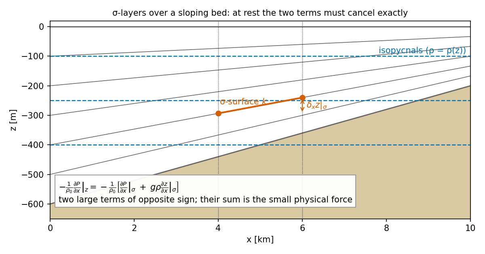
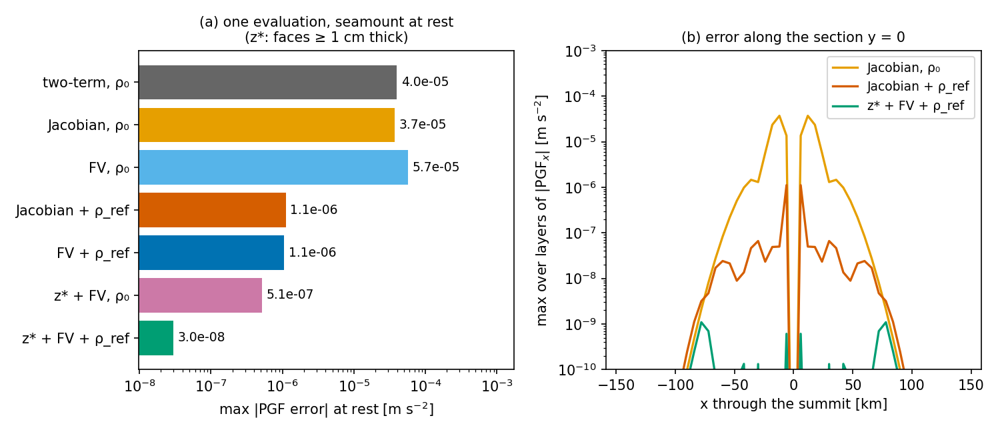

# Pressure gradient

The pressure-gradient force (PGF) drives every baroclinic motion, and on terrain-following layers it is the
term most prone to error: at rest over a slope it is the small difference of two large numbers. pyOCEAN offers
three baroclinic PGF schemes in `SigmaBaroclinic` (`pgf="twoterm"`, `"jacobian"`, `"fv"`), an optional
horizontally uniform reference profile $\rho_{ref}(z)$ that removes most of the resting stratification before
the PGF is computed (`rho_ref`), and, in ALE mode, z* or hybrid layers that avoid the problem at its root. This
page gives the continuous equations, each discrete scheme as coded, the results of the seamount and bay-mouth
step tests, and which combination to use.

## Physics

### Hydrostatic pressure

Under the hydrostatic and Boussinesq approximations,

$$
\frac{\partial p}{\partial z} = -\rho g
\quad\Rightarrow\quad
p(x,y,z,t) = p_a + \rho_0 g\,\eta + g\int_z^{\eta}\big(\rho - \rho_0\big)\,dz' ,
$$

and the horizontal force per unit mass is $-\frac{1}{\rho_0}\nabla_z p$. pyOCEAN splits it in two:

$$
-\frac{1}{\rho_0}\nabla_z p = \underbrace{-g\nabla\eta}_{\text{barotropic: free-surface solver}}
\;\underbrace{-\frac{g}{\rho_0}\nabla_z\int_z^{\eta}\rho'\,dz'}_{\text{baroclinic: this page}},
\qquad \rho' = \rho - \rho_0 .
$$

The barotropic part is θ-implicit in the free-surface step ([Free surface and time stepping](free-surface-time-stepping.md));
the baroclinic part is an explicit tendency in $G_k$ (`_tendencies`, `core/dynamics/sigma_baroclinic.py:1516`),
extrapolated with AB3. The surface atmospheric pressure $p_a$ is not included.

**Equation of state.** The stratified model has a linear EOS in temperature only (as CROCO `lin_EOS_cff`;
`density`, `:1285`):

$$
\rho = \rho_0 - \alpha\,(T - T_0),
$$

with `rho0` = $\rho_0$ (default 1000 kg m⁻³), `t_coef` = $\alpha$ (default 0.2 kg m⁻³ °C⁻¹), `t_ref` = $T_0$
(default 0 °C). Since N2a `salinity=True` adds $+\beta(S - S_0)$; since 2026-11-01 `eos="wright_full"` and
`"teos10"` are nonlinear and pressure dependent, and `pgf="fv"` then uses MOM6's `int_density_dz_generic_plm`
(T and S reconstructed separately, density evaluated at 5 × 5 quadrature points per face and layer), see
[Equation of state](equation-of-state.md#pressure-gradient). The phase-1 z model uses `physics/eos` (linear or TEOS-10).

### Why σ-layers make the PGF hard

On a surface of constant σ (or any layer that is not horizontal), the gradient at constant $z$ becomes

$$
\left.\frac{\partial P}{\partial x}\right|_z
= \left.\frac{\partial P}{\partial x}\right|_\sigma - \frac{\partial P}{\partial z}\left.\frac{\partial z}{\partial x}\right|_\sigma
= \left.\frac{\partial P}{\partial x}\right|_\sigma + g\rho\left.\frac{\partial z}{\partial x}\right|_\sigma .
$$

Over a slope, for a resting ocean with $\rho = \rho(z)$, both terms are large and must cancel exactly; their
discretisation errors do not (Haney 1991). The error grows with the steepness of the layers relative to the
grid and with the curvature of $\rho(z)$. Two slope factors measure it (`diagnostics/domain_check.py:11-20`):

$$
r_{x0} = \frac{|h_1 - h_2|}{h_1 + h_2}\ \ \text{(Beckmann \& Haidvogel 1993)},\qquad
r_{x1} = \max_k \frac{|z_{1,k} - z_{2,k} + z_{1,k-1} - z_{2,k-1}|}{|z_{1,k} + z_{2,k} - z_{1,k-1} - z_{2,k-1}|}\ \ \text{(Haney 1991)}
$$

for adjacent cells 1, 2 and interfaces $z_k$. $r_{x1} > 1$ means a layer of one column lies entirely above or below
the same layer of its neighbour: the scheme is then **hydrostatically inconsistent**, the stencil compares
densities from non-overlapping depth ranges. The usual limits are $r_{x0} \lesssim 0.2$ and $r_{x1} \lesssim 3$–7
(`check_domain`, `diagnostics/domain_check.py:176`, warns above `rx0_max = 0.2` and `rx1_max = 6`). The BayIW bay-mouth step has $r_{x0}$ = 0.57 and
$r_{x1}$ = 684; the seamount test $r_{x0}$ = 0.27, $r_{x1}$ = 10.7 (`validation/bayiw_iw/README.md`,
`validation/seamount/README.md`).

*σ-layers (grey) cross horizontal isopycnals (blue) over a slope. Along the red σ-surface the pressure changes
mostly because the surface dips; the term $g\rho\,\partial z/\partial x|_\sigma$ removes that change. At rest the
sum must be exactly zero.*

## The schemes in the code

`_baroclinic_pgf` (`core/dynamics/sigma_baroclinic.py:1381`) computes the baroclinic PGF at all u- and v-faces,
for every layer, from $\eta$, $T$ and (ALE) the layer thicknesses $h$. In σ mode $h_k = D\,\Delta\sigma_k$ and the
layer centres are $z_k = -H + D\,\sigma_{c,k}$, $D = \max(H + \eta, d_{min})$; in ALE mode $z_k$ are the centres
of $h$ (`layer_heights`, `:1267`). Faces with a NaN rest depth (walls) get 0; domain-edge faces get 0.

The anomaly used by all three schemes is

$$
\rho'_k = \rho(T_k) - \rho_{ref}(z_k)\qquad\text{or}\qquad \rho'_k = \rho(T_k) - \rho_0 \ \text{ without a profile.}
$$

### `pgf="twoterm"`: the second-order two-term form

$$
P'_k = g\Big(\sum_{k'>k}\rho'_{k'}h_{k'} + \tfrac12\rho'_k h_k\Big),\qquad
\mathrm{PGF}^x_{k} = -\frac{1}{\rho_0\,\Delta x_u}\Big[\big(P'_{k,R} - P'_{k,L}\big) + g\,\tfrac12\big(\rho'_{k,R} + \rho'_{k,L}\big)\big(z_{k,R} - z_{k,L}\big)\Big]
$$

(`:1416-1423`), $L$, $R$ the two cells of the face and $\Delta x_u$ the centre-to-centre distance (`fs.du`). It is
exact for horizontally uniform $\rho$ over a flat bed, and has large errors over steep slopes: max $|u|$
≈ 50 cm s⁻¹ in the seamount test (docstring at `:1390-1391`).

### `pgf="jacobian"` (default): the density-Jacobian form

The code cites **Song (1998)** for this scheme (docstring at `:1392-1396` and module docstring `:26-27`); the
higher-order Jacobian of Shchepetkin & McWilliams (2003) is **not** implemented (it is listed as pending in
`validation/seamount/README.md`). The horizontal pressure gradient at constant $z$ is integrated down from the
surface between consecutive layer centres:

$$
\Delta x\,\left.\frac{\partial P'}{\partial x}\right|_z(z_k)
= g\,\overline{\rho'_s}^{\,x}\,\delta_x\eta
+ g\sum_{k'=k}^{N-1}\Big[\delta_x\overline{\rho'}^{\,k}\;\overline{\delta_k z}^{\,x} - \delta_x\overline{z}^{\,k}\;\overline{\delta_k\rho'}^{\,x}\Big]_{k'+\frac12},
$$

where, for the pair of levels $(k', k'+1)$ of the two columns $L$, $R$ (`along`, `:1424-1437`):

$$
\overline{\rho'}^{\,k} = \tfrac12(\rho'_{k'} + \rho'_{k'+1}),\quad
\overline{z}^{\,k} = \tfrac12(z_{k'} + z_{k'+1}),\quad
\overline{\delta_k z}^{\,x} = \tfrac12\big[(z_{k'+1} - z_{k'})_L + (z_{k'+1} - z_{k'})_R\big],
$$

and $\delta_x a = a_R - a_L$. Level $N$ is the free surface: $z_N = \eta$ and $\rho'_s$ is extrapolated linearly
from the two top layers, $\rho'_s = \rho'_{N-1} + (\rho'_{N-1} - \rho'_{N-2})(\eta - z_{N-1})/(z_{N-1} - z_{N-2})$
(`:1411-1415`). The first term, $g\,\overline{\rho'_s}\,\delta_x\eta$, is the contribution of the anomaly between
the two surface heights. Then

$$
\mathrm{PGF}^x_k = -\frac{1}{\rho_0\,\Delta x_u}\;\Delta x\,\left.\frac{\partial P'}{\partial x}\right|_z(z_k).
$$

The Jacobian $\delta_x\bar\rho\,\overline{\delta_k z} - \delta_x\bar z\,\overline{\delta_k\rho}$ is the discrete
form of $\partial(\rho, z)/\partial(x, k)$; it vanishes identically when $\rho$ is a linear function of $z$, so the
scheme is **exact for linear stratification over any topography**
(`test_jacobian_pgf_is_exact_for_linear_stratification_over_a_seamount`, `tests/test_sigma_baroclinic.py:195-203`:
< 1e-13 m s⁻², also with stretched σ; the two-term form gives > 1e-6). For real (curved) profiles its error is
nearly that of the two-term form (next section).

### Reference profile `rho_ref`: remove the resting stratification first

The pressure of a horizontally uniform profile $\rho_{ref}(z)$ has no horizontal gradient at fixed $z$, so
subtracting it before the PGF removes the two large cancelling terms (Haney 1991; the "balanced" method of
Berntsen et al. 2015; `:1385-1388`). Only the anomaly $\rho - \rho_{ref}(z)$, usually a few per cent of the
stratification, goes through the scheme.

- `rho_ref=None` (default): $\rho_{ref} = \rho_0$.
- `rho_ref="auto"`: `initial_state` builds the profile from the initial $T$ with `reference_profile`
    (`:780`): the cell densities are averaged in 400 depth bins between the shallowest and deepest centre, and the
    bin means are interpolated linearly in $z$ (constant beyond the ends). Wet cells only. With
    `initial_state(..., h_src=...)` the profile comes from the source grid (`:1240-1243`).
- Any callable $z \mapsto \rho_{ref}(z)$, e.g. a `ReferenceProfile(z, rho)` (`:884`; `np.interp`, or a parallel
    Numba kernel with the same arithmetic for ≥ 1000 heights).

The profile is fixed for the whole run. The same profile is used by the along-layer tracer diffusion, which
diffuses $T - T_{ref}(z)$ ([Tracers](tracers.md#explicit-diffusion)).

!!! warning "Surface term with a reference profile (twoterm/jacobian)"
    With a profile, `twoterm` and `jacobian` integrate only $\rho - \rho_{ref}$ from the surface, and the
    barotropic solver uses $g\nabla\eta$ (that is, $\rho_0$ at the surface). The term
    $\tfrac{g}{\rho_0}\big(\rho_{ref}(\eta) - \rho_0\big)\nabla\eta$ is therefore not included, an error of
    $|\rho_{ref}(0) - \rho_0|/\rho_0$ in the surface-slope force (0 for the seamount profile, whose surface
    density is $\rho_0$; ~0.3 % for a 3 kg m⁻³ surface anomaly). The FV scheme includes it (below).

### `pgf="fv"`: finite-volume PGF (Adcroft, Hallberg & Harrison 2008)

`fv_pgf` (`core/vertical/pgf.py:165`, kernel `_fv_pgf_x`, `:107`) is a port of MOM6 `MOM_PressureForce_FV`
with the density integrals of `MOM_density_integrals.F90` (commit 0e9a561; line references in the module docstring,
`core/vertical/pgf.py:32-36`). The force on layer $k$ at a u-face is the contour integral of the pressure around
the layer's vertical section between the two cell centres, divided by its area:

$$
\mathrm{PFu}_k = -\frac{1}{\rho_0\,\bar h\,\Delta x}\oint p\,dz,\qquad \bar h = \tfrac12(h_L + h_R).
$$

Written out (surface-first indices in the kernel, `:157-159`):

$$
\mathrm{PFu}_k = \frac{1}{\rho_0\,\Delta x\,\bar h}\Big[\int_L p\,dz - \int_R p\,dz
+ \langle p\rangle^{x}_{top}\,\big(e^{top}_R - e^{top}_L\big) - \langle p\rangle^{x}_{bot}\,\big(e^{bot}_R - e^{bot}_L\big)\Big],
$$

with $e$ the interface heights, $\int_{L,R} p\,dz$ the pressure integrated over the layer in each column, and
$\langle p\rangle^x$ the mean pressure along the (straight) top and bottom interfaces between the two centres.
All integrals use **Boole's 5-point rule** (`_boole_mean`, `:95`):

$$
B = \frac{7(r_0 + r_4) + 32(r_1 + r_3) + 12\,r_2}{90},\qquad r_m = \rho'\ \text{at}\ m/4\ \text{of the layer},
$$

exact for polynomials up to degree 5, so exact for a linear EOS with piecewise-linear $T$. In the column:
$\Delta p_{layer} = g\,h\,B$, and $\int p\,dz = p_{top}h + \tfrac12 g h^2\big[B - (16(r_3 - r_1) + 7(r_4 - r_0))/90\big]$
(`:126-129`). Along the interface the bottom-pressure increment is integrated with Boole's rule at the 5
positions $m/4$ between $L$ and $R$, thickness and edge values interpolated linearly (`:142-156`). Only the
baroclinic part is returned: the $\rho_0 g\eta$ part is the free-surface gradient, and $\oint(\eta - z)\,dz$ gives
exactly $-g\,\delta_x\eta$.

**Reconstruction.** Inside each layer $T$ is linear between its bottom and top edge values
(`pressure_edges_plm`, `:56`): limited PLM in the interior layers (White & Adcroft 2008; MOM6
`pressure_reconstruction_plm`, `MOM_ALE.F90:1512-1596`), and unlimited h-weighted extrapolation in the bed and top
layers (`PLM_functions.F90:164-183`):

$$
T^{top}_0 = \frac{T_1 h_0 + T_0 h_1}{h_0 + h_1},\qquad T^{bot}_0 = 2T_0 - T^{top}_0
$$

(and symmetrically at the top).

**Anomaly reconstruction (beyond MOM6).** With a reference profile the PLM is applied to the anomaly
$T' = T - T_{ref}(z_c)$ at the layer centres, $T_{ref}(z) = T_0 + (\rho_0 - \rho_{ref}(z))/\alpha$, not to $T$
(`:185-186`). The curvature of the mean stratification then never enters the reconstruction error, and a column
equal to the reference gives no force at all. The column-constant surface term is
$p'_a = g\,\eta\,\big(\rho_{ref}(\eta/2) - \rho_0\big)$ (`:191-192`). MOM6 reconstructs $T$ itself and subtracts only a
constant $\rho_0$ (module docstring, `:15-23`).

**Bottom mass weighting near vanished layers** (MOM6 `MASS_WEIGHT_IN_PRESSURE_GRADIENT` with
`MASS_WEIGHT_IN_PGF_VANISHED_ONLY`, `MOM_density_integrals.F90:652-685`; `:131-141`). Only when one of the two
layers is vanished ($h \le$ `H_VANISHED` = 0.01 m, `:51`) and part of the layer lies below the neighbour's bed:

$$
h_w = \max\big(0,\ e^{bed}_L - e^{top}_R,\ e^{bed}_R - e^{top}_L\big)\Big(\frac{a - c}{a + c}\Big)^2,\quad a = h_L,\ c = h_R,
$$

$$
T'_L \leftarrow \frac{h_w c\,T'_R + (h_w a + a c)\,T'_L}{h_w(a + c) + a c},\qquad
T'_R \leftarrow \frac{h_w a\,T'_L + (h_w c + a c)\,T'_R}{h_w(a + c) + a c},
$$

for the top and bottom edge values used along the layer. The meaningless $T$ of a vanished layer then does not
enter the force. It is not applied between two non-vanished layers: there it would mix values from different
heights and break the exactness for linear stratification on steep σ-layers.

**Exactness.** FV is exact for linear stratification over the seamount (< 1e-13 m s⁻²,
`test_fv_pgf_is_exact_for_linear_stratification_over_a_seamount`, `tests/test_sigma_ale.py:108`) and gives
5e-17 m s⁻² with the exact profile (xfail note at `:116-118`).

## How large is the error? One evaluation at rest

`docs/manual/figures/make_pgf.py` builds the Beckmann & Haidvogel seamount of `validation/seamount`
(48 × 40 cells of 6 km, 20 layers, $H_0$ = 4500 m, 4050 m high, $L$ = 25 km) at rest with
$\rho(z) = \rho_0 + 3(1 - e^{z/1000})$ kg m⁻³ and calls `_baroclinic_pgf` once per scheme. The exact force is
zero, so the result is the error.

*(a) Maximum PGF error of each scheme at rest; (b) its distribution along the section through the summit. The
reference profile, not the scheme, removes most of the error; z* layers remove it at the root.*

| Scheme (one evaluation, this page's script) | max \|PGF error\| [m s⁻²] |
|---|---|
| two-term, $\rho_0$ | 4.0e-5 |
| Jacobian, $\rho_0$ | 3.7e-5 |
| FV, $\rho_0$, σ | 5.7e-5 |
| Jacobian + $\rho_{ref}$ | 1.1e-6 |
| FV + $\rho_{ref}$, σ | 1.1e-6 |
| z* + FV, $\rho_0$ (faces ≥ 1 cm) | 5.1e-7 |
| z* + FV + $\rho_{ref}$ (faces ≥ 1 cm) | 3.0e-8 |

The first five values match `validation/seamount/README.md` (4.0e-5, 3.7e-5, 1.1e-6, 1.1e-6) and the z* value
without profile (5.1e-7 on faces ≥ 1 cm; 2.5e-4 in the 1 mm layers below the neighbour's bed, where the velocity is
zero). For z* + FV + $\rho_{ref}$ the README gives 1.5e-7 (all faces, with the profile of `rho_ref="auto"`).

## Validation: the flow these errors drive

### Seamount (10 days, f₀ = 1e-4 s⁻¹, closed box)

From `validation/seamount/README.md` (Eulerian σ flux form; z* = ALE):

| PGF | max \|u\| at day 1 / 2 / 10 |
|---|---|
| Two-term, $\rho_0$ | 49.9 / 60.2 / 42.2 cm s⁻¹ |
| Jacobian, $\rho_0$ | 49.9 / 60.2 / 42.2 cm s⁻¹ |
| **Jacobian + $\rho_{ref}$** (`rho_ref="auto"`) | **0.17 / 0.21 / 0.41 cm s⁻¹** |
| FV + $\rho_{ref}$, σ | 0.16 / 0.20 / 1.36 cm s⁻¹ |
| **z* + FV + $\rho_{ref}$** | **0.02 / 0.02 / 0.10 cm s⁻¹** |
| z* + FV, no profile | 0.61 / 0.37 / 1.85 cm s⁻¹ |
| Beckmann & Haidvogel (1993), their spectral model | ~1 cm s⁻¹ at 10 days |

- **The second-order Jacobian alone is not enough**: against the two-term form the velocity changes by an rms of
    2e-6 m s⁻¹ (u rms 1.7e-2); its advantage is almost all in the depth-uniform part near the surface, which the free
    surface absorbs (Marsaleix et al. 2009 warn that low-order Jacobians are not automatically better). It stays the
    default because it is exact for linear stratification over any topography and never worse.
- **The reference profile is what works**: ~100× less spurious current.
- In σ, FV ties the Jacobian at $t = 0$ (1.06e-6 vs 1.11e-6) but the current grows earlier (1.36 vs 0.41 cm s⁻¹ at
    day 10). All configurations grow at the same rate (doubling every ~2 days, independent of $\Delta t$); FV only seeds
    the mode ~4 days earlier. The cause of this growing mode is open (README "Pendiente").
- Later runs: the four-model Ilicak benchmark (64 × 48 × 20, ALE configurations with vector-invariant momentum)
    gives σ + FV + $\rho_{ref}$ 0.17 / 0.19 / 0.21 cm s⁻¹ and z* 0.02 / 0.02 / 0.08 cm s⁻¹, against CROCO σ 36 and
    MOM6 σ 154 cm s⁻¹ at day 10 (MITgcm z* exact, 0) (`validation/ilicak_benchmark/README.md`).
    `validation/mom6_lock_exchange/README.md` records z* + FV + $\rho_{ref}$ 0.07 cm s⁻¹ at day 10 (before: 0.11).

### Bay-mouth step 600 → 164 m (BayIW)

A 2-D section (40 cells of 1 km, 30 layers) across the BayIW bay-mouth step, at rest with a tanh pycnocline at
80 m, 12 h with $\Delta t$ = 60 s (`_step_section` and `test_bay_mouth_step_spurious_flow_sigma_vs_zstar`,
`tests/test_sigma_ale.py:406-435`):

| Configuration | max \|u\| after 12 h |
|---|---|
| σ + Jacobian + $\rho_{ref}$ | 7.3 cm s⁻¹ |
| z* + FV + $\rho_{ref}$ (ALE) | 5e-12 m s⁻¹ (3.5e-12 after the B2 plan) |

(`docs/design/vision_roadmap.md` §7; `docs/superpowers/plans/2026-10-12-ale-B2-isopycnal-layers.md`.) The test
asserts z* < 1e-3 m s⁻¹ and < 5 % of σ. With $r_{x1}$ = 684 no σ scheme can be consistent; z* layers are flat, so
there are no cancelling terms.

### Unit tests

| Test | What it checks |
|---|---|
| `test_jacobian_pgf_is_exact_for_a_linear_density_over_a_flat_bed` (`tests/test_sigma_baroclinic.py:176`) | $\rho' = ax + bz$: exact $\mathrm{PGF}_x = g a z/\rho_0$ to 1e-10; two-term agrees to 1e-9 |
| `test_jacobian_pgf_is_exact_for_linear_stratification_over_a_seamount` (`:195`) | < 1e-13, uniform and stretched σ |
| `test_fv_pgf_is_exact_for_linear_stratification_over_a_seamount` (`tests/test_sigma_ale.py:108`) | < 1e-13 |
| `test_fv_pgf_error_over_the_seamount_is_not_larger_than_the_jacobian` (`:119`) | **xfail**, pending decision: binned profile FV 7.888e-8 vs Jacobian 7.876e-8 (+0.15 %); no profile FV 8.5e-5 vs 4.7e-5 |
| `test_fv_pgf_tabulates_any_callable_reference_profile` (`:133`) | any callable works as `rho_ref` |
| `tests/test_vertical_pgf.py` | FV kernel against analytic cases (5 tests) |

See also [Idealised benchmarks](../validation/idealised.md) and [BayIW](../validation/bayiw.md).

## Which scheme to use

| Situation | Recommendation |
|---|---|
| Eulerian σ, smooth topography | `pgf="jacobian"` (default) + `rho_ref="auto"` |
| Eulerian σ, steep slopes ($r_{x1}$ > 6) | still `rho_ref="auto"`, but expect spurious flow; prefer ALE z* or hybrid |
| ALE z* or hybrid | `pgf="fv"` + `rho_ref="auto"` (every ALE benchmark uses this) |
| Strong horizontal density fronts on a slope | the profile helps less (its anomalies are large); FV in z*/hybrid |

Note that `pgf` defaults to `"jacobian"` in ALE mode too; FV must be asked for.

## Options and defaults

| Option | Values | Default | Meaning | Where |
|---|---|---|---|---|
| `pgf` | `"twoterm"`, `"jacobian"`, `"fv"` | `"jacobian"` | baroclinic PGF scheme | `SigmaBaroclinic.__init__`, `:1021` |
| `rho_ref` | `None`, `"auto"`, callable | `None` | reference profile $\rho_{ref}(z)$ subtracted before the PGF and in the along-layer diffusion | `initial_state`, `:1207` |
| `rho0`, `t_coef`, `t_ref` | floats | 1000, 0.2, 0 | linear EOS $\rho_0$, $\alpha$, $T_0$ | `density`, `:1285` |
| `mass_weight`, `h_vanished` (of `fv_pgf`) | bool, m | True, 0.01 | bottom mass weighting near vanished layers | `core/vertical/pgf.py:165` |

## Legacy z-level pressure

`core/dynamics/pressure.py` (phase 1) computes the full hydrostatic pressure at T-cell centres on fixed z-levels
(Marshall et al. 1997, App. A; `hydrostatic_pressure`, `:79`):

$$
p_{face,0} = 0,\quad p_{face,k+1} = p_{face,k} + \rho_k g\,\Delta z_k,\qquad
p_k = \rho_0 g\eta + p_{face,k} + \tfrac12\rho_k g\,\Delta z_k ,
$$

with $k = 0$ at the surface, the full density $\rho_k$ (not an anomaly), $\rho_0$ = 1025 kg m⁻³, and no partial cells.
The PGF is the centred difference $-(p_{k,i} - p_{k,i-1})/(\rho_0\,\Delta x_u)$ (`pressure_gradient_x`, `:174`;
`pressure_gradient_y`, `:244`), zero on the domain-edge faces. On z-levels the two-term problem does not exist.
`surface_pressure_cg` (`:310`) is deprecated (Dirichlet η = 0 on the edges); use `ImplicitFreeSurface`.

## Known limitations

- ~~Linear EOS in $T$ only~~: salinity since N2a, nonlinear EOS since 2026-11-01
    ([Equation of state](equation-of-state.md)).
- The reference profile is fixed in time (an evolving profile is pending, `validation/seamount/README.md`).
- No high-order Jacobian (Shchepetkin & McWilliams 2003) and no PPM/PQM reconstruction in FV (Engwirda et al. 2017);
    both pending.
- With a profile, twoterm/jacobian omit $\tfrac{g}{\rho_0}(\rho_{ref}(\eta) - \rho_0)\nabla\eta$ (see the warning above).
- A spurious mode doubling every ~2 days in all seamount configurations (σ and z*) is not yet explained.
- The FV-vs-Jacobian comparison over the seamount is an open decision (strict=False xfail).

## References

- Adcroft, A., Hallberg, R. & Harrison, M. (2008). A finite volume discretization of the pressure gradient force
    using analytic integration. *Ocean Modell.* 22, 106–113.
    doi:[10.1016/j.ocemod.2008.02.001](https://doi.org/10.1016/j.ocemod.2008.02.001) [verify]
- Beckmann, A. & Haidvogel, D.B. (1993). Numerical simulation of flow around a tall isolated seamount.
    *J. Phys. Oceanogr.* 23, 1736–1753. doi:[10.1175/1520-0485(1993)023<1736:NSOFAA>2.0.CO;2](https://doi.org/10.1175/1520-0485(1993)023%3C1736:NSOFAA%3E2.0.CO;2)
- Berntsen, J., Xing, J. & Davies, A.M. (2015). Internal pressure gradient errors in σ-coordinate ocean models
    in high resolution fjord studies. *Ocean Modell.* doi:[10.1016/j.ocemod.2015.05.009](https://doi.org/10.1016/j.ocemod.2015.05.009)
- Engwirda, D., Kelley, M. & Marshall, J. (2017). High-order accurate finite-volume formulations for the pressure
    gradient force in layered ocean models. *Ocean Modell.* [verify]
- Haney, R.L. (1991). On the pressure gradient force over steep topography in sigma coordinate ocean models.
    *J. Phys. Oceanogr.* 21, 610–619. doi:[10.1175/1520-0485(1991)021<0610:OTPGFO>2.0.CO;2](https://doi.org/10.1175/1520-0485(1991)021%3C0610:OTPGFO%3E2.0.CO;2) [verify]
- Marsaleix, P., Auclair, F. & Estournel, C. (2009). Low-order pressure gradient schemes in sigma coordinate
    models: the seamount test revisited. *Ocean Modell.* 30, 169–177. doi:[10.1016/j.ocemod.2009.06.011](https://doi.org/10.1016/j.ocemod.2009.06.011)
- Marshall, J., Adcroft, A., Hill, C., Perelman, L. & Heisey, C. (1997). A finite-volume, incompressible
    Navier–Stokes model for studies of the ocean on parallel computers. *J. Geophys. Res.* 102(C3), 5753–5766.
- Shchepetkin, A.F. & McWilliams, J.C. (2003). A method for computing horizontal pressure-gradient force in an
    oceanic model with a nonaligned vertical coordinate. *J. Geophys. Res.* 108(C3).
    doi:[10.1029/2001JC001047](https://doi.org/10.1029/2001JC001047)
- Song, Y.T. (1998). A general pressure gradient formulation for ocean models. Part I: Scheme design and
    diagnostic analysis. *Mon. Wea. Rev.* 126, 3213–3230.
    doi:[10.1175/1520-0493(1998)126<3213:AGPGFF>2.0.CO;2](https://doi.org/10.1175/1520-0493(1998)126%3C3213:AGPGFF%3E2.0.CO;2)
- White, L. & Adcroft, A. (2008). A high-order finite volume remapping scheme for nonuniform grids: the piecewise
    quartic method (PQM). *J. Comput. Phys.* 227, 7394–7422. doi:[10.1016/j.jcp.2008.04.026](https://doi.org/10.1016/j.jcp.2008.04.026)
- MOM6 source, commit 0e9a561: `src/core/MOM_PressureForce_FV.F90`, `src/core/MOM_density_integrals.F90`,
    `src/ALE/MOM_ALE.F90`, `src/ALE/PLM_functions.F90` (local copy `~/pyOCEAN_refs/MOM6/src/`).
