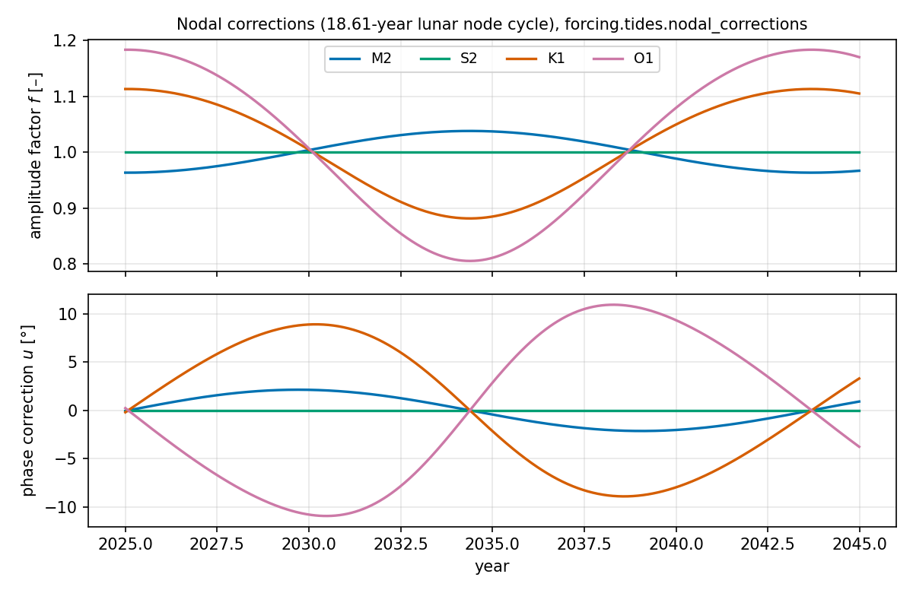
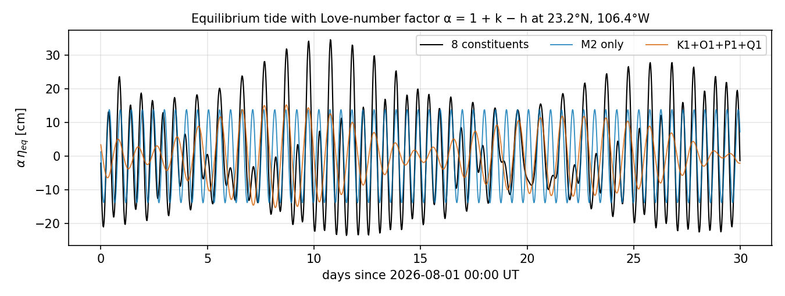
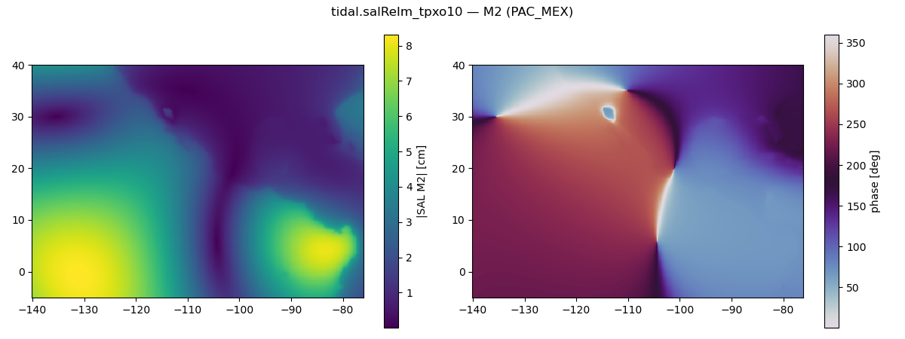
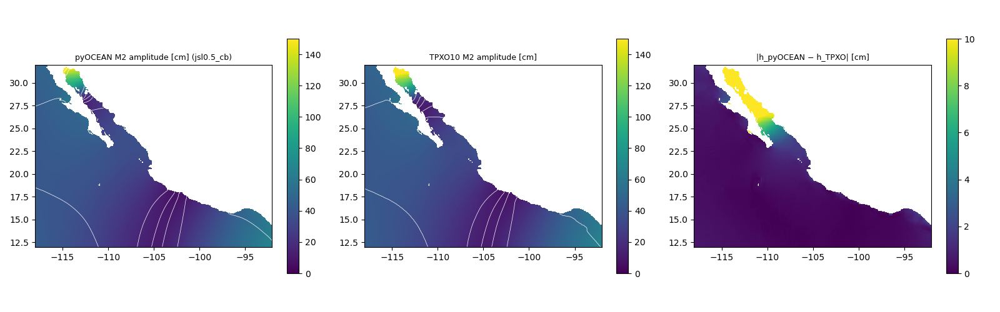

# Tides

pyOCEAN forces tides in two ways, as HYCOM does: through the **open boundaries** (elevation and transport
from the TPXO atlas, applied with the Flather radiation condition) and through the **tidal potential**
inside the domain (equilibrium tide with Love numbers, minus self-attraction and loading). An optional
**internal-tide drag** (Jayne & St. Laurent 2001, HYCOM `tiddrg = 1`) removes the energy that a barotropic
model cannot radiate into internal waves. All harmonic constants use the OTPS/TPXO conventions, so TPXO
values, TICON-3 gauge constants and model harmonic analyses can be compared directly. The code lives in
`forcing/tides.py`, `forcing/sources/tpxo.py`, `physics/tides/drag.py`,
`diagnostics/sealevel_qc.py` (harmonic analysis) and `diagnostics/tide_gauges.py` (gauge comparison).
How to run a tidal simulation is described in [Tides and the 2-D tidal model](../user-guide/tidal-model.md).

## Harmonic prediction (OTPS convention)

A tidal field is reconstructed from complex constants $h_c = \mathrm{Re}\,h_c + i\,\mathrm{Im}\,h_c$
(`predict`, `forcing/tides.py:139`):

$$
\eta(t) = \sum_c f_c(t)\left[\mathrm{Re}(h_c)\cos\theta_c(t) - \mathrm{Im}(h_c)\sin\theta_c(t)\right]
= \mathrm{Re}\sum_c f_c\,h_c\,e^{i\theta_c},
\qquad \theta_c(t) = \omega_c\,(t - t_{1992}) + \varphi_c + u_c(t).
$$

- $h_c = A_c e^{-iG_c}$: amplitude $A$ and Greenwich phase lag $G$, so $\eta = \sum f A\cos(\theta - G)$
    and $G = \mathrm{atan2}(-\mathrm{Im}\,h, \mathrm{Re}\,h)$.
- $\omega_c$ [rad s⁻¹] and the astronomical argument $\varphi_c$ at 1992-01-01 00:00 UT (MJD 48622) are the
    OTPS constants (`constit.h`; `OMEGA`, `PHASE_1992`, `forcing/tides.py:45,51`).
- Time is converted to Modified Julian Days (`to_mjd`, `forcing/tides.py:60`).
- `predict` works for any field: elevation [m], velocity [m s⁻¹] or transport [m² s⁻¹]; the leading
    dimensions of `hc` are spatial and the output has shape (nt, …).

Only the eight constituents HYCOM can force (`tidcon`) are tabulated, in HYCOM order
(`CONSTITUENTS`, `forcing/tides.py:42`):

| Constituent | ω [rad s⁻¹] | period [h] | φ₁₉₉₂ [rad] | species | equilibrium amplitude $A_c$ [m] | α = 1 + k − h |
|---|---|---|---|---|---|---|
| M2 | 1.405189e-4 | 12.42 | 1.731557546 | 2 | 0.2441 | 1 + 0.302 − 0.609 = 0.693 |
| S2 | 1.454441e-4 | 12.00 | 0 | 2 | 0.112743 | 0.693 |
| K1 | 7.292117e-5 | 23.93 | 0.173003674 | 1 | 0.141565 | 1 + 0.256 − 0.520 = 0.736 |
| O1 | 6.759774e-5 | 25.82 | 1.558553872 | 1 | 0.100661 | 1 + 0.298 − 0.603 = 0.695 |
| N2 | 1.378797e-4 | 12.66 | 6.050721243 | 2 | 0.046397 | 0.693 |
| P1 | 7.252295e-5 | 24.07 | 6.110181633 | 1 | 0.046848 | 1 + 0.287 − 0.581 = 0.706 |
| K2 | 1.458423e-4 | 11.97 | 3.487600001 | 2 | 0.030684 | 0.693 |
| Q1 | 6.495854e-5 | 26.87 | 5.877717569 | 1 | 0.019273 | 0.695 |

### Nodal corrections

The 18.61-year cycle of the lunar node modulates amplitude and phase. `nodal_corrections`
(`forcing/tides.py:84`) uses the OTPS formulae (Schureman 1958 approximations) in the longitude of the
node $N$, with the mean longitudes of Cartwright (1982) (`mean_longitudes`, `forcing/tides.py:66`;
$T$ = MJD − 51544.4993 days, $N = 125.0445° - 0.05295377°\,T$, also $s$, $h$, $p$ for the Moon, Sun and
perigee):

| Constituent | correction |
|---|---|
| M2, N2 | $f e^{iu} = 1 - 0.03731\,e^{iN} + 0.00052\,e^{2iN}$ |
| K1 | $f\cos u = 1 + 0.1158\cos N - 0.0029\cos 2N$, $f\sin u = -0.1554\sin N + 0.0029\sin 2N$ |
| K2 | $f\cos u = 1 + 0.2852\cos N + 0.0324\cos 2N$, $f\sin u = -0.3108\sin N - 0.0324\sin 2N$ |
| O1 | $f = \lvert 1 + 0.189\,e^{iN} - 0.0058\,e^{2iN}\rvert$, $u = 10.8°\sin N - 1.3°\sin 2N + 0.2°\sin 3N$ |
| Q1 | $f = \lvert 1 + 0.188\,e^{iN}\rvert$, $u = \arctan[0.189\sin N/(1 + 0.189\cos N)]$ |
| S2, P1 | $f = 1$, $u = 0$ |

*Nodal factors over 2025–2045 from `nodal_corrections` (`docs/manual/figures/make_tides.py`). O1 varies by
±19 % and K1 by ±11 % over the 18.61-year cycle, M2 by only ±4 %; ignoring f and u gives errors of that
size in the boundary forcing.*

The implementation is checked against pyTMD 2.1.7 in OTIS mode (`validation/tides/make_reference.py` →
`tests/data/tide_otps_reference.npz`; `tests/test_tides.py`) and matches it to round-off (CLAUDE.md).

## Open-boundary tides from TPXO

### Reading the atlas

`read_tpxo(h_files, u_files, grid_file, lon_range, lat_range)` (`forcing/sources/tpxo.py:93`) reads TPXO
NetCDF atlases (OTIS/atlas layout, e.g. TPXO10-atlas-v2 at 1/30°):

| File | Variables | Usual units |
|---|---|---|
| `h_<c>_tpxo10_atlas_30_v2.nc` | `hRe`, `hIm` (elevation) | mm |
| `u_<c>_tpxo10_atlas_30_v2.nc` | `uRe`, `uIm`, `vRe`, `vIm` (**transport**) | cm² s⁻¹ |
| `grid_tpxo10atlas_v2.nc` | `lon_z`, `lat_z`, `lon_u`, `lat_u`, `lon_v`, `lat_v`, `hz` | ° |

- Arrays are stored (lon, lat), longitudes 0–360 °E, on TPXO's own Arakawa C grid: U at (`lon_u`, `lat_z`),
    V at (`lon_z`, `lat_v`). Names are matched case-insensitively (TPXO10 uses `uRe…vIm`, older atlases
    `URe…VIm`); the constituent is inferred from the file name.
- Units are read from each variable's `units` attribute and converted to SI (`_si_factor`,
    `forcing/sources/tpxo.py:44`): elevation → m, transport → m² s⁻¹. Unknown units raise.
- Only the requested region plus one cell is read from disk (the global arrays are 10800 × 5401).
- **Land nodes**, stored as exactly 0 in TPXO (`option_0 = "land"`), are returned as NaN
    (`forcing/sources/tpxo.py:136`).
- Output: `xr.Dataset` with `h` (constituent, lat, lon) [m] and, with `u_files`, `U` (constituent, lat, lon_u)
    and `V` (constituent, lat_v, lon) [m² s⁻¹], complex, longitudes −180–180. The TPXO licence is academic:
    files are read in place, never copied.

### Interpolation to the open faces and velocity at model depth

`boundary_tide_constants(constants, h_grid, v_grid, hfac, flather_u, flather_v, constituents=None)`
(`forcing/tides.py:256`) interpolates the constants **once** to every Flather face:

- η from the z nodes, U and V from their own C-grid points, with a **land-aware bilinear** interpolation
    (`_interp_complex`, `forcing/tides.py:179`): NaN (land) nodes are excluded and the weights of the
    remaining ocean nodes renormalised, $\psi = \sum w_k\psi_k / \sum w_k$, so coastal amplitudes are not
    pulled towards zero (as OTPS/pyTMD). Points with no ocean node in their cell are NaN.
- Faces whose atlas cell holds only land (a model coastline finer than the atlas) take the constants of
    the nearest valid face (`_fill_from_nearest`, `forcing/tides.py:299`).
- The model depth at each face is $\sum_k \Delta z_k\,\mathrm{hFac}_{k}$ from the open-boundary hFac.

`boundary_tides_at(bc, t, ramp=1.0)` (`forcing/tides.py:314`) then predicts at time $t$:

$$
\eta_{ext} = r(t)\,\mathrm{predict}(h),\qquad \bar u_{ext} = r(t)\,\frac{\mathrm{predict}(U)}{H_{model}},
$$

i.e. the **TPXO transport divided by the model depth**, so the tidal volume flux is conserved on the model
bathymetry (TPXO's own velocity is transport over TPXO's depth). The output dict holds `eta_u`, `ubar_u`
(ny, nx+1) and `eta_v`, `vbar_v` (ny+1, nx), zero except on the Flather faces, ready for
`ImplicitFreeSurface.step(flather_eta=(eta_u, eta_v), flather_ubar=ubar_u, flather_vbar=vbar_v)`.
`boundary_tides` (`forcing/tides.py:209`) does both steps at every call (8× slower in PAC_MEX, CLAUDE.md);
use the pair above in time loops. For θ = ½ pass the mid-step time.

The Flather condition itself (outward transport
$Q = L H[\bar u_{ext} + \sqrt{g/H}\,(\eta - \eta_{ext})]$, implicit, on the matrix diagonal) is described in
[Open boundaries and nesting](open-boundaries.md) and [Free surface and time stepping](free-surface-time-stepping.md).

**Spin-up ramp.** Boundary and body forcing are multiplied by $r(t) = 1 - e^{-5t/\tau}$, HYCOM `tidrmp`
form; the PAC_MEX runs use τ = 2 days (`r` = 0.9994 at day 3; `validation/pacmex_tides/run_tides.py:281`).

## Tidal potential: body tide and self-attraction and loading

### Equilibrium tide with Love numbers

Inside the domain the astronomical forcing is the gradient of the equilibrium tide, reduced by the
yielding of the solid Earth (Love numbers $k$, $h$). `equilibrium_constants(lon, lat, constituents,
love=True)` (`forcing/tides.py:356`) returns complex constants usable with `predict`:

$$
h_c = \alpha_c A_c \cos^2\varphi\; e^{2i\lambda}\ \ (\text{semidiurnal}),\qquad
h_c = \alpha_c A_c \sin 2\varphi\; e^{i\lambda}\ \ (\text{diurnal}),
\qquad \alpha_c = 1 + k_c - h_c ,
$$

so that `predict` gives $\alpha\eta_{eq} = \alpha A f\,G(\varphi)\cos(\theta_c + m\lambda)$, as HYCOM
`mod_tides.F90` (`atide = A α cos²φ cos 2λ`, `btide = A α cos²φ sin 2λ`). The α factors follow Foreman et
al. (1993) via HYCOM (table above; `LOVE_ALPHA`, `forcing/tides.py:345`); `love=False` gives the
astronomical equilibrium tide.

*Equilibrium tide α η_eq at Mazatlán in August 2026. Look at the spring–neap modulation of the full signal
(black) from the M2–S2 and K1–O1 beats; at 23°N the diurnal and semidiurnal parts are of similar size.*

### Self-attraction and loading (SAL)

The ocean tide deforms the Earth and its own gravity field. pyOCEAN offers the two HYCOM options:

1. **Per-constituent SAL** from a HYCOM `tidal.salReIm.[ab]` file (HYCOM `tidein = 2`).
    `read_sal_hycom(path_b, idm, jdm, constituents=CONSTITUENTS)` (`forcing/tides.py:437`) returns complex
    constants $F$, shape (jdm, idm, nc) [m]; records are Re, Im of each constituent in HYCOM order
    (`mod_tides.F90`, `tides_forfun_sal`). HYCOM forms `etide = α η_eq − F` and forces
    $-g\nabla(\eta - \text{etide})$. The physical forcing is $-g\nabla(\eta - \alpha\eta_{eq} - \eta_{SAL})$,
    so the file must hold $F = -\eta_{SAL}$. The real HYCOM-IOA file
    (`~/pyOCEAN_refs/tidal.salReIm_tpxo10.[ab]`, PAC_MEX 1600 × 1125) does: a complex regression over deep
    water gives $F \approx -0.10\,\eta$ for the semidiurnals and $\approx -0.14\,\eta$ for the diurnals
    against TPXO10, correlation 0.95–0.99 (`validation/tides/check_sal_real.py`; CLAUDE.md).
2. **Scalar SAL** (HYCOM `tidsal`): `ImplicitFreeSurface(sal_beta=β)` (`core/dynamics/free_surface.py:109`)
    uses $g(1-\beta)\nabla\eta$ in the surface pressure gradient (β ∈ [0, 1)). The check above shows that
    the blkdat scalar 0.06 underestimates SAL for PAC_MEX (CLAUDE.md).

The effective forcing height and its acceleration are

$$
\eta_{body} = \sum_c \left[\alpha_c\,\eta_{eq,c} - F_c\right],\qquad
F_x = g\,\frac{\eta_{b}[j,i] - \eta_{b}[j,i-1]}{\Delta x_u},\quad F_y\ \text{likewise}
$$

(`body_tide(lon, lat, t, constituents, sal=None, ramp=1.0)`, `forcing/tides.py:393`;
`body_force(h_grid, eta_body, g=9.81)`, `forcing/tides.py:421`, zero on the domain-edge faces). The force
is added to the momentum tendency like any explicit term. In the run scripts the constants are combined
once, `equilibrium_constants(...) - F`, and predicted each step.

*M2 constants of the HYCOM-IOA SAL file over PAC_MEX (copy of `validation/tides/sal_m2_pacmex.png`):
amplitude up to ~8 cm in the open Pacific and < 1 cm in the Gulf of California.*

## Internal-tide drag (JSL, HYCOM `tiddrg = 1`)

Over rough topography the barotropic tide loses energy to internal waves. Jayne & St. Laurent (2001)
parameterise this as a linear drag with rate $\sim \tfrac12\kappa h^2 N_b/H$; HYCOM (Arbic et al. 2010)
uses a precomputed global field JSL [s⁻¹] (HYCOM-examples GLBp0.08 `relax/DRAG/JSL.[ab]`) and reads
`tidal.rh` = JSL × depth [m s⁻¹]. `physics/tides/drag.py` reproduces the HYCOM-examples preparation
(wiki §8B, `tidal.JSLH.07.lim24.csh`):

1. `regrid_bilinear(field, lat_axis, lon_axis, lat, lon)` (`physics/tides/drag.py:60`): plain bilinear from
    the rectilinear global grid, land nodes included (HYCOM `isuba_field` without masks), NaN → 0.
2. `jsl_to_rh(jsl, depth, max_rate=1.1574e-5, min_rate=1.1574e-6)` (`physics/tides/drag.py:42`): clip JSL at
    1/day (`hycom_clip`), set JSL ≤ 1/(10 days) to 0 (`hycom_bandmask` + `hycom_void`), then
    $rh = \mathrm{JSL}\cdot H$, 0 on land.
3. `rh_at_faces(rh, wet)` (`physics/tides/drag.py:77`): mean of the adjacent wet T-cells (one cell at coasts
    and edges) — HYCOM applies the drag on the p-grid and averages its increment to the faces.
4. `tidal_drag_rate(rh_face, depth_face, drgscl)` (`physics/tides/drag.py:102`):
    $r = \texttt{drgscl}\cdot rh/H$ [s⁻¹], so the damping rate is drgscl × JSL, at most drgscl per day.
5. Applied backward-Euler on the depth-mean velocity (`mod_barotp.F90`, `thkdrg = 0`):
    $\bar u \leftarrow \bar u/(1 + \Delta t\,r)$ (`implicit_linear_drag`, `physics/tides/drag.py:109`); in
    the run scripts $r$ is added to the quadratic-drag rate in the same implicit factor.

`validation/tides/make_tidal_rh.py` regenerates the PAC_MEX `tidal.rh` from the global JSL and matches the
HYCOM-tools product to a median relative 4e-8 (CLAUDE.md).

## Harmonic analysis

`harmonic_analysis(t, h, constituents, inference=None, rayleigh=1.0)` (`diagnostics/sealevel_qc.py:65`)
fits, by least squares,

$$
h(t) = \bar h + \sum_c f_c\left[\mathrm{Re}\,h_c\cos\theta_c - \mathrm{Im}\,h_c\sin\theta_c\right],
$$

the same basis as `predict` (built by predicting unit constants), so its constants compare directly with
TPXO and TICON-3. Missing samples (NaN) are skipped. Pairs closer in frequency than the Rayleigh criterion
$\lvert\Delta\omega\rvert T \ge 2\pi R$ raise an error unless one of them is **inferred**,
$h_{inf} = r\,h_{ref}$ with a complex ratio $r$ from a trusted source (Foreman 1977; Pawlowicz et al. 2002),
e.g. `inference={"p1": ("k1", r_p1), "k2": ("s2", r_k2)}` with ratios from TPXO. Returns `hc` (complex, m),
`mean`, `residual` and the list `inferred`. Over 30 days P1 and K2 cannot be separated from K1 and S2.

The tidal run scripts accumulate the same normal equations online (hourly, after the spin-up) for M2, S2,
K1, O1, N2, Q1 at every grid point (`ha_basis`, `validation/pacmex_tides/run_tides.py:184`).

*M2 amplitude of the PAC_MEX barotropic run with JSL drag (drgscl 0.5) and the HYCOM-IOA drag field, against
TPXO10, and their vector difference (copy of `validation/pacmex_tides/out/m2_map_jsl0.5_cb.png`). Look at the
Gulf of California (right panel): the misfit there exceeds 10 cm while the open Pacific is within ~1 cm.*

## Validation

| Test | Result | Source |
|---|---|---|
| Nodal corrections and prediction vs pyTMD 2.1.7 (OTIS) | round-off | `tests/test_tides.py` |
| TPXO reader on the real TPXO10-atlas-v2 vs pyTMD | 9e-8 m / 7e-5°, incl. coastal points | `validation/tides/check_tpxo_real.py`, CLAUDE.md |
| Equilibrium tide, ramp, SAL subtraction, record order of `tidal.salReIm` | exact | `tests/test_tidal_potential.py` |
| Scalar SAL: seiche frequency uses g(1 − β) | 1e-9 | `tests/test_tidal_potential.py` |
| Small equatorial basin follows α η_eq − ⟨α η_eq⟩ | passes | `tests/test_tidal_potential.py` |
| Real SAL file sign and size | F ≈ −0.10 η (semidiurnal), −0.14 η (diurnal), corr 0.95–0.99 | `validation/tides/check_sal_real.py` |
| tidal.rh vs HYCOM-tools | median relative 4e-8 | `validation/tides/make_tidal_rh.py` |
| PAC_MEX barotropic run vs 31 TICON records | median RSS 1.95 cm (TPXO 1.87 cm) | `validation/pacmex_tides/out/summary.txt` |

Full results: [Tides and sea level](../validation/tides-sealevel.md).

## Known limitations

- Only 8 constituents (no M4, MS4, MN4 or long-period tides); `predict` raises for any other name.
- Mean longitudes use the Cartwright 1990–2010 formulae at all dates, as OTPS does.
- The equilibrium-tide forcing has no long-period species and no third-degree terms.
- SAL per constituent needs a HYCOM `tidal.salReIm` file on the model grid (or interpolated with
    `regrid_bilinear`); there is no online SAL computation.
- The JSL drag acts on the depth-mean velocity of the 2-D models only; it is not wired into
    `SigmaBaroclinic`.
- `boundary_tides_at` assumes the transport constants and model depth are positive at every Flather face;
    open faces must be wet (`open_boundary_hfac`).

## References

- Arbic, B.K., Wallcraft, A.J. & Metzger, E.J. (2010). Concurrent simulation of the eddying general
    circulation and tides in a global ocean model. *Ocean Modell.* 32, 175–187.
    doi:10.1016/j.ocemod.2010.01.007 **[verify]**
- Cartwright, D.E. (1982). Tidal analysis — a retrospect. In: *Time Series Methods in Hydrosciences*,
    Elsevier, 170–188.
- Egbert, G.D. & Erofeeva, S.Y. (2002). Efficient inverse modeling of barotropic ocean tides. *J. Atmos.
    Oceanic Technol.* 19, 183–204. doi:10.1175/1520-0426(2002)019<0183:EIMOBO>2.0.CO;2 **[verify]**
- Flather, R.A. (1976). A tidal model of the northwest European continental shelf. *Mém. Soc. R. Sci.
    Liège* 6(10), 141–164.
- Foreman, M.G.G. (1977). Manual for tidal heights analysis and prediction. Pacific Marine Science Report 77-10.
- Foreman, M.G.G., Henry, R.F., Walters, R.A. & Ballantyne, V.A. (1993). A finite element model for tides
    and resonance along the north coast of British Columbia. *J. Geophys. Res.* 98(C2), 2509–2531.
    doi:10.1029/92JC02470 **[verify]**
- Jayne, S.R. & St. Laurent, L.C. (2001). Parameterizing tidal dissipation over rough topography.
    *Geophys. Res. Lett.* 28, 811–814. doi:10.1029/2000GL012044 **[verify]**
- Pawlowicz, R., Beardsley, B. & Lentz, S. (2002). Classical tidal harmonic analysis including error
    estimates in MATLAB using T_TIDE. *Comput. Geosci.* 28, 929–937. doi:10.1016/S0098-3004(02)00013-4 **[verify]**
- Schureman, P. (1958). *Manual of Harmonic Analysis and Prediction of Tides.* US Coast and Geodetic Survey,
    Special Publication 98.
- Sutterley, T.C. et al. pyTMD: Python-based tidal prediction software (test oracle only). **[verify]**
