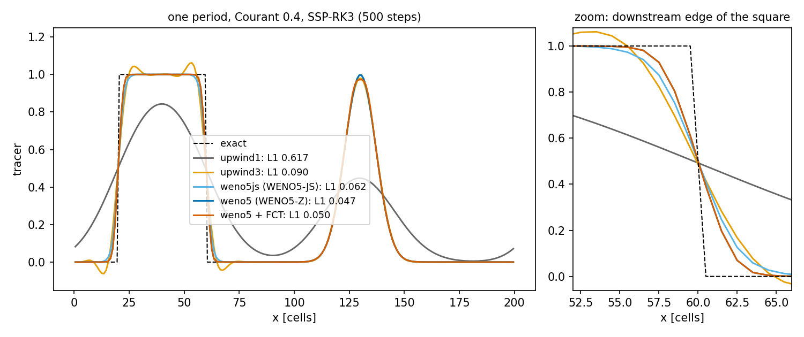

# Tracer transport and spurious mixing

The stratified model `SigmaBaroclinic` carries the temperature $T$ and, since N2a, an optional active salinity $S$;
they set the density through the linear equation of state or TEOS-10 ([Pressure gradient](pressure-gradient.md#physics)). This page describes its
transport: the flux-form equation on layers, the horizontal and vertical advection schemes (`tracer_scheme`), the
Zalesak flux-corrected transport of the ALE step (`tracer_limiter`), the values on open boundaries, the explicit
along-layer diffusion `kh` and the implicit vertical diffusion `kv`, and the two diagnostics that measure the mixing
the numerics add (RPE and the online variance decay `mix_num`). It ends with the legacy phase-1 advection.

## Physics

For layer $k$ of thickness $h_k$ the tracer equation in flux form is

$$
\frac{\partial (h_k T_k)}{\partial t} + \nabla_h\cdot(h_k\mathbf u_k T_k) + \big[\omega T\big]_{k-\frac12}^{k+\frac12}
= \nabla_h\cdot\big(K_h\,h_k\nabla_h \tilde T_k\big) + \Big[K_v\frac{\partial T}{\partial z}\Big]_{k-\frac12}^{k+\frac12},
$$

with $\omega$ the volume flux per unit area through the layer interfaces ($\omega \equiv 0$ in the Lagrangian step of
ALE) and $\tilde T$ the diffused field ($T$, or the anomaly $T - T_{ref}(z)$, see below). Integrated over a cell of
area $A$ the discrete unknown is the content $q_k = V_k T_k$, $V_k = h_k A$:

$$
\frac{d(V_k T_k)}{dt} = -\sum_{\text{faces}} Q\,T_{face} - \big(F^z T\big)_{k+\frac12} + \big(F^z T\big)_{k-\frac12} + \dots
$$

with $Q$ the layer volume transports [m³ s⁻¹] of the step and $F^z$ the interface fluxes. Because $\sum_k Q_k$ is
exactly the free-surface flux and $F^z$ follows from layer continuity, a uniform tracer stays uniform to round-off
("constancy", `validation/lock_exchange/README.md`: 1e-12) and the total content is conserved
([Free surface and time stepping](free-surface-time-stepping.md#layer-transports)).

There is no surface heat flux and no salinity in `SigmaBaroclinic` today (module docstring,
`core/dynamics/sigma_baroclinic.py:55-58`); the sponge and the open boundaries are the only tracer sources.

## Horizontal schemes

The face value $T_{face}$ is reconstructed upwind of each transport. `tracer_scheme` (`_faces`,
`core/dynamics/sigma_baroclinic.py:1549`) selects:

| `tracer_scheme` | Face value for $Q \ge 0$ at the face between cells $i-1$ and $i$ | Function |
|---|---|---|
| `"weno5"` (default) | WENO5-Z (Borges et al. 2008, as CROCO `step3d_t.F`) | `_weno5_faces` `:535`, kernel `_wval` `:176` |
| `"weno5js"` | WENO5-JS (Jiang & Shu 1996) | same, `z_variant=False` |
| `"upwind3"` | $(-T_{i-2} + 5T_{i-1} + 2T_i)/6$ (UP3, Leonard 1979) | `_up3_faces`, `:125` |
| `"upwind1"` | $T_{i-1}$ (donor cell) | `_up3_faces(order=1)` |

The mirror formulas apply for $Q < 0$.

### WENO5

For a face with $Q \ge 0$ the stencil is $v_1,\dots,v_5 = T_{i-3},\dots,T_{i+1}$ ($v_3$ the upwind cell). Three
third-order candidates and their smoothness indicators (`_weno5_faces_numpy`, `:552-564`):

$$
q_0 = \frac{2v_1 - 7v_2 + 11v_3}{6},\quad q_1 = \frac{-v_2 + 5v_3 + 2v_4}{6},\quad q_2 = \frac{2v_3 + 5v_4 - v_5}{6},
$$

$$
\beta_0 = \tfrac{13}{12}(v_1 - 2v_2 + v_3)^2 + \tfrac14(v_1 - 4v_2 + 3v_3)^2,\quad
\beta_1 = \tfrac{13}{12}(v_2 - 2v_3 + v_4)^2 + \tfrac14(v_2 - v_4)^2,
$$

$$
\beta_2 = \tfrac{13}{12}(v_3 - 2v_4 + v_5)^2 + \tfrac14(3v_3 - 4v_4 + v_5)^2,\qquad d = (0.1,\ 0.6,\ 0.3),
$$

$$
T_{face} = \frac{\sum_r \alpha_r q_r}{\sum_r \alpha_r},\qquad
\alpha_r =
\begin{cases}
d_r\Big(1 + \dfrac{\tau_5}{\varepsilon + \beta_r}\Big),\ \tau_5 = |\beta_2 - \beta_0|,\ \varepsilon = 10^{-40} & \text{WENO5-Z}\\[2ex]
\dfrac{d_r}{(\varepsilon + \beta_r)^2},\ \varepsilon = 10^{-6} & \text{WENO5-JS}
\end{cases}
$$

WENO5-Z is less dissipative and has no tunable ε. **Near walls and dry cells** the order drops: if all five cells
are wet, WENO5; if only $v_2, v_3, v_4$ are, WENO3 with candidates $(-v_2 + 3v_3)/2$ and $(v_3 + v_4)/2$, weights
$(1/3)/(10^{-6} + (v_3 - v_2)^2)^2$ and $(2/3)/(10^{-6} + (v_4 - v_3)^2)^2$; otherwise first-order upwind $v_3$
(`_wval`). These are the CROCO rules (`validation/lock_exchange/README.md`). Faces with $Q = 0$ (land, closed
edges) carry no flux. The compiled kernels (`_weno5_rows`, `_advect_faces_h` `:237`, `_advect_div` `:296`) compute
the face values only on the upwind side and fuse the divergence; the NumPy versions are the test oracles.

### UP3 and upwind1

UP3 falls back to first-order upwind where its 3-point upwind stencil reaches a dry cell. It is not limited: in the
lock exchange it overshot by ~50 % of the range at the nose (T in 1.95–13.2 for an initial 5–10), creating water
denser and lighter than any initial water, which makes the RPE *fall* ("unmixing"; Ilicak et al. 2012 §3.5)
(`validation/lock_exchange/README.md`). `upwind1` is monotone but very diffusive.

### One period of 1-D advection with the real face functions

`docs/manual/figures/make_tracers.py` advects a square wave and a Gaussian once around a periodic row of 200 cells
at Courant 0.4 (500 steps) with the model's face functions (`_up3_faces`, `_weno5_faces_numpy`) and the model's
SSP-RK3 stage formulas; three ghost cells on each side make the row periodic, so the wall rules never act.

*Square wave and Gaussian after one period. Left: relative L1 error in the legend. Right: the downstream edge of
the square. WENO5-Z is the sharpest; UP3 over- and undershoots; FCT keeps WENO5-Z inside [0, 1].*

| Scheme | min | max | relative L1 error |
|---|---|---|---|
| `upwind1` | 5.2e-3 | 0.843 | 0.617 |
| `upwind3` | −6.2e-2 | 1.062 | 0.090 |
| `weno5js` | −3.7e-4 | 1.0004 | 0.062 |
| `weno5` (WENO5-Z) | −3.6e-11 | 1.0000 | 0.047 |
| `weno5` + FCT | 3e-16 | 1.0000 | 0.050 |

(Output of the script; the tracer sum is conserved to 1e-10 in every case.) WENO is essentially non-oscillatory,
not bounded: for a two-cell pulse the same functions give a maximum of 1.11 after one step of WENO5-Z
(computed with this script's setup), and `test_fct_keeps_a_pulse_inside_its_range_where_weno_overshoots`
(`tests/test_sigma_ale.py:1282`) finds 0.10 at Courant 0.5. In the Ilicak overflow, unlimited WENO5-Z in z* made
new extrema up to 4.7 °C (0.1–0.25 % of the volume) before the FCT (`validation/ilicak_benchmark/README.md`, item 6).

## Vertical advection (σ mode)

In Eulerian σ mode the interface fluxes $F^z$ come from layer continuity
([Free surface and time stepping](free-surface-time-stepping.md#vertical-flux)). The face value at
interface $k$ uses the same reconstruction as the horizontal one, **in layer-index space** (as CROCO): WENO5 /
WENO3 / upwind over $T_{k-3..k+1}$ for $F^z \ge 0$ (`_advect_div`, `:305-324`; `_rhs_numpy`, `:1797-1800`). The bed
and surface interfaces carry no flux. With stretched σ the index-space reconstruction is not uniform in $z$. In ALE,
$F^z \equiv 0$ and the vertical exchange is the remap after the regrid ([Vertical coordinates and ALE](vertical-ale.md)).

## Time stepping

SSP-RK3 on frozen transports with layer volumes linear from $V^n$ to $V^{n+1}$, or the predictor–corrector
`tracer_time="pc"`; formulas on [Free surface and time stepping](free-surface-time-stepping.md#tracer-time-stepping).
The ALE step advects the stack $(T, T^2)$ together when `mix_diagnostic=True` (default), otherwise $T$ alone.

## Flux-corrected transport `tracer_limiter="fct"`

In ALE mode with SSP-RK3 and a WENO5 scheme the default is `tracer_limiter="fct"` (`:1112-1121`; any other
combination with `"fct"` raises). It wraps the three RK3 stages in the Zalesak (1979) limiter (spec 2026-10-14 §4;
`_advect_fct`, `:1850`, fused kernels `_fct_stage` `:424`, `_fct_fluxes` `:443`, `_fct_coeff_kernel` `:379`,
`_fct_final` `:486`; NumPy oracle `_advect_fct_numpy`, `:1885`, and `fct_coefficients_numpy`, `:338`). HYCOM
`mod_tsadvc.F90:877-905` does the same around its own scheme.

1. **High-order flux.** The three RK3 stages are run with WENO5 face fluxes $F^{(0)}, F^{(1)}, F^{(2)}$; their
    combination

    $$F_H = \tfrac16\big(F^{(0)} + F^{(1)}\big) + \tfrac23 F^{(2)}$$

    reproduces the RK3 result exactly: $V^{n+1}c_{RK3} = V^n c^n - \Delta t\,\nabla\cdot F_H$
    (Zalesak 1979, eq. 6; `test_fct_with_unit_coefficients_is_the_rk3_result`).
2. **Low-order flux.** Donor cell $F_L = Q\,c_{up}$ with the same open-edge rule;
    $V^{n+1}c_L = V^n c^n - \Delta t\,\nabla\cdot F_L$ is bounded because `limit_outflow` keeps every layer's outflow
    below its content (`core/vertical/ale.py:331`).
3. **Antidiffusive flux** $A = F_H - F_L$.
4. **Bounds** from the old and the low-order values over the cell, its four horizontal neighbours **and the layers
    $k \pm 1$ of its column** (wet cells only):

    $$c^{max}_i = \max_{m \in \mathcal N(i)}\max(c^n_m, c_{L,m}),\qquad c^{min}_i = \min_{m \in \mathcal N(i)}\min(c^n_m, c_{L,m}).$$

    Bounds from the layer alone clipped legitimate along-layer extrema to donor cell (σ layers bent over the seamount
    summit: 0.22 → 0.71 cm s⁻¹; hybrid internal wave 0.50 → 0.31 of the oscillation; docstring `:345-347`).
5. **Zalesak ratios** per cell (eqs. 7–13):

    $$P^{\pm}_i = \Delta t\sum(\text{antidiffusive fluxes into / out of } i),\quad
    Q^{+}_i = \max\big(V^{n+1}_i(c^{max}_i - c_{L,i}), 0\big),\quad Q^{-}_i = \max\big(V^{n+1}_i(c_{L,i} - c^{min}_i), 0\big),$$

    $$R^{\pm}_i = \min\big(1,\ Q^{\pm}_i/P^{\pm}_i\big)\ \ (0 \text{ if } P^\pm_i = 0 \text{ or the cell is dry}).$$

6. **Face coefficient** for a face between $i-1$ and $i$:
    $C = \min(R^+_i, R^-_{i-1})$ if $A \ge 0$, else $C = \min(R^+_{i-1}, R^-_i)$. Domain-edge faces (open
    boundaries) keep $C = 0$: their flux is the upstream value (`test_fct_open_edge_faces_are_upstream`).
7. **Update** (eq. 14): $V^{n+1}c^{n+1} = V^n c^n - \Delta t\,\nabla\cdot(F_L + C\,A)$.

Each tracer of the stack ($T$ and $T^2$) is limited on its own. The FCT is horizontal only, because the Lagrangian
step has no vertical flux; the vertical neighbours enter only through the bounds. Effect: Ilicak overflow z*,
$\nu$ = 1000, new T extrema 4.74 °C → 1e-8 °C (docstring `:1001`); in all Ilicak cases T stays in the initial range
(excursion ≤ 1.5e-8 °C), with dRPE/dt changed by +5 % ($\nu$ = 1000), 0 ($\nu$ = 100) and −7 % ($\nu$ = 1)
(`validation/ilicak_benchmark/README.md`, items 6 and 8).

## Open-boundary values

On an open face the tracer value is upstream (Marsaleix et al. 2006; `_open_faces`, `:1556`; the compiled
kernels do the same): the boundary cell when the flow leaves the domain, the exterior value when it enters. The
exterior is

- σ mode: `T_ext`, the initial $T$ (resting exterior), or the provider `open_boundary_state(t)` remapped onto the
    layers;
- ALE: the exterior profile kept in $z$ (`T_ext`, `h_ext` from `initial_state`) remapped onto $h^n$ every step
    (`_exterior`, `:1758`), or the provider.

For the $T^2$ stack the inflow value is $T_{ext}^2$. A tracer sponge (`sponge_tracer=True`, default with
`sponge_cells > 0`) relaxes $T$ toward the exterior after advection, implicitly:
$T \leftarrow (T + r\Delta t\,T_{ext})/(1 + r\Delta t)$ with the MITgcm OBCS rate profile (`:2051-2053`,
`:2147-2149`). See [Open boundaries and nesting](open-boundaries.md).

## Explicit diffusion

### Along the layers: `kh`

After advection, with `kh` > 0 [m² s⁻¹], a forward-Euler Laplacian diffusion along the layers in flux form
(MITgcm `diffKhT`; `_diffuse_h`, `:1578`; NumPy `_diffuse_h_numpy`, `:1600`; ALE kernel `_diffuse_ale_kernel`, `:505`):

$$
V_k\,\frac{T^*_k - T_k}{\Delta t} = -\sum_{\text{faces}} F,\qquad
F^x_k = -K_h\,L_u\,h_{u,k}\,\frac{\tilde T_{k,i} - \tilde T_{k,i-1}}{\Delta x_u},
$$

with $h_{u,k} = D_u\,\Delta\sigma_k$ (σ) or $\min(h_L, h_R)$ between two active cells (ALE; `face_thickness`,
`core/vertical/ale.py:66`, as MITgcm `hFacW`), so no diffusive flux enters a vanished cell. Faces with
$D \le d_{min}$ or land carry no flux; dry cells keep their value. The scheme is conservative and keeps a uniform $T$
uniform.

**Diffusing the anomaly.** With a reference profile (`rho_ref` callable), the diffused field is

$$
\tilde T = T - T_{ref}(z_c),\qquad T_{ref}(z) = T_0 + \frac{\rho_0 - \rho_{ref}(z)}{\alpha},
$$

evaluated at the layer centres (`:1586-1587`, `:1611-1612`; Mellor & Blumberg 1985 [verify]). A resting
stratification is then not mixed across sloping σ-surfaces (e.g. a shelf step). The limit
$K_h\Delta t(1/\Delta x^2 + 1/\Delta y^2) \le \tfrac12$ of forward Euler is not checked by the code.

### Vertical: `kv`

With `kv` > 0 [m² s⁻¹], an implicit (backward-Euler) vertical diffusion with the same tridiagonal solver as the
momentum (`vertical_implicit`, `core/dynamics/sigma_wd.py:88`), no flux at the bed and the surface, constant
$K_v$ at every interface, on $\Delta z = D\,\Delta\sigma_k$ (σ, `:2142-2146`) or $\max(h^\dagger, 10^{-6}\,\mathrm m)$
(ALE, `:2047-2050`). With `closure='gls'` (stratified) or `'kpp'` the tracer diffusivity is the closure's $\kappa_t$ (floor `kv`) for T, S and passive tracers (N2a 8c, N3); `kv` alone applies with the constant closure.

## Spurious mixing diagnostics

Every numerical advection scheme mixes. pyOCEAN measures it two ways (`diagnostics/mixing.py`).

### Reference potential energy (RPE)

$$
\mathrm{RPE} = g\int \rho^*(z)\,z\,dV
$$

the potential energy of the state obtained by re-sorting all parcels adiabatically, heaviest at the bottom
(Winters et al. 1995; used for model intercomparison by Ilicak et al. 2012). Advection leaves it unchanged; any
diapycnal mixing, physical or numerical, increases it. With no physical mixing and a linear EOS, dRPE/dt is the
spurious mixing. `reference_potential_energy` (`diagnostics/mixing.py:52`) sorts the cells by density (stable sort,
heaviest first), stacks their volumes from the deepest point, and integrates $z\,A(z)$:

- `area=`: flat-bottom, vertical-walled basin: $z = V_{cum}/A$, moment $\tfrac12 A(z_{hi}^2 - z_{lo}^2)$;
- `hypsometry=(z, A(z))`: the exact hypsometry of the bed (used by the Ilicak benchmark,
    `validation/ilicak_benchmark/metrics.py`).

`SigmaBaroclinic.rpe(st)` (`:1300`) uses the flat-bottom form with the wet area, so it is exact only for flat beds.
Compare RPE only between schemes that respect the tracer range: unbounded schemes create false extrema that lower the
RPE (Ilicak et al. 2012 §3.5).

### Online variance decay `mix_num`

$$
M_{num} = \frac{A(c^2) - \big(A(c)\big)^2}{\Delta t}
$$

for one application $A$ of the discrete advection operator, with the same velocities and fluxes for $c$ and $c^2$
(Burchard & Rennau 2008; Klingbeil et al. 2014; `numerical_variance_decay`, `diagnostics/mixing.py:87`). For a
conservative scheme its volume sum equals the loss of $\int c^2\,dV$ over the step; it is zero for an exact
translation. It is local and computed online every step (offline estimates from hourly output overestimate it by up
to ~60 %; Schlichting et al. 2023, cited in `diagnostics/mixing.py:23-25`).

In the model, $T$ and $T^2$ are advected together and

$$
\texttt{mix\_num} = V^{n+1}\,\frac{\overline{T^2} - \overline{T}^{\,2}}{\Delta t}\quad[\mathrm{T^2\,m^3\,s^{-1}}]
$$

(`step`, `:2137-2139`). In ALE the remap adds its own part,
$V^{n+1}\big(\mathcal R(T^2) - \mathcal R(T)^2\big)/\Delta t$ (`_step_ale`, `:2043, 2056-2057`), so `mix_num` covers
advection plus regrid–remap (`test_online_mixing_includes_the_remap_and_matches_the_global_variance_loss`,
`tests/test_sigma_ale.py:173`). Explicit diffusion (`kh`, `kv`) is not included. In ALE, `mix_diagnostic=False`
halves the tracer work and leaves `mix_num = None` ($T$ is unchanged, `test_mixing_diagnostic_off_leaves_T_unchanged`).

`tracer_content(st, power)` (`:1296`) returns $\sum V T^{power}$ for budget checks (power 1: heat content; 2: variance).

### What the diagnostics showed

| Case | Result | Source |
|---|---|---|
| Lock exchange vs CROCO (σ, flux form, WENO5-Z) | ΔRPE/RPE₀ 3.22e-5 vs CROCO 2.19e-5 (1.3–1.5× more, open); WENO5-JS 2.92e-5; $A_h$ = 100: 1.26e-5 | `validation/lock_exchange/README.md` |
| Ilicak lock exchange, z* | RPE = MOM6 z* ±1.6 % | `CLAUDE.md`, Ilicak row |
| Hybrid lock exchange vs ALE-σ | RPE 8.8e5 J vs 1.9e8 J | `CLAUDE.md`, ALE row |
| Ilicak benchmark, hybrid | 250–1200× less mixing than z* | `CLAUDE.md`, Ilicak row |
| Ilicak internal wave, z* | dRPE/dt 3.14e-4 vs MITgcm 3.41e-4, MOM6 3.81e-4 ($\nu$ = 0.01) | `validation/ilicak_benchmark/README.md` |

Details on [Idealised benchmarks](../validation/idealised.md).

## Salinity, freshwater and the variance budget

**Salinity.** With `salinity=True` the state holds $S$ (g/kg, index order $(k, j, i)$). It is advected with the same
fluxes and scheme as $T$, diffused by `kh` and `kv`, relaxed by the sponges, remapped in ALE and saved in the restart.
Density is $\rho(T, S)$ in every consumer: linear EOS $\rho = \rho_0[1 - \alpha(T - T_0) + \beta(S - S_0)]$
(Vallis 2006, eq. 1.156) or TEOS-10, in the pressure gradient (the finite-volume PGF `fv_pgf_rho` works with
$\rho$, without $1/\alpha$), the stratification $N^2$ of the closure and the diagnostics.

**Real freshwater flux.** Precipitation minus evaporation $fw = P - E$ [m/s, positive into the ocean] is a volume
source of the free surface (Huang 1993; MITgcm `useRealFreshWaterFlux`):
$\partial_t \eta = \dots + fw$. For the tracers the incoming water has $S = 0$ and the temperature of the top
layer (MOM6 `applyBoundaryFluxesInOut`, `MOM_diabatic_aux.F90:1013-1117`), so in each layer whose volume changes
from $V_{\rm adv}$ to $V_{\rm fw}$

$$
\begin{aligned}
S,\ S^2,\ \text{passive:}\quad & c_{\rm new} = c\,V_{\rm adv}/V_{\rm fw} \quad(\text{content } Vc \text{ unchanged}),\\
T,\ T^2:\quad & \text{unchanged.}
\end{aligned}
$$

There is no virtual salt flux. A river is a `'clamped'` open-boundary inflow with $S = 0$ and a prescribed transport (as in the Lorenz case); there is no separate river source. The
substep sits between the advection and the vertical diffusion ([time step](../architecture/time-step.md)).

**Exact discrete variance budget.** With `variance_budget=True` each operator that changes a tracer $c$ on volumes
$V$ reports its contribution to $\sum V c^2$, per cell, in $c^2\,{\rm m^3\,s^{-1}}$ (Klingbeil et al. 2014, §2.2;
Burchard & Rennau 2008, eq. 24):

| Term | Operator | Meaning |
|---|---|---|
| `{c}_num_adv` | advection | $V^1(\langle c^2\rangle_{\rm adv} - c_{\rm adv}^2)/\Delta t$: numerical mixing |
| `{c}_surf` | freshwater substep | source of variance from rescaling at fixed content |
| `{c}_phy_h`, `{c}_phy_v` | `kh`, `kv` | $V(c_a^2 - c_b^2)/\Delta t$: physical mixing |
| `{c}_num_remap` | ALE remap | numerical mixing of the remapping |
| `{c}_sponge` | boundary and interior sponges | relaxation sink |

Their sum is the tendency of $\sum V c^2$ to round-off (`tests/test_n2a_budget.py`).

**Total exchange flow and Lorenz's relation.** `diagnostics/tef.py` classifies the flux through a transect into
250 salinity bins at every step (from the effective face fluxes of the advection) and gives the bulk in/out
salinities. With the region budget, the exact mixing of Lorenz et al. (2021), eq. 32,

$$
M_e = \frac{s_{\rm out}\,(s^2)_{\rm in} - s_{\rm in}\,(s^2)_{\rm out}}{s_{\rm in} - s_{\rm out}}\,(Q_r - dV + Q_{\rm surf})
$$

equals the total mixing of the model inside the estuary to $10^{-10}$ in relative terms
(`validation/lorenz_estuary/`). Horizontal diffusion must be zero for the identity to be exact. The TEF
accumulators are not saved in the restart.

**Stratified GLS.** With `gls_stratified` (default True, closure `gls`) the k–ε model includes the buoyancy
production $B = -\kappa_t N^2$, $\alpha_N = (k/\varepsilon)^2 N^2$ in the Canuto A stability functions and the
Galperin limit $l \le 0.53\sqrt{2k}/N$ (CROCO `gls_mixing.F:829-860`); the tracer diffusivity $\kappa_t$ replaces the
constant `kv` for $T$ and $S$ (floor $10^{-6}$ m²/s, CROCO `nuws`). Details in
[Turbulence and friction](turbulence-friction.md).

## In the code: order inside one step

| σ mode (`step`, `:2084`) | ALE (`_step_ale`, `:1977`) |
|---|---|
| transports $Q$ at $n+\theta$, $F^z$ from continuity | layer fluxes (PPM or donor cell), open faces, `limit_outflow`, $h^\dagger$ |
| `_advect` on $(T, T^2)$: SSP-RK3 with WENO/UP3 in x, y, k | `_advect_fct` (or `_advect`) on $(T, T^2)$ or $T$: horizontal only |
| `mix_num` (advection) | `mix_num` (advection) |
| `kh` (`_diffuse_h_numpy`) | `kh` (`_diffuse_ale_kernel`, on $h^\dagger$) |
| `kv` (implicit) | `kv` (implicit, on $h^\dagger$) |
| tracer sponge | tracer sponge on $h^\dagger$ |
| | regrid, remap $T$ (and $T^2$), `mix_num` += remap part |

## Options and defaults

| Option | Values | Default | Meaning | Where |
|---|---|---|---|---|
| `tracer_scheme` | `"weno5"`, `"weno5js"`, `"upwind3"`, `"upwind1"` | `"weno5"` | face reconstruction (x, y and σ vertical) | `:1027` |
| `tracer_time` | `"ssprk3"`, `"pc"` | `"ssprk3"` | time scheme | `:1024` |
| `tracer_limiter` | `"fct"`, `"none"`, `None` | `None` = `"fct"` in ALE with SSP-RK3 + WENO5, else `"none"` | Zalesak FCT | `:1112` |
| `kh` | [m² s⁻¹] | 0 | explicit along-layer diffusion (of $T - T_{ref}$ with a profile) | `_diffuse_h` |
| `kv` | [m² s⁻¹] | 0 | implicit vertical diffusion | `step` |
| `mix_diagnostic` | bool | True | ALE: advect and remap $T^2$ for `mix_num` | `:1064` |
| `sponge_tracer` | bool | True | relax $T$ in the sponge band | `:1061` |

## Legacy phase-1 advection

`numerics/advection/__init__.py` (phase 1, z-levels, `ModelState`) implements only the **first-order upwind**
(donor-cell) flux form, $F_x = u\,T_{up}$, $F_y$, $F_z$ likewise, with zero flux at walls, bed and surface
(`upwind_flux_x` `:79`, `advect_tracer` `:257`, `tracer_tendency` `:353`). The docstring announces a PPM upgrade
(Colella & Woodward 1984) for phase 2; it was not implemented in this module (PPM exists only in the ALE remap,
`core/vertical/remap.py`). No partial cells.

## Known limitations

- Salinity and the real freshwater flux exist (N2a); a prescribed surface heat and shortwave flux exists since N3 (bulk formulae are N2b). ALE has GLS and KPP closures since N3; the constant closure still has no convective adjustment.
- The WENO/UP3 reconstructions assume uniform spacing (in x, y and in layer index).
- FCT only in ALE with SSP-RK3 and WENO5; σ mode has no limiter (WENO5 can make small new extrema).
- `kh` is forward Euler (no stability check) and Laplacian only (no isoneutral/GM).
- Tracer diffusivity is the constant `kv`, except in σ with the stratified GLS (`gls_stratified`: $\kappa_t$).
- `SigmaBaroclinic.rpe` assumes a flat bottom.
- The lock exchange mixes 1.3–1.5× more than CROCO with the same tracer scheme (candidates on the momentum side).

## References

- Borges, R., Carmona, M., Costa, B. & Don, W.S. (2008). An improved weighted essentially non-oscillatory scheme
    for hyperbolic conservation laws. *J. Comput. Phys.* 227, 3191–3211.
    doi:[10.1016/j.jcp.2007.11.038](https://doi.org/10.1016/j.jcp.2007.11.038)
- Burchard, H. & Rennau, H. (2008). Comparative quantification of physically and numerically induced mixing in
    ocean models. *Ocean Modell.* 20, 293–311. doi:[10.1016/j.ocemod.2007.10.003](https://doi.org/10.1016/j.ocemod.2007.10.003)
- Colella, P. & Woodward, P.R. (1984). The piecewise parabolic method (PPM) for gas-dynamical simulations.
    *J. Comput. Phys.* 54, 174–201.
- Ilicak, M., Adcroft, A.J., Griffies, S.M. & Hallberg, R.W. (2012). Spurious dianeutral mixing and the role of
    momentum closure. *Ocean Modell.* 45–46, 37–58. doi:[10.1016/j.ocemod.2011.10.003](https://doi.org/10.1016/j.ocemod.2011.10.003)
- Jiang, G.-S. & Shu, C.-W. (1996). Efficient implementation of weighted ENO schemes. *J. Comput. Phys.* 126,
    202–228. doi:[10.1006/jcph.1996.0130](https://doi.org/10.1006/jcph.1996.0130)
- Klingbeil, K., Mohammadi-Aragh, M., Gräwe, U. & Burchard, H. (2014). Quantification of spurious dissipation and
    mixing – discrete variance decay in a finite-volume framework. *Ocean Modell.* 81, 49–64.
    doi:[10.1016/j.ocemod.2014.06.001](https://doi.org/10.1016/j.ocemod.2014.06.001)
- Lorenz, M., Klingbeil, K. & Burchard, H. (2021). Impact of evaporation and precipitation on estuarine mixing.
    *J. Phys. Oceanogr.* 51, 1319–1333. doi:[10.1175/jpo-d-20-0158.1](https://doi.org/10.1175/jpo-d-20-0158.1)
- Leonard, B.P. (1979). A stable and accurate convective modelling procedure based on quadratic upstream
    interpolation. *Comput. Methods Appl. Mech. Eng.* 19, 59–98.
- Marsaleix, P., Auclair, F. & Estournel, C. (2006). Considerations on open boundary conditions for regional and
    coastal ocean models. *J. Atmos. Oceanic Technol.* 23, 1604–1613. doi:[10.1175/jtech1930.1](https://doi.org/10.1175/jtech1930.1)
- Mellor, G.L. & Blumberg, A.F. (1985). Modeling vertical and horizontal diffusivities with the sigma coordinate
    system. *Mon. Wea. Rev.* 113, 1379–1383. [verify]
- Schlichting, D. et al. (2023). *JAMES*. doi:[10.1029/2022MS003380](https://doi.org/10.1029/2022MS003380) [verify]
- Shu, C.-W. & Osher, S. (1988). Efficient implementation of essentially non-oscillatory shock-capturing schemes.
    *J. Comput. Phys.* 77, 439–471.
- Winters, K.B., Lombard, P.N., Riley, J.J. & D'Asaro, E.A. (1995). Available potential energy and mixing in
    density-stratified fluids. *J. Fluid Mech.* 289, 115–128. doi:[10.1017/S002211209500125X](https://doi.org/10.1017/S002211209500125X)
- Zalesak, S.T. (1979). Fully multidimensional flux-corrected transport algorithms for fluids.
    *J. Comput. Phys.* 31, 335–362. doi:[10.1016/0021-9991(79)90051-2](https://doi.org/10.1016/0021-9991(79)90051-2)
