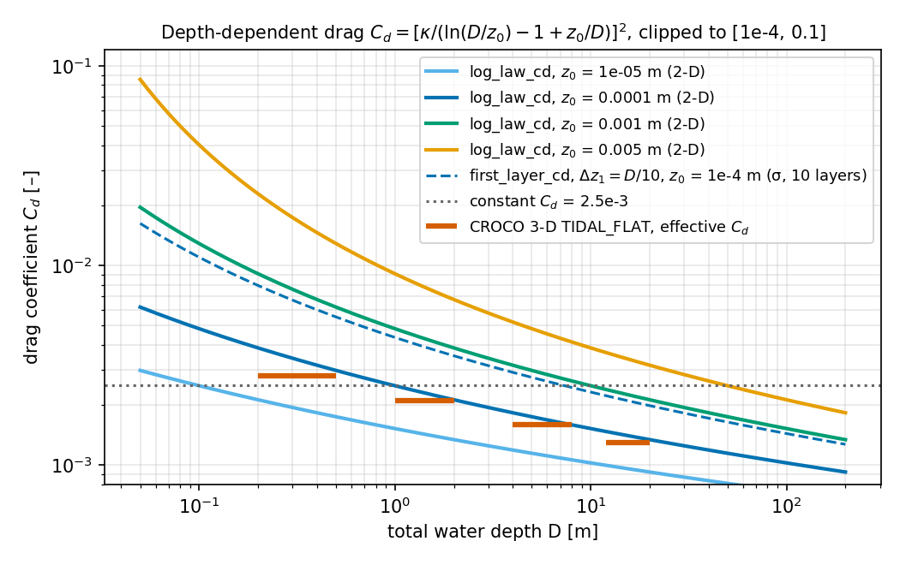
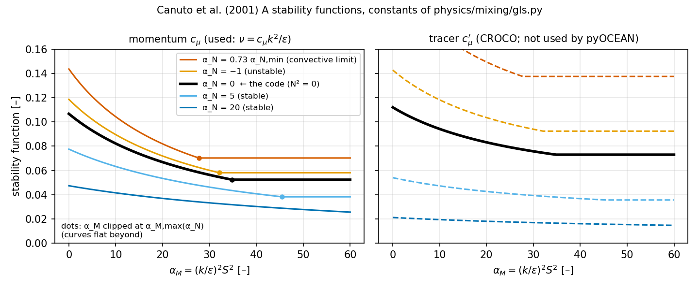
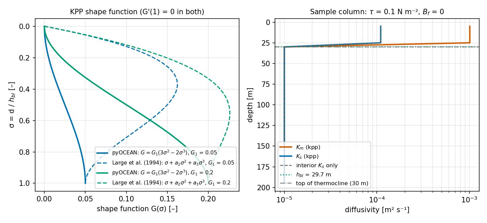

# Turbulence closures and bottom friction

This page describes how pyOCEAN represents the unresolved vertical momentum exchange: the vertical eddy viscosity
$\nu$ (closures `'constant'`, `'parabolic'`, `'gls'`, `'none'`), the stress at the bed (quadratic drag with a
constant, depth-dependent or first-layer log-law coefficient), and the wind stress at the surface. It also documents
the KPP module, which exists and is tested but is **not wired into any model time step yet**. You need this page
when you choose `closure`, `nu_const`, `z0` or `kv` for `SigmaWetDry` / `SigmaBaroclinic`, or a drag coefficient for
a 2-D tidal run.

!!! warning "What is and is not coupled today (code state 2026-10-14)"
    | Feature | `SigmaWetDry` (σ, homogeneous) | `SigmaBaroclinic`, `vertical_coordinate='sigma_eulerian'` | `SigmaBaroclinic`, `vertical_coordinate='ale'` | 2-D tidal runs |
    |---|---|---|---|---|
    | `closure='constant'` / `'none'` | yes | yes (default `'constant'`, $\nu$ = 1e-4) | yes (only these two) | — |
    | `closure='parabolic'` | yes (default) | yes | **no** (raises) | — |
    | `closure='gls'` (k-ε, Canuto A) | yes | yes, momentum only, **no buoyancy** | **no** (raises) | — |
    | First-layer log-law bed drag (`z0`) | yes (default `z0` = 1e-4 m) | yes (default `z0=None`) | **no**: `z0` must be `None` | — |
    | Tracer vertical diffusion | — | constant `kv` only | constant `kv` only | — |
    | 2-D quadratic drag, constant or `log_law_cd(D, z0)` | — | — | — | in the run scripts |
    | KPP (`physics/mixing/kpp.py`) | no | no | no | no (legacy z-model module, tests only) |

    Sources: `SigmaBaroclinic._setup_ale` (`core/dynamics/sigma_baroclinic.py:1148-1153`) raises for `z0` and for
    `closure` other than `'constant'`/`'none'` in ALE; a repository-wide search finds `kpp_tendency` only in
    `tests/test_kpp.py`.

## Physics

### Vertical momentum flux

The hydrostatic Boussinesq momentum equation (see [Governing equations](equations.md)) contains the vertical
divergence of the Reynolds stress, modelled with an eddy viscosity $\nu$ [m² s⁻¹]:

$$
\frac{\partial \mathbf{u}}{\partial t} = \dots + \frac{\partial}{\partial z}\left(\nu \frac{\partial \mathbf{u}}{\partial z}\right),
\qquad
\nu \frac{\partial \mathbf{u}}{\partial z}\Big|_{z=\eta} = \frac{\boldsymbol\tau_s}{\rho_0},
\qquad
\nu \frac{\partial \mathbf{u}}{\partial z}\Big|_{z=-H} = \frac{\boldsymbol\tau_b}{\rho_0}.
$$

The surface stress $\boldsymbol\tau_s$ [N m⁻²] is the wind (see [Air–sea fluxes](air-sea-fluxes.md)); the bed stress
$\boldsymbol\tau_b$ is parameterised with a quadratic drag law.

### Bottom drag and the law of the wall

Over a rough bed the velocity in the constant-stress layer follows the law of the wall

$$
u(z') = \frac{u_*}{\kappa}\ln\frac{z'}{z_0}, \qquad u_*^2 = \frac{|\tau_b|}{\rho_0},
$$

with $z'$ the height above the bed, $z_0$ [m] the roughness length and $\kappa = 0.41$ (CROCO `vonKar`). Two drag
coefficients follow (Soulsby 1997, §3):

* **Depth-mean (2-D) model.** If the whole column is logarithmic, its mean is
    $\bar u = (u_*/\kappa)[\ln(D/z_0) - 1 + z_0/D]$, so $\tau_b/\rho_0 = C_d\,\lvert\bar u\rvert\,\bar u$ with

$$
C_d(D) = \left[\frac{\kappa}{\ln(D/z_0) - 1 + z_0/D}\right]^2 .
$$

* **Layered (3-D) model.** The bottom-layer velocity $u_1$ is taken as the law of the wall at its mid-point
    $z_1 = \Delta z_1/2$:

$$
C_d = \left[\frac{\kappa}{\ln\!\left(\Delta z_1 / (2 z_0)\right)}\right]^2 ,
\qquad \frac{\tau_b}{\rho_0} = C_d\,\lvert u_1\rvert\,u_1 .
$$

$C_d(D)$ grows as the water shoals. In CROCO's 3-D TIDAL_FLAT run (GLS, $z_0$ = 1e-4 m) the effective coefficient
$\tau_b/(\rho_0\bar u^2)$ falls from 2.8e-3 at D = 0.2–0.5 m to 1.3e-3 at D = 12–20 m, and the log-law formula gives
3.2e-3 … 1.4e-3 (`validation/tidal_flat/README.md`). A constant $C_d$ therefore over-damps deep water and
under-damps tidal flats.

*`log_law_cd` for four roughness lengths, `first_layer_cd` for 10 uniform σ-layers, a constant 2.5e-3 and the
effective $C_d$ of CROCO's 3-D TIDAL_FLAT run. Note that `first_layer_cd` multiplies $u_1^2$, not $\bar u^2$, so it
is larger than the depth-mean coefficient for the same $z_0$.*

### Parabolic eddy viscosity

For a homogeneous flow driven by the bed stress, the mixing length $\ell = \kappa z'(1 - z'/D)^{1/2}$ with a linear
stress profile gives (Rodi 1993; Bowden 1978 **[verify]**; Davies & Jones 1988 **[verify]**)

$$
\nu(z') = \kappa\,u_*\,z'\left(1 - \frac{z'}{D}\right),
$$

which, with $\tau_b = \rho_0 u_*^2$, gives a logarithmic velocity profile near the bed. It is the equilibrium,
zero-equation limit of k-ε (Umlauf & Burchard 2003). It vanishes at the surface and responds instantly to $u_*$.

### k-ε generic length scale (GLS) closure

The GLS framework (Umlauf & Burchard 2003; Warner et al. 2005) carries the turbulent kinetic energy $k$ [m² s⁻²]
and a generic variable $\psi = (c_\mu^0)^p k^m l^n$. For k-ε, $p = 3$, $m = 3/2$, $n = -1$, so $\psi = \varepsilon$
[m² s⁻³]:

$$
\frac{\partial k}{\partial t} = \frac{\partial}{\partial z}\left(\frac{\nu}{\sigma_k}\frac{\partial k}{\partial z}\right) + P + B - \varepsilon,
\qquad
\frac{\partial \psi}{\partial t} = \frac{\partial}{\partial z}\left(\frac{\nu}{\sigma_\psi}\frac{\partial \psi}{\partial z}\right)
    + \frac{\psi}{k}\left(\beta_1 P + \beta_3 B - \beta_2 \varepsilon\right),
$$

with shear production $P = \nu S^2$, $S^2 = (\partial_z u)^2 + (\partial_z v)^2$, buoyancy production
$B = -\nu' N^2$, and

$$
\nu = c_\mu(\alpha_M, \alpha_N)\,\frac{k^2}{\varepsilon},\quad
\nu' = c_\mu'(\alpha_M, \alpha_N)\,\frac{k^2}{\varepsilon},\quad
\alpha_M = \left(\frac{k}{\varepsilon}\right)^2 S^2,\quad
\alpha_N = \left(\frac{k}{\varepsilon}\right)^2 N^2 .
$$

The stability functions are those of Canuto et al. (2001), version A.

!!! warning "No buoyancy in the pyOCEAN GLS"
    pyOCEAN's port sets $B = 0$ and $\alpha_N = 0$: the closure sees shear only, as for homogeneous water
    (`physics/mixing/gls.py:14`, `:175-183`). The Galperin limit uses $N^2 = 10^{-14}$ s⁻² (`:177`), and the
    tracer diffusivity $\nu'$ is not computed: tracers use the constant `kv`. Adding $B = -K_\rho N^2$ and the
    tracer stability function is step 3 of the unified-core plan (`docs/design/unified_core.md`, row 3, with a
    Kato–Phillips benchmark). In a stratified `SigmaBaroclinic` run, `closure='gls'` therefore over-mixes
    momentum across pycnoclines.

## Discretisation

### Implicit vertical viscosity with bed and surface stress

All closures share one backward-Euler tridiagonal solve per velocity component and column
(`vertical_implicit`, `core/dynamics/sigma_wd.py:88`; compiled kernel `_thomas_columns`, `:53`; NumPy oracle
`_vertical_implicit_numpy`, `:99`). Layers $k = 0 \dots N-1$ (bed first) with thicknesses $\Delta z_k$, interfaces
$k + \tfrac12$ with spacing $h_{k+\frac12} = \tfrac12(\Delta z_k + \Delta z_{k+1})$:

$$
\Delta z_k \frac{u_k' - u_k^*}{\Delta t}
= \nu_{k+\frac12}\frac{u_{k+1}' - u_k'}{h_{k+\frac12}}
- \nu_{k-\frac12}\frac{u_k' - u_{k-1}'}{h_{k-\frac12}}
- \delta_{k,0}\, r\, u_0'
+ \delta_{k,N-1}\,\frac{\tau_s}{\rho_0},
$$

where $u^* = u^n + \Delta t\,G_k$ is the velocity after the explicit (AB3) tendencies, $r = C_d \lvert u_0^*\rvert$
[m s⁻¹] linearises the bed stress (implicit in $u'$, coefficient lagged), and the viscosities at the bed and surface
interfaces are not used (the boundary fluxes are $r u_0'$ and $\tau_s/\rho_0$). The solve conserves
$\sum_k \Delta z_k u_k$ except for the two boundary fluxes. This is step 1 of the Casulli & Cheng (1992) fractional
step; the free surface then adds a vertically uniform barotropic correction (see
[Wetting and drying](wetting-drying.md#the-3-d-wetting-drying-model-sigmawetdry)).

!!! note "Component-wise drag speed"
    `SigmaWetDry.column_step` (`core/dynamics/sigma_wd.py:218-221`) uses $r = C_d\lvert u_0^*\rvert$ with the
    *normal* component of the face only ($\lvert u\rvert$ at u-faces, $\lvert v\rvert$ at v-faces), not the full
    speed $\lvert\mathbf u\rvert$ that CROCO uses. In 1-D channel tests the two agree; in 2-D flows the drag is
    underestimated where the tangential component is large.

**Depth-mean correction for the ALE thin-layer coupling.** In ALE runs the viscous coupling thickness $\Delta z_k$
(MOM6's upwind-biased face thickness, see [Vertical coordinates and ALE](vertical-ale.md)) differs from the
thickness $h^{\rm m}_k$ whose fractions $w_k = h^{\rm m}_k/D_f$, $D_f = \sum_k h^{\rm m}_k$, define the depth mean
$\bar u = \sum_k w_k u_k$. After the solve, `column_step` adds a uniform $\delta$ so that the depth-mean balance holds
with the implicit bed stress (`core/dynamics/sigma_wd.py:237-243`):

$$
\delta = \frac{\sum_k w_k u_k^* + \Delta t\,\tau_s/(\rho_0 D_f) - \sum_k w_k u_k' - \Delta t\, r\, u_0'/D_f}
{\sum_k w_k + \Delta t\, r / D_f},
\qquad u_k \leftarrow u_k' + \delta .
$$

### Closures

`closure` selects $\nu_{k+\frac12}$ (`core/dynamics/sigma_wd.py:222-229`):

| `closure` | $\nu$ at interior interfaces | Notes |
|---|---|---|
| `'constant'` | `nu_const` | `SigmaBaroclinic` default (1e-4 m² s⁻¹); `SigmaWetDry` default `nu_const` = 1e-2 |
| `'parabolic'` | $\max\left(\kappa\,u_*\,D\,\sigma_w(1-\sigma_w),\ \nu_{\min}\right)$ | `parabolic_viscosity` (`physics/mixing/parabolic.py:27`); $u_* = \sqrt{C_d}\,\lvert u_0^*\rvert$ from the same first-layer drag; $D$ the face total depth; $\nu_{\min}$ = `nu_min` (1e-5) |
| `'gls'` | $\nu$ from k-ε, averaged from cells to faces | lagged one step (state updated after the step) |
| `'none'` | 0 | with `z0=None` the solve is skipped and the wind is added to the top layer as $\Delta t\,\tau_s/(\rho_0\Delta z_{N-1})$ (`:231-234`) |

### GLS k-ε: the discrete scheme

`GLSKEpsilon` (`physics/mixing/gls.py:90`) is a column-by-column port of CROCO `gls_mixing.F` (default
`GLS_KEPSILON` + `CANUTO_A`), without horizontal or vertical advection of $k$, $\psi$. State at the $N+1$ interfaces
of every cell column (index 0 = bed, $N$ = surface): `tke` $k$, `eps` $\psi=\varepsilon$, `akv` $\nu$, shape
$(N+1, M)$.

**Constants** (`physics/mixing/gls.py:39-69`, CROCO `gls_mixing.F` and `gls_stab_func.h`):

| Symbol | Value | Code |
|---|---|---|
| $\kappa$ | 0.41 | `KAPPA` |
| $p, m, n$ | 3, 3/2, −1 | `RP, RM, RN` |
| $\beta_1, \beta_2$ | 1.44, 1.92 ($\beta_3$ unused: $B = 0$) | `BETA1, BETA2` |
| $\sigma_k^{-1}, \sigma_\psi^{-1}$ | 1.0, 0.7692 | `SIG_K_INV, SIG_PSI_INV` |
| $e_1, e_2, e_3$ | $3 + p/n = 0$, $3/2 + m/n = 0$, $-1/n = 1$, so $\varepsilon = (c_\mu^0)^{e_1} k^{e_2}\psi^{e_3} = \psi$ | `E1, E2, E3` |
| Canuto A $c_1 \dots c_6$ | 5.0, 0.8, 1.968, 1.136, 0.0, 0.4 | `C1 … C6` |
| $c_{b1} \dots c_{b5}, c_{bb}$ | 5.95, 0.6, 1.0, 0.0, 0.3333, 0.72 | `CB1 … CBB` |
| $c_\mu^0$ | $\left[(a_2^2 - 3a_3^2 + 3a_1 n_n)/(3 n_n^2)\right]^{1/4}$ = 0.5265 | `self.cm0` (`:104`) |
| $k_{\min}, \varepsilon_{\min}, \nu_{\min}$ | 1e-10, 1e-12, 1e-5 | CROCO non-3-D values (`:98`) |
| Galperin $c_{\rm lim}$ | 0.53 | `galp` |
| $z_{0s,\min}, z_{0b,\min}$ | 1e-2 m, 1e-4 m | `z0s_min, z0b_min` |
| Charnock | 1400/g | `chk` |

with $a_1 = 2/3 - c_2/2$, $a_2 = 1 - c_3/2$, $a_3 = 1 - c_4/2$, $a_5 = 1/2 - c_6/2$,
$a_{b1} = 1 - c_{b2}$, $a_{b2} = 1 - c_{b3}$, $a_{b3} = 2(1-c_{b4})$, $a_{b5} = 2c_{bb}(1 - c_{b5})$,
$n_n = c_1/2$, $n_b = c_{b1}$, and the polynomial coefficients $d_0 \dots d_5$, $n_0 \dots n_2$,
$n_{b0}, n_{b1}$ and the limiter coefficients $L_0 \dots L_6$ exactly as `gls_stab_func.h`
(`physics/mixing/gls.py:54-69`). Numerically: $d_0$ = 19914, $d_1$ = 5087.4, $d_2$ = 571.85, $d_3$ = 104.00,
$d_4$ = 172.81, $d_5$ = −0.672, $n_0$ = 2124.2, $n_1$ = 345.30, $n_2$ = −2.4.

**Shear and production** at interior interfaces $i = 1 \dots N-1$ (`:147-151`), with cell-centre layer velocities
(mean of the two faces) and $h_i = \tfrac12(\Delta z_{i-1} + \Delta z_i)$:

$$
S_i^2 = \frac{(u_i - u_{i-1})^2 + (v_i - v_{i-1})^2}{h_i^2},\qquad
P_i = \nu_i^n S_i^2,\qquad
\varepsilon_i^n = \max\left(\psi_i^n, \varepsilon_{\min}\right).
$$

**Transport equations** (`GLSKEpsilon._solve`, `:115-135`). For $X = k$ or $\psi$, backward Euler with explicit
sources and the dissipation linearised implicitly (Patankar 1980), so both stay positive:

$$
h_i\frac{X_i^{n+1} - X_i^n}{\Delta t}
= \mathcal F_{i} - \mathcal F_{i-1} + h_i\,\mathcal S_i - h_i\,\mathcal D_i\,X_i^{n+1},
\qquad
\mathcal F_j = \frac{\bar\nu_j}{\sigma_X}\,\frac{X_{j+1}^{n+1} - X_j^{n+1}}{\Delta z_j},\quad
\bar\nu_j = \tfrac12\left(\nu_j^n + \nu_{j+1}^n\right),
$$

where $\mathcal F_j$ is the diffusive flux through layer $j$ (between interfaces $j$ and $j+1$). The bed layer
($j = 0$) and surface layer ($j = N-1$) carry no diffusive coupling to the boundary interfaces; for $\psi$ they carry
the log-layer flux below instead. The sources are

| | $\mathcal S_i$ | $\mathcal D_i$ | boundary flux |
|---|---|---|---|
| $k$ | $P_i$ | $\varepsilon_i^n/k_i^n$ | 0 (bed and surface) |
| $\psi$ | $\beta_1(\psi_i^n/k_i^n)P_i$ | $\beta_2\,\varepsilon_i^n/k_i^n$ | $F_\psi$ below, into interfaces 1 and $N-1$ |

followed by the floors $k \ge k_{\min}$, $\psi \ge \psi_{\min} = \varepsilon_{\min}$ (when $N > 1$).

**Boundary conditions** (`:153-171`; Burchard et al. 1998 **[verify]** via the CROCO docstring). The boundary
interfaces hold Dirichlet values

$$
k_0 = \max\!\left(k_{\min}, \frac{u_{*b}^2}{(c_\mu^0)^2}\right),\quad
k_N = \max\!\left(k_{\min}, \frac{u_{*s}^2}{(c_\mu^0)^2}\right),\quad
\psi_0 = \max\!\left(\psi_{\min}, (c_\mu^0)^p\,l_b^n\,k_0^m\right),\quad
\psi_N = \max\!\left(\psi_{\min}, (c_\mu^0)^p\,l_s^n\,k_s^m\right),
$$

and the $\psi$ equation receives the log-layer flux

$$
F_\psi = -n\,(c_\mu^0)^{p+1}\,\kappa\,\sigma_\psi^{-1}\,k_{b,s}^{m+\frac12}\,l_{b,s}^n,\qquad
l_b = \kappa\left(\tfrac12\Delta z_0 + z_{0b}\right),\quad
l_s = \kappa\left(\tfrac12\Delta z_{N-1} + z_{0s}\right),
$$

with $k_b = \tfrac12(k_0 + k_1)$, $k_s = \tfrac12(k_{N-1} + k_N)$, $z_{0b} = \max(z_0, 10^{-4})$ m and
$z_{0s} = \max(10^{-2}\ {\rm m}, 1400\,u_{*s}^2/g)$ (Charnock). The bed friction velocity comes from
`SigmaWetDry._gls_update` (`core/dynamics/sigma_wd.py:314-335`): $C_d\lvert u_1\rvert u_1$ at u- and v-faces with
`first_layer_cd` of the face bed layer $D_f\Delta\sigma_0$, averaged to the cell, $u_{*b}^2 = \lvert\boldsymbol\tau_b\rvert/\rho_0$.

!!! note "No wind in the GLS boundary condition"
    `_gls_update` calls `GLSKEpsilon.step` without `ustar2_sfc`, so $u_{*s} = 0$ even when `tau_x, tau_y` are
    given: $k_N = k_{\min}$ and $z_{0s} = 10^{-2}$ m. Wind-driven surface turbulence is not represented yet.

**Length-scale limiter and viscosity** (`:175-193`). The Galperin et al. (1988) **[verify]** limit
$l \le 0.53\sqrt{2k}/N$ is applied as $\psi \ge (c_\mu^0)^p\,l_{\rm lim}^n\,k^m$ with $N^2 = 10^{-14}$ s⁻² (inactive in
practice). Then $\varepsilon = \max(\psi, \varepsilon_{\min})$, $\alpha_M = (k/\varepsilon)^2 S^2$ and

$$
\alpha_N = \min\left(\max(0.73\,\alpha_{N,\min}, 0), 10^{10}\right) = 0,\qquad
\alpha_{N,\min} = \frac{-(d_1 + n_{b0}) + \sqrt{(d_1 + n_{b0})^2 - 4 d_0 (d_4 + n_{b1})}}{2(d_4 + n_{b1})} = -3.056,
$$

$$
\alpha_M \le \alpha_{M,\max}(\alpha_N) = \frac{L_0 + L_1\alpha_N + L_2\alpha_N^2 + L_3\alpha_N^3}{L_4 + L_5\alpha_N + L_6\alpha_N^2}
\;(= 34.82 \text{ at } \alpha_N = 0),
$$

$$
c_\mu = \frac{n_0 + n_1\alpha_N + n_2\alpha_M}{d_0 + d_1\alpha_N + d_2\alpha_M + d_3\alpha_N\alpha_M + d_4\alpha_N^2 + d_5\alpha_M^2},
\qquad
\nu_i = \max\left(c_\mu\,\frac{k_i^2}{\varepsilon_i},\ \nu_{\min}\right).
$$

CROCO uses $\alpha_N = (k/\varepsilon)^2 N^2$ in the same limiter (`~/pyOCEAN_refs/croco/OCEAN/gls_mixing.F:850-866`);
with $N^2 = 0$ pyOCEAN's expression reduces to $\alpha_N = 0$. The boundary viscosities are extrapolated,
$\nu_N = \max(1.5\nu_{N-1} - 0.5\nu_{N-2}, \nu_{\min})$ and likewise at the bed (`:192-193`). The new $\nu$ (cell
centres) is averaged to the faces for the next step (`SigmaWetDry._gls_at_faces`, `core/dynamics/sigma_wd.py:302`).

*Canuto A stability functions from the constants of `physics/mixing/gls.py` with the code's $\alpha_M$ limiter. The
black line ($\alpha_N = 0$) is the only one pyOCEAN uses; the coloured curves show what buoyancy would add. The tracer
function $c_\mu'$ (right) uses CROCO's $n_{b2}$, which `gls.py` does not define.*

**Call order inside `SigmaWetDry.step`** (`core/dynamics/sigma_wd.py:258-299`): $\nu^n$ from the previous GLS update
→ implicit viscous solve and free surface → new velocities → `_gls_update` advances $k$, $\varepsilon$ with the new
velocities and depth. The GLS state starts at the floors ($k = k_{\min}$, $\varepsilon = \psi_{\min}$,
$\nu = \nu_{\min}$, `:110-113`) and is saved in restarts (CLAUDE.md, `core/restart.py`).

## Bottom friction in the code

### 3-D models: first-layer law of the wall

`first_layer_cd(dz_bottom, z0, kappa=0.41, cd_min=1e-4, cd_max=0.1)` (`physics/bottom_friction.py:48`) returns
$[\kappa/\ln(\Delta z_1/(2z_0))]^2$, clipped to [`cd_min`, `cd_max`]; a bed layer with $\Delta z_1/2 \le z_0$ or a
non-finite thickness gets `cd_max` (CROCO's `Cdb_min`/`Cdb_max` analogues). `SigmaWetDry` evaluates it on the
bed-layer thickness at each face, $\Delta z_1 = D_f\Delta\sigma_0$ by default, or `hu_drag`/`hv_drag` when given
(`core/dynamics/sigma_wd.py:218-219`). `cd_max` is a `SigmaWetDry` argument (default 0.1).

`hu_drag`, `hv_drag` exist for the ALE thin-layer coupling: the viscous solve then sees the upwind-biased coupling
thickness, while the drag should see the mean bed-layer thickness (`SigmaBaroclinic._step_ale`,
`core/dynamics/sigma_baroclinic.py:1997-2002`). Because ALE currently requires `z0=None`, the drag is zero in ALE runs
and these arguments have no effect yet.

### 2-D models: depth-dependent log-law or constant drag coefficient

`log_law_cd(depth, z0, kappa=0.41, cd_min=1e-4, cd_max=0.1)` (`physics/bottom_friction.py:31`) returns
$C_d(D)$ above, clipped; dry, NaN or very shallow columns (where $\ln(D/z_0) - 1 + z_0/D \le 0$, i.e.
$D \lesssim e\,z_0$) get `cd_max`. The 2-D models (`WetDryFreeSurface`, `ImplicitFreeSurface`) do not contain a drag
term: the run scripts add it as a semi-implicit factor before the free-surface solve,

$$
\hat u = \frac{u^n + \Delta t\,G}{1 + \Delta t\,\left(C_d\lvert\mathbf u^n\rvert + r_{\rm JSL}\,H\right)/D},
$$

* `validation/tidal_flat/run_tidal_flat.py:87-91`: $C_d$ constant (`--cd`, default 2.5e-3) or `log_law_cd(D, z0)`
    (`--z0`), on the face total depth;
* `validation/pacmex_tides/run_tides.py:326-335`: constant `--cd` (default 2.5e-3), or the HYCOM-IOA spatial
    coefficient `cb` read from `~/HYCOM/relax/DRAG/cb.[ab]` (`--cb-file`; NaN cells keep `--cd`; the help text
    says "cb < 0" **[verify]** the sign convention of that file), plus the JSL internal-tide drag rate
    $r_{\rm JSL}$ (HYCOM `tiddrg=1`, `physics/tides/drag.py`; see [Tides](tides.md)). It uses the full speed
    $\lvert\mathbf u\rvert$ and the rest depth $H$ (or $H + \eta$ with `--nonlinear`, floored at 1 m).

### Choosing `z0`

| `z0` | Meaning |
|---|---|
| `None` | no bed stress (free-slip bed; only the viscosity acts). Default of `SigmaBaroclinic`; required by ALE. |
| `1e-4` m | default of `SigmaWetDry` and CROCO TIDAL_FLAT; smooth mud/sand (Soulsby 1997 **[verify]** table values) |
| larger | rougher beds; $C_d$ rises fast in shallow water (figure above) |

The GLS bed boundary condition uses `z0 or 1e-4` (`core/dynamics/sigma_wd.py:184`), so with `z0=None` and
`closure='gls'` the length scale still uses 1e-4 m while the momentum equation has no drag.

## Surface stress as a top flux

`SigmaBaroclinic.step(st, tau_x, tau_y)` takes the wind stress [N m⁻²] at u- and v-faces and divides it by the
model's `rho0` (`core/dynamics/sigma_baroclinic.py:2100-2101`; default `rho0` = 1000 kg m⁻³). The kinematic stress
enters the right-hand side of the top layer of the implicit solve ($\delta_{k,N-1}\tau_s/\rho_0$ above), as ROMS/CROCO
`sustr/svstr`, not through the AB3 extrapolation. The Ekman transport $\tau/(\rho_0 f)$ is reproduced to 0.05 %
(module docstring, `core/dynamics/sigma_baroclinic.py:36-37`; CLAUDE.md). On dry faces the velocity is reset to 0
after the free-surface step, so wind over dry land has no effect.

## KPP (legacy z-level model only, not coupled)

`physics/mixing/kpp.py` implements the K-Profile Parameterization of Large, McWilliams & Doney (1994) on the
phase-1 z-level `ModelState` (k = 0 at the surface). It returns an explicit tendency (`kpp_tendency`, `:555`) for
u, v, T, S. **No time stepper calls it**; it is exercised only by `tests/test_kpp.py` (32 tests). Making KPP an
alternative to GLS on σ columns is step 5 of `docs/design/unified_core.md`, and the roadmap wants it without the
background diffusivity that suppresses the internal-wave spectrum (`docs/design/vision_roadmap.md`, turbulence row).

### Equations as implemented

**Constants** (`physics/mixing/kpp.py:99-118`): $\kappa$ = 0.4, $Ri_{cr}$ = 0.3, $Ri_0$ = 0.7, $C_v$ = 1.8,
$C_G$ = 0.416, $\epsilon$ = 0.1, $\nu_0$ = 1e-3 m² s⁻¹, $\kappa_0$ = 1e-4 m² s⁻¹, $K_{bg}$ = 1e-5 m² s⁻¹ (momentum and
scalars), $K_{conv}$ = 1e-2 m² s⁻¹, $\rho_0$ = 1025 kg m⁻³, $c_p$ = 3996 J kg⁻¹ K⁻¹.

**Surface forcing** (`:657-672`): $u_* = \sqrt{\lvert\boldsymbol\tau\rvert/\rho_0}$,
$\langle w'T'\rangle_0 = Q_{net}/(\rho_0 c_p)$ ($Q_{net}$ positive into the ocean),
$\langle w'S'\rangle_0 = S_0(E - P)$, and $B_f = g(\alpha_T\langle w'T'\rangle_0 - \beta_S\langle w'S'\rangle_0)$ with
fixed $\alpha_T$ = 2e-4 K⁻¹, $\beta_S$ = 7.4e-4 PSU⁻¹.

**Turbulent velocity scales** (`_velocity_scales`, `:145-207`), with $\zeta = -\kappa d B_f/u_*^3$:

$$
\zeta \ge 0:\ w_m = w_s = \frac{\kappa u_*}{1 + 5\zeta};\qquad
\zeta < 0:\ w_m = \kappa u_*(1 - 16\zeta)^{1/4},\ w_s = \kappa u_*(1 - 16\zeta)^{1/2},
$$

both clipped to $[10^{-10}, 0.5]$ m s⁻¹ (no strongly convective branch).

**Boundary-layer depth** (`obl_depth`, `:214-333`): at every level centre $d_k$,

$$
Ri_b(d_k) = \frac{(g/\rho_0)(\rho_k - \rho_0^{\rm sfc})\,d_k}{\lvert\mathbf u_k - \mathbf u_0\rvert^2 + V_t^2(d_k)},\qquad
V_t^2 = \frac{C_v\,d\,N\,w_s(d)}{Ri_{cr}},
$$

with the reference taken at the top layer, $N$ from the density difference with the level below, and $h_{bl}$ the
first depth where $Ri_b = Ri_{cr}$ (linear interpolation between level centres, clipped to $[d_0, d_{N-1}]$).

**Interior mixing** (`interior_diffusivity`, `:336-425`): at each interior interface
$Ri_g = N^2/S^2$ and

$$
f(Ri_g) = \left[1 - \min\left(\max(Ri_g/Ri_0, 0), 1\right)^2\right]^3,\quad
K_m = \nu_0 f + K_{bg} + K_{conv}\,[N^2<0],\quad
K_s = \kappa_0 f + K_{bg} + K_{conv}\,[N^2<0].
$$

There is no double-diffusion term.

**Boundary-layer profile** (`_blmix`, `:428-552`): one velocity scale per column, evaluated at
$d = \epsilon h_{bl}$; with $G_1 = K^{\rm int}(h_{bl})/(h_{bl}w_x)$ taken at the deepest interface inside the layer,

$$
G(\sigma) = G_1\,(3\sigma^2 - 2\sigma^3),\qquad K_x = \max\left(h_{bl}\,w_x\,G(\sigma),\ K_x^{\rm int}\right),\quad \sigma = d/h_{bl}\le 1 .
$$

**Non-local transport**: $\gamma_x = C_G\,\langle w'x'\rangle_0/(w_s h_{bl})$ inside the layer when $B_f > 0$, and the
explicit flux at interface $k_f$ is $F = K_s\,(\phi_{k-1} - \phi_k)/\Delta z_f + K_s\,\gamma\,\langle w'\phi'\rangle_0$
(`:549-550`, `:713`). Momentum mixing is applied to cell-centred velocities and averaged back to the faces
(`:727-749`).

*Left: pyOCEAN's shape function against the Large et al. (1994) cubic with the same $G(1)$ and $G'(1) = 0$. Right: a
sample column (mixed layer to 30 m, wind 0.1 N m⁻², no buoyancy flux) through `obl_depth`, `interior_diffusivity` and
`_blmix`: the boundary-layer profile never exceeds the interior shear-mixing values.*

### Departures from Large et al. (1994)

These are documented here because KPP is a planned option; none affects current runs.

1. **Shape function.** L94 eq. (11) has $G(\sigma) = a_0 + a_1\sigma + a_2\sigma^2 + a_3\sigma^3$ with $a_0 = 0$,
    $a_1 = 1$ (from the surface-layer similarity). The code drops the linear term and scales the cubic by $G_1$, so
    $K$ in the boundary layer is bounded by the interior value at its base (figure, right) instead of
    $\sim h_{bl}w_x$. The docstring calls this the "Phase 1 simplification" ($G'(1) = 0$), but the missing $a_1$ is a
    larger change than the slope matching.
2. **Sign of the surface buoyancy flux.** L94 defines $B_f$ so that surface heating is stabilising. The code treats
    $B_f > 0$ (heating, $Q_{net} > 0$) as unstable: $\zeta < 0$ and the non-local term is switched on
    (`:174`, `:518`, `:668-672`; `tests/test_kpp.py` checks "non-local warming of surface layer when Q_net > 0").
3. **Non-local flux.** $\gamma$ already contains $\langle w'x'\rangle_0$, and the flux multiplies it again by the surface
    flux (`:549-550` and `:713`), giving a term quadratic in the surface flux; L94 has $K_s\gamma_s$ with
    $\gamma_s = C_s\langle w'x'\rangle_0/(w_s h)$, $C_s \approx 6.3$ **[verify]** (the code's $C_G$ = 0.416).
4. **Unresolved shear.** $V_t^2$ omits the factor $(-\beta_T)^{1/2}/(\kappa^2)(c_s\epsilon)^{-1/2}$ of L94 eq. (23).
5. Explicit time stepping (stable only for $\Delta t \le \Delta z^2/(2K)$), cell-centred momentum mixing.

## Options and defaults

| Option | Values | Default | Meaning | Where |
|---|---|---|---|---|
| `closure` | `'constant'`, `'parabolic'`, `'gls'`, `'none'` | `SigmaWetDry`: `'parabolic'`; `SigmaBaroclinic`: `'constant'` | vertical viscosity | `core/dynamics/sigma_wd.py:161`, `core/dynamics/sigma_baroclinic.py:1007` |
| `nu_const` | m² s⁻¹ | 1e-2 (`SigmaWetDry`), 1e-4 (`SigmaBaroclinic`) | $\nu$ of `'constant'` | same |
| `nu_min` | m² s⁻¹ | 1e-5 | floor of `'parabolic'` (`SigmaWetDry` only; GLS has its own 1e-5) | `sigma_wd.py:163` |
| `z0` | m or `None` | 1e-4 (`SigmaWetDry`), `None` (`SigmaBaroclinic`) | bed roughness of the first-layer law; `None` = no bed stress | same |
| `cd_max` | – | 0.1 | upper clip of $C_d$ (`SigmaWetDry`) | `sigma_wd.py:165` |
| `kv` | m² s⁻¹ | 0 | constant vertical tracer diffusivity, implicit | `sigma_baroclinic.py:1013`, `:2142-2146` |
| `rho0` | kg m⁻³ | 1000 | divides the wind stress | `sigma_baroclinic.py:1006` |
| `log_law_cd(D, z0, kappa, cd_min, cd_max)` | | 0.41, 1e-4, 0.1 | 2-D depth-dependent $C_d$ | `physics/bottom_friction.py:31` |
| `first_layer_cd(dz, z0, ...)` | | same | 3-D first-layer $C_d$ | `physics/bottom_friction.py:48` |
| `parabolic_viscosity(ustar, depth, sigma_w, nu_min, kappa)` | | 1e-5, 0.41 | parabolic $\nu$ at interfaces | `physics/mixing/parabolic.py:27` |
| `GLSKEpsilon(n_layers, n_columns, z0_bed)` | | `z0_bed` = 1e-4 (floored at 1e-4) | k-ε column solver | `physics/mixing/gls.py:90` |

## Validation

* **GLS k-ε** (`tests/test_gls.py`, 3 tests): $c_\mu^0$ = 0.527 for Canuto A; positive decay without shear; log-layer
    equilibrium in uniform flow ($\nu \approx \kappa u_* z$, $k \approx u_*^2/(c_\mu^0)^2$), with a depth-mean velocity 6 %
    above the 2-D log-law value (`validation/tidal_flat/README.md`).
* **σ model** (`tests/test_sigma_wd.py`): implicit solver against a dense solution, momentum conservation, uniform
    flow reaches the 2-D log-law Chézy velocity (0.96–0.99), parabolic profile, GLS positive with mass conserved.
* **CROCO 3-D TIDAL_FLAT** (GLS, $z_0$ = 1e-4 m, 10 layers): pyOCEAN σ + GLS 1.2 cm η rms over wet cells and
    0.01–0.05 m s⁻¹ ū rms; parabolic 5.2 cm; 2-D log-law 4.5 cm; 2-D constant $C_d$ = 2.5e-3 27.0 cm
    (`validation/tidal_flat/README.md`; regression in `tests/test_wetting_drying.py::TestTidalFlatVsCroco3D`). The
    parabolic closure falls short because it vanishes at the surface and has no memory; GLS keeps
    $\nu \approx$ 0.024 m² s⁻¹ at the surface.
* **Bottom friction** (`tests/test_bottom_friction.py`, 4 tests): clipping in very shallow and dry water, the formula.
* **Wind** — Ekman transport to 0.05 % (`tests/test_sigma_baroclinic.py`).
* **KPP** — 32 unit tests of the module on the legacy state (`tests/test_kpp.py`), no model-level validation.

See [Validation: wetting and drying](../validation/wetting-drying.md) for the TIDAL_FLAT figures.

## Known limitations

* GLS has no buoyancy production and no tracer diffusivity; tracers use a constant `kv` (planned: unified-core
    step 3, Kato–Phillips benchmark).
* GLS ignores the wind ($u_{*s} = 0$) and has no advection of $k$, $\varepsilon$.
* ALE runs allow only `'constant'`/`'none'` and no bed drag (`z0=None`): the law-of-the-wall drag needs a bed layer
    that can vanish under z*, and GLS/parabolic assume σ-layers (`core/dynamics/sigma_baroclinic.py:1148-1153`).
* The bed-stress speed is the face-normal component only (above).
* The pressure gradient and the implicit friction are split (fractional step): the friction does not see the
    pressure increment of the same step (first order in $\Delta t$; `validation/tidal_flat/README.md`, item 7).
* KPP is not coupled and deviates from L94 as listed above.

## References

* Bowden, K.F. (1978). Physical problems of the benthic boundary layer. *Geophys. Surv.* 3, 255–296. **[verify]**
* Burchard, H., Petersen, O. & Rippeth, T.P. (1998). Comparing the performance of the Mellor–Yamada and the κ–ε
    two-equation turbulence models. *J. Geophys. Res.* 103(C5), 10543–10554. **[verify]**
* Canuto, V.M., Howard, A., Cheng, Y. & Dubovikov, M.S. (2001). Ocean turbulence. Part I: One-point closure model —
    momentum and heat vertical diffusivities. *J. Phys. Oceanogr.* 31, 1413–1426.
    [doi:10.1175/1520-0485(2001)031<1413:OTPIOP>2.0.CO;2](https://doi.org/10.1175/1520-0485(2001)031<1413:OTPIOP>2.0.CO;2) **[verify DOI]**
* Casulli, V. & Cheng, R.T. (1992). Semi-implicit finite difference methods for three-dimensional shallow water flow.
    *Int. J. Numer. Meth. Fluids* 15, 629–648. [doi:10.1002/fld.1650150602](https://doi.org/10.1002/fld.1650150602) **[verify DOI]**
* Davies, A.M. & Jones, J.E. (1988). Modelling turbulence in shallow sea regions. **[verify]**
* Galperin, B., Kantha, L.H., Hassid, S. & Rosati, A. (1988). A quasi-equilibrium turbulent energy model for
    geophysical flows. *J. Atmos. Sci.* 45, 55–62. **[verify]**
* Large, W.G., McWilliams, J.C. & Doney, S.C. (1994). Oceanic vertical mixing: a review and a model with a nonlocal
    boundary layer parameterization. *Rev. Geophys.* 32(4), 363–403.
    [doi:10.1029/94RG01872](https://doi.org/10.1029/94RG01872)
* Patankar, S.V. (1980). *Numerical Heat Transfer and Fluid Flow.* Hemisphere. **[verify]**
* Rodi, W. (1993). *Turbulence Models and Their Application in Hydraulics.* IAHR.
* Soulsby, R.L. (1997). *Dynamics of Marine Sands.* Thomas Telford, London, §3.
* Umlauf, L. & Burchard, H. (2003). A generic length-scale equation for geophysical turbulence models. *J. Mar. Res.*
    61, 235–265. [doi:10.1357/002224003322005087](https://doi.org/10.1357/002224003322005087) **[verify DOI]**
* Warner, J.C., Sherwood, C.R., Arango, H.G. & Signell, R.P. (2005). Performance of four turbulence closure models
    implemented using a generic length scale method. *Ocean Modell.* 8, 81–113.
    [doi:10.1016/j.ocemod.2003.12.003](https://doi.org/10.1016/j.ocemod.2003.12.003) **[verify DOI]**
* CROCO source: `~/pyOCEAN_refs/croco/OCEAN/gls_mixing.F`, `gls_stab_func.h` (reference implementation).
