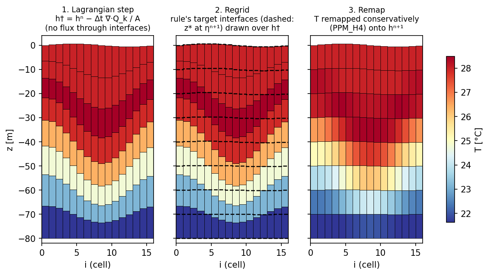
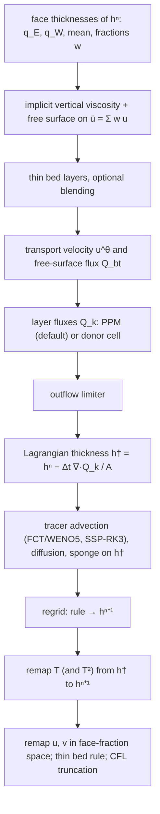
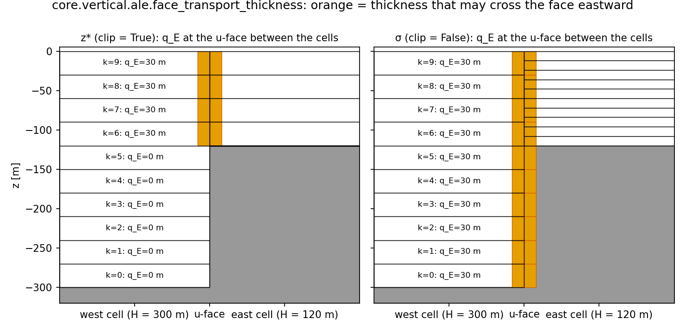
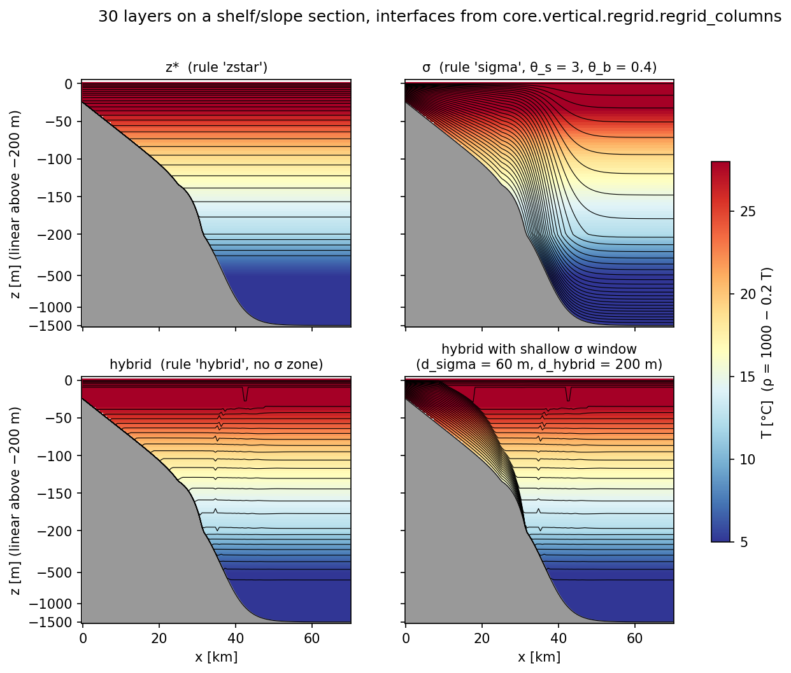
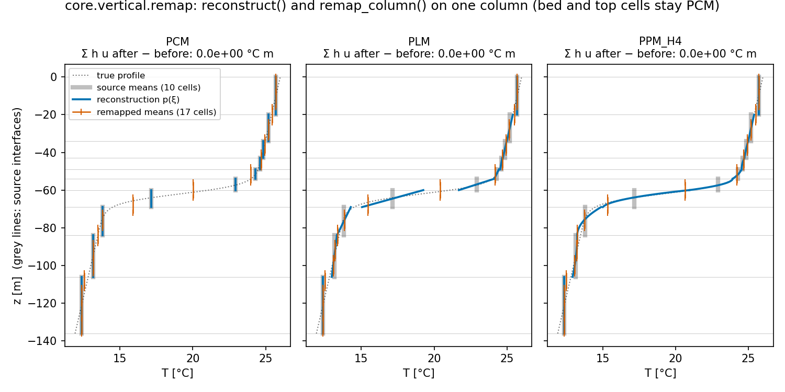
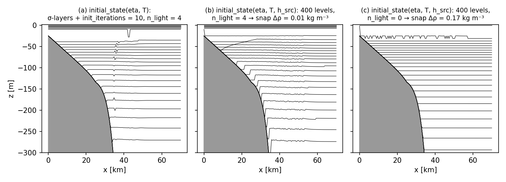
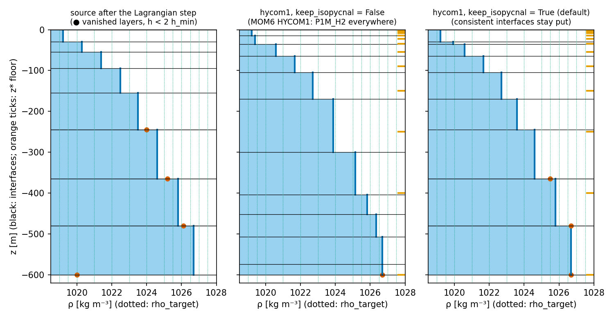

# Vertical coordinates and ALE

The ALE (Arbitrary Lagrangian–Eulerian) mode is the heart of pyOCEAN's stratified model. With
`vertical_coordinate="ale"`, the layer thickness $h_k$ is prognostic and every time step has three
sub-steps: a **Lagrangian step** in which the layer interfaces move with the flow (no flux through them),
a **regrid** that chooses new interfaces with a rule (z\*, σ or hybrid z\*–isopycnal), and a **remap**
that maps temperature and velocity conservatively onto the new layers. This is the vertical
Lagrangian-remap method of MOM6 (White et al. 2009; Adcroft et al. 2019; Griffies et al. 2020), with
pieces of HYCOM (Bleck 2002) where they work better. Use this page to understand how the layers move, what
each option does, and how far each piece matches MOM6 and HYCOM.

The code lives in three modules and one class:

| Module | Content |
|---|---|
| `core/vertical/ale.py` | face thicknesses, layer fluxes (donor cell and PPM), outflow limiter, Lagrangian continuity, thin-layer rules |
| `core/vertical/regrid.py` | grid rules z\*, σ, hybrid (HYCOM1), shallow σ window, target densities, initial-state snapping |
| `core/vertical/remap.py` | PCM / PLM / PPM_H4 reconstructions and the conservative column remap, threaded 3-D driver |
| `SigmaBaroclinic` (`core/dynamics/sigma_baroclinic.py:933`) | the ALE step `_step_ale` (line 1977), setup `_setup_ale` (1123), initial state (1190, 1222), `_regrid_remap` (1327), `_remap_faces` (1367) |

Convention (`core/vertical/ale.py:5-6`, `core/vertical/regrid.py:5-8`): thickness `h` is (N, ny, nx) with
**k = 0 at the bed**; interface heights `zw` are (N+1, ny, nx) with `zw[0] = −H` and `zw[N] = η` (z = 0 at
rest); u-faces are (N, ny, nx+1) and v-faces (N, ny+1, nx). No rule changes the column thickness
$D = H + \eta$.

*One step on a section with a mode-1 internal wave: the Lagrangian step leaves wavy interfaces (left), the
z\* rule asks for flat ones at the new η (dashed, centre), and the remap puts the temperature on the new
layers (right). Computed with `regrid_columns` and `remap_columns`.*

## The ALE step in order

`SigmaBaroclinic.step` (`core/dynamics/sigma_baroclinic.py:2084`) computes the explicit momentum
tendencies $G$ (pressure gradient, Coriolis/PV flux, kinetic-energy gradient, viscosity), combines them with
AB3, and calls `_step_ale`:

1. **Face thicknesses** of $h^n$ (`_transport_thickness`, line 1344): the upwind transport thicknesses
    $q_E, q_W$ (clipped at the shallower bed for z\* and hybrid), their mean, and the face fractions
    $w_k$ (below).
2. The exterior state of open boundaries is evaluated at $t^{n+1}$ ([Open boundaries](open-boundaries.md)).
3. **Vertical viscosity and free surface** (`SigmaWetDry.step`, `core/dynamics/sigma_wd.py:258`): each
    face column gets the implicit viscosity with the surface stress, then the depth mean
    $\bar u = \sum_k w_k u_k$ goes to the wet–dry θ-implicit free-surface solver, which returns
    $\eta^{n+1}$ and $\bar u^{n+1}$; the barotropic correction is uniform in the vertical
    ([Free surface and time stepping](free-surface-time-stepping.md)).
4. Open-boundary velocities; velocity set to zero in thin bed layers; optional thin-layer blending.
5. **Transport velocity** $u^\theta$ and free-surface volume flux $Q_{bt}$.
6. **Layer fluxes** $Q_k$ that add up exactly to $Q_{bt}$.
7. **Outflow limiter**: no layer loses more than it holds.
8. **Lagrangian continuity**: $h^\dagger$.
9. **Tracers** on the moving layers with no flux through the interfaces ($F_z = 0$): flux-form WENO5
    with SSP-RK3 and the FCT limiter, along-layer diffusion, implicit vertical diffusion, tracer sponge
    ([Tracers](tracers.md)).
10. **Regrid** with the rule, at the new surface $\eta^{n+1}$, using the densities of $T^\dagger$.
11. **Remap** $T$ (and $T^2$ for the mixing diagnostic) from $h^\dagger$ to $h^{n+1}$.
12. **Remap the face velocities** from the face geometry of $h^\dagger$ to that of $h^{n+1}$; zero
    velocity in thin bed layers; CFL truncation backstop.

## (a) The Lagrangian step

### Five face thicknesses, each for its job

A C-grid velocity sits between two columns whose layers have different thicknesses. pyOCEAN uses five
face thicknesses (`core/vertical/ale.py:8-41`):

| Thickness | Formula | Used for | Code |
|---|---|---|---|
| Transport (upwind) | $q_{E,k}$ = layer k of the **west** cell (eastward flow), $q_{W,k}$ = of the **east** cell, clipped at the shallower bed for z\* and hybrid | layer fluxes $Q_k$ | `face_transport_thickness` (line 212) |
| Mean | $\tfrac12(q_E + q_W)$ | fractions $w_k$ of the depth mean $\bar u$, thin-bed rule, remap of face velocities | `_mean_face_thickness` (`sigma_baroclinic.py:1362`) |
| Min | $\min(h_L, h_R)$ (MITgcm hFacW) | along-layer tracer diffusion (no diffusive flux into a vanished cell) | `face_thickness` (line 66) |
| Viscous | upwind-biased harmonic/arithmetic mean | implicit vertical viscosity (default in ALE) | `viscous_face_thickness` (line 82) |
| PPM swept | mean thickness of the volume swept in Δt | layer fluxes with `thickness_flux="ppm"` | `ppm_transport_x` (line 736) |

**Clipping at the shallower bed** (z\* and hybrid; HYCOM `cnuity.F90:252-256`): only the part of the
upwind layer above the shallower of the two beds may cross the face,

$$
q_k = \min\Big(h_{k,\rm up},\ \max\big(0,\ z^{\rm top}_{k,\rm up} - \max(-H_W, -H_E)\big)\Big),
\qquad z^{\rm top}_{k,\rm up} = -H_{\rm up} + \sum_{m\le k} h_{m,\rm up} .
$$

Water facing rock does not move. Without the clip, the residual pressure-gradient error of a z\* layer
facing rock accelerates it with nothing to oppose it (seamount: 0.02 → 35 cm/s in one day; module
docstring). σ-layers are **not** clipped: they follow the terrain, and layer k of a deep column continues
as layer k of the shallow one. Domain-edge faces use the inner cell; faces next to land are 0.

*Eastward transport thickness $q_E$ over a 300 → 120 m step. In z\* only the four layers above the shallow
bed may pass; in σ every layer passes (the east column's ten σ-layers are thinner).*

**Face fractions** (`face_fractions`, line 888):

$$
w_k = \frac{h_{k,f}}{\sum_m h_{m,f}},\qquad h_{k,f} = \tfrac12(q_{E,k} + q_{W,k}),
$$

with $w_k = 1/N$ on faces that hold no water, so $\bar u$ stays defined. A layer that vanished on one side
keeps half of the other side's thickness; a z\* layer facing rock has $w_k = 0$; a partial z\* layer gets the
part above the shallow bed (as MITgcm hFacW). In σ, $w_k = \Delta\sigma_k$.

### Transport velocity

The layer fluxes use a time-weighted velocity (`transport_velocity`, `core/vertical/ale.py:804`):

$$
u^\theta_k = \theta_{bc}\,u_k^{n+1} + (1-\theta_{bc})\,u_k^{n} + (\theta - \theta_{bc})\big(\bar u^{n+1} - \bar u^{n}\big),
\qquad \bar u = \sum_k w_k u_k ,
$$

$$
Q_{bt} = L\,D_f\sum_k w_k u^\theta_k ,
$$

with $u^n = 0$ on faces that carried no flow in the free-surface step (`last_wet`), $L$ the face length,
$D_f$ the upwind total face depth of the free-surface solver (`fs.last_Du`). The depth mean thus keeps the
free-surface weight θ (default 0.6), so $Q_{bt}$ is exactly the flux of the continuity equation, while the
baroclinic part $u' = u - \bar u$ takes $\theta_{bc}$ (default ½, time-centred like the AB3 tendency). A
$\theta_{bc} > ½$ damps internal waves at about $(\theta_{bc}-½)\,\omega^2\Delta t$: before 2026-10-13 the
baroclinic part used θ, and the Ilicak internal wave kept 0.45 of its oscillation after 200 days instead
of 0.65–0.72 in MOM6, CROCO and MITgcm; with $\theta_{bc} = ½$ it keeps 0.74
(`SigmaBaroclinic` docstring; `validation/ilicak_benchmark/README.md`).

### Donor-cell layer fluxes (`thickness_flux="upwind"`)

`upwind_transport_x` (`core/vertical/ale.py:233`) gives the layer volume fluxes through the u-faces:

$$
Q_k = L\,u^\theta_k\,q_k(u^\theta_k) + R\,\frac{q_k(R)}{\sum_j q_j(R)},\qquad
R = Q_{bt} - \sum_k L\,u^\theta_k\,q_k(u^\theta_k),
$$

where $q(s) = q_E$ for $s \ge 0$ and $q_W$ otherwise (the other one if that column is empty). The residual
$R$ is shared in proportion to the layers of its upwind cell (HYCOM `cnuity.F90:585-620`, "upstream
barotropic correction"), so $\sum_k Q_k = Q_{bt}$ exactly and $\sum_k h_k = H + \eta$ after the step. A thick
layer can flow into a cell where it has vanished: an isopycnal layer that outcrops, or the front of a lock
exchange. The v-faces use the same function on swapped axes. This scheme is first order and 28 % cheaper
than PPM (CLAUDE.md).

### PPM layer fluxes (`thickness_flux="ppm"`, default)

`ppm_transport_x` (`core/vertical/ale.py:736`) is MOM6 `continuity_PPM` with the OM4 defaults (Adcroft et
al. 2019, appendix A). For each layer:

**1. Edge thicknesses** (`ppm_edges_x`, line 438; MOM6 `PPM_reconstruction_x`,
`MOM_continuity_PPM.F90:2827-2942`). A limited slope (Lin 1994, eq. B2), zero next to land,

$$
s_i = \operatorname{sign}(\delta_i)\min\Big(\lvert\delta_i\rvert,\ 2\min\big(h^{\max}_i - h_i,\ h_i - h^{\min}_i\big)\Big),
\qquad \delta_i = \tfrac12(h_{i+1} - h_{i-1}),
$$

($h^{\max}, h^{\min}$ over the three cells; a land or outside neighbour is replaced by the cell itself)
gives the west and east edge values

$$
h_{W,i} = \tfrac12(h_{i-1} + h_i) + \tfrac16(s_{i-1} - s_i),\qquad
h_{E,i} = \tfrac12(h_{i+1} + h_i) + \tfrac16(s_i - s_{i+1}).
$$

**2. Positive-definite limiter** (`PPM_limit_pos`, `:3184-3226`). With $c = 3(h_W + h_E - 2h)$ and
$\Delta = h_E - h_W$, a parabola whose minimum falls inside the cell ($c > 0$, $\lvert\Delta\rvert < c$) is
flattened if $h \le h_{\min}$, and otherwise scaled towards the mean by

$$
\lambda = \min\Big(1,\ \frac{12\,c\,(h - h_{\min})}{c^2 + 3\Delta^2}\Big),\qquad
h_{W,E} \leftarrow h + \lambda\,(h_{W,E} - h),
$$

with $h_{\min}$ = `H_PPM_MIN` = 2e-10 m (MOM6 `:534`).

**3. Swept thickness** (`_swept_thickness`, line 476; MOM6 `flux_elem`, `:1182-1194`). For $u \ge 0$ the
donor is the west cell, with Courant number $C = \min(\lvert u\rvert\Delta t/\Delta x_{\rm donor}, 1)$:

$$
\bar h = h_E + C\Big[\tfrac12(h_W - h_E) + c_3\big(C - \tfrac32\big)\Big],\qquad
\frac{\partial(u\bar h)}{\partial u} = h_E + C\big[(h_W - h_E) + 3c_3(C - 1)\big],\qquad c_3 = h_W + h_E - 2h ,
$$

(mirror image for $u < 0$), both capped by the clipped $q$ where the bed clip is active ($q < h_{\rm donor}$)
and by 0 from below. The uncorrected flux is $F_k = L\,u_k\,\bar h_k$.

**4. Barotropic adjustment** (MOM6 `zonal_flux_adjust`, `:1368-1546`; Hallberg & Adcroft 2009). A uniform
velocity correction $\delta u$ per face column is found so that

$$
\sum_k L\,(u_k + \delta u)\,\bar h_k(u_k + \delta u) = Q_{bt},
$$

by Newton iterations with bracketing bisection, $\delta u$ bounded so every layer stays below Courant ½
(`CONTINUITY_CFL_LIMIT`, `:773-874`):
$\delta u \in [\min(\max(-\ell_E, \max_k(-\ell_E - u_k)), 0),\ \max(\min(\ell_W, \min_k(\ell_W - u_k)), 0)]$,
$\ell = \tfrac12\Delta x/\Delta t$. The iteration stops when every face satisfies
$\lvert\sum F - Q_{bt}\rvert \le 10^{-12}\max(\lvert Q_{bt}\rvert, 1)$, or after `max_iter` = 20.

**5. Exact closure.** The remaining residual is shared like the donor-cell scheme (HYCOM), so
$\sum_k Q_k = Q_{bt}$ to round-off. Only the fluxes change, not the velocities (as MOM6).

The Numba kernels `_ppm_edges_kernel` and `_ppm_transport_kernel` do the same arithmetic as the NumPy
reference `ppm_transport_x_numpy` (test oracle). PPM needs about 20 layers in density currents (CLAUDE.md:
10-layer hybrid lock exchange with PPM gave a dense body at 1.26 U, with donor cell a nose at 1.12 U;
`validation/mom6_ke_schemes/`).

### Outflow limiter

The PPM swept volume of a cell never exceeds its content for Courant ≤ ½ per face, but the uniform
barotropic correction and the residual share can add the last few per cent (internal wave: 99.4 % +
1.2 %; overflow: 90.6 % + 10 %; docstring of `limit_outflow`, `core/vertical/ale.py:331`). The limiter
enforces, for every cell-layer (x and y together),

$$
\Delta t\,O_k \le (h_k - h_{\rm floor})^+ A,\qquad O_k = \sum_{\text{faces}}\text{outgoing }\lvert Q_k\rvert,
\qquad h_{\rm floor} = 2\times10^{-10}\ \text{m}.
$$

A cell-layer that exceeds it has its outgoing fluxes scaled by $r = (h_k - h_{\rm floor})^+A/(\Delta t\,O_k)$.
The flux cut at each face goes back to the **other layers of the same face**, so $\sum_k Q_k$ is unchanged
(`_give_back`, line 395): first to layers flowing the same way, in proportion to the room left in their
donor cell; then by reducing layers flowing the other way (in proportion to $\lvert Q\rvert$, never past 0);
finally on the donor's layers in proportion to their content, for the next pass to cut. Passes repeat
until no cell exceeds (at most 50). If a layer still exceeds after 50 passes but its inflow keeps
$h^\dagger \ge 0$, the fluxes are accepted with a `RuntimeWarning`; a negative $h^\dagger$ raises
(barotropic CFL). The common case, nothing to limit, is a single fused parallel test (`_exceeds_kernel`).
The number of limited cell-layers accumulates in `SigmaState.n_limited`.

MOM6 bounds the correction by the CFL and accepts a barotropic/baroclinic mismatch instead; HYCOM has no
such limit (FCT only). Here $\sum h = H + \eta$ stays exact (docstring).

### Lagrangian continuity

`lagrangian_thickness` (`core/vertical/ale.py:278`), with no flux through the interfaces ($\tilde w = 0$):

$$
h_k^\dagger = h_k^n - \frac{\Delta t}{A}\Big(Q_{k,i+\frac12} - Q_{k,i-\frac12} + Q_{k,j+\frac12} - Q_{k,j-\frac12}\Big).
$$

Values in $[-10^{-9}, 0)$ m are round-off and set to 0; a more negative one raises (Δt too long for the
outflow). Tracers are advected on the same fluxes from $V^n = h^nA$ to $V^\dagger = h^\dagger A$
(`_advect_fct`; [Tracers](tracers.md)).

### Thin bed layers

`zero_thin_bed_velocity` (`core/vertical/ale.py:950`; HYCOM `hybgen.F90:1757-1764`, "thin near-bottom
layer, zero total current"): in the run of face layers thinner than `h_thin_bed` (default 0.01 m) that
starts at the bed, the velocity is set to 0 and the removed part $\sum_{\rm thin} w u$ is spread over the
other layers in proportion to $w$, so $\sum_k w_k u_k$ is unchanged. Faces whose layers are all thin are
left alone. It is applied after the free-surface step (on the mean thickness of $h^n$) and after the
velocity remap (on that of $h^{n+1}$).

## (b) Regridding: the grid rules

`regrid_columns(rule, H, eta, h, rho, params, wet, n_out=None)` (`core/vertical/regrid.py:345`) returns the
target interfaces `zw` (N+1, ny, nx), bed first, NaN in dry columns. The per-column kernels are Numba
functions run in parallel over columns (`_regrid_columns`, line 310).

**Minimum thickness.** After every rule the interfaces are kept at least
$h_{\min,\rm eff} = \min(h_{\min}, D/N)$ apart (`enforce_min_thickness`, line 87): first clamped from the
top ($z_j \le z_{j+1} - h_{\min,\rm eff}$, j = N−1 … 1), then inflated from the bed
($z_j \ge z_{j-1} + h_{\min,\rm eff}$, j = 1 … N−1). $h_{\min}$ = `H_MIN` = 1e-3 m by default (MOM6
`MIN_THICKNESS`). MOM6 only inflates from the bed (`coord_zlike.F90:137-143`, `coord_sigma.F90:76-81`); the
top clamp was added because a bed-only sweep followed by pinning η left a negative surface layer with
stretched σ in very shallow water (−2.3 cm with D = 5 cm, θ_s = 5, 50 layers;
`validation/mom6_column/README.md`).

**Input checks** (raise `ValueError`): unknown rule; missing required parameter (`dz_top` for z\*;
`dsigma` for σ; `dz_top` and `rho_target` for hybrid, plus `dsigma` if `d_hybrid > 0`); hybrid without
densities; a wet column with non-finite H or η or $D \le 0$; $H \le 0$ with z\*, or with the hybrid rule
without a σ zone; non-finite density in a wet column; `n_out` different from the source count except for
the hybrid rule.

### z\* (`rule="zstar"`)

Adcroft & Campin (2004); MOM6 `build_zstar_column`. With nominal level thicknesses $\Delta z^*_k$
(`dz_top`, **surface first**, e.g. MITgcm `delR`) and $s = D/H$, the interfaces from the surface are
(`zstar_column`, line 45)

$$
e_0 = \eta,\qquad e_{k+1} = e_k - s\,\Delta z^*_k,\qquad e_N = -H ,
$$

i.e. $z = \eta + s\,z^*$. Levels that fall below the bed collapse to $h_{\min,\rm eff}$ at the bed (upward
sweep $e_k \ge e_{k+1} + h_{\min,\rm eff}$), and the deepest active level is truncated: the partial cell of
MITgcm. If $\sum\Delta z^* < H$ the bed layer takes the rest. z\* needs $H > 0$ in every wet column.

### σ (`rule="sigma"`)

MOM6 `build_sigma_column` (`sigma_column`, line 64): fractions $\Delta\sigma_k$ bed first (`dsigma`,
default the model's), $z_0 = -H$, $z_{j+1} = z_j + D\,\Delta\sigma_j$, $z_N = \eta$ pinned, then the minimum
thickness from both ends. Works with $H \le 0$ (floodable land).

### Hybrid z\*–isopycnal (`rule="hybrid"`, HYCOM1)

The HYCOM1 coordinate of MOM6 used in OM4 (Adcroft et al. 2019): interfaces follow **target densities**
where the water column has them, never rise above a **z\* floor**, and respect a **maximum thickness**. It is
not a port of HYCOM's hybgen, which moves interfaces by entraining water from neighbouring layers with
cushion-function minimum thicknesses (Bleck 2002); the decision of 2026-10-11 was to keep HYCOM1 and borrow
hybgen's principles (CLAUDE.md). `hycom1_column` (`core/vertical/regrid.py:204`) works on depths
$x \in [0, D]$ from the surface and the column turned surface first:

1. **Massless layers take a valid density** (HYCOM `hybgen.F90:904-925`). A layer with
    $h < 2h_{\min}$ keeps a stale density, e.g. the light water of a bed layer that a gravity current has
    covered. It takes the density of the nearest layer with mass above it (below it, for a run of massless
    layers at the top), so the monotonising step does not lighten the water over it. Only the density seen
    by the rule changes, not the tracer.
2. **Monotonise** (MOM6 `coord_hycom.F90:218`): from the bed up, $\rho_k \leftarrow \min(\rho_k, \rho_{k+1})$
    (surface-first indices: no layer denser than the one below it).
3. **P1M_H2 interpolation** (`_p1m_h2_positions`, line 102; MOM6 `build_and_interpolate_grid` with
    `INTERPOLATION_SCHEME = P1M_H2`, `regrid_interp.F90:378-511`). Edge values by the thickness-weighted
    second-order formula (`regrid_edge_values.F90:168-194`)

    $$
    \rho_{k-\frac12} = \frac{\rho_{k-1}h_k + \rho_k h_{k-1}}{h_{k-1} + h_k},
    $$

    bounded (`bound_edge_values`, the same routine as the remap) and, where the two values at an interface
    differ, replaced by their average (`P1M_functions.F90:29-61`). Each target $\rho^*$ is then located: at
    the surface if lighter than the top edge, at the bed if denser than the bottom edge, **at an existing
    interface** if it lies in the jump between two cells' edge values, and otherwise inside cell k by
    inverting the linear profile, $x = x_k + h_k\,(\rho^* - \rho_{k,\rm top})/(\rho_{k,\rm bot} - \rho_{k,\rm top})$.
    No boundary extrapolation. If no cell matches (NaN density) the input grid, or a uniform grid, is
    returned (MOM6 stops with FATAL).
4. **Isopycnal layer preservation** (`keep_isopycnal`, default True; `_keep_consistent`, line 158; only
    when the source and target have the same layer count). Layer j, between targets $t_j$ and $t_{j+1}$,
    is *consistent* if it has no mass ($h < 2h_{\min}$) or $t_j \le \rho_j \le t_{j+1}$ with its **own**
    density. An interface between two consistent layers stays where the Lagrangian step left it; so does an
    interface whose own target lies between the densities of its two layers, both with mass (a density jump
    over z-floor layers, e.g. the BayIW two-layer case). The other interfaces keep their P1M position,
    clipped between the nearest kept ones above and below. Pure isopycnal layers then have no spurious
    diapycnal diffusion (White et al. 2009, figs. 11–12), and hybgen also moves only layers that left their
    target (Bleck 2002). With `keep_isopycnal=False` the rule is MOM6's HYCOM1 (P1M everywhere).
5. **z\* floor** (`coord_hycom.F90:255-267`): no interface above its z\* position,
    $x_k \leftarrow \min\big(\max(x_k,\ s\sum_{m<k}\Delta z^*_m),\ D\big)$, $s = D/H$.
6. **Maximum thickness** (`:270-279`): $x_k \leftarrow \min(x_k,\ x_{k-1} + h^{\max}_{k-1})$ with
    `max_h_top` (surface first; default ∞).
7. **Order restored** ($x_k \ge x_{k-1}$; the floor may push a kept interface past a regridded one),
    $x_N = D$, then back to heights $z = \eta - x$ bed first, the bed and surface pinned, and the minimum
    thickness.

The z\* floor is the only thing that gives thickness to targets that are absent from the column (MOM6
`coord_hycom.F90:253-267`). If $\sum\Delta z^*$ stops above the deepest bed, the layers below hold a
homogeneous deep water mass as one slab layer with one velocity, blind to topographic steps; the model
warns (`_setup_ale`, `sigma_baroclinic.py:1123`; BayIW two-layer section: interface rise 0.06 of MITgcm's
before the fix). Give `dz_top` the full depth, as OM4's `hycom1_75_800m`.

**Target densities.** `target_densities(rho_top, n_layers, n_light=0, d_rho_light=0.01)`
(`core/vertical/regrid.py:292`) returns N+1 interface targets, surface first:

$$
\rho^*_{0\ldots n_\ell-1} = \rho_{\min} - \Delta\rho_\ell\,(n_\ell, \ldots, 1),\qquad
\rho^*_{n_\ell\ldots N} = \text{linspace}(\rho_{\min}, \rho_{\max}, N + 1 - n_\ell),
$$

with $\rho_{\min,\max}$ the range of the given profile. The $n_\ell$ "light" targets are lighter than any
water, so those interfaces stay on their z\* floor and the mixed layer is resolved in z (OM4 style;
`validation/mom6_column/README.md`).

### Shallow-water σ window and floodable columns

With `d_hybrid > 0` the hybrid grid turns into σ in shallow water (`window_shallow_sigma`, line 263;
decision of 2026-10-11). With the weight

$$
q = \operatorname{clip}\Big(\frac{D - d_\sigma}{d_{\rm hyb} - d_\sigma},\ 0,\ 1\Big)
\qquad (q = 1 \text{ if } D > d_\sigma \text{ when } d_{\rm hyb} \le d_\sigma),
$$

each interface keeps its hybrid position inside the window

$$
q\,(-H) + (1-q)\,z^\sigma_j \;\le\; z_j \;\le\; q\,z^{*}_j + (1-q)\,z^\sigma_j
$$

and is clipped to the nearer bound otherwise; then the bed and surface are pinned and the minimum
thickness applied. q = 0 (D ≤ $d_\sigma$) is pure σ, q = 1 the hybrid grid unchanged; in between, the
isopycnals that fit between σ and z\* are kept. The grid is continuous in D, interfaces never cross, and
$\sum h = D$. HYCOM (`MOM_hybgen_regrid.F90:590-620`) instead blends the minimum thicknesses dp0k/ds0k
so that they add up to D, which makes its column pure σ between `dsns` and `dpns`, following no isopycnal
(docstring). Columns with $H \le 0$ (floodable land) always use σ when `d_hybrid > 0`, and a column in the
σ zone ($q \le 0$) skips the hybrid computation.

*Thirty layers over a 25 → 1500 m shelf and slope with a tropical stratification. z\* (surface-refined
`dz_top`), stretched σ, the hybrid rule (4 light targets keep the top in z, isopycnals below, z\* layers
where the stratification ends) and the same with a σ window between 60 and 200 m. The hybrid grids were
built as `initial_state` does without `h_src`: σ-layers plus 10 regrid–remap passes.*

## (c) Remapping

`remap_column(h_src, u_src, h_tgt, scheme, u_tgt)` (`core/vertical/remap.py:307`) maps cell means between
two grids of the same total thickness (vertical Lagrangian-remap; Griffies et al. 2020). It is a port of
MOM6 `remapping_core_h` with `boundary_extrapolation = .false.`, `om4_remap_via_sub_cells = .false.`,
`h_neglect` = 1e-30 m, `h_neglect_edge` = 1e-10 m (`validation/mom6_column/README.md`).

### Reconstructions

Each source cell gets a polynomial $p(\xi) = c_0 + c_1\xi + c_2\xi^2$, $\xi \in [0, 1]$ across the cell,
whose mean is the cell mean $\bar u$ (`reconstruct`, line 235):

**PCM** — $p = \bar u$.

**PLM** — $p = u_L + (u_R - u_L)\,\xi$ (White & Adcroft 2008; MOM6 `PLM_functions.F90:22-262`). The slope is
the thickness-weighted centred difference limited by the neighbours,

$$
\sigma_c = 2\,(\bar u_{k+1} - \bar u_{k-1})\,\frac{h_k}{h_{k-1} + 2h_k + h_{k+1}},\qquad
\sigma_k = \operatorname{sign}(\sigma_c)\min\Big(\lvert\sigma_c\rvert,\ 2\min(\bar u_k - u_{\min},\ u_{\max} - \bar u_k)\Big)
$$

if $(\bar u_k - \bar u_{k-1})(\bar u_{k+1} - \bar u_k) > 0$ and 0 otherwise; it is then reduced so that the
cell's edge values stay monotonic with respect to the neighbours' edges (`_plm_monotonized_slope`, MOM6
`:122-158`).

**PPM_H4** (default) — $p(\xi) = u_L + [4(\bar u - u_L) + 2(\bar u - u_R)]\,\xi + 3[(u_R - \bar u) + (u_L - \bar u)]\,\xi^2$
with explicit fourth-order edge values (MOM6 `PPM_functions.F90:23-120`, `regrid_edge_values.F90:215-350`):

- **interior edges** from the four cells around them (`_edges_h4`, line 160), the non-uniform-grid
    formula of MOM6 `edge_values_explicit_h4`; on a uniform grid it reduces to
    $u_{k-\frac12} = \tfrac{7}{12}(\bar u_{k-1} + \bar u_k) - \tfrac{1}{12}(\bar u_{k-2} + \bar u_{k+1})$. Where
    two adjacent thicknesses add up to 0, all four are raised to $10^{-5}\max(h_{\rm neglect}, \sum h)$;
- **end edges** from the cubic whose means over the first (last) four cells are the cell means
    (`_end_values_h4`, line 101; White & Adcroft 2008, appendix), in the closed form of MOM6 `end_value_h4`
    (`regrid_edge_values.F90:636-749`): the 4 × 4 system reduced to weighted differences
    $\bar u_{k+1} - \bar u_k$ with no subtraction of thicknesses, $h_3, h_4$ raised to $10^{-6}h_1$ when
    $h_2 + h_3$ or $h_3 + h_4$ vanish. A direct elimination is singular when vanished layers sit in the end
    stencil (errors up to 0.3 in the first version; README);
- edges **bounded** by the neighbouring means with a limited slope (`_bound_edges`, line 200; MOM6
    `bound_edge_values`, answer date ≥ 2019) and averaged where they are discontinuous against the trend
    (`_check_discontinuous`);
- the **Colella & Woodward (1984) limiter**: flat at an extremum
    ($(\bar u_{k+1} - \bar u_k)(\bar u_k - \bar u_{k-1}) \le 0$); if
    $3(u_R - u_L)\big((\bar u - u_L) + (\bar u - u_R)\big) > (u_R - u_L)^2$ then $u_L = 3\bar u - 2u_R$ (bounded by
    the neighbour), and symmetrically for $u_R$.

The **top and bottom cells stay PCM** (no extrapolation; MOM6 default `REMAP_BOUNDARY_EXTRAP = False`).

**Order reduction** (`_effective_scheme`, line 47): a column with ≤ 1 active ($h > 0$) cell uses PCM, ≤ 3
active cells at most PLM. MOM6 counts all cells (`MOM_remapping.F90:453-460`), so a z\* column with ≤ 3
active cells among vanished ones uses PLM in pyOCEAN and PPM_H4 in MOM6, a design difference that can reach
~0.4 in values of order 10 (README).

### Integration and conservation

For each source cell with $h > 0$, the overlap with every target cell $[a, b]$ (in ξ) contributes
$L\cdot\overline{p}_{[a,b]}$ with

$$
\overline{p}_{[a,b]} = c_0 + \tfrac12 c_1(a + b) + \tfrac13 c_2(a^2 + ab + b^2)
$$

(the point value when $b - a \le 10^{-14}$). The **Hallberg trick** (MOM6 `MOM_remapping.F90:942-961`): in
every source cell the thickest sub-cell takes the residual $\bar u\,h - \sum(\text{other sub-cells})$, so
the column content $\sum h u$ is conserved to round-off. The last target absorbs a source that is longer by
round-off, and a target longer by round-off is extended with the top value of the last source cell. A
**vanished target** cell ($h = 0$) gets the point value of the reconstruction at its position. A **dry
column** (no source thickness) keeps its values (or their mean if the layer counts differ).

*Reconstructions of a 10-cell column with a sharp thermocline and the remap onto 17 uniform cells. All
three conserve $\sum h u$ to round-off; PPM_H4 follows the profile best inside the thermocline. The bed and
top cells are constant.*

### 3-D driver

`remap_columns(h_src, f_src, h_tgt, scheme, wet)` (`core/vertical/remap.py:418`) remaps every wet column in a
Numba `prange` loop over columns; dry columns copy the source (or NaN if the layer counts differ). The
number of threads is `numba.set_num_threads`, set by `SigmaBaroclinic` from `set_threads(n)` (≤ 5
performance cores; [Performance](../architecture/performance.md)). The scheme is `remap_scheme`:
`"pcm"`, `"plm"` or `"ppm_h4"` (default).

## (d) Velocities and the initial state

### Remapping face velocities in fraction space

Velocities live on faces, whose layer geometry is the mean thickness $h_{k,f}$ of the two cells.
`_remap_faces` (`core/dynamics/sigma_baroclinic.py:1367`) remaps each face column from the geometry of
$h^\dagger$ to that of $h^{n+1}$ **in fraction space**:

$$
h^{\rm src}_k = w^\dagger_k\,S,\qquad h^{\rm tgt}_k = w^{n+1}_k\,S,\qquad S = \sum_k h^\dagger_{k,f},
$$

so both have the same total $S$ and the depth mean $\sum_k w_k u_k$ seen by the free surface is conserved
exactly. Then the thin-bed rule and the CFL truncation backstop `truncate_cfl` (MOM6 `vertvisc_limit_vel`,
`MOM_vert_friction.F90:2555-2715`): where $\lvert u\rvert\Delta t/\Delta x_{\rm donor} > ½$,
$u = \pm 0.9\cdot ½\,\Delta x_{\rm donor}/\Delta t$. Truncations at faces thicker than `h_thin_bed` are counted
in `SigmaState.n_trunc`; the run stops with the location when the count exceeds `max_truncations`
(default 1000).

### Initial state

`initial_state(eta, T, h_src=None)` (`core/dynamics/sigma_baroclinic.py:1190`) builds a resting state.

**Without `h_src`** — T is given on the layers of `layer_heights(eta)`:

- z\* and σ: $h$ is the rule's grid at η (`_initial_h`, line 1307; σ where $H \le 0$ under z\*);
- hybrid: $h$ starts as σ-layers, T is sampled on them, and `init_iterations` (default 10) regrid–remap
    passes move the grid towards the isopycnal one, as MOM6 (`THICKNESS_CONFIG = "uniform"`,
    `MOM_state_initialization.F90:271`; `REGRID_ACCELERATE_INIT`, `:488-507`). Starting from the z\* floor
    instead (e.g. 19 × 0.5 m plus one 190 m bed layer) would lose a continuous stratification.

**With `h_src`** — `h_src` (N_src, ny, nx), bed first, $\sum h_{\rm src} = H + \eta$ in wet columns, and T
(N_src, ny, nx) holds the layer means on that source grid, e.g. the z-levels of the data
(`_initial_state_from_source`, line 1222). For the hybrid rule the grid is regridded **once on the source
levels themselves** (`regrid_columns(..., n_out=N)`; MOM6 `MOM_state_initialization.F90:2928`), and
`snap_to_jumps` moves model interfaces onto the density jumps of the source; then T is remapped
conservatively from the source grid (`:2933-2935`). Dry columns get $T = T_0$. Iterating on the model grid
instead oscillates around a sharp jump (BayIW two-layer with a full-depth floor: 24 to 348 mixed layers
depending on the pass count; code comment). Use `h_src` for hybrid runs from z-level data: the σ start lost
the top metres of deep columns and gave 1.6 cm/s from rest at the BayIW shelf edge; with `h_src` this
dropped to 3.3e-4 (CLAUDE.md, which gives no unit for the second value).

**`snap_to_jumps(zw, zw_src, rho_src, drho)`** (`core/vertical/regrid.py:425`; beyond MOM6). The P1M
interpolation averages discontinuous edge values, so the interface of a density jump of the data falls inside
a neighbouring source cell and one model layer would start with both water masses (BayIW: a 13.8 m layer at
20 °C between 22.77 and 18.52 °C). Every interior source interface whose density jump exceeds `drho` and
lies strictly inside a model layer gets the nearer movable interface of that layer (never the bed or the
surface). The model passes `drho` = the smallest spacing of `rho_target`.

*The same section as above, top 300 m, hybrid rule built three ways: (a) σ start + 10 passes; (b) `h_src`
on 400 fine levels with 4 light targets, whose 0.01 kg m⁻³ spacing makes `snap_to_jumps` treat almost every
source interface as a jump (staircases); (c) `h_src` without light targets (snap threshold 0.17 kg m⁻³):
smooth isopycnals.*

!!! warning "Light targets and `snap_to_jumps`"
    The snap threshold is the smallest spacing of `rho_target`. With OM4-style light targets
    (`d_rho_light` = 0.01 kg m⁻³) and a finely sampled continuous profile in `h_src`, nearly every source
    interface exceeds it and the model interfaces lock onto source levels (panel b). With data on coarse
    levels and sharp jumps (BayIW) this is the intended behaviour; with fine continuous profiles, check the
    initial grid.

After either path, the exterior profile of the open boundaries is stored in z: `T_ext`, `h_ext`
([Open boundaries](open-boundaries.md)).

*One 600 m hybrid column after a Lagrangian step (left): layers near their targets (dotted), vanished
layers (dots) and a massless bed layer with a stale light density. Centre: `keep_isopycnal=False` (MOM6
HYCOM1) moves all interfaces to the P1M positions. Right: the default keeps the interfaces between
consistent layers. Orange ticks: the z\* floor.*

## (e) Thin and vanished layers in the momentum equations

Isopycnal and z\* layers can vanish. Three mechanisms tie a nearly massless layer to its neighbours.

### Upwind-biased viscous coupling (`thin_layer_coupling="mom6"`, default in ALE)

The implicit vertical viscosity couples layers through the face thickness. `viscous_face_thickness(q_a,
q_b, u)` (`core/vertical/ale.py:82`) uses MOM6's upwind-biased rule (`MOM_vert_friction.F90:1519-1533`,
there only near the bed; Hallberg & Rhines 1996 via Hallberg & Adcroft 2009 §2.4) through the whole column:

$$
h^{\rm visc}_k =
\begin{cases}
\dfrac{2\,q_a q_b}{q_a + q_b + h_{\rm neglect}} & \text{if } u\,(q_b - q_a) > 0 \ \text{(water leaves the thinner side)},\\[2ex]
\tfrac12(q_a + q_b) & \text{otherwise (thick water advances over thin)},
\end{cases}
$$

with $q_a, q_b$ the transport thicknesses on the low-index (west/south) and high-index side,
$h_{\rm neglect}$ = 1e-10 m, floored at `DZ_FLOOR` = 1e-6 m. A layer draining into its thick part is tied
to its neighbours; the nose of a gravity current is not held back (harmonic everywhere slowed the overflow
plume from 10 to 2 m/s at 4 h; docstring). The tie time of a thin layer is about
$h_{\rm thin}\,h_{\rm interface}/\nu$ (Higdon 2005, §3.1). Without `u` the function returns the harmonic
mean everywhere (MOM6 `HARMONIC_VISC`).

Because the implicit solve conserves $\sum_k h^{\rm visc}_k u_k$, not $\sum_k w_k u_k$, the coupled step adds
a uniform correction δ on the face column of the free surface (`column_step` with `dz_mean`,
`core/dynamics/sigma_wd.py:187`):

$$
\delta = \frac{\sum_k w_k(u_k + \Delta t\,G_k) + \Delta t\,\tau_s/D_f - \sum_k w_k\hat u_k - \Delta t\,r\,\hat u_0/D_f}
{\sum_k w_k + \Delta t\,r/D_f},\qquad \hat u_k \leftarrow \hat u_k + \delta ,
$$

so wind and bed stress enter $\bar u$ as without the coupling and the shear is kept (review fix of
2026-10-14; $r$ = 0 in ALE without `z0` or the quadratic drag; since N3 the log-law rates are passed as $r_k$). With `thin_layer_coupling="none"` the mean thickness is
used directly.

### HYCOM thin-layer blending (`thin_layer_cutoff`, default 0 = off)

`blend_thin_layers(vel, hf, w, cutoff)` (`core/vertical/ale.py:122`; HYCOM `mod_momtum.F90:3055-3065`,
cutoff 0.5 m there): from the top down,

$$
u_k \leftarrow \frac{u_k\,q + u_{\rm nb}\,(c - q)}{c},\qquad q = \min(h_{k,f}, c),
$$

with $u_{\rm nb}$ the (already blended) layer above, or the layer below for the top layer; then a uniform
correction restores $\sum_k w_k u_k$. pyOCEAN passes the upwind (donor) thickness $h_{k,f}$, so a nose
advancing from a thick cell is not blended. It is off by default: blending the vanished layer ahead of a
gravity-current nose gives it the counter-flowing velocity of the layer above, which keeps the nose from
entering (hybrid lock-exchange front 1.05 → 0.70 U for any cutoff ≥ 0.01 m; `SigmaBaroclinic` docstring).

### Thin bed layers and the CFL backstop

See [thin bed layers](#thin-bed-layers) and the CFL truncation above.

## Options and defaults

All are arguments of `SigmaBaroclinic(...)` (`core/dynamics/sigma_baroclinic.py:1005`) unless marked
`regrid_params`. Full list: [Configuration reference](../user-guide/configuration-reference.md).

| Option | Values | Default | Meaning |
|---|---|---|---|
| `vertical_coordinate` | `"sigma_eulerian"`, `"ale"` | `"sigma_eulerian"` | ALE switches on everything on this page |
| `regrid` | `"sigma"`, `"zstar"`, `"hybrid"` | `"sigma"` | grid rule |
| `regrid_params["dz_top"]` | array (N), surface first [m] | required for z\*, hybrid | nominal z\* thicknesses / hybrid floor |
| `regrid_params["dsigma"]` | array (N), bed first | the model's `dsigma` | σ fractions (σ rule, shallow σ zone) |
| `regrid_params["rho_target"]` | array (N+1), surface first [kg m⁻³] | required for hybrid | interface target densities (`target_densities`) |
| `regrid_params["max_h_top"]` | array (N) [m] | ∞ | maximum layer thickness (hybrid) |
| `regrid_params["d_sigma"]`, `["d_hybrid"]` | [m] | 0, 0 (no σ zone) | shallow σ window; needed for $H \le 0$ with hybrid |
| `regrid_params["h_min"]` | [m] | 1e-3 | minimum thickness after regridding |
| `regrid_params["keep_isopycnal"]` | bool | True | isopycnal layer preservation (hybrid) |
| `remap_scheme` | `"pcm"`, `"plm"`, `"ppm_h4"` | `"ppm_h4"` | vertical reconstruction |
| `thickness_flux` | `"ppm"`, `"upwind"` | `"ppm"` | layer thickness at the faces in the fluxes |
| `theta_bc` | float or None | None → ½ | time weight of the baroclinic layer transport |
| `theta` | ½ … 1 | 0.6 | free-surface weight (depth-mean transport) |
| `h_thin_bed` | [m] | 0.01 | thin bed face layers carry no velocity |
| `init_iterations` | int | 10 | hybrid initial regrid–remap passes (without `h_src`) |
| `thin_layer_coupling` | `"mom6"`, `"none"`, None | None → `"mom6"` in ALE | viscous face thickness |
| `thin_layer_cutoff` | [m] | None → 0 (off) | HYCOM blending |
| `max_truncations` | int | 1000 | stop after this many counted CFL truncations |
| `momentum` | `"vector_invariant"`, `"flux"` | `"vector_invariant"` in ALE | [Momentum](momentum.md) |
| `ke_scheme` | `"arakawa"`, `"gudonov"` | `"arakawa"` | kinetic energy of the vector-invariant form |
| `pgf` | `"jacobian"`, `"twoterm"`, `"fv"` | `"jacobian"` | use `"fv"` with z\* and hybrid ([Pressure gradient](pressure-gradient.md)) |
| `tracer_limiter` | `"fct"`, `"none"`, None | None → `"fct"` in ALE with SSP-RK3 WENO5 | [Tracers](tracers.md) |
| `mix_diagnostic` | bool | True | advect and remap $T^2$ for `mix_num` |
| `solver` | `"direct"`, `"cg"`, None | None → `"cg"` in ALE | free-surface solver |

**Restrictions of the ALE mode** (`_setup_ale`, line 1123, raise `ValueError`): `closure="parabolic"` (assumes σ-layers; since N3 `z0` is accepted, as `LogLawBedDrag` over the bottom `hbbl` metres, and `"gls"` and `"kpp"` work); `z0` together with `bottom_drag='quadratic'`; cells with $H \le 0$ need `regrid="sigma"` or the hybrid rule with `d_hybrid > 0`; no open
boundary next to a cell with $H \le 0$. A hybrid floor that stops above the deepest bed gives a warning.
Restarts check the regrid rule, its parameters and the scheme choices ([Output and
restarts](../user-guide/output-restart-diagnostics.md)).

## Validation

| What | Result | Source |
|---|---|---|
| `remap_column` vs MOM6 `remapping_core_h` (compiled Fortran) | max difference 1.2e-14 – 4.7e-12 on values of order 10 (PCM, PLM, PPM_H4; 10→10, 25→40, 50→50, 4→7 cells, 15 % vanished source cells); 108 degenerate end columns (vanished, 1e-10 m and 1 mm layers) ≤ 1.3e-13 | `validation/mom6_column/README.md`, `tests/test_vertical_vs_mom6.py` |
| z\* and σ rules vs MOM6 `build_zstar_column`, `build_sigma_column` | ≤ 2.8e-14 m (H = 201, 164, 40, 11 m) | same |
| P1M_H2 interpolation vs MOM6 `build_and_interpolate_grid` | bit for bit on 6 profiles | same |
| Full `build_hycom1_column` (floor, max thickness) vs MOM6 | not compared yet | same |
| Hybrid rule vs HYCOM `hybgen` (MOM6 port) | quantitative only (different algorithms); tables in `hybgen_comparison.txt` | same |
| Unit tests | remap 23, regrid 44, ALE geometry 54, ALE model 117 (+1 xfail) | CLAUDE.md |
| Hybrid lock exchange vs MOM6 (21 layers) | nose/body 1.05/0.98 U (MOM6 1.05); RPE 8.8e5 J vs 1.9e8 J for ALE-σ | CLAUDE.md |
| Bay-mouth step 600 → 164 m at rest, 12 h | max\|u\| z\* + FV PGF 5e-12 m/s vs σ + Jacobian 7.3 cm/s | CLAUDE.md |
| z\* seamount | 0.08 cm/s at day 10 | CLAUDE.md |
| Ilicak et al. (2012) benchmark | hybrid 250–1200× less mixing than z\*; T stays in its initial range; overflow completes at ν = 100 and 1000 | `validation/ilicak_benchmark/README.md`, CLAUDE.md |

Details and the remaining open cases are on the validation pages: [Idealised benchmarks](../validation/idealised.md),
[BayIW](../validation/bayiw.md), [Component checks](../validation/components.md).

## Known limitations

- Since N3 ALE has the law-of-the-wall bed drag and the GLS and KPP closures; the constant closure has no convective adjustment.
- The hybrid overflow at ν = 1 m² s⁻¹ completes in only 1 of 5 trajectories (vanished-layer slab at the east
    wall), and the hybrid internal wave at ν = 0.01 is still damped (0.50 of the oscillation; CLAUDE.md, open).
- PPM thickness fluxes need about 20 layers in density currents.
- Order reduction counts active cells, unlike MOM6 (design choice).
- `snap_to_jumps` uses the smallest target spacing as threshold (see the warning above).
- The full HYCOM1 column has not been compared with MOM6; hybgen is not ported.
- Open boundaries cannot touch cells that can dry.

## References

- Adcroft, A. & Campin, J.-M. (2004). Rescaled height coordinates for accurate representation of
    free-surface flows in ocean circulation models. *Ocean Modelling* 7, 269–284. doi:10.1016/j.ocemod.2003.09.003
- Adcroft, A. et al. (2019). The GFDL global ocean and sea ice model OM4.0: model description and simulation
    features. *JAMES* 11, 3167–3211. doi:10.1029/2019MS001726
- Bleck, R. (2002). An oceanic general circulation model framed in hybrid isopycnic-Cartesian coordinates.
    *Ocean Modelling* 4, 55–88. doi:10.1016/S1463-5003(01)00012-9
- Colella, P. & Woodward, P. R. (1984). The piecewise parabolic method (PPM) for gas-dynamical simulations.
    *J. Comput. Phys.* 54, 174–201. **[verify]**
- Griffies, S. M. et al. (2020). A primer on the vertical Lagrangian-remap method in ocean models based on
    finite volume generalized vertical coordinates. *JAMES* 12, e2019MS001954. doi:10.1029/2019MS001954
- Hallberg, R. & Adcroft, A. (2009). Reconciling estimates of the free surface height in Lagrangian vertical
    coordinate ocean models with mode-split time stepping. *Ocean Modelling* 29, 15–26. doi:10.1016/j.ocemod.2009.02.008
- Hallberg, R. & Rhines, P. (1996). Buoyancy-driven circulation in an ocean basin with isopycnals intersecting
    the sloping boundary. *J. Phys. Oceanogr.* 26, 913–940. **[verify]**
- Higdon, R. L. (2005). A two-level time-stepping method for layered ocean circulation models: further
    development and testing. *J. Comput. Phys.* 206, 463–504. doi:10.1016/j.jcp.2004.12.011
- Lin, S.-J. (1994). A "consistent" method for the slope-limited piecewise linear advection scheme.
    *Mon. Wea. Rev.* (appendix B) **[verify]**
- White, L. & Adcroft, A. (2008). A high-order finite volume remapping scheme for nonuniform grids: the
    piecewise quartic method (PQM). *J. Comput. Phys.* 227, 7394–7422. doi:10.1016/j.jcp.2008.04.026
- White, L., Adcroft, A. & Hallberg, R. (2009). High-order regridding–remapping schemes for continuous
    isopycnal and generalized coordinates in ocean models. *J. Comput. Phys.* 228, 8665–8692.
    doi:10.1016/j.jcp.2009.08.016
- MOM6 source, commit 0e9a561 (`~/pyOCEAN_refs/MOM6/src`): `ALE/MOM_remapping.F90`, `ALE/regrid_edge_values.F90`,
    `ALE/PLM_functions.F90`, `ALE/PPM_functions.F90`, `ALE/P1M_functions.F90`, `ALE/regrid_interp.F90`,
    `ALE/coord_zlike.F90`, `ALE/coord_sigma.F90`, `ALE/coord_hycom.F90`, `ALE/MOM_hybgen_regrid.F90`,
    `core/MOM_continuity_PPM.F90`, `parameterizations/vertical/MOM_vert_friction.F90`,
    `initialization/MOM_state_initialization.F90`.
- HYCOM source (`~/pyOCEAN/HYCOM-src`): `cnuity.F90`, `hybgen.F90`, `mod_momtum.F90`.
