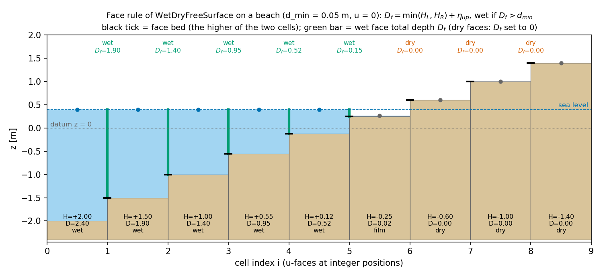
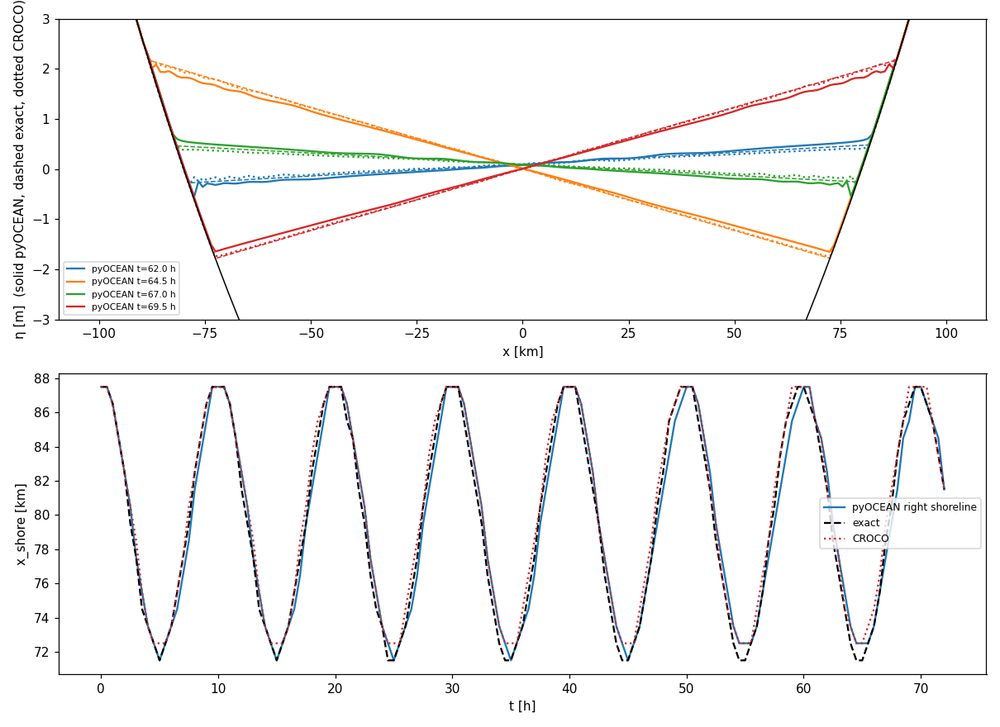
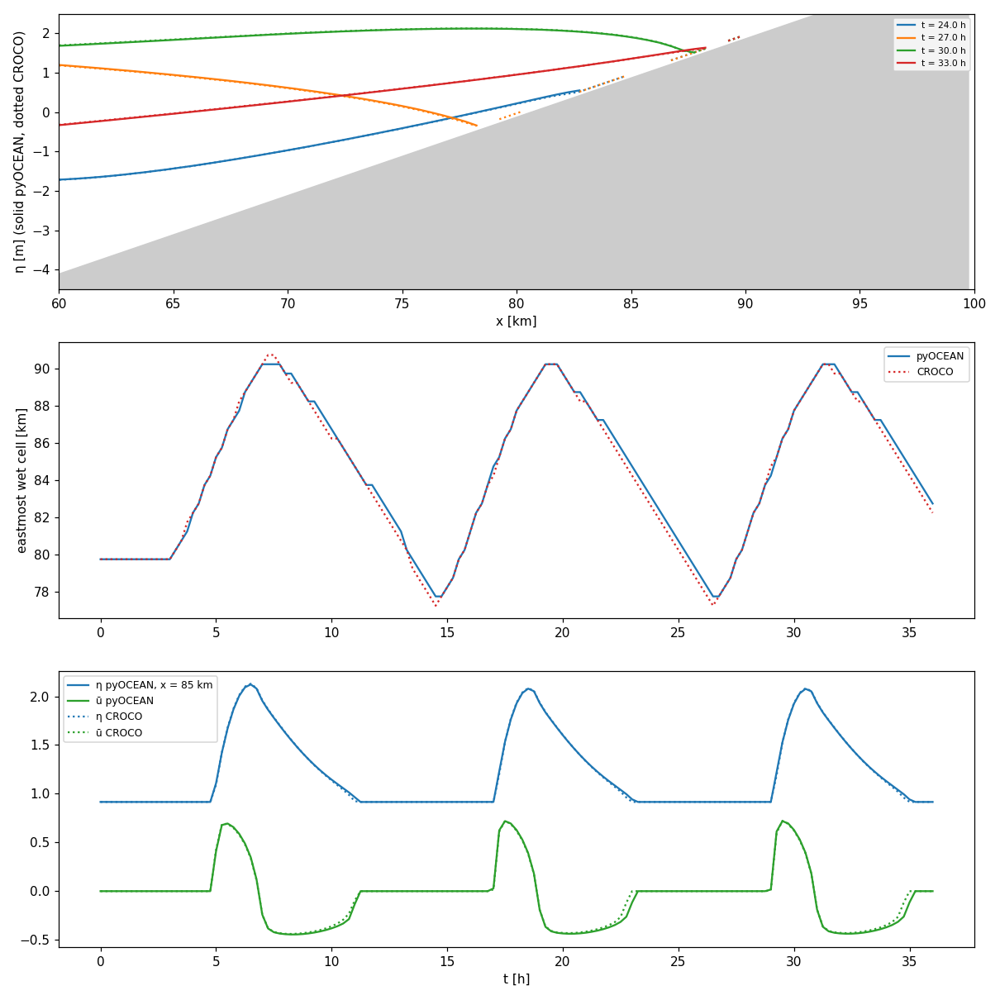
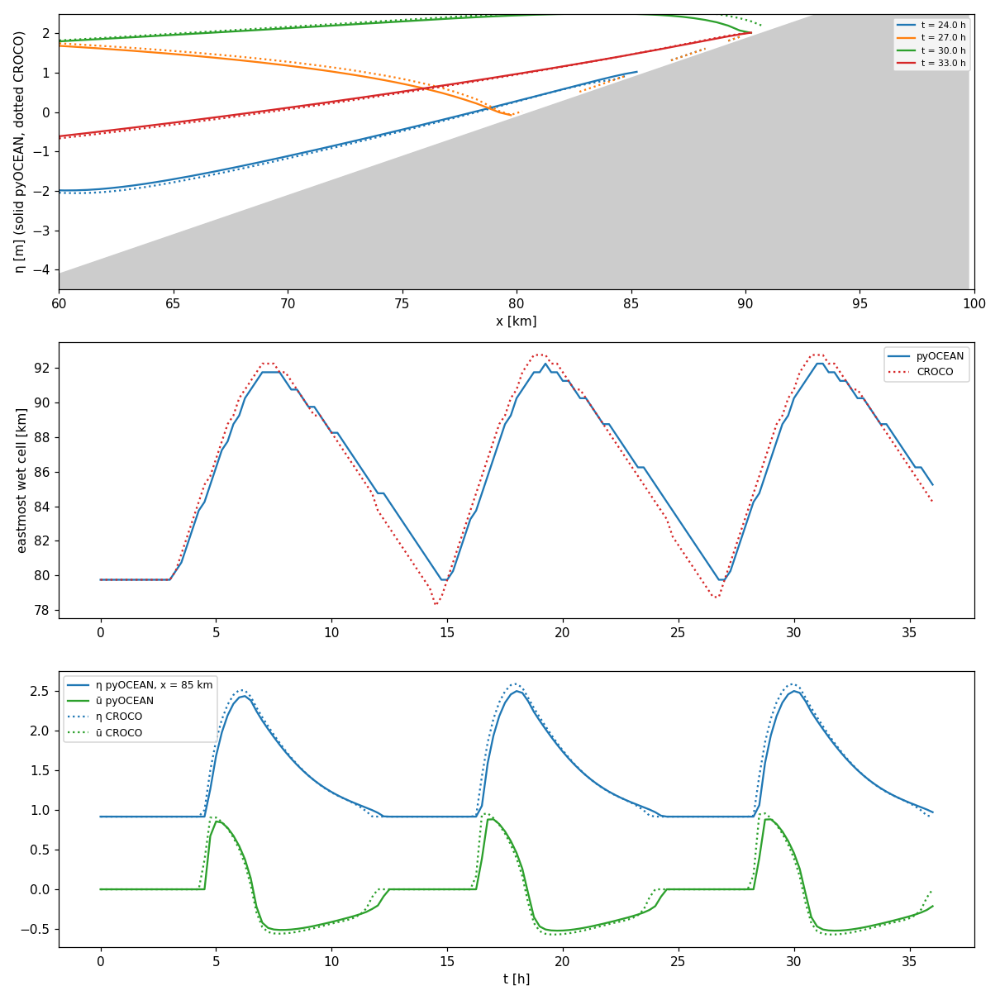

# Wetting and drying

Tidal flats, estuaries and lagoons flood and dry every tide. pyOCEAN handles this with the semi-implicit,
mass-conservative and positivity-preserving method of Casulli (1990) and Casulli & Cheng (1992): the free surface is
solved with the **total** water depth $D = H + \eta$ at the faces, a face whose upwind total depth falls below
$d_{\min}$ is dry (no flux, $u = 0$), and land that can flood is simply a cell with a negative depth $H < 0$. The
same free-surface solver (`WetDryFreeSurface`) drives the 2-D tidal model, the homogeneous 3-D σ model
(`SigmaWetDry`) and the stratified model (`SigmaBaroclinic`, σ and ALE). The subgrid bathymetry of Casulli (2009) and
a momentum-conserving front (Stelling & Duinmeijer 2003) are planned (roadmap stage B).

## Physics

The depth-integrated continuity and momentum equations with the total depth are

$$
\frac{\partial\eta}{\partial t} + \nabla\cdot\left[(H + \eta)\,\bar{\mathbf u}\right] = 0,
\qquad
\frac{\partial\bar{\mathbf u}}{\partial t} = -g\nabla\eta + \mathbf G,
$$

with $H$ [m] the still-water depth below the datum ($H < 0$: land above the datum that can flood; NaN: a permanent
wall), $\eta$ [m] the surface elevation and $\mathbf G$ all other (explicit) accelerations. A column is wet while
$D = H + \eta > 0$. The difficulty is to keep $D \ge 0$ and conserve volume exactly while the shoreline moves across
the grid; the semi-implicit method does both by making the face flux depend on the *upwind* total depth, which is
zero when the donor cell is empty (Casulli & Cheng 1992; Casulli 2009).

*The face rule evaluated by `WetDryFreeSurface._face_depth` on a beach (u = 0, so the higher η of the two cells is
upwind). The face bed is the higher of its two cells; the face at i = 5 is wet ($D_f$ = 0.15 m) although the cell
beyond holds only a 2 cm film, so the sea can flood it; faces between dry cells are dry.*

## Discretisation: the 2-D wet–dry free surface

`WetDryFreeSurface` (`core/dynamics/wetting_drying.py:51`) on the Arakawa C grid.

**Face depth and wetness** (`_face_depth`, `:158-170`; face beds `:118-123`):

$$
H_f = \min(H_L, H_R)\ \ \text{(the higher bed)},\qquad
\eta_{\rm up} =
\begin{cases}
\eta_L & u_f^n > 0\\
\eta_R & u_f^n < 0\\
\max(\eta_L, \eta_R) & u_f^n = 0
\end{cases},\qquad
D_f = H_f + \eta_{\rm up},
$$

and the face is wet if $D_f > d_{\min}$ (default 0.05 m, the analogue of CROCO's `Dcrit`/`D_wetdry`). A dry face
gets $D_f = 0$, carries no flux and no pressure coupling, and its velocity is 0. Faces next to a wall cell (NaN) have
$H_f$ = NaN and are always closed.

**θ-method** (Casulli 1990). With $\hat u_f$ the velocity after all explicit tendencies and
$\delta_f$ the centre-to-centre spacing,

$$
u^*_f = \hat u_f - g(1-\theta)\Delta t\,\frac{\eta^n_R - \eta^n_L}{\delta_f},\qquad
u^{n+1}_f = u^*_f - g\theta\Delta t\,\frac{\eta^{n+1}_R - \eta^{n+1}_L}{\delta_f},
$$

$$
A_i\,\eta_i^{n+1} = A_i\,\eta_i^n - \Delta t\sum_f s_f L_f D_f\left[\theta u_f^{n+1} + (1-\theta)u_f^n\right],
$$

on wet faces only ($s_f = \pm1$ the outward sign, $L_f$ the face length, $A_i$ the cell area). Substituting
$u^{n+1}$ gives a symmetric positive-definite system (`_matrix`, `:182-200`; `step`, `:239-271`):

$$
A_i\eta_i^{n+1} + \sum_f c_f\left(\eta_i^{n+1} - \eta_{\rm nb}^{n+1}\right)
= A_i\eta_i^n - \Delta t\sum_f s_f L_f D_f\left[\theta u^*_f + (1-\theta)u^n_f\right],
\qquad c_f = \frac{g\,\theta^2\Delta t^2 L_f D_f}{\delta_f}.
$$

A dry cell's row reduces to $A_i\eta_i = A_i\eta_i^n$: it keeps its level, and the matrix stays SPD. $D_f$ is
frozen at time $n$, so the matrix changes every step and is assembled from the face arrays each time (unlike
`ImplicitFreeSurface`, which factorises once). $\tfrac12 \le \theta \le 1$ (default 0.6).

**Properties.** The flux form conserves volume exactly. With the upwind total depth the scheme is mass-positive
(Casulli & Cheng 1992; Casulli 2009): a cell can only lose the water it has. A residual positivity guard sets
$\eta = -H$ where $D < 0$ after the solve and reports the clipped volume in `last_clip_volume` (`:299-303`); it should
only remove round-off (Thacker: 7.7e-6 m³ per m of channel over 72 h, `validation/thacker/out/summary.txt`). A lake
at rest next to emerged land ($\eta = 0$ in the water, $\eta = -H$ on land) stays exactly at rest (well balanced,
`tests/test_wetting_drying.py::TestLakeAtRest`).

**Solvers** (`step`, `:272-297`):

* `solver='direct'`: sparse direct solve (`spsolve`) every step.
* `solver='cg'`: conjugate gradients warm-started from $\eta^n$, relative tolerance `cg_rtol` (1e-10), with
    preconditioner `precond='lu'` (default) — the exact LU factorisation of a *lagged* matrix, refactorised when CG needs
    more than `refactor_iterations` (5) iterations — or `'jacobi'`. Because the matrix changes slowly with $D$, the lagged
    inverse is an excellent SPD preconditioner: on the 96 273-cell northern Gulf of California nest, 1–3 iterations and
    7–19 ms per solve against 97–117 iterations and ~50 ms with Jacobi (factorisation 0.19 s; docstring `:83-87`).
    With CG, $\eta^{n+1}$ is then recomputed from the divergence of the final θ-weighted transports and Flather fluxes
    (MITgcm `exactConserv`), so the CG tolerance does not leak into volume and tracer budgets, and the positivity guard
    is applied after that recompute (`:322-336`; the earlier order let $D$ reach −9e-5 m, see
    `tests/test_wetting_drying.py::test_cg_exact_conservation_keeps_the_positivity_guard`).
* For bit-for-bit restarts the lagged matrix is saved and refactorised on restart
    (`preconditioner_state` / `set_preconditioner_state`, `:203-225`).

**Open boundaries.** `flather_u/flather_v` faces on the domain edge use Flather with the total depth of the adjacent
cell, closed while that cell is dry; see [Open boundaries](open-boundaries.md#barotropic-mode-flather-radiation).

**Momentum.** `WetDryFreeSurface` only does the pressure/continuity step. The caller builds $\hat u$: advection and
viscosity (`core/dynamics/nonlinear.py`, where a term whose stencil reaches a dry face is set to zero), Coriolis, and
the bed drag as a semi-implicit factor (see
[Turbulence closures and bottom friction](turbulence-friction.md#bottom-friction-in-the-code)).
A face that becomes wet starts from $u = 0$ plus one step of $\mathbf G$ (dry faces store $u = 0$).

## The 3-D wetting-drying model: `SigmaWetDry`

`SigmaWetDry` (`core/dynamics/sigma_wd.py:143`) is the homogeneous 3-D extension (Casulli & Cheng 1992; Casulli 1999).
The column of total depth $D$ is split into $N$ σ-layers of thickness $\Delta z_k = D\,\Delta\sigma_k$ ($k = 0$ at the
bed; `dsigma` uniform by default or stretched, positive and summing to 1). Layers thin out but never vanish as a cell
dries: $D$ is floored at $d_{\min}$ in the column solve (`column_step`, `:209`). The density is uniform, so the
pressure gradient is the barotropic $-g\nabla\eta$ in every layer. One step (`step`, `:258-299`):

1. **Columns.** For each face, $\hat u_k$ from the implicit vertical viscosity with the first-layer log-law bed stress
    and the wind as a top flux, on $u^n + \Delta t\,G_k$ (equations in
    [Turbulence closures](turbulence-friction.md#implicit-vertical-viscosity-with-bed-and-surface-stress)). The face
    depth for this step is the mean of the two cells (`face_depths`, `:246`; the edge face takes its inner cell).
2. **Free surface.** The depth mean $\hat{\bar u} = \sum_k w_k\hat u_k$ ($w_k = \Delta\sigma_k$ by default) goes to
    `WetDryFreeSurface.step`, which returns $\eta^{n+1}$ and $\bar u^{n+1}$ with the upwind total face depth.
3. **Barotropic correction**, uniform in the vertical:

$$
u_k^{n+1} = \hat u_k + \left(\bar u^{n+1} - \hat{\bar u}\right)\ \text{on wet faces},\qquad u_k^{n+1} = 0\ \text{on dry faces},
$$

where "wet" is the free surface's wet mask of this step, plus the open Flather faces with $\bar u^{n+1} \ne 0$
(`:293-296`).
4. With `closure='gls'`, advance k-ε with the new velocities (`_gls_update`, `:314`).

Splitting the pressure correction from the implicit friction lags the friction by one step on the pressure-driven
increment (first order in $\Delta t$); it keeps the free-surface system identical to the 2-D one, so mass conservation
and positivity are inherited. Without bed friction and viscosity the model reproduces the 2-D one exactly
(`tests/test_sigma_wd.py`). Vertical advection is not included in `SigmaWetDry`; `SigmaBaroclinic` adds it.

**Face geometry for ALE.** `step` accepts the face geometry of the ALE model instead of $D\,\Delta\sigma_k$:

| Argument | Meaning |
|---|---|
| `wu`, `wv` | layer fractions at the faces for the depth mean $\bar u = \sum_k w_k u_k$ (`core.vertical.ale.face_fractions`) |
| `hu`, `hv` | layer thicknesses at the faces for the implicit vertical viscosity |
| `hu_drag`, `hv_drag` | bed-layer thickness for the log-law drag (default `hu[0]`, `hv[0]`) |
| `hu_mean`, `hv_mean` | thicknesses whose fractions are `wu`, `wv` (the face column of the free surface, clipped at the shallower bed); when given, `column_step` restores the depth-mean balance with a uniform correction $\delta$ |

## Wetting and drying in the stratified model

**σ mode** (`SigmaBaroclinic`, `vertical_coordinate='sigma_eulerian'`). The layer volume transports use the upwind
total face depth of the free surface, $Q_k = L_f D_f\Delta\sigma_k\,u_k^\theta$ with $D_f$ = `fs.last_Du/Dv`
(`core/dynamics/sigma_baroclinic.py:2114-2122`), so $\sum_k Q_k$ is exactly the free-surface flux, $\omega$ vanishes
at the surface and a uniform tracer stays uniform through flooding and drying. Tracers are updated only where the new
layer volume is positive (`ok = active & (V1 > 0)`, `:2136`).

**ALE mode.** The grid rule decides whether a column may dry (`_setup_ale`, `:1169-1172`;
`core/vertical/regrid.py:326`, `:355-379`):

| `regrid` | Columns with $H \le 0$ (floodable) |
|---|---|
| `'sigma'` | allowed (σ-layers on the total depth) |
| `'zstar'` | **rejected** (`ValueError`): z* layers need $H > 0$ |
| `'hybrid'` | allowed only with a shallow σ zone, `regrid_params` `d_hybrid > 0`; floodable columns are σ at any depth, and between `d_sigma` and `d_hybrid` the window transition keeps only the isopycnals that fit between σ and z* (continuous in $D$) |

Open boundaries next to floodable cells are not supported in ALE (`:1173-1179`). An ALE-σ drying beach keeps
$h \ge 0$, $\sum_k h_k = \max(H + \eta, 0)$ to 1e-9 m, a uniform tracer uniform to 1e-10 and the tracer content to
1e-10 relative (`tests/test_sigma_ale.py::test_sigma_ale_on_a_drying_beach_stays_positive_and_uniform`). See
[Vertical coordinates and ALE](vertical-ale.md).

## Options and defaults

| Option | Values | Default | Meaning | Where |
|---|---|---|---|---|
| `bathy` | (ny, nx) [m] | — | $H$ below the datum; $< 0$ floodable land; NaN wall | `wetting_drying.py:57-59` |
| `d_min` | m | 0.05 | face depth below which a face is dry | `wetting_drying.py:91`, `sigma_wd.py:163`, `sigma_baroclinic.py:1008` |
| `theta` | ½ … 1 | 0.6 | implicit weight of the free surface | same |
| `solver` | `'direct'`, `'cg'` | `'direct'`; `SigmaBaroclinic`: `'cg'` in ALE, `'direct'` in σ | free-surface linear solver | `wetting_drying.py:92`, `sigma_baroclinic.py:1076-1077` |
| `cg_rtol` | – | 1e-10 | CG relative tolerance | `wetting_drying.py:92` |
| `precond` | `'lu'`, `'jacobi'` | `'lu'` | CG preconditioner (lagged LU) | `wetting_drying.py:93` |
| `refactor_iterations` | int | 5 | refactorise the lagged LU when CG needs more | `wetting_drying.py:93` |
| `flather_u`, `flather_v` | bool masks | None | Flather faces on the domain edge | `wetting_drying.py:91` |
| `n_layers`, `dsigma` | | 10, uniform | σ-layers of `SigmaWetDry` | `sigma_wd.py:161-165` |
| `z0`, `closure`, `nu_const`, `nu_min`, `cd_max` | | 1e-4, `'parabolic'`, 1e-2, 1e-5, 0.1 | see [Turbulence](turbulence-friction.md) | `sigma_wd.py:161-165` |

## Validation

Details and figures: [Validation: wetting and drying](../validation/wetting-drying.md).

**Thacker (1981) parabolic bowl** (CROCO `THACKER_2DV`, 200 km channel, $\Delta x$ = 1 km, $\Delta t$ = 60 s, 72 h,
no friction; `validation/thacker/README.md`):

| | η rms (72 h) | η rms, last period | shoreline rms | volume |
|---|---|---|---|---|
| pyOCEAN, θ = 0.5, $d_{\min}$ = 0.05 m | 4.6 cm | 6.9 cm | 0.8 km | exact (4e-16) |
| pyOCEAN, θ = 0.5, $d_{\min}$ = 0.01 m | 9.7 cm | 15.4 cm | 1.4 km | exact |
| CROCO, $D_{\rm crit}$ = 0.01 m | 2.0 cm | 2.9 cm | 0.6 km | exact |

Convergence (rms after one period): 10.2, 3.8, 1.8 and 1.05 cm at $\Delta x$ = 4, 2, 1, 0.5 km.

*Thacker bowl: η at four times in the last period (solid pyOCEAN, dashed exact, dotted CROCO) and the right shoreline
over 72 h. The planar surface slowly loses amplitude in pyOCEAN (front dissipation, below).*

**CROCO TIDAL_FLAT, 2DH** (100 km channel, 500 m cells, bed from 16 m to −3.9 m, 2 m tide at the west Flather edge,
$C_d$ = 2.5e-3, UP3 advection, threshold 0.1 m, $\Delta t$ = 15 s, 36 h; `validation/tidal_flat/README.md`): η rms
difference 1.1 cm (max 5.1 cm) where both are wet, ū rms 0.006–0.033 m s⁻¹ at the stations, shoreline within one cell
(rms 0.35 km), no clipped volume. Insensitive to θ = 0.5–0.6 and to the advection scheme; $d_{\min}$ = 0.05 m moves
the measured shoreline 2 km because a 5–10 cm film counts as wet.

*TIDAL_FLAT 2DH, pyOCEAN against CROCO with the same physics.*

**CROCO TIDAL_FLAT, original 3-D** (GLS k-ε, $z_0$ = 1e-4 m, 10 levels; `validation/tidal_flat/README.md`):

| Against CROCO 3-D, last period | η rms (wet cells) | η max | ū rms (stations) | shoreline max |
|---|---|---|---|---|
| 2-D, $C_d$ = 2.5e-3 | 27.0 cm | 128 cm | 0.17–0.29 m s⁻¹ | 3.5 km |
| 2-D, log-law $C_d(D)$, $z_0$ = 1e-4 m | 4.5 cm | 39 cm | 0.02–0.10 m s⁻¹ | 1.5 km |
| 3-D σ, parabolic | 5.2 cm | 45 cm | 0.03–0.12 m s⁻¹ | 2.0 km |
| **3-D σ, GLS k-ε** | **1.2 cm** | 8.7 cm | **0.01–0.05 m s⁻¹** | 1.0 km |

Tidal ranges agree to ≤ 2 cm at every station (4.72 / 4.72 m at 50 km); the run takes ~14 s. Regression tests:
`tests/test_wetting_drying.py::TestTidalFlatVsCroco` (η rms < 2 cm, max < 6 cm, ū rms < 4 cm s⁻¹, shoreline within one
cell, no clipping) and `::TestTidalFlatVsCroco3D` (constant $C_d$ > 20 cm; log-law < 8 cm; σ + GLS η < 2.5 cm, ū
< 5 cm s⁻¹).

*2-D pyOCEAN with the log-law $C_d(D)$ against CROCO's 3-D run.*

*3-D σ + GLS pyOCEAN against CROCO 3-D: η profiles, the moving shoreline and η, ū at x = 85 km.*

Other tests (`tests/test_wetting_drying.py`, 24 passing + 1 strict xfail): lake at rest, one Thacker period against
the exact solution (max < 10 cm, rms < 2 cm), shoreline within 2 km, convergence with resolution, exact mass and
$D \ge -10^{-10}$, the deep limit equals the linear free surface (with and without Flather), the volume budget through a
Flather face, and a dry boundary cell closes its Flather face.

## Known limitations

* **Front dissipation.** A face that becomes wet starts with $u = 0$, a momentum sink at the moving shoreline:
    pyOCEAN loses ~1 % of the planar Thacker amplitude per period ($A/A_0$ = 0.936 after 7 periods), CROCO ~0.2 %
    (0.984), because CROCO does not zero the velocity on dry faces, it only masks the flux. Extrapolating velocity to
    newly wet faces was tried and rejected (it pumps energy through faces that flicker). The target stays visible as the
    strict xfail `tests/test_wetting_drying.py::TestThacker::test_front_dissipation_as_low_as_croco` (amplitude after
    3 periods > 0.99; the regression test requires > 0.965). Planned fix: a momentum-conserving front (Stelling &
    Duinmeijer 2003) or CROCO's strategy.
* In TIDAL_FLAT pyOCEAN dries one cell later than CROCO on the ebb: the front holds a little water (same cause).
* **Threshold sensitivity.** Results depend on $d_{\min}$ (Thacker: 4.6 cm rms with 0.05 m, 9.7 cm with 0.01 m).
* **No subgrid bathymetry.** A cell is either wet or dry as a whole; Casulli (2009) subgrid wetting (vision roadmap,
    stage B) would remove the sensitivity to intertidal topography.
* Pressure–friction splitting in `SigmaWetDry` (first order in $\Delta t$; not noticeable at $\Delta t$ = 15 s, to be
    measured with large steps).
* ALE: no z* over floodable cells, no open boundary next to them, and no log-law drag (`z0=None`).
* A dry cell keeps its last $\eta$ (≥ $-H$); the module docstring's "a dry cell keeps its surface on the bed" holds
    only after the positivity guard or when the cell drained to $D = 0$.

## References

* Casulli, V. (1990). Semi-implicit finite difference methods for the two-dimensional shallow water equations.
    *J. Comput. Phys.* 86, 56–74. [doi:10.1016/0021-9991(90)90091-E](https://doi.org/10.1016/0021-9991(90)90091-E) **[verify DOI]**
* Casulli, V. (1999). A semi-implicit finite difference method for non-hydrostatic, free-surface flows.
    *Int. J. Numer. Meth. Fluids* 30, 425–440.
* Casulli, V. (2009). A high-resolution wetting and drying algorithm for free-surface hydrodynamics.
    *Int. J. Numer. Meth. Fluids* 60, 391–408. [doi:10.1002/fld.1896](https://doi.org/10.1002/fld.1896) **[verify DOI]**
* Casulli, V. & Cheng, R.T. (1992). Semi-implicit finite difference methods for three-dimensional shallow water flow.
    *Int. J. Numer. Meth. Fluids* 15, 629–648.
* Stelling, G.S. & Duinmeijer, S.P.A. (2003). A staggered conservative scheme for every Froude number in rapidly
    varied shallow water flows. *Int. J. Numer. Meth. Fluids* 43, 1329–1354. **[verify]**
* Thacker, W.C. (1981). Some exact solutions to the nonlinear shallow-water wave equations. *J. Fluid Mech.* 107,
    499–508.
* CROCO test cases `THACKER`, `TIDAL_FLAT` (`~/pyOCEAN_refs/croco/`, runs in `~/pyOCEAN_refs/croco_runs/`).
