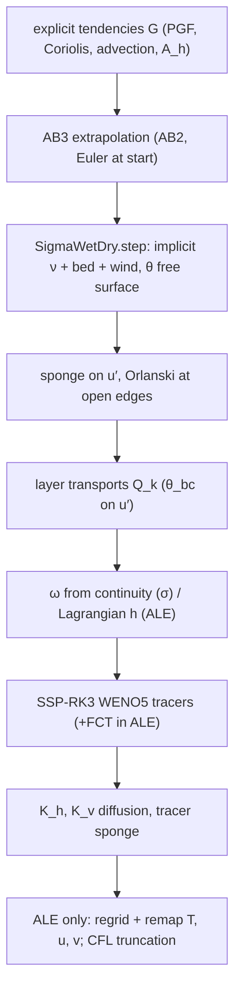
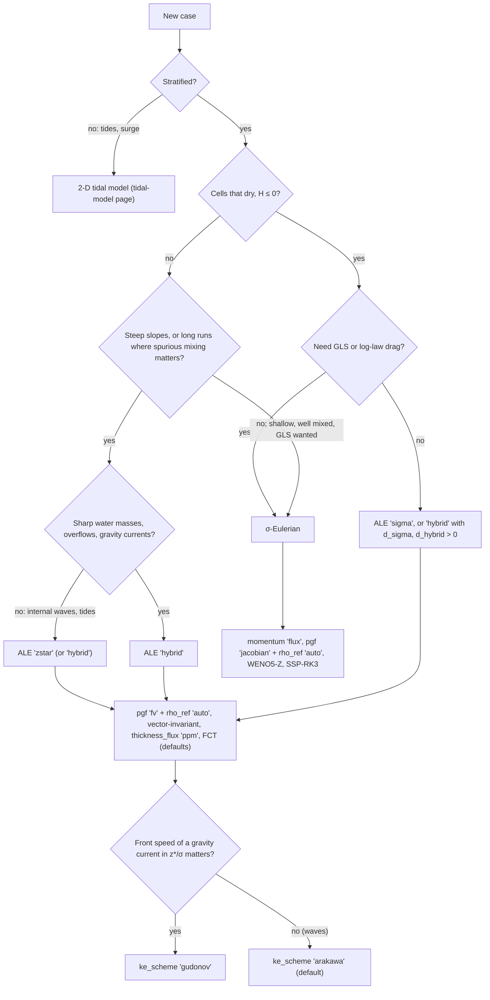

# Building a model with SigmaBaroclinic

This page takes you from an empty script to a running stratified simulation. `SigmaBaroclinic`
(`core/dynamics/sigma_baroclinic.py:933`) is the 3-D hydrostatic, Boussinesq model of pyOCEAN. It runs in
two vertical modes:

- **σ-Eulerian** (`vertical_coordinate="sigma_eulerian"`, the default): terrain-following layers with a fixed
    fraction Δσ_k of the water column, vertical advection through ω, the GLS / parabolic / constant closures and the
    log-law bed drag. It reproduces CROCO in the lock exchange, and its homogeneous core (`SigmaWetDry`) reproduces
    CROCO's 3-D tidal flat.
- **ALE** (`vertical_coordinate="ale"`): a Lagrangian step with no flux through the layer interfaces, then a
    regrid to a target grid (`"sigma"`, `"zstar"` or `"hybrid"`) and a conservative remap, as in MOM6. This is
    the mode to use for real stratified regional runs over steep topography.

Both modes share the free surface and the vertical viscosity of `SigmaWetDry` (`core/dynamics/sigma_wd.py:143`),
whose θ-implicit wet–dry free surface is `WetDryFreeSurface` (`core/dynamics/wetting_drying.py:51`).
Every option is listed in the [configuration reference](configuration-reference.md); the numerics behind them
are in [Vertical coordinates and ALE](../theory/vertical-ale.md), [Momentum](../theory/momentum.md),
[Pressure gradient](../theory/pressure-gradient.md) and [Tracers](../theory/tracers.md).

!!! warning "What the model does not have (yet)"
    - ~~One tracer only, T, and a linear equation of state~~: salinity (`salinity=True`) since N2a, and the
        nonlinear `eos="wright_full"` / `"teos10"` since 2026-11-01 ([Equation of state](../theory/equation-of-state.md)).
        The default is still the linear EOS ρ = ρ₀ − α (T − T₀) (+ β (S − S₀) with salinity); older realistic cases
        use a *density-equivalent* temperature, T = T₀ + (ρ₀ − ρ)/α, as the BayIW "real" case does.
    - **Surface forcing of `step`:** momentum stress (`tau_x`, `tau_y`), a prescribed freshwater flux `fw` (N2a) and a
        prescribed heat flux `heat` (N3); no bulk formulae inside the model yet (N2b).
    - **Closures (since N3, 2026-10-30):** `closure='kpp'` (CVMix/MOM6, no background diffusivity by default) and
        the stratified GLS (`gls_stratified=True`) work in σ and ALE; a prescribed `heat` flux and `periodic` boundaries
        exist (see [Turbulence closures](../theory/turbulence-friction.md)).
    - **ALE** accepts `z0` (law-of-the-wall drag over `hbbl`) and `closure` `"constant"`, `"none"`, `"gls"` or `"kpp"`
        (`core/model/preflight.py`).

## Step 0 — environment and threads

```python
import os
os.environ.setdefault("NUMBA_NUM_THREADS", "5")          # before importing numba / pyOCEAN
for v in ("OMP_NUM_THREADS", "OPENBLAS_NUM_THREADS", "MKL_NUM_THREADS", "VECLIB_MAXIMUM_THREADS"):
    os.environ.setdefault(v, "1")                          # BLAS threads give no speed-up (CLAUDE.md)

from core.dynamics.sigma_baroclinic import SigmaBaroclinic, set_threads
set_threads(5)                                             # default is 1 thread!
```

The compiled kernels run on **one thread unless you call `set_threads(n)`**
(``set_threads`` (`core/dynamics/sigma_baroclinic.py:166`); the default `_THREADS = [1]` is at `:163`).
`n` is clipped to `NUMBA_NUM_THREADS`, which must be set before Numba is imported. Results are bit-identical for
any thread count (same docstring). On the development laptop (M3 Pro), use at most the 5 performance cores in
total over all concurrent runs (CLAUDE.md, "Known issues"). The first step of a run compiles the Numba kernels;
they are cached on disk (`cache=True`), so later runs start faster. See [Installation](../getting-started/installation.md)
for the environment itself.

## Step 1 — the horizontal grid

Grids are `xarray.Dataset`s with Arakawa C staggering (`core/grid/horizontal.py`). Three builders exist:

| Builder | Use | Coriolis |
|---|---|---|
| `create_cartesian_grid(nx, ny, dx, dy, x0=0, y0=0, f0=1e-4, beta=0)` (`core/grid/horizontal.py:48`) | idealised boxes and channels | f = f₀ + β y |
| `create_cartesian_grid_stretched(dx, dy, x0=0, y0=0, f0=1e-4, beta=0)` (`:163`) | telescopic grids, MITgcm `delXFile`/`delYFile` | f = f₀ + β y |
| `create_spherical_grid(nx, ny, dlon, dlat, lon0=0, lat0=0)` (`:246`) | regional lon/lat grids | f = 2Ω sin φ |

```python
from core.grid.horizontal import create_cartesian_grid
hg = create_cartesian_grid(nx=128, ny=1, dx=500.0, dy=500.0, f0=0.0)   # a 64 km x–z channel
```

A "2-D" section is simply `ny = 1`: the walls at the south and north faces close it, so v = 0 and f does nothing
(the BayIW section runs this way, `validation/bayiw_2d/section.py`, module docstring). The model reads the
metric arrays `dx_u`, `dy_u`, `dx_v`, `dy_v`, `area_t`, `dx_t`, `dy_t`, `area_u`, `area_v` and the Coriolis
parameter at the cell corners `f_q`.

!!! note "Uniform spacing for the σ-mode tracer stencils"
    The σ-mode docstring lists "Cartesian uniform spacing for the UP3/WENO face interpolation" as a limitation
    (`core/dynamics/sigma_baroclinic.py:55`). The ALE validation runs (BayIW, MITgcm `internal_wave`) use
    stretched grids.

Real regional grids (GEBCO, spherical grids, initial and boundary data) are covered in
[Regional setup](regional-setup.md).

## Step 2 — the bathymetry array

The model takes one array `bathy` of shape `(ny, nx)`:

| Value | Meaning |
|---|---|
| `H > 0` | water, rest depth below the datum [m], **positive down** |
| `H ≤ 0` | land that can flood (wetting–drying); bed above the datum |
| `NaN` | permanent wall (land that never floods) |

The active-cell mask is `act = np.isfinite(bathy)` (``SigmaBaroclinic.__init__``
(`core/dynamics/sigma_baroclinic.py:1065`); ``WetDryFreeSurface.__init__`` (`core/dynamics/wetting_drying.py:113`)).
**The grid's `mask_t` is not used.** Face depths are the shallower of the two cells
(`H_u = fmin(H_L, H_R)`, `core/dynamics/wetting_drying.py:120`).

!!! danger "`build_bathymetry` returns 0 for land"
    ``build_bathymetry`` (`core/grid/bathymetry.py:379`) follows the phase-1 z-level convention "0 = land"
    (its docstring, "positive downward, 0 = land"). Passed unchanged to `SigmaBaroclinic`, every land cell
    becomes an *active, floodable* cell with H = 0. Convert it first:

    ```python
    bathy = np.where(depth > 0, depth, np.nan)       # walls where the GEBCO pipeline put land
    ```

    In ALE z* the unconverted array fails immediately with "cells with H ≤ 0 can dry: use regrid='sigma', or
    'hybrid' with a shallow σ zone" (`core/dynamics/sigma_baroclinic.py:1171`).

Before running, check the domain (slope factors, isolated basins, pits, CFL advice) with
``check_domain`` (`diagnostics/domain_check.py:178`) — see
[Output, restarts and diagnostics](output-restart-diagnostics.md#domain-checker).

## Step 3 — construct the model

The minimal σ call:

```python
m = SigmaBaroclinic(hg, bathy, dt=10.0, n_layers=20, rho0=1000.0, t_coef=0.28, z0=None,
                    closure="constant", nu_const=1e-6)
```

The minimal ALE z* call:

```python
m = SigmaBaroclinic(hg, bathy, dt=120.0, n_layers=50, rho0=1025.0, t_coef=0.2, t_ref=10.0, z0=None,
                    closure="constant", nu_const=1e-5, pgf="fv", rho_ref="auto",
                    vertical_coordinate="ale", regrid="zstar", regrid_params=dict(dz_top=delR))
```

What the constructor does, in order (``SigmaBaroclinic.__init__`` (`core/dynamics/sigma_baroclinic.py:1005-1121`)):

1. checks `pgf`, `tracer_time`, `tracer_scheme`, the open-boundary edges and modes;
2. resolves the automatic defaults: `theta_bc = 0.5`; `thin_layer_coupling = "mom6"` in ALE, `"none"` in σ;
    `thin_layer_cutoff = 0`; `solver = "cg"` in ALE, `"direct"` in σ (`:1047-1077`);
3. builds the `SigmaWetDry` core (free surface, vertical viscosity, closure) with Flather faces on the open
    edges (`:1078`);
4. builds the sponge rate fields (`_sponge_rates`, `:906`) and the boundary masks;
5. `_setup_ale` (`:1123`): `momentum` defaults to `"vector_invariant"` in ALE and `"flux"` in σ; checks the ALE
    scope (z0, closure, regrid rule, required `regrid_params`, floodable cells, the hybrid z* floor);
6. resolves `tracer_limiter`: `"fct"` in ALE with SSP-RK3 and WENO5, `"none"` otherwise (`:1112-1121`).

The defaults of `SigmaBaroclinic` differ from those of `SigmaWetDry` (closure `"constant"`, ν = 1e-4 m² s⁻¹,
`z0=None` here; `"parabolic"`, 1e-2, 1e-4 m there): pass `z0` and `closure` explicitly when you mean the bed drag.

### Array conventions

| Quantity | Shape | Location | Order |
|---|---|---|---|
| `eta` | `(ny, nx)` | cell centres | — |
| `T`, `h` | `(N, ny, nx)` | cell centres | **k = 0 at the bed** |
| `u` | `(N, ny, nx+1)` | u-faces (west face of cell i is i) | k = 0 at the bed |
| `v` | `(N, ny+1, nx)` | v-faces (south face of cell j is j) | k = 0 at the bed |
| `tau_x` | `(ny, nx+1)` | u-faces | N m⁻² |
| `tau_y` | `(ny+1, nx)` | v-faces | N m⁻² |
| `regrid_params["dz_top"]` | `(N,)` | nominal z* thicknesses | **surface first** |
| `regrid_params["rho_target"]` | `(N+1,)` | interface target densities | **surface first**, increasing |
| `dsigma` | `(N,)` | σ fractions | bed first, Σ = 1 |
| `OBData.T`, `.u_normal` / `.zw` | `(nz, n)` / `(nz+1, n)` | exterior profiles | **surface first**, `zw` decreasing |

The mixed orders are the code's: z-level data and target lists are surface first (MITgcm/MOM6 habit), model arrays
are bed first. `SigmaState` (`core/dynamics/sigma_baroclinic.py:107`) is a dataclass of plain NumPy arrays; see
[Data structures](../architecture/data-structures.md).

## Step 4 — the initial state

```python
st = m.initial_state(eta, T)                 # σ, or ALE on the rule's own initial grid
st = m.initial_state(eta, T_src, h_src=h_src)  # ALE only: T given on a source grid (e.g. data z-levels)
```

``SigmaBaroclinic.initial_state`` (`core/dynamics/sigma_baroclinic.py:1190`) always returns a **resting** state
(u = v = 0). Without `h_src`, `T` must be given on the layers of ``m.layer_heights(eta)``
(`core/dynamics/sigma_baroclinic.py:1267`):

- σ: centres z_k = −H + D σ_c,k;
- ALE `"sigma"` / `"zstar"`: the centres of the rule's grid;
- ALE `"hybrid"`: **σ-layers**. The hybrid grid is then built by `init_iterations` (default 10) regrid–remap
    passes, as MOM6 `THICKNESS_CONFIG = "uniform"` + `REGRID_ACCELERATE_INIT` (`_initial_h`, `:1307-1325`).

So the usual pattern is

```python
z = m.layer_heights(eta)          # (N, ny, nx), bed first, z = 0 at the rest surface
T = my_profile(z)                 # any function of height
st = m.initial_state(eta, T)
```

With `rho_ref="auto"`, `initial_state` also builds the reference density profile ρ_ref(z) from this T (400 depth bins,
``reference_profile`` (`core/dynamics/sigma_baroclinic.py:780`)), used by the pressure gradient and by the
horizontal diffusion of T − T_ref(z). It also stores the exterior profile `T_ext` (and `h_ext` in ALE) that the open
boundaries and the sponge use (`:1211-1219`).

**`h_src` (ALE only).** For a hybrid run from z-level data, give the data's own layer thicknesses `h_src`
`(N_src, ny, nx)`, bed first, clipped at the bed so that Σ h_src = H + η in every wet column, and `T_src` on those
layers. The hybrid grid is regridded once on the source levels and the model interfaces are snapped onto the
density jumps of the data (``regrid.snap_to_jumps`` (`core/vertical/regrid.py:425`)); then T is remapped
conservatively from the source (``_initial_state_from_source`` (`core/dynamics/sigma_baroclinic.py:1222-1265`),
MOM6 `Z_INIT_ALE_REMAPPING`). Without it, the σ start loses the top metres of deep columns: "1.6 cm/s from rest at
the BayIW shelf edge, now 3.3e-4" (CLAUDE.md, ALE mode row). Dry columns get T = `t_ref`.

To start from a non-resting state, overwrite `st.u`, `st.v` after `initial_state` (they are plain arrays). In ALE the
face velocities must be consistent with `st.h`; no pyOCEAN test does this.

## Step 5 — the time loop

```python
for n in range(n_steps):
    st = m.step(st, tau_x=tau_x, tau_y=tau_y)     # tau in N m⁻², or None
```

``SigmaBaroclinic.step`` (`core/dynamics/sigma_baroclinic.py:2084`) returns a new `SigmaState`; `st.time` [s] is
advanced by `dt`. One step is (σ mode, `:2090-2152`):



The full call graph is in [The time step](../architecture/time-step.md).

### Wind stress

τ enters as the top flux of the implicit vertical viscosity, τ/ρ₀ into the top layer, as ROMS/CROCO
`sustr/svstr`, not through AB3 (docstring of `step`, `:2086-2088`). Give it on the faces:

```python
tau_x = np.zeros((ny, nx + 1)); tau_y = np.zeros((ny + 1, nx))
tau_y[:-1, :] = tau_on_cells            # BayIW convention: v-face j = south face of cell j
st = m.step(st, tau_y=tau_y)
```

(`validation/bayiw_cut/run_pyocean.py:64-66`.) Bulk formulae that turn winds into stress are in
[Surface forcing](surface-forcing.md); the model itself only takes τ.

### Open boundaries

Any domain edge not listed in `open_boundaries` is a closed, free-slip wall. An open edge gets
([theory](../theory/open-boundaries.md)):

- **Flather** (1976) radiation of the depth-mean flow in the free surface, toward a resting exterior (η = 0, ū = 0)
    or toward `eta`/`ubar` of `open_boundary_state`;
- **Orlanski** (1976) radiation of the baroclinic normal velocity u′, with the Courant number clipped to
    `[0, orlanski_cmax]` (``_radiate`` (`core/dynamics/sigma_baroclinic.py:1645`));
- **upstream tracer values**: the exterior T on inflow, the boundary cell on outflow (`_open_faces`, `:1556`);
- optionally a **sponge band** of `sponge_cells` cells with the MITgcm OBCS profile, relaxing u′ (never the depth
    mean) and, if `sponge_tracer`, T toward the exterior (`_sponge_rates`, `:906`). `sponge_tau = (τ_inner, τ_boundary)`
    [s]: the time scale goes from τ_boundary at the edge to τ_inner at the inner end; the rate is zero at
    distance `sponge_cells`.

The exterior is at rest with the initial T profile unless you give `open_boundary_state`, a function
t [s] → `{edge: OBData}` evaluated at tⁿ⁺¹ every step (`_evaluate_exterior`, `:1717`). Each `OBData`
(`boundaries/obcs/__init__.py:124`) holds `T (nz, n)`, `u_normal (nz, n)`, `zw (nz+1, n)` on its own z grid
(surface first, decreasing, reaching the bed of the boundary column), and optionally `eta (n,)`, `ubar (n,)`,
with `n` = ny for west/east and nx for south/north. Per edge, `open_boundary_mode` chooses `"radiating"` (default:
Flather + Orlanski + nudging of u′ toward the exterior with `obc_tau_in` / `obc_tau_out`, CROCO `u3dbc.F`) or
`"clamped"` (u′ = u′ₑₓₜ, Dirichlet, no sponge on that edge).

Validated settings: mode-1 channel interior error 0.82 closed, 0.16 Orlanski only, 0.015 with a 10-cell sponge
in σ (module docstring, `:46-47`); z* 0.79 / 0.16 / 0.016 and hybrid 0.77 / 0.198 / 0.024 in ALE (CLAUDE.md, ALE
row); analytic mode-1 wave through a clamped west and radiating east edge within ±5 % (`validation/internal_wave/README.md`).

### Output and restart in the loop

```python
from diagnostics.output import OutputWriter
from core.restart import write_restart
w = OutputWriter("run.zarr", hg, bathy, n_layers=m.n, dsigma=m.core.dsigma, start="2026-01-01T00:00:00", model=m)
for n in range(1, n_steps + 1):
    st = m.step(st)
    if n % n_out == 0:
        w.write(st.time, eta=st.eta, u=st.u, v=st.v, T=st.T)
    if n % n_restart == 0:
        write_restart("restart.nc", m, st)
w.close()
```

Details, what is saved, and the ALE caveat of the σ output metadata are in
[Output, restarts and diagnostics](output-restart-diagnostics.md).

### Diagnostics you get for free

| Diagnostic | Where | Meaning |
|---|---|---|
| `m.rpe(st)` | `:1300` | reference potential energy [J], flat-basin geometry (area = wet area) |
| `m.tracer_content(st, power=1)` | `:1296` | Σ V T (or Σ V T² with `power=2`) [°C m³]: conservation check |
| `st.mix_num` | `:2139`, `:2043-2057` | online numerical mixing V (A(T²) − (A T)²)/Δt [°C² m³ s⁻¹] per cell; in ALE advection + remap parts; `None` with `mix_diagnostic=False` |
| `st.n_trunc` | `:2068` | CFL velocity truncations so far (ALE) |
| `st.n_limited` | `:2081` | cell-layers whose outflow was cut by the outflow limiter so far (ALE) |
| `st.omega` | `:2150` | σ: interface velocity ω [m s⁻¹]; ALE: `None` |
| `st.Qx`, `st.Qy`, `st.Fz` | `:2152` | layer volume transports of the last step [m³ s⁻¹] |
| `m.core.fs.last_clip_volume` | `core/dynamics/wetting_drying.py:302` | volume removed by the positivity guard in the last step (should be ~0) |
| `m.core.fs.cg_iterations`, `lu_factorizations` | `core/dynamics/wetting_drying.py:108-109` | CG iterations of the last solve, LU refactorisations so far |

A healthy ALE run keeps `n_trunc = 0` and max|Σ_k h_k − H − η| at round-off (the BayIW runs: ≤ 8e-13 m,
`validation/bayiw_cut/README.md`).

## Which configuration should I use?



Why each branch (numbers with their source):

| Choice | Use it when | Evidence |
|---|---|---|
| **σ-Eulerian** | shallow coastal and tidal cases, wetting–drying with GLS and the log-law drag | lock exchange = CROCO GRAV_ADJ front speeds 0.463 / 0.486 m s⁻¹ (`validation/lock_exchange/README.md`); 3-D TIDAL_FLAT to 1.2 cm (CLAUDE.md, `sigma_wd` row). Mixes 1.3–1.5× more than CROCO in the lock exchange (same README) |
| **ALE z\*** | stratified runs over steep topography | seamount 0.08–0.10 cm s⁻¹ at day 10 with `pgf="fv"` + `rho_ref="auto"` vs 0.41 for σ + Jacobian (`validation/seamount/README.md`, `validation/ilicak_benchmark/README.md`); lock exchange RPE within 1.6 % of MOM6 z* (Ilicak README) |
| **ALE hybrid** | long runs, density currents, sharp interfaces | 250–1200× less spurious mixing than z* in the lock exchange, fronts 0.94–1.06 U (Ilicak README, item 5); needs Σ `dz_top` ≥ max depth and `rho_target` designed for the water masses (see below). Open issues at ν = 1 overflow and ν = 0.01 internal wave ([Troubleshooting](troubleshooting.md#known-open-issues)) |
| **ALE σ** | terrain-following layers that can dry, inside the ALE machinery | lock exchange Benjamin ±10 % (CLAUDE.md, ALE row); RPE gain in 6 h 2.69e8 J vs 2.91e8 J for σ-Eulerian (same row) |
| `momentum="flux"` (σ) | always in σ (`"vector_invariant"` is ALE-only) | flux form gives the right front speed; the advective form was 16 % slow (`validation/lock_exchange/README.md`) |
| `momentum="vector_invariant"` (ALE default) | ALE | MOM6 form; "costs the same as the flux form" (CLAUDE.md, ALE row) |
| `ke_scheme="arakawa"` (default) | internal waves, tides, anything wave-like | `"gudonov"` damps progressive internal waves ~9 % per 5 km at dx = 100 m and `"arakawa"` gives MITgcm's mode-1 u to 0.91–1.01 (`validation/internal_wave/README.md`); the Ilicak benchmark runs use it |
| `ke_scheme="gudonov"` | gravity-current fronts and bores in z*/σ | ALE-σ lock exchange 0.98 U vs 0.91/0.84 U with `"arakawa"` (docstring, `core/dynamics/sigma_baroclinic.py:955-959`) |
| `thickness_flux="ppm"` (default) | ≥ ~20 layers | MOM6 `continuity_PPM`; hybrid lock exchange with 21 layers = MOM6; with 10 layers the dense body runs at 1.26 U (CLAUDE.md, ALE row; `validation/mom6_ke_schemes/`) |
| `thickness_flux="upwind"` | few layers, or cost | 28 % cheaper (docstring, `:961-963`); 10 layers + upwind nose 1.12 U (CLAUDE.md) |
| `pgf="jacobian"` + `rho_ref="auto"` (σ) | σ over slopes | seamount 0.41 cm s⁻¹ at day 10; 42 cm s⁻¹ without the reference profile (`validation/seamount/README.md`) |
| `pgf="fv"` + `rho_ref="auto"` (ALE) | ALE, any rule | exact for linear ρ on any layers (CLAUDE.md, `pgf.py` row); z* seamount 0.10 cm s⁻¹ |
| `tracer_scheme="weno5"` + `"ssprk3"` (default) | always | `upwind3` overshoots ~50 % at a lock-exchange nose (module docstring, `:18-19`); with FCT (ALE default) T stays inside the initial range (excursion ≤ 1.5e-8 °C, Ilicak README item 6) |
| closure | σ: `"gls"` (CROCO k-ε, Canuto A), `"kpp"`, `"parabolic"`, `"constant"`; ALE (since N3): `"constant"`, `"none"`, `"gls"` or `"kpp"` | GLS is stratified by default (`gls_stratified=True`); see [Turbulence and friction](../theory/turbulence-friction.md) |

## Worked example A — σ-Eulerian closed basin (lock exchange and seamount)

Based on `validation/lock_exchange/run_lock_exchange.py` and `validation/seamount/run_seamount.py`. Checked for this manual by running the code below on one thread for 2 h
(lock exchange; 1.4 s): heat drift −1.9e-14, ΔRPE/RPE₀ = 7.3e-7.

```python
import numpy as np
from core.grid.horizontal import create_cartesian_grid
from core.dynamics.sigma_baroclinic import SigmaBaroclinic, set_threads

set_threads(1)
# --- lock exchange: 64 km × 20 m, Δx = 500 m, Δρ = 5 kg m⁻³ (CROCO GRAV_ADJ, Ilicak 2012)
L, H, NX, NZ, DT = 64e3, 20.0, 128, 20, 10.0
hg = create_cartesian_grid(nx=NX, ny=1, dx=L / NX, dy=L / NX, f0=0.0)
bathy = np.full((1, NX), H)                                   # closed: no open_boundaries
m = SigmaBaroclinic(hg, bathy, dt=DT, n_layers=NZ, rho0=1000.0, t_coef=0.28, z0=None,
                    closure="constant", nu_const=1e-6, ah=0.0)   # adv='flux', tracer 'weno5' by default
T0 = np.where(np.arange(NX) < NX // 2, 5.0 / 0.28, 10.0 / 0.28)   # ρ = ρ₀ − αT: left side dense
st = m.initial_state(np.zeros((1, NX)), np.broadcast_to(T0, (NZ, 1, NX)).copy())
rpe0, heat0 = m.rpe(st), m.tracer_content(st)
for n in range(int(17 * 3600 / DT)):
    st = m.step(st)
print((m.rpe(st) - rpe0) / rpe0, m.tracer_content(st) / heat0 - 1)
```

Expected at 17 h with 40 layers: front speeds 0.463 / 0.486 m s⁻¹ against Benjamin's 0.495 and
ΔRPE/RPE₀ = 3.22e-5 (`validation/lock_exchange/README.md`).

The seamount variant shows the reference profile, which matters far more than the PGF scheme in σ:

```python
dx, nx, ny, nz = 6e3, 64, 48, 20                     # Beckmann & Haidvogel (1993), 384 × 288 km
hg = create_cartesian_grid(nx=nx, ny=ny, dx=dx, dy=dx, f0=1e-4)
x = (np.arange(nx) + 0.5) * dx - nx * dx / 2
y = (np.arange(ny) + 0.5) * dx - ny * dx / 2
Hs = 4500.0 - 4050.0 * np.exp(-(x[None, :]**2 + y[:, None]**2) / 25e3**2)
m = SigmaBaroclinic(hg, Hs, dt=600.0, n_layers=nz, rho0=1000.0, t_coef=0.2, z0=None,
                    closure="constant", nu_const=1e-4, rho_ref="auto")   # pgf='jacobian' default
z = m.layer_heights(np.zeros((ny, nx)))
rho = 1000.0 + 3.0 * (1 - np.exp(z / 1000.0))
st = m.initial_state(np.zeros((ny, nx)), (1000.0 - rho) / 0.2)          # T from ρ by the linear EOS
```

Expected: max|u| 0.17 / 0.21 / 0.41 cm s⁻¹ at day 1 / 2 / 10 (42 cm s⁻¹ without `rho_ref`),
`validation/seamount/README.md`. That README also reports a mode that doubles every ~2 days in every configuration
(open; see [Troubleshooting](troubleshooting.md#known-open-issues)).

## Worked example B — ALE z\* with open boundaries, a sponge, output and restart

Based on the analytic test `test_clamped_west_radiating_east_carries_the_analytic_mode1_wave`
(`tests/test_sigma_ale.py:1041`) and `validation/internal_wave/case.py`: a 200 m channel, N² = 1e-6 s⁻², a mode-1
internal tide imposed at the west edge (`"clamped"`) and leaving through a radiating east edge with a 20-cell sponge.
Checked for this manual on one thread: 3 wave periods (534 steps, 4.4 s) with zero truncations; a restart written
after 108 steps and read into a fresh model reproduced the next 10 steps bit for bit (η, u, v, T, h).

```python
from pathlib import Path
import numpy as np
from boundaries.obcs import OBData
from core.dynamics.sigma_baroclinic import SigmaBaroclinic, set_threads
from core.grid.horizontal import create_cartesian_grid
from core.restart import read_restart, write_restart
from diagnostics.output import OutputWriter
from diagnostics.postmortem import BlowupGuard

set_threads(1)
H, N2, P, u0, nz, nx, dx, dt = 200.0, 1e-6, 44567.0, 0.024, 20, 100, 100.0, 250.0
RHO0, ALPHA = 1000.0, 2e-4
omega = 2 * np.pi / P
k = np.pi * omega / (np.sqrt(N2) * H)                 # mode-1 wavenumber, ω ≪ N
Tz = N2 / (9.81 * ALPHA)                              # dT/dz for N² with ρ = ρ₀ − ρ₀α(T − T₀)

hg = create_cartesian_grid(nx=nx, ny=1, dx=dx, dy=dx, f0=0.0)
bathy = np.full((1, nx), H)
zw_ext = np.linspace(0.0, -H, nz + 1)[:, None]       # exterior grid: surface first, reaches the bed
zc_ext = 0.5 * (zw_ext[1:] + zw_ext[:-1])

def west(t):                                          # t [s] → {edge: OBData}, evaluated at tⁿ⁺¹
    u = u0 * np.cos(np.pi * zc_ext / H) * np.sin(omega * t)
    zeta = (u0 * k * H / (np.pi * omega)) * np.sin(np.pi * zc_ext / H) * np.sin(omega * t)
    return {"west": OBData(side="west", T=20.0 + Tz * zc_ext - Tz * zeta, u_normal=u, zw=zw_ext)}

def build():
    return SigmaBaroclinic(
        hg, bathy, dt=dt, n_layers=nz, rho0=RHO0, t_coef=RHO0 * ALPHA, t_ref=20.0, z0=None,
        closure="constant", nu_const=1e-3, ah=1e-2, kh=1e-2, kv=1e-3, pgf="fv", rho_ref="auto",
        vertical_coordinate="ale", regrid="zstar", regrid_params=dict(dz_top=np.full(nz, H / nz)),
        open_boundaries=("west", "east"), sponge_cells=20, sponge_tau=(3000.0, 250.0),
        open_boundary_state=west, open_boundary_mode={"west": "clamped", "east": "radiating"})

m = build()
eta0 = np.zeros((1, nx))
st = m.initial_state(eta0, 20.0 + Tz * m.layer_heights(eta0))

out = Path("out"); out.mkdir(exist_ok=True)
writer = OutputWriter(out / "run.nc", hg, bathy, n_layers=nz, fmt="netcdf", start="2026-01-01T00:00:00")
guard = BlowupGuard(limits={"eta": 5.0, "u": 2.0}, dump_path=out / "blowup.npz", depth=bathy, dt=dt, dx=dx)
for n in range(1, 3 * int(P / dt) + 1):
    st = m.step(st)                                     # tau_x/tau_y omitted: no wind
    guard.check(step=n, time=st.time, eta=st.eta, u=st.u, v=st.v, T=st.T)
    if n % 36 == 0:                                     # every 2.5 h
        writer.write(st.time, eta=st.eta, u=st.u, v=st.v, T=st.T, mix_num=st.mix_num)
        write_restart(out / "restart.nc", m, st)
writer.close()

# later, in a new process: same constructor arguments, then read_restart instead of initial_state
m2 = build()
st2 = read_restart(out / "restart.nc", m2)
```

Points to notice:

- `rho_ref="auto"` and `pgf="fv"` are the ALE choices of every validation script (`validation/bayiw_cut/cut.py:193-198`,
    `validation/ilicak_benchmark/run_pyocean.py:50-53`).
- The defaults resolved for this model are `momentum="vector_invariant"`, `ke_scheme="arakawa"`, `thickness_flux="ppm"`,
    `solver="cg"`, `tracer_limiter="fct"`, `thin_layer_coupling="mom6"`, `theta_bc=0.5` (printed in the test run).
- A `"clamped"` edge needs `open_boundary_state` and gets no sponge (`:1044-1045`, `:1081`); here the 20-cell
    sponge acts only at the east edge.
- `sponge_tracer=True` (default) also relaxes T toward the exterior in the band. The BayIW runs switch it off
    (`sponge_tracer=False`), relaxing only u′, as their MITgcm reference.
- For a regional run with a resting exterior just drop `open_boundary_state` and `open_boundary_mode`: the edges
    radiate toward η = 0, ū = 0, u′ = 0 and the initial T profile (BayIW cut, `validation/bayiw_cut/cut.py:193-198`).

## Worked example C — ALE hybrid initialised from z-level data (`h_src`)

Based on `validation/bayiw_2d/section.py:118-155`, `validation/bayiw_baroclinic/bayiw.py:101-181` and
`validation/ilicak_benchmark/run_pyocean.py:46-63`. A 48 × 32 km box with a 60 m shelf, a slope and a 600 m basin,
a warm 80 m surface layer over a stratified interior given on 40 data levels of 15 m, a land row in the north and an
open south edge. Checked for this manual on one thread: 24 h (720 steps, 3.5 s) with zero truncations and T inside the initial range
[12.15, 22.00] °C.

```python
import numpy as np
from core.dynamics.sigma_baroclinic import SigmaBaroclinic, set_threads
from core.grid.horizontal import create_cartesian_grid
from core.vertical.regrid import target_densities

set_threads(1)
nx, ny, dx, nz = 24, 16, 2000.0, 15
RHO0, TCOEF, T_REF = 1025.0, 0.2, 10.0
x = (np.arange(nx) + 0.5) * dx
H1 = 60.0 + 540.0 * 0.5 * (1 + np.tanh((x - 24e3) / 6e3))         # shelf → basin [m]
bathy = np.broadcast_to(H1, (ny, nx)).copy()
bathy[-1, :] = np.nan                                               # wall row

# "data": T on 40 z-levels of 15 m, surface first
dz_data = np.full(40, 15.0)
zf = np.concatenate([[0.0], np.cumsum(dz_data)])                   # level interfaces, depth [m]
zc = -0.5 * (zf[1:] + zf[:-1])
T_data = np.where(zc > -80.0, 22.0, 12.0 + 4.0 * np.exp((zc + 80.0) / 150.0))

# source grid: level thicknesses clipped at the bed, flipped to bed first (bayiw.mitgcm_source)
Hc = np.nan_to_num(bathy)[None]
top = np.minimum(zf[:-1, None, None], Hc)
bot = np.minimum(zf[1:, None, None], Hc)
h_src = (bot - top)[::-1].copy()                                   # Σ h_src = H in every wet column
T_src = np.broadcast_to(T_data[:, None, None], h_src.shape)[::-1].copy()

# hybrid rule: targets lighter than any water keep the top n_light layers in z (OM4 style)
rho = RHO0 - TCOEF * (T_data - T_REF)
n_light = 4
rho_target = target_densities(rho, nz, n_light=n_light)           # (nz+1,), surface first
dz_top = np.r_[np.full(n_light, 5.0), np.full(nz - n_light, (600.0 - 5.0 * n_light) / (nz - n_light))]
assert dz_top.sum() >= np.nanmax(bathy)                            # z* floor down to the deepest bed

hg = create_cartesian_grid(nx=nx, ny=ny, dx=dx, dy=dx, f0=1e-4)
m = SigmaBaroclinic(hg, bathy, dt=120.0, n_layers=nz, rho0=RHO0, t_coef=TCOEF, t_ref=T_REF, z0=None,
                    closure="constant", nu_const=1e-4, ah=10.0, pgf="fv", rho_ref="auto",
                    vertical_coordinate="ale", regrid="hybrid",
                    regrid_params=dict(dz_top=dz_top, rho_target=rho_target),
                    open_boundaries=("south",), sponge_cells=4, sponge_tau=(3600.0, 600.0))
st = m.initial_state(np.zeros((ny, nx)), T_src, h_src=h_src)

tau_y = np.zeros((ny + 1, nx)); tau_y[:-1, :] = 0.1               # 0.1 N m⁻² northward
for n in range(720):                                               # 24 h
    st = m.step(st, tau_y=tau_y)
    assert st.n_trunc == 0
```

Designing the hybrid rule is the user's job; these are the rules the code and the validation runs teach:

1. **`dz_top` must reach the deepest bed.** "The z* floor is the only thing that gives absent density targets
    thickness"; a floor that stops above the bed leaves a homogeneous deep water mass "in one slab layer with one
    velocity" (BayIW two-layer section: interface rise 0.06 of MITgcm's, 1.02 with a full-depth floor;
    `validation/bayiw_baroclinic/bayiw.py:166-172`). The constructor warns when Σ `dz_top` < max H
    (`core/dynamics/sigma_baroclinic.py:1159-1168`).
2. **Light targets keep the mixed layer in z**: `target_densities(rho, n, n_light)` (`core/vertical/regrid.py:292`)
    puts `n_light` targets below the lightest water, so those interfaces sit on their z* floor (BayIW uses 10 light
    targets for the top 14.7 m, `bayiw.N_LIGHT`).
3. **Put water masses at bracket centres**, not on a target: "a density exactly on a target can split a water mass
    between two layers" (`bayiw.centred_targets`, `validation/bayiw_baroclinic/bayiw.py:134-142`;
    `cases.targets`, `validation/ilicak_benchmark/cases.py:120-129`).
4. **Use `h_src`** whenever the data are on z-levels; the interfaces then snap onto the data's density jumps.
5. Hybrid runs need `d_sigma`, `d_hybrid > 0` (a shallow σ window) if any cell has H ≤ 0
    (`:1169-1172`). The window keeps the isopycnals that fit between the σ and z* positions
    (``window_shallow_sigma`` (`core/vertical/regrid.py:263`)).

Expected behaviour (Ilicak README): T stays exactly in the initial range; with 25 layers the BayIW cut costs about
half of z* with 50 layers (0.160 vs 0.304 s/step on 5 threads, `validation/bayiw_cut/README.md`).

## References

- Adcroft, A. & Campin, J.-M. (2004). Rescaled height coordinates for accurate representation of free-surface flows
    in ocean circulation models. *Ocean Modell.* 7, 269–284. doi:10.1016/j.ocemod.2003.09.003 **[verify]**
- Adcroft, A. et al. (2019). The GFDL global ocean and sea ice model OM4.0. *JAMES* 11, 3167–3211.
    doi:10.1029/2019MS001726
- Beckmann, A. & Haidvogel, D.B. (1993). Numerical simulation of flow around a tall isolated seamount. Part I.
    *J. Phys. Oceanogr.* 23, 1736–1753. **[verify]**
- Benjamin, T.B. (1968). Gravity currents and related phenomena. *J. Fluid Mech.* 31, 209–248.
- Casulli, V. & Cheng, R.T. (1992). Semi-implicit finite difference methods for three-dimensional shallow water flow.
    *Int. J. Numer. Meth. Fluids* 15, 629–648.
- Flather, R.A. (1976). A tidal model of the north-west European continental shelf. *Mém. Soc. R. Sci. Liège* 6(10), 141–164.
- Ilicak, M., Adcroft, A.J., Griffies, S.M. & Hallberg, R.W. (2012). Spurious dianeutral mixing and the role of
    momentum closure. *Ocean Modell.* 45–46, 37–58. doi:10.1016/j.ocemod.2011.10.003
- Orlanski, I. (1976). A simple boundary condition for unbounded hyperbolic flows. *J. Comput. Phys.* 21, 251–269.
- Petersen, M.R. et al. (2015). Evaluation of the arbitrary Lagrangian–Eulerian vertical coordinate method in the
    MPAS-Ocean model. *Ocean Modell.* 86, 93–113. doi:10.1016/j.ocemod.2014.12.004
- Song, Y. & Haidvogel, D. (1994). A semi-implicit ocean circulation model using a generalized topography-following
    coordinate system. *J. Comput. Phys.* 115, 228–244.
