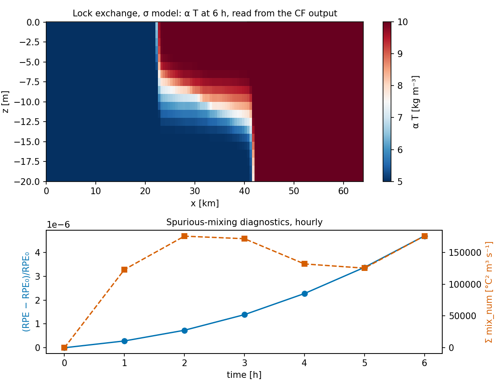

# Output, restarts and diagnostics

This page covers everything that leaves the time loop: model output (CF-1.8/SGRID in Zarr or NetCDF4), bit-for-bit
restart files, the blow-up post-mortem guard, the pre-run domain checker and the spurious-mixing diagnostics. Inside
the time step the state is plain NumPy arrays (`SigmaState`); xarray is used only at this I/O boundary (CLAUDE.md,
"Data structures").

| Task | Tool | File |
|---|---|---|
| write model fields | `OutputWriter` | `diagnostics/output.py:49` |
| phase-1 z-level snapshots | `write_snapshot`, `read_snapshot`, `DiagnosticsWriter` | `diagnostics/io.py` |
| restart | `write_restart`, `read_restart` | `core/restart.py:89`, `:134` |
| locate a blow-up | `BlowupGuard` | `diagnostics/postmortem.py:35` |
| check a domain before running | `check_domain`, `rx0`, `rx1`, … | `diagnostics/domain_check.py` |
| spurious mixing | `model.rpe`, `reference_potential_energy`, `st.mix_num`, `numerical_variance_decay` | `diagnostics/mixing.py` |

## Model output: `OutputWriter`

### What it writes

``OutputWriter`` (`diagnostics/output.py:49`) writes one record per call to `write(time, **fields)`:

- **Conventions:** CF-1.8 standard names and units; time as "seconds since `start`"; global attributes
    `Conventions = "CF-1.8 SGRID-0.3"`, `title`, `source`, `history` plus anything in `attrs`.
- **Horizontal staggering:** an SGRID 2-D grid topology variable `grid` (Arakawa C) with the MOM6 dimension names
    `xh`/`yh` (cell centres), `xq` (u-faces, nx + 1) and `yq` (v-faces, ny + 1), understood by xgcm (module docstring,
    `:14-16`). On a spherical grid the coordinates are CF longitude/latitude; on a Cartesian grid,
    `projection_x/y_coordinate` in metres (`:75-83`).
- **Vertical:** σ-layers as CF `ocean_sigma_coordinate`, `formula_terms = "sigma: s_rho eta: eta depth: h"`, i.e.
    z = η + σ (h + η); `s_rho` (layer centres) and `s_w` (interfaces) go from −1 at the bed to 0 at the surface and
    follow the `dsigma` you pass (stretched σ supported).
- **Static fields:** `h` (bathymetry, "< 0: floodable land, NaN: wall"), `mask` (`np.isfinite(H)`), `grid`.
- **Precision:** float64, so reading back is exact (`tests/test_output.py`, round-trip test).

Fields accepted by `write` (`FIELDS`, `diagnostics/output.py:35-44`):

| Name | Dimensions | Units | `standard_name` |
|---|---|---|---|
| `eta` | (time, yh, xh) | m | `sea_surface_height_above_geoid` |
| `u` | (time, s_rho, yh, xq) | m s⁻¹ | `sea_water_x_velocity` |
| `v` | (time, s_rho, yq, xh) | m s⁻¹ | `sea_water_y_velocity` |
| `T` | (time, s_rho, yh, xh) | degC | `sea_water_potential_temperature` |
| `S` | (time, s_rho, yh, xh) | 1e-3 | `sea_water_salinity` |
| `ubar` | (time, yh, xq) | m s⁻¹ | `barotropic_sea_water_x_velocity` |
| `vbar` | (time, yq, xh) | m s⁻¹ | `barotropic_sea_water_y_velocity` |
| `mix_num` | (time, s_rho, yh, xh) | degC2 m3 s-1 | — (online numerical mixing) |

Any other name raises `unknown output field`; a wrong shape raises `…: shape … does not match …`
(`diagnostics/output.py:114`, `:120`). The `s_rho` axis is the model's layer axis, **bed first** (k = 0 is
s_rho = −1 + Δσ₀/2).

### Formats

| `fmt` | Behaviour | Use |
|---|---|---|
| `"zarr"` (default) | the first `write` creates the store with the static fields (`mode="w"`); every later `write` appends along `time` (`:135-141`); `close()` is a no-op | long runs: nothing is held in memory and a crash keeps what was written |
| `"netcdf"` | records are buffered and one NetCDF4 file is written on `close()` (`:143-149`) | short runs, single-file deliverables |

Times are rounded to whole seconds (`int(round(time))`, `:126`).

```python
from diagnostics.output import OutputWriter
w = OutputWriter("run.zarr", hg, bathy, n_layers=m.n, dsigma=m.core.dsigma,
                 start="2026-02-01T00:00:00", title="BayIW test", attrs={"institution": "UNAM"})
for n in range(1, n_steps + 1):
    st = m.step(st)
    if n % n_out == 0:
        w.write(st.time, eta=st.eta, u=st.u, v=st.v, T=st.T, mix_num=st.mix_num)
w.close()                     # needed for fmt="netcdf"; harmless for Zarr
```

Depth-mean velocities are not part of `SigmaState`; compute them before writing if you need them, e.g. for σ
`ubar = np.tensordot(m.core.dsigma, st.u, axes=(0, 0))`.

!!! warning "ALE output: the vertical metadata says σ"
    `OutputWriter` only knows σ-layers. For an ALE run it still labels the layer axis `ocean_sigma_coordinate` with
    the uniform (or given) `dsigma`, which is **not** where z* or hybrid layers are, and the layer thickness `st.h`
    cannot be written: `"h"` is not in `FIELDS` (and the name is taken by the bathymetry). Until the writer learns
    ALE (the variable registry of roadmap step 3, CLAUDE.md), save `h` next to the output yourself, on the same
    dimensions, for example:

    ```python
    import xarray as xr
    # inside the loop, next to w.write(...)
    rec = xr.Dataset({"h_layer": (("time", "s_rho", "yh", "xh"), st.h[None], {"units": "m"})},
                     coords={"t_model": ("time", [st.time], {"units": "s"})})
    if n == n_out:
        rec.to_zarr("layers.zarr", mode="w")              # first record
    else:
        rec.to_zarr("layers.zarr", append_dim="time")     # later records
    ```

    (Checked for this manual: three appended records read back exactly. A `datetime64` time coordinate appended this
    way was mis-encoded by xarray's default integer time units, so the snippet stores model seconds.)

    The validation scripts avoid the issue by remapping ALE fields onto fixed z-levels before saving
    (``to_mitgcm_levels`` (`validation/bayiw_2d/section.py`), ``case.to_levels`` (`validation/internal_wave/case.py`)).

### Reading and plotting

```python
import numpy as np
import xarray as xr
import matplotlib.pyplot as plt

ds = xr.open_zarr("run.zarr")             # or xr.open_dataset("run.nc")
last = ds.isel(time=-1, yh=0)             # an x–z section of a ny = 1 channel
# heights of the layer centres from the CF formula z = η + σ (h + η)
z = (last.eta + ds.s_rho * (ds.h.isel(yh=0) + last.eta)).transpose("s_rho", "xh")
x = np.broadcast_to(ds.xh.values / 1e3, z.shape)
plt.pcolormesh(x, z.values, last["T"].values, shading="nearest")
plt.xlabel("x [km]"); plt.ylabel("z [m]")

# u at cell centres (average of the two faces) and the time series of η at one cell
u_c = 0.5 * (ds.u.isel(xq=slice(0, -1)).values + ds.u.isel(xq=slice(1, None)).values)
ds.eta.isel(yh=0, xh=64).plot()
```



*The σ lock exchange of `validation/lock_exchange` (128 × 20 layers, 6 h), written with `OutputWriter` and read back
with the code above (script `docs/manual/figures/make_user_guide.py`). Top: the dense water (left) runs under the
light water; the σ heights come from the CF formula. Bottom: the RPE rises steadily while Σ mix_num, an
instantaneous rate, fluctuates — read the RPE for the integral and mix_num for where the mixing happens.*

With xgcm, the SGRID attributes identify the staggered axes (`xh`/`xq`, `yh`/`yq`); see
[Data structures](../architecture/data-structures.md) for the index conventions.

### Legacy output of the phase-1 z-level model

`diagnostics/io.py` writes the phase-1 `ModelState` (`core/state.py`): ``write_snapshot(state, path, variables=None)``
(`:79`), ``read_snapshot(path)`` (`:119`) and ``DiagnosticsWriter(path, variables=None)`` (`:165`, a context manager
that buffers snapshots and writes one NetCDF4 file with an unlimited `time` on `close()`). Variables `u, v, w, T, S,
eta` on dimensions `k` (**0 = surface**), `k_f`, `j_t`, `i_t`, `i_u`, `j_v`. These functions do not accept a
`SigmaState`; use `OutputWriter` and the restart module for the σ/ALE model.

## Restarts: `write_restart` / `read_restart`

### What is saved

A restart must hold everything the next step reads, not only the prognostic fields (module docstring,
`core/restart.py:1-25`). ``write_restart`` (`core/restart.py:89`) writes a float64 NetCDF4 file with:

| Content | Variables | Why it matters |
|---|---|---|
| prognostic state | `eta, u, v, T`, attribute `time` | |
| AB3 history | `ab_hist_u`, `ab_hist_v` (0–3 levels, newest first) | a restart during the AB start-up also reproduces the continuous run |
| last transports | `Qx, Qy, Fz`, `omega` | the flux-form momentum advection and the vector-invariant PV flux use the transports of the previous step |
| mixing field | `mix_num` | |
| ALE thickness | `h` | |
| counters | attributes `n_trunc`, `n_limited` | `max_truncations` keeps counting across restarts |
| GLS state | `gls_tke, gls_eps, gls_akv` | k, ε, ν at the interfaces (closure `"gls"`) |
| exterior profile | `T_ext` (and `h_ext` in ALE) | inflow T and sponge target; in ALE kept in z |
| lagged-LU preconditioner | `fs_lu_data, fs_lu_indices, fs_lu_indptr`, attributes `fs_lu_rows/cols/refactor` | CG stops at an iterate that depends on the preconditioner (``preconditioner_state`` (`core/dynamics/wetting_drying.py:203`)) |
| reference profile | `rho_ref_z, rho_ref_rho` | the `"auto"` profile built at the start |
| configuration | attributes `config_*` | checked on reading |

### How to restart

```python
from core.restart import write_restart, read_restart

write_restart("restart_0030h.nc", m, st)            # anywhere in the loop

# new process: build the model with the SAME arguments, then read instead of initial_state
m = SigmaBaroclinic(...same arguments..., open_boundary_state=my_exterior)
st = read_restart("restart_0030h.nc", m)            # restores st and the model's hidden state
n0 = int(round(st.time / m.dt))
for n in range(n0, n1):
    st = m.step(st, tau_x=wind_x(n * m.dt))         # forcing indexed by the restored time/step
```

- **Do not call `initial_state`** after `read_restart`: it would rebuild `rho_ref` and `T_ext` from the current T.
- ``read_restart`` (`core/restart.py:134`) compares every configuration key (list in the
    [configuration reference](configuration-reference.md#output-restart-and-diagnostics)) and raises
    `restart incompatible with the model configuration — key: restart … vs model …` listing all mismatches. Values are
    compared exactly (float `atol=0`, arrays at 17 significant digits).
- Functions are not saved: pass `open_boundary_state` (and a callable `rho_ref`) again. The check only records
    whether a provider exists (`obc_state = function | none`).
- The forcing (wind) is the caller's: restart its time index from `st.time`.

### Evidence

- `tests/test_restart.py` (17/17, CLAUDE.md): bit-for-bit restarts in σ with GLS, during the AB3 start-up, with open
    boundaries, stretched layers and `rho_ref="auto"`, in ALE for every rule with and without open boundaries, with the
    lagged LU, and refusal of incompatible models (other layers, boundaries, regrid parameters, θ_bc, thin-layer options,
    tracer limiter).
- `validation/bayiw_cut/restart_check.py hybrid`: BayIW cut, two layers, bay, wind and open boundaries, 60 h straight
    against 30 h + restart + 30 h: η, u, v, T and h identical bit for bit, zero truncations (11.5 min; 98 MB file;
    `validation/bayiw_cut/README.md`).
- The worked example B of [Building a model](building-a-model.md#worked-example-b-ale-z-with-open-boundaries-a-sponge-output-and-restart)
    was checked the same way for this manual (10 steps after the restart, identical).

## Blow-up post-mortem: `BlowupGuard`

``BlowupGuard`` (`diagnostics/postmortem.py:35`) checks the fields you give it after each step. On any NaN/Inf, or a
value beyond its limit, it writes all checked fields to an `.npz` and raises `BlowupError` with *where* and *what*.

```python
from diagnostics.postmortem import BlowupGuard, BlowupError
guard = BlowupGuard(limits={"eta": 5.0, "u": 3.0, "v": 3.0}, dump_path="out/blowup.npz",
                    lat=hg["lat_t"].values, lon=hg["lon_t"].values,   # spherical grids only
                    depth=bathy, dt=m.dt, dx=float(hg["dx_t"].min()), history=5)
for n in range(n_steps):
    st = m.step(st)
    guard.check(step=n, time=st.time, eta=st.eta, u=st.u, v=st.v, T=st.T, h=st.h)
```

A real report (synthetic fields, a 9 m s⁻¹ spike in layer 1):

```text
Blow-up at step 3 (t = 360.0 s = 0.004 d):
  |u| > 2.0: u[k=1, j=2, i=3] = 9, depth 50.0 m, local CFL 1.08
    neighbourhood
    [[0. 0. 0.]
     [0. 9. 0.]
     [0. 0. 0.]]
  recent max|eta|: step 0: 0, step 1: 0, step 2: 0
  recent max|u|: step 0: 0.5, step 1: 1, step 2: 1.5
  state dumped to out/blowup.npz
```

How to read it:

- `u[k=1, j=2, i=3]`: layer (bed = 0), row, column **of the field's own grid** (for `u`, face i is the west face of
    cell i). lat/lon/depth are looked up at the nearest cell, i clipped for face arrays (module docstring, `:18-20`).
- `local CFL` = |value| Δt/Δx for the names in `velocity_fields`; > 1 means the explicit advection is unstable there.
- `neighbourhood`: the 3 × 3 values around the point in the same layer — a single-cell spike points to a
    numerical problem (vanished layer, bad bathymetry cell), a smooth large-scale field to a physical one
    (forcing, boundary).
- `recent max|…|`: the maxima of the last `history` steps: a steady growth is an instability, a jump is a single
    event.
- For a NaN, the report gives the count and the first NaN in memory order.

Reload the dump with `np.load("out/blowup.npz")` and plot the neighbourhood. Typical causes and fixes are in
[Troubleshooting](troubleshooting.md#nan-or-blow-up).

## Domain checker

``check_domain`` (`diagnostics/domain_check.py:178`) runs all pre-run checks on a bathymetry `H` (> 0 water,
≤ 0 floodable, NaN wall) and returns a `DomainReport` with `errors`, `warnings`, `info`, `.ok` and `.summary()`:

| Check | Rule | Classified as |
|---|---|---|
| advective CFL | c = u_max Δt/Δx_min; also `dt_max_advective = Δx_min/u_max × cfl_target` | error > 1, warning > `cfl_target` |
| external-wave CFL | √(g H_max) Δt √(1/Δx² + 1/Δy²), only with `implicit_free_surface=False` | error > 1 |
| internal-wave CFL | √(`gprime_h`) Δt/Δx_min, if `gprime_h` is given [m² s⁻²] | error > 1, warning > `cfl_target` |
| inertial | f Δt | warning > 1 |
| `rx0` (Beckmann & Haidvogel) | \|h₁ − h₂\|/(h₁ + h₂) on wet faces | warning > `rx0_max` (0.2) |
| `rx1` (Haney) | for `sigma_layers` uniform σ-layers | warning > `rx1_max` (6.0) |
| isolated water bodies | 4-connected wet bodies other than the largest | warning |
| pits | deeper than 3 × the median of the wet 8-neighbours and by > 20 m | warning |
| isolated cells | fewer than 2 wet lateral neighbours (HYCOM `topo_zthin`) | warning |

Example on the seamount of `validation/seamount` (pass the mode-1 speed c₁² as `gprime_h`; here c₁ = 2 m s⁻¹):

```python
from diagnostics.domain_check import check_domain
rep = check_domain(hg, H, dt=600.0, u_max=0.5, sigma_layers=20, gprime_h=2.0**2)
print(rep.summary())
```

```text
Domain check: OK
  WARNING rx0 max 0.27 at (j=23, i=30, x-face); 16 faces > 0.2
  WARNING rx1 max 10.7 at (j=23, i=30, x-face); 40 faces > 6.0
  info    grid 64×48, Δx_min 6000 m, wet cells 3072, depth 565.0–4500.0 m
  info    advective CFL 0.05 (u_max 0.5 m/s); Δt ≤ 6000 s for CFL 0.5
  info    internal wave CFL 0.20 (√g′H = 2.00 m/s)
  info    Isolated water bodies (not connected to the main one through permanently wet cells): 0
```

The rx0 = 0.27 and rx1 = 10.7 match `validation/seamount/README.md`. Notes:

- `rx1` in `check_domain` assumes **uniform** σ (`np.linspace(-1, 0, sigma_layers + 1)`, `:219`). For stretched σ
    call ``rx1(H, sigma_w)`` (`diagnostics/domain_check.py:82`) with σ ∈ [−1, 0] from the bed up, e.g.
    `rx1(H, m.core.sigma_w[:, 0] - 1.0)`.
- rx0/rx1 matter for σ-layers. In ALE z* the layers are flat and the same slopes give 4× less spurious current than
    σ with the Jacobian (`validation/seamount/README.md`).
- A `gprime_h` from the full density contrast over the full depth overestimates the internal speed; with the seamount
    values (Δρ = 3 kg m⁻³, 4500 m) it reports an "error" CFL 1.15 although the case runs at Δt = 600 s.
- A one-row channel (`ny = 1`) always reports "isolated cells" (each cell has two neighbours at most, and the end
    cells one); ignore it there.
- The single checks can be called alone: ``rx0`` (`:64`), ``rx1`` (`:82`), ``isolated_water_bodies(H, min_depth=0)``
    (`:106`), ``find_pits(H, ratio=3.0, min_excess=20.0)`` (`:130`), ``isolated_cells(H, min_neighbours=2)`` (`:150`).

## Spurious-mixing diagnostics

### Reference potential energy (RPE)

RPE = g ∫ ρ\*(z) z dV, ρ\* the adiabatically sorted density (Winters et al. 1995): advection leaves it unchanged,
any diapycnal mixing — physical or numerical — raises it. With no explicit mixing and a linear EOS, dRPE/dt is the
spurious mixing (Ilicak et al. 2012). ``reference_potential_energy(rho, volume, area=None, hypsometry=None)``
(`diagnostics/mixing.py:52`) sorts the cells heaviest first and stacks them in

- a flat basin of horizontal area `area` (z = V/A), or
- the real basin given by `hypsometry = (z, A(z))`: heights above the deepest point [m, increasing] and the area at
    those heights [m²].

`model.rpe(st)` (``SigmaBaroclinic.rpe`` (`core/dynamics/sigma_baroclinic.py:1300`)) uses the flat-basin form with the
wet area — exact only for a flat bed. For a sloping basin build the hypsometry from the bathymetry:

```python
import numpy as np
from diagnostics.mixing import reference_potential_energy
Hw = np.nan_to_num(bathy)
act = np.isfinite(bathy)
Hmax = Hw[act].max()
z = np.linspace(0.0, Hmax + 1.0, 50001)                       # fine steps (see the caveat)
A = np.array([(m.area[act] * (Hmax - Hw[act] <= zz)).sum() for zz in z])
V = m.layer_volumes(st.eta, st.h)
rho = m.density(st.T)
rpe = reference_potential_energy(rho[:, act], V[:, act], hypsometry=(z, A))
```

!!! warning "Coarse hypsometry"
    The moment ∫ z A dz is interpolated linearly in volume; "with two points on a flat bed it gives 1.5 times the
    exact value". The benchmark refined the hypsometry to steps of H/50000 (`validation/ilicak_benchmark/README.md`,
    item 12 — classified (a), to be fixed in the diagnostic).

### Online numerical mixing `mix_num`

Every step the model advects T and T² with the same operator and stores
M_num = V (A(T²) − (A T)²)/Δt [°C² m³ s⁻¹] per cell (Burchard & Rennau 2008; `core/dynamics/sigma_baroclinic.py:2139`).
Its volume sum is the loss of ∫T² dV by advection in that step (checked to add up exactly to the global variance loss,
`validation/lock_exchange/README.md`). In ALE the remap part is added (`:2043`, `:2057`), so `mix_num` is
the spurious mixing of advection + regrid–remap. With `mix_diagnostic=False` (ALE) it is `None` and the step is
cheaper (BayIW z*: 3.32 → 2.72 s/step, `validation/bayiw_baroclinic/README.md`).

```python
total_rate = float(np.nansum(st.mix_num))          # °C² m³ s⁻¹, global
where = st.mix_num.sum(axis=0) / m.area            # column-integrated, per unit area
```

`mix_num` is an instantaneous rate and is noisy from step to step (figure above); average it over many steps, and
use the RPE for the integral. Offline estimates from model output overestimate the mixing by up to ~60 % at hourly
output (Schlichting et al. 2023, cited in `diagnostics/mixing.py:24-25`), so compute it online.

### Offline variance decay of an operator

``numerical_variance_decay(advect, c, dt)`` (`diagnostics/mixing.py:87`) returns (A(c²) − (A c)²)/Δt for any
advection function `advect` — for testing a scheme in isolation.

### Conservation checks

`m.tracer_content(st)` (Σ V T) and `m.tracer_content(st, power=2)` (Σ V T²) give the budgets. In a closed basin
Σ V T must stay at round-off (the lock exchange of [Building a model](building-a-model.md) drifts by −1.9e-14 in 2 h);
with open boundaries it changes by the boundary fluxes. In ALE also check max|Σ_k h_k − H − η| (≤ 8e-13 m in the BayIW
cut runs, ≤ 1e-13 m in the `internal_wave` runs; `validation/bayiw_cut/README.md`, `validation/internal_wave/README.md`).

## References

- Burchard, H. & Rennau, H. (2008). Comparative quantification of physically and numerically induced mixing in ocean
    models. *Ocean Modell.* 20, 293–311. doi:10.1016/j.ocemod.2007.10.003
- Beckmann, A. & Haidvogel, D.B. (1993). *J. Phys. Oceanogr.* 23, 1736–1753. **[verify]**
- Haney, R.L. (1991). On the pressure gradient force over steep topography in sigma coordinate ocean models.
    *J. Phys. Oceanogr.* 21, 610–619. **[verify]**
- Ilicak, M., Adcroft, A.J., Griffies, S.M. & Hallberg, R.W. (2012). *Ocean Modell.* 45–46, 37–58.
    doi:10.1016/j.ocemod.2011.10.003
- Klingbeil, K. et al. (2014). Quantification of spurious dissipation and mixing — discrete variance decay in a
    finite-volume framework. *Ocean Modell.* 81, 49–64. doi:10.1016/j.ocemod.2014.06.001
- Schlichting, D. et al. (2023). *JAMES*. doi:10.1029/2022MS003380 **[verify]**
- Winters, K.B., Lombard, P.N., Riley, J.J. & D'Asaro, E.A. (1995). Available potential energy and mixing in
    density-stratified fluids. *J. Fluid Mech.* 289, 115–128.
