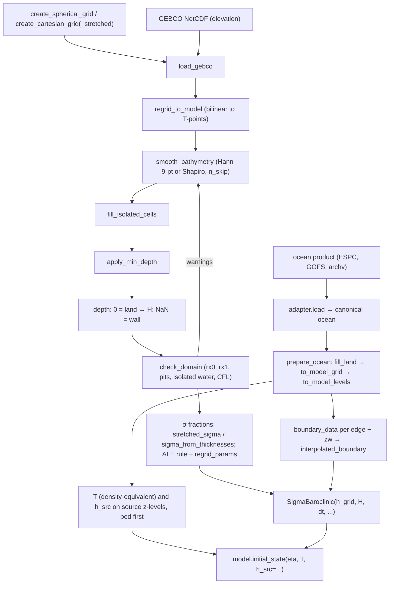

# Regional setup: grid, bathymetry, initial and boundary data

This page walks through building a regional domain for pyOCEAN: the horizontal grid, the bathymetry
pipeline, the pre-run domain check, the choice of vertical levels, the initial state and the open-boundary
data. The grids themselves are described in [Grids and bathymetry](../theory/grids.md), the vertical
coordinates in [Vertical coordinates and ALE](../theory/vertical-ale.md), the model constructor in
[Building a model](building-a-model.md) and the boundary physics in
[Open boundaries and nesting](../theory/open-boundaries.md). External data products and their adapters are
covered in [Surface forcing and external data](surface-forcing.md).

## The preprocessing pipeline



Steps B1–B5 are chained by `build_bathymetry` in one call.

## Horizontal grid

All grids are Arakawa C grids stored as `xr.Dataset` (`core/grid/horizontal.py`): T-points
(`j_t`, `i_t`), u-faces (`j_t`, `i_u`, nx + 1 columns, western face of each cell), v-faces (`j_v`, `i_t`,
ny + 1 rows, southern face) and corners (`j_v`, `i_u`). Metric arrays: `dx_t`, `dy_t`, `area_t`, `dx_u`,
`dy_u`, `area_u`, `dx_v`, `dy_v`, `area_v` [m, m²], Coriolis `f_t`, `f_q` [s⁻¹], `mask_t`.

| Function | Grid | Coriolis | Where |
|---|---|---|---|
| `create_cartesian_grid(nx, ny, dx, dy, x0=0, y0=0, f0=1e-4, beta=0)` | uniform, flat Earth | $f = f_0 + \beta y$ | `core/grid/horizontal.py:48` |
| `create_cartesian_grid_stretched(dx, dy, x0=0, y0=0, f0=1e-4, beta=0)` | telescopic, `dx[i]`, `dy[j]` = cell widths (MITgcm `delXFile`/`delYFile`); gradient spacing at faces = distance between T-points | $f_0 + \beta y$ | `core/grid/horizontal.py:163` |
| `create_spherical_grid(nx, ny, dlon, dlat, lon0=0, lat0=0)` | uniform lon–lat; `lon0`, `lat0` = **south-west corner**; $dx = R\cos\varphi\,\Delta\lambda$, $dy = R\Delta\varphi$, R = 6.371×10⁶ m | $2\Omega\sin\varphi$ | `core/grid/horizontal.py:246` |

The spherical grid also carries `lon_t, lat_t, lon_u, lat_u, lon_v, lat_v, lon_q, lat_q` [°], which the
forcing interpolation, the TPXO reader and `build_bathymetry` need. Real-data runs therefore use
`create_spherical_grid`; to match a HYCOM grid, set `lon0 = plon[0] − Δ/2`, `lat0 = plat[0] − Δ/2`
(`validation/pacmex_tides/run_tides.py:115`).

```python
from core.grid.horizontal import create_spherical_grid
hg = create_spherical_grid(nx=650, ny=500, dlon=0.04, dlat=0.04, lon0=-118.02, lat0=11.98)
```

## Bathymetry

`core/grid/bathymetry.py` follows the HYCOM-tools `topo` practice. Sign conventions: GEBCO elevation is
negative in the ocean; model depth is **positive downward, 0 = land**.

| Step | Function | What it does |
|---|---|---|
| 1 | `load_gebco(path, lon_bounds, lat_bounds)` (`:64`) | reads `elevation` (or `z`) and clips to the domain + 0.5° margin; coordinates renamed to `lon`/`lat` |
| 2 | `regrid_to_model(raw, lon_t, lat_t, method="linear")` (`:146`) | bilinear (or nearest) to T-points; outside the data = land; depth = max(0, −elevation) |
| 3 | `smooth_bathymetry(depth, n_passes=1, mask=None, kernel="hann", n_skip=0)` (`:221`) | `'hann'`: 9-point [[1,2,1],[2,4,2],[1,2,1]]/16 of HYCOM `topo_smooth_skip.f`, land neighbours replaced by the centre value; `'shapiro'`: 5-point, $d' = (1-\alpha)d + \frac{\alpha}{n}\sum_{ocean} d_{nbr}$, α = 0.5, land excluded; `n_skip` leaves cells within n cells of land unsmoothed |
| 4 | `fill_isolated_cells(depth, min_ocean_neighbors=2)` (`:304`) | iteratively turns ocean cells with < 2 ocean N/S/E/W neighbours into land (HYCOM `topo_zthin.f`) |
| 5 | `apply_min_depth(depth, min_depth)` (`:351`) | raises ocean cells shallower than `min_depth` |
| all | `build_bathymetry(h_grid, source_path, min_depth=10.0, n_smooth_passes=2, n_skip=1, kernel="hann", method="linear")` (`:379`) | steps 1–5 on a spherical grid |

```python
import numpy as np
from core.grid.bathymetry import build_bathymetry
depth = build_bathymetry(hg, "GEBCO_2023.nc", min_depth=5.0, n_smooth_passes=2, n_skip=1)
H = np.where(depth > 0, depth, np.nan)       # SigmaBaroclinic / wet-dry convention: NaN = wall
```

!!! warning "Two land conventions"
    The bathymetry functions, `compute_hfac` and the 2-D `ImplicitFreeSurface` use **depth = 0 on land**.
    `SigmaBaroclinic`, `SigmaWetDry` and `WetDryFreeSurface` use **H > 0 water, H < 0 floodable land, NaN
    permanent wall** (`core/dynamics/sigma_wd.py:150`). Convert with `np.where(depth > 0, depth, np.nan)`;
    for wetting and drying keep the negative elevations of the intertidal zone instead of clipping them
    (skip `apply_min_depth`; see `validation/pacmex_tides/run_tides_wd.py:66`).

Use an existing HYCOM depth file directly with `forcing.sources.hycom_ab.read_field("regional.depth.b",
"depth", idm=…, jdm=…)` (NaN on land).

## Check the domain before running

`check_domain(h_grid, H, dt, u_max=1.0, sigma_layers=None, implicit_free_surface=True, gprime_h=None,
cfl_target=0.5, rx0_max=0.2, rx1_max=6.0)` (`diagnostics/domain_check.py:178`) takes H in the
SigmaBaroclinic convention and returns a `DomainReport` (`errors`, `warnings`, `info`, `ok`, `summary()`):

| Check | Formula / rule | Error / warning |
|---|---|---|
| advective CFL | $u_{max}\Delta t/\Delta x_{min}$; suggests $\Delta t \le \Delta x_{min}\,c_{target}/u_{max}$ | error > 1, warning > `cfl_target` |
| external gravity wave (explicit free surface only) | $\sqrt{gH_{max}}\,\Delta t\sqrt{1/\Delta x^2 + 1/\Delta y^2}$ | error > 1 |
| internal wave (if `gprime_h` = g′H) | $\sqrt{g'H}\,\Delta t/\Delta x_{min}$ | error > 1, warning > target |
| inertial | $f\Delta t$ | warning > 1 |
| rx0 (Beckmann & Haidvogel 1993) | $\lvert h_1 - h_2\rvert/(h_1 + h_2)$ on wet faces | warning > `rx0_max` |
| rx1 (Haney 1991; with `sigma_layers`) | $\max_k \frac{\lvert z_{1,k} - z_{2,k} + z_{1,k-1} - z_{2,k-1}\rvert}{\lvert z_{1,k} + z_{2,k} - z_{1,k-1} - z_{2,k-1}\rvert}$ for uniform σ | warning > `rx1_max` |
| isolated water bodies | 4-connected wet bodies other than the largest | warning |
| pits | wet cell > 3 × median of wet 8-neighbours and > 20 m deeper | warning |
| isolated cells | < 2 wet lateral neighbours | warning |

Usual limits: rx0 ≲ 0.2, rx1 ≲ 3–7 with the Shchepetkin & McWilliams (2003) pressure gradient
(`diagnostics/domain_check.py:19`). The pits check caught the GEBCO 2021 pits in Guaymas bay that gave a
0 cm M2 gauge in the Gulf of California nest (`diagnostics/domain_check.py:8`). If rx0 is too large, smooth
more (`n_smooth_passes`) or, with steep slopes, prefer z* or hybrid ALE with `pgf="fv"` to σ.

```python
from diagnostics.domain_check import check_domain
rep = check_domain(hg, H, dt=120.0, u_max=1.0, sigma_layers=30, gprime_h=0.02 * 500)
print(rep.summary())
assert rep.ok
```

A blow-up during the run is located by `diagnostics.postmortem.BlowupGuard` (see
[Output, restarts and diagnostics](output-restart-diagnostics.md)).

## Vertical levels

In `SigmaBaroclinic` the layers are counted **from the bed** (k = 0 at the bed).

- **σ (`vertical_coordinate="sigma_eulerian"`, default) and ALE-σ**: layer thicknesses $h_k = D\,\Delta\sigma_k$.
    Pass `dsigma` (n_layers positive fractions summing to 1, bed first; default uniform):
    - `stretched_sigma(n, theta_s, theta_b=0)` (`core/grid/sigma_levels.py:33`): Song & Haidvogel (1994)
        stretching with $h_c = 0$, $C(s) = (1-\theta_b)\frac{\sinh\theta_s s}{\sinh\theta_s} + \theta_b\left[\frac{\tanh\theta_s(s+\frac12)}{2\tanh(\theta_s/2)} - \frac12\right]$,
        σ_w = 1 + C(s); θ_s (0…~8) refines the surface, θ_b (0…1) also the bed.
    - `sigma_from_thicknesses(dz_top_first)` (`core/grid/sigma_levels.py:47`): fractions proportional to a
        z-level list (MITgcm `delR`, surface first); the σ-layers coincide with those levels where the depth
        equals their sum.
- **ALE z\*** (`vertical_coordinate="ale", regrid="zstar"`): `regrid_params=dict(dz_top=...)` gives the
    target thicknesses **surface first** [m]; layers below the bed vanish (partial bottom layer). The list
    must reach the deepest bed.
- **ALE hybrid** (`regrid="hybrid"`): z* floor `dz_top` (reaching the bed: `SigmaBaroclinic` warns when it
    stops above the deepest bed), density targets `rho_target`, plus `max_h_top`, `d_sigma`, `d_hybrid`,
    `h_min`, `keep_isopycnal`. See [Vertical coordinates and ALE](../theory/vertical-ale.md).

For σ models check rx1 with the same number of layers (`check_domain(..., sigma_layers=n)`; the check
assumes uniform σ).

## Initial state

### What the σ/ALE model needs

`SigmaBaroclinic` carries **one tracer, T**, with a linear equation of state
$\rho = \rho_0 - \alpha_T\,(T - T_0)$ (`density`, `core/dynamics/sigma_baroclinic.py:1285`; constructor
arguments `rho0`, `t_coef` = α_T [kg m⁻³ °C⁻¹], `t_ref` = T₀). There is no salinity. For realistic
stratification use a **density-equivalent temperature** computed from your T and S,

$$
T_{eq} = T_0 + \frac{\rho_0 - \rho(\theta, S)}{\alpha_T},
$$

with ρ the potential density from your EOS of choice (e.g. TEOS-10 `gsw.rho(SA, CT, 0)`); this is what
the realistic BayIW case does (CLAUDE.md, "density-equivalent T").

`model.initial_state(eta, T, h_src=None)` (`core/dynamics/sigma_baroclinic.py:1190`) returns a resting
`SigmaState`:

- without `h_src`, `T` must already be on the model layers (N, ny, nx), bed first, at the heights
    `model.layer_heights(eta)`;
- **with `h_src`** (ALE only), `T` holds layer means on a *source grid* of thicknesses `h_src`
    (N_src, ny, nx), **bed first**, with $\sum_k h_{src} = H + \eta$ in every wet column (checked to 1e-10).
    The model grid is regridded once on the source levels and T is remapped conservatively from them, as MOM6
    `Z_INIT_ALE_REMAPPING` (`MOM_state_initialization.F90:2928-2935`), plus, for the hybrid rule, the
    interfaces are moved onto the density jumps of the source. **Use this for hybrid runs from z-level data**:
    starting from σ-layers lost the top metres of deep columns (1.6 cm s⁻¹ spurious flow from rest at the
    BayIW shelf edge, 3.3e-4 with `h_src`; CLAUDE.md).
- With `rho_ref="auto"` the reference density profile of the pressure gradient is taken from this T.
    Dry columns get `T = t_ref`.

### From an ocean product

```python
import numpy as np
from core.grid.vertical import create_z_grid
from core.dynamics.sigma_baroclinic import SigmaBaroclinic
from forcing.ocean_init import prepare_ocean
from forcing.interp import interp_time

# source z-levels: interfaces must reach below the deepest bed
dz_src = np.array([2, 2, 2, 2, 2, 3, 5, 5, 5, 5, 5, 5, 10, 10, 10, 10, 10, 25, 25, 50, 50, 50, 50, 100, 100,
                   100, 100, 100, 100, 100, 250, 250, 500, 500, 500, 500, 1000], float)      # surface first [m]
vg = create_z_grid(dz_src.size, dz_src)
prep = prepare_ocean(ocean, hg, vg)                     # canonical ocean → T-points and the vg level centres
at0 = interp_time(prep["t"], np.datetime64("2026-08-01"))
theta, salt = at0["temp"].values, at0["salt"].values    # (nz, ny, nx), surface first

T_eq = density_equivalent_T(theta, salt)               # your function, formula above

# thickness of each source level clipped at the bed, bed first (as validation/bayiw_baroclinic/bayiw.py:101)
zf = vg["z_f"].values[:, None, None]                     # interfaces, surface first, ≤ 0
Hc = np.nan_to_num(H)[None]
h_src = (np.minimum(-zf[1:], Hc) - np.minimum(-zf[:-1], Hc))[::-1].copy()
T_src = T_eq[::-1].copy()

model = SigmaBaroclinic(hg, H, dt=120.0, n_layers=25, rho0=1025.0, t_coef=0.2, t_ref=20.0,
                        vertical_coordinate="ale", regrid="hybrid",
                        regrid_params=dict(dz_top=dz_top_hybrid, rho_target=targets),
                        pgf="fv", rho_ref="auto", open_boundaries=("west", "south"), sponge_cells=20)
st = model.initial_state(np.zeros(H.shape), T_src, h_src=h_src)
```

`to_model_levels` fills each column downward with its deepest valid value, so levels below the source
bathymetry are defined; levels below the model bed get zero thickness in `h_src`. With z\* the same call
works with `regrid="zstar"` and `regrid_params=dict(dz_top=...)`.

For the legacy phase-1 z-level model, `forcing.ocean_init.initial_state(prepared, h_grid, v_grid, t,
remove_mean_ssh=True)` (`forcing/ocean_init.py:86`) fills a `ModelState` (T, S, u, v, η) directly; it does
not produce a `SigmaState`.

## Open-boundary data

### Phase-1 / generic `OBData`

`boundary_data(prepared, side, t, remove_mean_ssh=True)` (`forcing/ocean_init.py:123`) extracts the
exterior values of one edge with pyOCEAN's staggering:

| side | T, S, η at | u_normal |
|---|---|---|
| west | `i_t = 0` | u at `i_u = 0` |
| east | `i_t = nx − 1` | u at `i_u = nx` |
| south | `j_t = 0` | v at `j_v = 0` |
| north | `j_t = ny − 1` | v at `j_v = ny` |

and returns `OBData(side, T, S, u_normal, eta)` with shapes (nz, n_bdy) and (n_bdy,)
(`boundaries/obcs/__init__.py:124`). The domain-mean SSH of the same time is removed by default, consistent
with the initial state.

### Time-varying exterior for `SigmaBaroclinic`

`SigmaBaroclinic(..., open_boundaries=(...), open_boundary_state=f, open_boundary_mode={edge: mode})` takes a
function `f(t)` of the model time t [s] returning `{edge: OBData}` with, per edge, `T` (nz, n_bdy), `zw`
(nz + 1, n_bdy) the **interfaces of the data's own vertical grid, surface first, decreasing** [m], `eta`
(n_bdy,), `u_normal` (nz, n_bdy) and `ubar` (n_bdy,) the depth-mean normal velocity for Flather. The
exterior is evaluated at $t^{n+1}$ and remapped from its own z grid onto the model layers
(`core/dynamics/open_boundary.py`). Modes: `'radiating'` (default: Flather toward (η, ū)ₑₓₜ, Orlanski on u′
with nudging, time scales `obc_tau_in` = 1 day inflow, `obc_tau_out` = 10 days outflow, sponge toward the
exterior) or `'clamped'` (Dirichlet, no sponge). Without `open_boundary_state` the exterior is the
resting initial state. `forcing.boundary_time.interpolated_boundary(times, states)`
(`forcing/boundary_time.py:17`) builds `f` from snapshots, linear in time and constant beyond the ends:

```python
from boundaries.obcs import OBData
from forcing.boundary_time import interpolated_boundary
from forcing.ocean_init import boundary_data

zf = vg["z_f"].values                                          # (nz+1,), surface first
times, states = [], []
for k, t in enumerate(np.arange(np.datetime64("2026-08-01"), np.datetime64("2026-08-08"), np.timedelta64(6, "h"))):
    st_k = {}
    for edge in ("west", "south"):
        ob = boundary_data(prep, edge, t)
        n = ob.T.shape[1]
        zw = np.repeat(zf[:, None], n, axis=1)                 # must reach below the local bed
        Hb = np.nan_to_num(H[:, 0] if edge == "west" else H[0, :])            # edge-cell depth
        dzc = np.minimum(-zw[1:], Hb) - np.minimum(-zw[:-1], Hb)              # levels clipped at the bed
        ubar = (ob.u_normal * dzc).sum(0) / np.where(Hb > 0, Hb, 1.0)
        st_k[edge] = OBData(side=edge, T=density_equivalent_T(ob.T, ob.S), zw=zw,
                            eta=ob.eta, u_normal=ob.u_normal, ubar=ubar)
    times.append(k * 6 * 3600.0)
    states.append(st_k)
boundary_state = interpolated_boundary(times, states)        # pass as open_boundary_state=
```

The BayIW nested runs build the same structure from MITgcm output (`nest_state`,
`validation/bayiw_cut/cut.py:318`). `validate_state` (`core/dynamics/open_boundary.py:19`) checks the
shapes (n = ny for west/east, nx for south/north), that `zw` decreases, and the remap requires the data to
reach the bed of every boundary column (`zw[-1] ≤ −H`). Restrictions: no H ≤ 0 cells on an open edge; the edge's
`u_normal`/`ubar` sign convention is the model's (positive east/north). Tidal boundaries for the 2-D models
use `boundary_tide_constants` instead ([Tides](../theory/tides.md)).

## Checklist

1. Grid: `create_spherical_grid` with the SW corner at `lon0`, `lat0`.
2. Bathymetry: `build_bathymetry` (or a HYCOM depth file), then NaN for walls.
3. `check_domain` with your Δt, u_max, n_layers and g′H; fix warnings (smoothing, pits, isolated water).
4. Vertical: σ fractions or the ALE rule and its parameters (the z\* floor must reach the deepest bed).
5. Ocean data: adapter → `prepare_ocean` → density-equivalent T → `h_src` → `initial_state(..., h_src=...)`.
6. Boundaries: `boundary_data` per edge + `zw` → `interpolated_boundary` → `open_boundary_state`.
7. Forcing: wind stress at the faces ([Surface forcing](surface-forcing.md)).

## Known limitations

- Only rectilinear grids (uniform spherical or stretched Cartesian); no curvilinear or rotated grids, no
    stretched spherical grid.
- `SigmaBaroclinic` has no salinity: S enters only through a density-equivalent T, and the EOS is linear.
- `regrid_to_model` is point bilinear interpolation, not cell averaging; at coarse resolution, block-average
    the source first (as `run_tides_wd.py` does with GEBCO).
- `check_domain`'s rx1 uses uniform σ even if you pass stretched fractions to the model.
- `prepare_ocean` interpolates linearly in depth; there is no conservative vertical remap of the source.

## References

- Beckmann, A. & Haidvogel, D.B. (1993). Numerical simulation of flow around a tall isolated seamount.
    *J. Phys. Oceanogr.* 23, 1736–1753. doi:10.1175/1520-0485(1993)023<1736:NSOFAA>2.0.CO;2
- GEBCO Compilation Group (2023). GEBCO 2023 Grid. doi:10.5285/f98b053b-0cbc-6c23-d9da-7de7d696a50d
- Haney, R.L. (1991). On the pressure gradient force over steep topography in sigma coordinate ocean
    models. *J. Phys. Oceanogr.* 21, 610–619. doi:10.1175/1520-0485(1991)021<0610:OTPGFO>2.0.CO;2 **[verify]**
- Shapiro, R. (1970). Smoothing, filtering, and boundary effects. *Rev. Geophys. Space Phys.* 8(2), 359–387.
- Shchepetkin, A.F. & McWilliams, J.C. (2003). A method for computing horizontal pressure-gradient force in
    an oceanic model with a nonaligned vertical coordinate. *J. Geophys. Res.* 108(C3), 3090.
    doi:10.1029/2001JC001047
- Song, Y. & Haidvogel, D. (1994). A semi-implicit ocean circulation model using a generalized
    topography-following coordinate system. *J. Comput. Phys.* 115, 228–244. doi:10.1006/jcph.1994.1189
- Vallis, G.K. (2006). *Atmospheric and Oceanic Fluid Dynamics.* Cambridge University Press.
