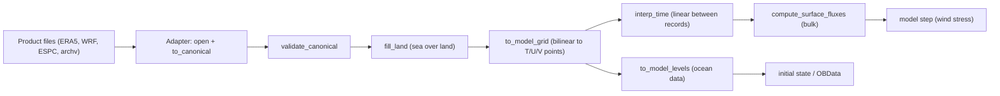

# Surface forcing and external data

This page explains how to bring atmospheric and oceanic products (ERA5, WRF, HYCOM ESPC/GOFS, native HYCOM
archives) into pyOCEAN. Every product goes through the same chain:



The model core only sees **canonical** data on the model grid; an adapter only translates names, units,
signs and time stamps, and every grid/time operation is shared (`forcing/interp.py`). This follows the MOM6
separation between the ocean core and a flux coupler (Adcroft et al. 2019; `docs/design/forcing_architecture.md`).
The physics of the bulk formulae is in [Air–sea fluxes](../theory/air-sea-fluxes.md).

!!! warning "What the models consume today"
    `SigmaBaroclinic.step(st, tau_x, tau_y)` takes only the **wind stress at the u- and v-faces** [N m⁻²].
    Heat and freshwater fluxes are computed but are consumed only by the legacy phase-1 `surface_tendency`
    (see [Which model line consumes each flux](../theory/air-sea-fluxes.md#which-model-line-consumes-each-flux)).
    Ocean products feed initial and boundary conditions.

## The canonical contract

`forcing/canonical.py` defines the names, units and sanity ranges (`CANONICAL_VARS`,
`forcing/canonical.py:45`). Conventions: CF-1.8 standard names and SI units (UDUNITS spelling); coordinates
`time` (datetime64, strictly increasing), `lat` [°N], `lon` [°E], and for ocean data `depth` [m,
**positive downward**]; fluxes positive **into the ocean**; accumulated fields are converted to
instantaneous rates **by the adapter**.

**Atmosphere** (`kind="atmosphere"`, coordinates `time, lat, lon`):

| Name | Units | CF standard name | valid range | required |
|---|---|---|---|---|
| `u10`, `v10` | m s-1 | eastward_wind / northward_wind | −100 … 100 | yes |
| `t2m` | K | air_temperature | 180 … 340 | yes |
| `q2m` | kg kg-1 | specific_humidity | 0 … 0.05 | yes |
| `msl` | Pa | air_pressure_at_mean_sea_level | 85 000 … 110 000 | yes |
| `sw_down` | W m-2 | surface_downwelling_shortwave_flux_in_air | 0 … 1500 | yes |
| `lw_down` | W m-2 | surface_downwelling_longwave_flux_in_air | 50 … 600 | yes |
| `precip` | m s-1 | lwe_precipitation_rate | 0 … 1e-3 | no |

**Ocean** (`kind="ocean"`, coordinates `time, depth, lat, lon`):

| Name | Units | CF standard name | valid range | required |
|---|---|---|---|---|
| `temp` | degC | sea_water_potential_temperature (θ) | −3 … 40 | yes |
| `salt` | psu | sea_water_salinity | 0 … 45 | yes |
| `u`, `v` | m s-1 | eastward/northward_sea_water_velocity | −5 … 5 | no |
| `ssh` | m | sea_surface_height_above_geoid | −5 … 5 | no |

`validate_canonical(ds, kind)` (`forcing/canonical.py:92`) checks, in order: the kind; the coordinates
(time strictly increasing, depth ≥ 0); the required variables; and for every canonical variable present
its exact `units` attribute, that it is not all NaN (NaN over land is allowed) and that its finite values
lie inside `valid_range`. The ranges are not quality control: they catch unit errors (K ↔ °C, J m⁻² ↔
W m⁻², m h⁻¹ ↔ m s⁻¹), which shift values by orders of magnitude. It raises `ValueError` naming the
variable, or returns the dataset unchanged.

## Adapters and the registry

An adapter subclasses `ForcingSource` (`forcing/sources/base.py:125`), sets `kind` and implements
`open(t0, t1, bbox)` (raw subset) and `to_canonical(ds)`. `load(t0, t1, bbox)` chains both, adds the
provenance attributes `pyocean_source` and `pyocean_kind`, and validates the result, so a unit bug fails
immediately. `BBox(lon_min, lon_max, lat_min, lat_max)` (±180 convention; `forcing/sources/base.py:40`)
selects the region; `BBox.from_grid(h_grid, pad=1.0)` encloses every T/U/V point of a spherical grid plus a
margin in degrees. `subset_bbox` keeps one extra source cell on each side in the dataset's own longitude
convention.

Adapters register under short names with `@register_source(name)`; importing `forcing.sources` registers
all of them:

```python
from forcing.sources import available_sources, get_source
available_sources()        # ['era5', 'espc', 'gofs', 'hycom_archive', 'wrf']
src = get_source("era5", paths=[...])    # same as ERA5Source(paths=[...])
```

| Name | Class | kind | File |
|---|---|---|---|
| `era5` | `ERA5Source(paths, accumulation_seconds=3600.0)` | atmosphere | `forcing/sources/era5.py:103` |
| `wrf` | `WRFSource(paths, mask_land=True)` | atmosphere | `forcing/sources/wrf.py:68` |
| `espc`, `gofs` | `HYCOMZSource(paths, temperature="in_situ")` | ocean | `forcing/sources/hycom_z.py:63` |
| `hycom_archive` | `HYCOMArchiveSource(paths, grid, depths=GOFS_DEPTHS, velocity="auto")` | ocean | `forcing/sources/hycom_archive.py:92` |

TPXO tides are read by `forcing.sources.tpxo.read_tpxo` (not a `ForcingSource`; see [Tides](../theory/tides.md)).

### ERA5 (hourly single levels)

| ERA5 | canonical | conversion |
|---|---|---|
| `u10`, `v10`, `t2m`, `msl` | same | none |
| `d2m` + `msl` | `q2m` | $e = a_1\exp[a_3(T_d - T_0)/(T_d - a_4)]$, $q = \varepsilon e/(p - (1-\varepsilon)e)$; $a_1$ = 611.21 Pa, $a_3$ = 17.502, $a_4$ = 32.19 K, $T_0$ = 273.16 K, ε = 0.621981 (IFS Cy41r2 IV eq. 7.5, Buck 1981) |
| `ssrd`, `strd` [J m⁻²] | `sw_down`, `lw_down` | accumulation → rate, centred |
| `tp` [m] | `precip` | accumulation → rate, centred |

- **Layouts**: new CDS (2024+; coordinate `valid_time`, instantaneous and accumulated variables in separate
    files, extra `number`/`expver` coordinates, dropped) and legacy CDS (`time`, one file). Give any mix of
    files and time chunks in `paths`; they are merged.
- **Accumulations**: each hourly value covers the hour *ending* at its stamp, so its rate belongs to
    t − 30 min. The adapter computes $r = \max(A,0)/\Delta$ at $t_k - \Delta/2$ and interpolates linearly back
    to $t_k$; at the last record the hour-ending rate is used (`_centred_rate`, `forcing/sources/era5.py:175`).
    Negative values (IFS noise) are set to zero.
- The time window is widened by one accumulation period on each side.
- ERA5 evaporation `e` is **not** used: E comes from the bulk latent flux, so heat and water are consistent.

### WRF (`wrfout`)

| WRF | canonical | conversion |
|---|---|---|
| `U10`, `V10` (grid-relative) | `u10`, `v10` | $u_e = U\cos\alpha - V\sin\alpha$, $v_e = V\cos\alpha + U\sin\alpha$ with `COSALPHA`/`SINALPHA` when present (identity on Mercator) |
| `T2` | `t2m` | none |
| `Q2` (mixing ratio) | `q2m` | $q = r/(1+r)$ |
| `PSFC` | `msl` | none (surface pressure ≈ MSLP over the ocean) |
| `SWDOWN`, `GLW` | `sw_down`, `lw_down` | none (instantaneous) |
| `RAINC + RAINNC` [mm since cycle start] | `precip` | de-accumulated per file, centred, mm → m; bucket counters `I_RAINC`, `I_RAINNC` × `BUCKET_MM` added |
| `LANDMASK` (and `LAKEMASK`) | — | land set to NaN when `mask_land=True` |

Each file is one **forecast cycle**: precipitation is de-accumulated per file
($r_{k-1/2} = \max(A_k - A_{k-1}, 0)/(1000\,\Delta t_k)$ at mid-interval, then interpolated to $t_k$; first
and last records take the nearest interval rate). Overlapping times keep the **newest** cycle. HYCOM-IOA's
preprocessing assigns the interval rate to the end of the interval instead (30 min shift for hourly output).
**Only rectilinear grids** (MAP_PROJ 3 Mercator or 6 lat-lon; tolerance 1e-4°) are supported; Lambert or
polar-stereographic domains raise `NotImplementedError` (`_rectilinear_axes`, `forcing/sources/wrf.py:178`).

### HYCOM z-level NetCDF (ESPC-D-V02, GOFS 3.1)

Per-variable files (`t3z` `water_temp` → `temp`, `s3z` `salinity` → `salt`, `u3z`/`v3z` `water_u`/`water_v`
→ `u`/`v`, `ssh` `surf_el` → `ssh`); NetCDF-3 with packed shorts, 40 depths, longitudes 0–360 (converted to
±180), time in hours since 2000-01-01, and a `tau` lead-time variable that is dropped. **Temperature**:
`water_temp` carries `standard_name = sea_water_temperature`, i.e. in-situ, so by default
(`temperature="in_situ"`) it is converted to θ with TEOS-10: $p =$ `gsw.p_from_z(-depth, lat)`,
$S_A =$ `gsw.SA_from_SP`, θ = `gsw.pt0_from_t` (`_potential_temperature`, `forcing/sources/hycom_z.py:125`).
The difference is ≈ 0.01 °C at 100 m, 0.1 °C at 1000 m and 0.4 °C at 4000 m. The conversion needs the
salinity files; pass `temperature="potential"` for a product that already stores θ.

### Native HYCOM `.a/.b` files and archives

`forcing/sources/hycom_ab.py` reads HYCOM's binary format (Wallcraft et al. 2009):

- `.a`: records of idm·jdm big-endian float32 values (i fastest), padded to a multiple of 4096 words
    (`hycom_npad`); the data void 2¹⁰⁰ is returned as NaN.
- `.b`: text with header values (`idm`, `jdm`, `iversn`, …) and one line per record. `read_b` recognises the
    archive, grid/depth, forcing, relaxation and other labelled dialects.
- `read_field(path_b, name, k=None, index=0, idm=None, jdm=None, check=True)` (`forcing/sources/hycom_ab.py:134`)
    reads one field by name (and layer); `read_record(path_b, irec, ...)` by position (e.g. `tidal.salReIm`).
    Both check the data min/max against the `.b` line (relative 1e-4), which catches wrong dimensions or
    offsets, and return (jdm, idm) float64.

`HYCOMArchiveSource` (`forcing/sources/hycom_archive.py:92`) converts `archv`/`archm` archives (hybrid layers)
to the canonical ocean on fixed z levels:

- `thknss` [Pa] → $h =$ dp/9806 m; `srfhgt` [m² s⁻²] → $\eta =$ srfhgt/9.806; `temp` is already θ;
    `salin` is practical salinity.
- `velocity="auto"`: `archm*` files hold total velocity, others (instantaneous `archv`) the baroclinic part,
    to which `u_btrop`/`v_btrop` are added (archv2data3z.f). Face velocities are averaged to p-points.
- Layers → z by piecewise-constant sampling (`remap_layers_to_z`, `forcing/sources/hycom_archive.py:60`):
    a depth takes the value of the layer that contains it; vanished layers are skipped; depths below the bed
    are NaN. Default target depths: the 40 GOFS/ESPC levels (`GOFS_DEPTHS`, 0–5000 m).
- Valid time from the model day, `yrflag = 3` only (days since 1900-12-31). `open_all()` reads every
    archive over the whole domain. Only rectilinear HYCOM grids are supported.

## Interpolation to the model

All functions are in `forcing/interp.py`:

| Function | What it does |
|---|---|
| `fill_land(da, lat_dim="lat", lon_dim="lon")` (`:126`) | sea-over-land: each NaN cell with valid N/S/E/W neighbours takes their mean, sweeping until nothing more can be filled; ocean values are never modified; an all-NaN slice stays NaN (HYCOM `landfill`, croco_tools `fillmask`) |
| `to_model_grid(ds, grid, point="t")` (`:46`) | bilinear interpolation from a regular lon/lat grid to C-grid points `'t'`, `'u'` or `'v'` of a spherical grid (Press et al. 2007 eq. 3.6.5); source in 0–360 or ±180 and either latitude order; raises if the source does not cover the domain. Dimensions become e.g. (time, j_t, i_u) |
| `interp_time(ds, t)` (`:182`) | linear between the two bracketing records, as MITgcm `exf_set_fld.F` and HYCOM `forfun.F90`; no extrapolation (raises) |
| `to_model_levels(ds, v_grid)` (`:227`) | linear in depth to the model layer centres $-z_t$; each column is first filled downward with its deepest valid value (vertical sea-over-land), levels above the first source depth take the shallowest value; `depth` becomes `k` |

Land NaNs must be removed with `fill_land` **before** `to_model_grid`. Curvilinear sources are not
handled.

## Worked example: wind stress for `SigmaBaroclinic` from ERA5

```python
import numpy as np
from datetime import datetime
from core.grid.horizontal import create_spherical_grid
from forcing.sources import BBox, get_source
from forcing.interp import fill_land, to_model_grid, interp_time
from forcing.bulk import compute_surface_fluxes

hg = create_spherical_grid(650, 500, 0.04, 0.04, lon0=-118.0, lat0=12.0)
era5 = get_source("era5", paths=["era5_inst_2026-08.nc", "era5_accum_2026-08.nc"])
atm = era5.load(datetime(2026, 8, 1), datetime(2026, 8, 3), BBox.from_grid(hg))   # canonical, validated
atm_t = to_model_grid(atm.map(fill_land), hg, point="t")                          # (time, j_t, i_t)

def wind_stress_at_faces(t, sst, u_sfc=0.0, v_sfc=0.0):
    """τ [N m⁻²] on the u- and v-faces from the bulk fluxes at T-points."""
    fl = compute_surface_fluxes(interp_time(atm_t, t), sst, u_sfc, v_sfc, scheme="ncar")
    tx, ty = fl["tau_x"], fl["tau_y"]
    tau_u = np.empty((tx.shape[0], tx.shape[1] + 1))
    tau_u[:, 1:-1] = 0.5 * (tx[:, 1:] + tx[:, :-1])
    tau_u[:, 0], tau_u[:, -1] = tx[:, 0], tx[:, -1]          # edge faces: adjacent cell (open boundaries)
    tau_v = np.empty((ty.shape[0] + 1, ty.shape[1]))
    tau_v[1:-1] = 0.5 * (ty[1:] + ty[:-1])
    tau_v[0], tau_v[-1] = ty[0], ty[-1]
    return tau_u, tau_v

# inside the time loop (model: SigmaBaroclinic, st: SigmaState; T-layers are bed first, so the top is st.T[-1])
# t = np.datetime64("2026-08-01T00:00") + np.timedelta64(int((n + 1) * model.dt), "s")
# tau_u, tau_v = wind_stress_at_faces(t, sst=st.T[-1])
# st = model.step(st, tau_u, tau_v)
```

Use `scheme="kara"` with `sss=…` to reproduce HYCOM-IOA (`flxflg = 6`), and `albedo=albedo_large_yeager(lat)`
for `albflg = 2`. `SigmaBaroclinic` carries a single tracer T (linear EOS), so the SST passed to the bulk
formula is its top layer; with ALE the top layer is `st.T[-1]` too (k = 0 at the bed).

!!! tip "Pre-processing once"
    `to_model_grid` on a long record is the expensive part. Do it once per forcing file set and keep the
    result (e.g. as NetCDF), then call only `interp_time` in the loop — the "canonical cache" design of
    `docs/design/forcing_architecture.md` §4.

## Worked example: ocean data for initial and boundary conditions

Continuing the example above (`hg`, `BBox`, `get_source`, `datetime`, `np` already defined):

```python
import glob
from core.grid.vertical import create_z_grid
from forcing.ocean_init import prepare_ocean, initial_state, boundary_data

vg = create_z_grid(30, np.full(30, 20.0))        # 30 levels of 20 m (surface first), for example

espc = get_source("espc", paths=sorted(glob.glob("espc/*_t3z.nc") + glob.glob("espc/*_s3z.nc")
                                       + glob.glob("espc/*_u3z.nc") + glob.glob("espc/*_v3z.nc")
                                       + glob.glob("espc/*_ssh.nc")))
ocean = espc.load(datetime(2026, 8, 1), datetime(2026, 8, 8), BBox.from_grid(hg))   # θ via TEOS-10
prep = prepare_ocean(ocean, hg, vg)        # fill_land → to_model_grid (T, U, V points) → to_model_levels
state0 = initial_state(prep, hg, vg, np.datetime64("2026-08-01"))        # phase-1 ModelState
west = boundary_data(prep, "west", np.datetime64("2026-08-01T06"))       # OBData(T, S, u_normal, eta)
```

`prepare_ocean` returns `{"t": temp/salt/ssh, "u": u, "v": v}` on z-levels `vg` (`create_z_grid`); by default
the domain-mean SSH is removed (`remove_mean_ssh=True`), from the boundaries too, because every product
refers SSH to its own datum. For the σ/ALE model (`SigmaBaroclinic`) the initial state and the open-boundary
exterior are built differently (T only, layer source grid, `OBData.zw`): see
[Regional setup](regional-setup.md#initial-state).

## Options and defaults

| Option | Values | Default | Where |
|---|---|---|---|
| `ERA5Source(accumulation_seconds)` | s | 3600 | `forcing/sources/era5.py:119` |
| `WRFSource(mask_land)` | bool | True | `forcing/sources/wrf.py:84` |
| `HYCOMZSource(temperature)` | `'in_situ'`, `'potential'` | `'in_situ'` | `forcing/sources/hycom_z.py:78` |
| `HYCOMArchiveSource(depths, velocity)` | array; `'auto'`, `'baroclinic'`, `'total'` | `GOFS_DEPTHS`, `'auto'` | `forcing/sources/hycom_archive.py:111` |
| `BBox.from_grid(pad)` | degrees | 1.0 | `forcing/sources/base.py:64` |
| `to_model_grid(point)` | `'t'`, `'u'`, `'v'` | `'t'` | `forcing/interp.py:46` |
| `initial_state` / `boundary_data(remove_mean_ssh)` | bool | True | `forcing/ocean_init.py:86,123` |

## Adding a new product

```python
from forcing.sources.base import ForcingSource, register_source, subset_bbox

@register_source("myproduct")
class MySource(ForcingSource):
    kind = "atmosphere"
    def __init__(self, paths): self.paths = paths
    def open(self, t0, t1, bbox):
        ds = xr.open_mfdataset(self.paths).sel(time=slice(t0, t1))
        return subset_bbox(ds, bbox)
    def to_canonical(self, ds):
        out = ...   # rename, convert to canonical units, set attrs["units"] exactly as CANONICAL_VARS
        return out
```

`load` will reject wrong units or out-of-range values. Grid or time interpolation must not be done inside
an adapter.

## Validation

`tests/test_forcing_canonical.py` (18), `tests/test_forcing_interp.py` (24), `tests/test_forcing_sources_base.py`
(13), `tests/test_era5.py` (17), `tests/test_wrf.py` (13), `tests/test_hycom_z.py` (16),
`tests/test_hycom_ab.py` (20), `tests/test_hycom_archive.py` (16), `tests/test_ocean_init.py` (13) (counts from
CLAUDE.md). The archive reader is validated only on synthetic files (no `archv` on disk). Bulk-formula
validation: [Air–sea fluxes](../theory/air-sea-fluxes.md#validation).

## Known limitations

- Heat, freshwater and pressure forcing are not used by the σ/ALE model (wind stress only).
- No GFS, CMEMS, river or FES adapters yet (planned in `docs/design/forcing_architecture.md`).
- Only rectilinear source grids (no Lambert WRF, no curvilinear HYCOM grids); bilinear interpolation only.
- `HYCOMArchiveSource` supports `yrflag = 3` only; layer → z sampling is piecewise constant.
- `interp_time` does not extrapolate: the forcing must cover the whole run.

## References

- Adcroft, A. et al. (2019). The GFDL global ocean and sea ice model OM4.0. *J. Adv. Model. Earth Syst.*
    11, 3167–3211. doi:10.1029/2019MS001726 **[verify]**
- Buck, A.L. (1981). New equations for computing vapor pressure and enhancement factor. *J. Appl. Meteor.*
    20, 1527–1532. **[verify]**
- ECMWF (2016). IFS Documentation Cy41r2, Part IV: Physical Processes, §7.2.1.
- Hersbach, H. et al. (2020). The ERA5 global reanalysis. *Q. J. R. Meteorol. Soc.* 146, 1999–2049.
    doi:10.1002/qj.3803 **[verify]**
- IOC, SCOR & IAPSO (2010). The international thermodynamic equation of seawater – 2010 (TEOS-10).
    Manuals and Guides 56, UNESCO.
- Metzger, E.J. et al. (2014). US Navy operational global ocean and Arctic ice prediction systems.
    *Oceanography* 27(3), 32–43.
- Press, W.H. et al. (2007). *Numerical Recipes*, 3rd ed., §3.6.
- Skamarock, W.C. et al. (2019). A Description of the Advanced Research WRF Model Version 4. NCAR/TN-556+STR.
- Wallcraft, A.J., Metzger, E.J. & Carroll, S.N. (2009). Software Design Description for HYCOM Version 2.2.
    NRL/MR/7320--09-9166.
