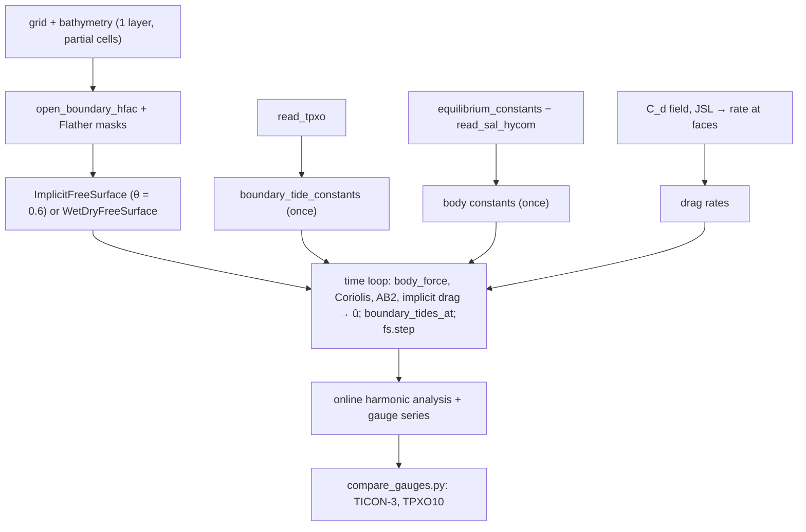

# Tides and the 2-D tidal model

This page shows how to set up and run a **barotropic tidal simulation** like the PAC_MEX runs (Mexican
Pacific and Gulf of California), how to analyse its output and how to compare it with tide gauges. The
reference scripts are `validation/pacmex_tides/run_tides.py` (linear/nonlinear shallow water with partial
cells and `ImplicitFreeSurface`) and `validation/pacmex_tides/run_tides_wd.py` (wetting and drying with
`WetDryFreeSurface`). There is no packaged "tidal model" class: the run script assembles the pieces below,
and you should start from one of these two scripts. The physics of each forcing term is in
[Tides](../theory/tides.md); the free-surface solver in [Free surface and time stepping](../theory/free-surface-time-stepping.md);
wetting and drying in [Wetting and drying](../theory/wetting-drying.md).

## What is solved

Linear shallow water on the sphere (`validation/pacmex_tides/run_tides.py:11`; Vallis 2006 §3.1):

$$
\partial_t\mathbf u + f\hat{\mathbf z}\times\mathbf u = -g\nabla\eta + g\nabla\eta_{body}
    - \frac{C_d\lvert\mathbf u\rvert\mathbf u}{H} - r_{JSL}\,\mathbf u ,\qquad
\partial_t\eta = -\nabla\cdot(H\mathbf u),
$$

with $\eta_{body} = \sum_c(\alpha_c\eta_{eq,c} - F_c)$ (body tide minus SAL), Flather radiation at the open
edges toward the TPXO elevation and transport, Coriolis (4-point C-grid average) and the body force with
AB2, the drag terms semi-implicit, and the implicit θ-method free surface. Options add the nonlinear terms
($H \to H + \eta$ in continuity and drag, $-\nabla\cdot(\eta\mathbf u)$, momentum advection; `core/dynamics/nonlinear.py`)
and a Laplacian viscosity.



## Step 1 — grid and bathymetry

PAC_MEX uses a subdomain of the HYCOM-IOA grid (uniform 0.04°, 118–92°W, 12–32°N, 650 × 500 cells) and its
bathymetry `regional.depth_final` read with `read_field` (`validation/pacmex_tides/run_tides.py:98`,
`subdomain`); a nest uses GEBCO 1/100°. Wet cells are floored at `min_depth` = 10 m (no wetting and drying):

```python
import numpy as np
from core.grid.horizontal import create_spherical_grid
from core.grid.vertical import compute_hfac, create_z_grid
from core.dynamics.free_surface import ImplicitFreeSurface, open_boundary_hfac
from forcing.sources.hycom_ab import read_field

depth = read_field("regional.depth_final.b", "depth", idm=1600, jdm=1125)[j0:j1, i0:i1]
depth = np.where(np.isfinite(depth) & (depth > 0), np.maximum(depth, 10.0), 0.0)   # 0 = land
ny, nx = depth.shape
hg = create_spherical_grid(nx, ny, 0.04, 0.04, lon0=lon_w, lat0=lat_s)    # lon0/lat0 = SW corner
vg = create_z_grid(1, [float(depth.max())])                                 # one layer
hf = compute_hfac(vg, depth, hfac_min=0.0)                                  # partial cell = exact depth
hf = open_boundary_hfac(hf, ["west", "east", "south", "north"])
```

Any bathymetry from the [regional setup](regional-setup.md) pipeline works. With one layer of thickness
$H_{max}$ and `hfac_min=0`, the face depth is the exact model depth. Check the domain first with
`check_domain(hg, H, dt, u_max=2.0, implicit_free_surface=True)` (the WD script does,
`validation/pacmex_tides/run_tides_wd.py:174`): GEBCO pits and isolated water bodies give dead gauges.

## Step 2 — open boundaries and the free-surface operator

All wet edge faces are Flather faces:

```python
hu = (vg.dz.values[:, None, None] * hf.hfac_u.values)[0]
hv = (vg.dz.values[:, None, None] * hf.hfac_v.values)[0]
wet_u, wet_v, wet_t = hu > 0, hv > 0, depth > 0
fl_u = np.zeros_like(wet_u); fl_u[:, [0, -1]] = wet_u[:, [0, -1]]
fl_v = np.zeros_like(wet_v); fl_v[[0, -1], :] = wet_v[[0, -1], :]
fs = ImplicitFreeSurface(hg, vg, hf, dt=120.0, theta=0.6, g=9.81, flather_u=fl_u, flather_v=fl_v)
```

- **θ = 0.6** slightly damps grid-scale gravity waves; tides have ωΔt ≈ 0.02 and are unaffected
    (`run_tides.py:15`). θ must be in [½, 1].
- **Δt = 120 s** in PAC_MEX (implicit free surface: no external-wave CFL). `solver='direct'` (default)
    factorises the SPD matrix once with SuperLU.
- Scalar SAL instead of a SAL file: `ImplicitFreeSurface(..., sal_beta=β)`.

## Step 3 — boundary tides from TPXO

```python
from pathlib import Path
from forcing.sources.tpxo import read_tpxo
from forcing.tides import CONSTITUENTS, boundary_tide_constants, boundary_tides_at

CONS = list(CONSTITUENTS)                       # m2 s2 k1 o1 n2 p1 k2 q1
A = Path("~/pyOCEAN_refs/TPXO10_atlas_v2_nc").expanduser()
tc = read_tpxo([A / f"h_{c}_tpxo10_atlas_30_v2.nc" for c in CONS],
               [A / f"u_{c}_tpxo10_atlas_30_v2.nc" for c in CONS], A / "grid_tpxo10atlas_v2.nc",
               lon_range=(-118.5, -91.5), lat_range=(11.5, 32.5))   # domain + 0.5° margin
bcon = boundary_tide_constants(tc, hg, vg, hf, fl_u, fl_v)          # interpolate once (8× faster)
```

`boundary_tides_at(bcon, t_mid, ramp)` then gives `eta_u, ubar_u, eta_v, vbar_v` each step; the velocity is
TPXO transport over the **model** depth. For one-way nesting in a parent pyOCEAN run, `--bc parent:<run.npz>`
builds the same dataset from the parent's harmonic constants of η and transports (P1 and K2 inferred from
K1 and S2 with the median TPXO ratio; `parent_constants`, `run_tides.py:140`).

## Step 4 — body tide minus SAL

```python
from forcing.tides import equilibrium_constants, read_sal_hycom, predict, body_force

lon_t, lat_t = hg["lon_t"].values, hg["lat_t"].values
body_hc = equilibrium_constants(lon_t, lat_t, CONS)                       # α η_eq constants (ny, nx, 8)
body_hc -= read_sal_hycom("tidal.salReIm_tpxo10.b", 1600, 1125)[j0:j1, i0:i1]   # F = −η_SAL
body_flat = body_hc.reshape(-1, len(CONS))
```

The SAL file is on the HYCOM-IOA grid; for another grid interpolate Re and Im with
`physics.tides.drag.regrid_bilinear` (`run_tides_wd.py:131-134`). `--no-sal` drops it (sensitivity).

## Step 5 — bottom drag

Three choices, combinable (`run_tides.py:238-253`, `run_tides_wd.py:136-146`):

| Drag | How | Script option |
|---|---|---|
| Uniform quadratic $C_d$ | `cd_t = np.full((ny, nx), 2.5e-3)` | `--cd` (default 2.5e-3) |
| Spatial quadratic $C_d$ (HYCOM-IOA `cb.[ab]`, `cb = -1`) | `read_field(".../relax/DRAG/cb.b", "CB", ...)`, NaN → `--cd` | `--cb-file` (always used in the WD script unless `--z0`) |
| Log-law $C_d(D, z_0)$ (Soulsby 1997) | `physics.bottom_friction.log_law_cd(D, z0)`: $C_d = [\kappa/(\ln(D/z_0) - 1 + z_0/D)]^2$, κ = 0.41, clipped to [1e-4, 0.1] | `--z0` (WD script only) |
| JSL internal-tide drag (HYCOM `tiddrg = 1`) | `jsl_to_rh` → `tidal_drag_rate(rh, depth, drgscl)` → `rh_at_faces` | `--drgscl` (0 = off; WD default 0.5) |

$C_d$ at the faces is the mean of the adjacent wet cells (`rh_at_faces(cd_t, wet_t)`). The JSL field comes
from the global HYCOM-examples GLBp0.08 `JSL.[ab]` (4500 × 2251), interpolated bilinearly.

## Step 6 — the time loop

Per step $n$, at the mid-step time $t_{n+1/2}$ (`run_tides.py:298-344`):

1. ramp $r = 1 - e^{-t/\tau_r}$, $\tau_r$ = 2 days / 5 (HYCOM `tidrmp`);
2. $\eta_b = r\cdot$ `predict([t_mid], body_flat, CONS)`, $(g_x, g_y)$ = `body_force(hg, eta_b)`;
3. Coriolis on the C grid with 4-point averages, $G_u = f v + g_x$, $G_v = -f u + g_y$ (plus advection
    and viscosity with `--nonlinear`, `--ah`), extrapolated with AB2 ($\tfrac32 G^n - \tfrac12 G^{n-1}$;
    forward Euler on the first step);
4. semi-implicit drag:
    $\hat u = (u + \Delta t\,G_u^{AB})/(1 + \Delta t\,[C_d\lvert\mathbf u\rvert/D + r_{JSL}])$, with $D = H$
    (linear) or $\max(H + \eta_f, 1\ \mathrm m)$ (nonlinear);
5. `bt = boundary_tides_at(bcon, t_mid, ramp=r)`;
6. `eta, u, v = fs.step(eta, u, v, u_hat, v_hat, flather_eta=(bt["eta_u"], bt["eta_v"]),
    flather_ubar=bt["ubar_u"], flather_vbar=bt["vbar_v"], eta_tendency=s_ab)`, where `s_ab` is the AB2
    nonlinear flux divergence $-\nabla\cdot(\eta\mathbf u)$ or `None`;
7. blow-up check (max |η| > 20 m dumps the state; the WD script uses `diagnostics.postmortem.BlowupGuard`).

## Step 7 — output and harmonic analysis

The script stores η every 10 min at the gauge points (nearest wet cell within 3 cells of each TICON-3
coastal record) and accumulates, hourly after the spin-up, the least-squares normal equations of the
basis $[1, f\cos\theta_c, -f\sin\theta_c]$ for M2, S2, K1, O1, N2, Q1 (`ha_basis`, `run_tides.py:184`; P1
and K2 cannot be separated in 30 days). At the end it solves them for complex constants of η, $U = Hu$ and
$V = Hv$ on the whole grid and writes `out/run_<tag>.npz` (`gauge_*`, `hc_map`, `hc_U`, `hc_V`, axes, depth,
optional hourly η snapshots with `--snapshots`).

For a single series use `diagnostics.sealevel_qc.harmonic_analysis(t, h, cons, inference=...)` (see
[Tides](../theory/tides.md#harmonic-analysis)).

## Step 8 — comparison with tide gauges

`diagnostics/tide_gauges.py` compares harmonic constants with TICON-3 (Hart-Davis et al. 2022; amplitudes
in cm, Greenwich lags in degrees, longitudes 0–360):

```python
from diagnostics.tide_gauges import load_ticon, diagnose_station, compare_with_siblings
st = load_ticon("TICON_3.txt", (-118, -92), (12, 32), CONS)       # coastal records; hc in m (complex)
d = diagnose_station(h_obs, h_mod, CONS)    # rss, rss_corrected, rel_misfit, tau_minutes, gain, flags, d_amp, d_phase
```

- Metric: vector difference $\lvert h_{obs} - h_{mod}\rvert$ per constituent and
    $\mathrm{RSS} = \sqrt{\tfrac12\sum_c\lvert\Delta h_c\rvert^2}$, the RMS over a tidal cycle (Stammer et al. 2014).
- Defect diagnosis: a clock offset τ and a real gain κ are fitted jointly,
    $\min\sum_c\lvert h_{obs} - \kappa h_{mod} e^{-i\omega_c\tau}\rvert^2$ (τ on a 1-min grid within ±13 h),
    and accepted only if the corrected misfit is < 10 % of the signal and at most half the original RSS.
    Flags: `timezone` (τ within 5 min of a whole number of hours ≥ 1), `units` (|κ| within 5 % of 10ⁿ, n ≠ 0),
    `inverted` (κ < 0), `lag_damping` (any other accepted correction with |τ| > 10 min or |κ − 1| > 0.2:
    lagoon, harbour or atlas resolution), `misfit` (large residual, no simple correction).
- `compare_with_siblings(records, CONS)` tests each record of a site against the median of the others: a
    record that differs from its siblings with an instrumental signature is a confirmed gauge defect.

`validation/pacmex_tides/compare_gauges.py [tag ...]` does all of this for a run (gauge records flagged as
defects in `validation/tide_gauges/` are excluded; P1, K2 inferred with TPXO ratios) and writes
`out/gauges_<tag>.csv`, `out/summary.txt` and `out/m2_map_<tag>.png`. Related diagnostics:
`gulf_axis.py` (M2 along the Gulf of California axis), `compare_nest.py` (resolution × nonlinearity ×
boundary), `compare_wd.py` (wetting and drying), `validation/hycom_ioa/compare_hycom_pyocean.py` (against the
HYCOM-IOA operational archives).

## Raw sea-level data: quality control

Near-real-time gauge data (IOC SLSMF relaying the SMN-UNAM network) are not quality controlled.
`diagnostics/sealevel_qc.py` implements checks designed not to mistake a real ocean signal for a defect
(IOC Manuals and Guides 14 vol. IV and 83; SELENE/GESLA practice):

| Function | Detects | Keeps |
|---|---|---|
| `regularize(t, h, step, tol=0.02)` (`:131`) | puts samples on a grid anchored to multiples of `step`; averages agreeing duplicates, discards conflicting ones; reports unsorted samples and gaps | — |
| `flag_spikes(h, expected=None, half_window=7, mad_window=121, k=6, min_dev=0.05, max_run=3)` (`:189`) | runs of ≤ 3 samples deviating from a running median by > max(kσ, 5 cm), σ = 1.4826 MAD | tsunamis, seiches (coherent, raise σ) |
| `flag_flatlines(h, resolution, expected=None, min_change=3, min_abs=0.02, max_samples=None)` (`:215`) | identical values while the expected tide moves > max(3 × resolution, 2 cm) | slack water quantised at the resolution |
| `detect_steps(r, short=10, long=1490, threshold=0.05, k_noise=5)` (`:244`) | datum shifts in a residual: same change at 10-sample, 60-sample and one-tidal-day (1490 min) scales, stable level on both sides | storm surge (changes over hours), shelf seiches |
| `clock_offsets(t, h, reference, window=3 d, max_lag=13 h)` (`:343`) | τ and κ per window from $h \approx a + \kappa p(t - \tau)$ | lagoon lag (constant in time) |
| `clock_changes(t_center, tau_minutes, ...)` (`:462`) | significant jump (z > 5, > 15 min) or drift (> 10 min) in the window τ series | spring–neap scatter |
| `compare_twins(h1, h2, step, ...)` (`:396`) | co-located sensors: lag, gain, offset, steps and drift of the aligned difference | tide, surge and seiches cancel |

`validation/tide_gauges/qc_ioc_mexico.py` applies them to the Mexican network (results in
`validation/tide_gauges/README.md`: e.g. the Veracruz2 float stuck for 90 days, Isla Clarión recording
−0.10 × the tide, a 9 cm La Paz2 float–radar drift since 2026-08-09). Single-sensor datum steps are only
candidates: all 8 that could be tested against a twin were rejected by it.

## Wetting-and-drying variant

`run_tides_wd.py` runs the northern Gulf of California at 1/120° (2 × 2 block mean of GEBCO 2021) with the
raw intertidal flats of the Colorado delta:

- bathymetry convention of `WetDryFreeSurface`: $H > 0$ water, $H < 0$ floodable land, **NaN wall**; land
    above +8 m is a permanent wall, and only the connected Gulf component is kept (`scipy.ndimage.label`);
    `--floor 5` floors the depth at 5 m (control run without drying);
- `WetDryFreeSurface(hg, H, dt=60, theta=0.6, d_min=0.05, flather_u, flather_v, solver="cg", cg_rtol=1e-10)`
    (`core/dynamics/wetting_drying.py:51`); Flather only on edge faces deeper than 20 m;
- initial η = 0 on wet cells and $\eta = -H$ (dry) on floodable cells; drag on the total depth
    $D = \max(H + \eta, d_{min})$ averaged to faces, with HYCOM `cb` or the log law (`--z0`) plus JSL
    (`--drgscl` 0.5);
- `wet_fraction` of every cell is saved for the intertidal area.

Usage: `python run_tides_wd.py --bc parent:out/run_s_min5.npz --tag wd_raw`.

## Configuration summary

| Parameter | PAC_MEX (`run_tides.py`) | Gulf WD nest (`run_tides_wd.py`) |
|---|---|---|
| grid | 0.04°, 650 × 500 | 1/120° |
| depth | HYCOM-IOA `regional.depth_final`, floor 10 m (`--min-depth`) | GEBCO 2021, raw (`--floor` optional) |
| free surface | `ImplicitFreeSurface`, θ = 0.6, direct (SuperLU) | `WetDryFreeSurface`, θ = 0.6, CG + lagged-LU, `d_min` 0.05 m |
| Δt | 120 s | 60 s |
| constituents | 8 (boundary and body); analysis of 6 | same |
| boundary | Flather + TPXO10-atlas-v2 (or `parent:`) | Flather (> 20 m) + parent run |
| body | α η_eq − SAL file (`--no-sal`) | α η_eq − SAL (interpolated) |
| drag | $C_d$ = 2.5e-3 (`--cd`, `--cb-file`), JSL (`--drgscl`) | `cb` or `--z0`, JSL 0.5 |
| ramp | 1 − exp(−5t/2 d) | same |
| run | `--start 2026-08-01 --days 33 --spinup 3` | same |
| options | `--nonlinear`, `--adv upwind3/centred`, `--ah`, `--domain gebco100`, `--box`, `--snapshots`, `--benchmark N` | `--benchmark N` |

## Results summary

| Run / comparison | Result | Source |
|---|---|---|
| PAC_MEX reference (C_d 2.5e-3), 31 TICON records | median RSS **1.95 cm** (TPXO10 1.87 cm, no SAL 3.35 cm); Pacific 1.60 (TPXO 1.79), Gulf of California 12.54 (TPXO 5.12) cm | `validation/pacmex_tides/out/summary.txt`; CLAUDE.md |
| M2 vs TPXO10 over depth > 1000 m | RMS 1.58 cm, amplitude ratio 1.010, phase −0.6° | `out/summary.txt` |
| Acapulco | 0.6 cm (TPXO 5–6 cm) | CLAUDE.md |
| Gulf of California | amphidrome misplaced: Guaymas 22 vs 13.5 cm, −37° | CLAUDE.md |
| Drag ensembles (C_d 0.0015–0.006, JSL drgscl 0.25–1.0, + HYCOM-IOA cb) | best Pacific 1.44 cm (JSL 1.0) vs TPXO 1.79; Gulf stays 11–12.5 cm (TPXO 5.1): the Gulf error is not a missing sink | `out/summary.txt`; CLAUDE.md |
| 1/100° nest of the northern Gulf (TPXO boundary) | median RSS 5.00 cm at 7 gauges vs 11.67 cm at 1/25° (TPXO 2.08) | `out/nest_summary.txt` |
| Gulf WD nest, M2 along the axis vs TPXO | amplitude RMS error 29.1 cm (floor 5 m) → 8.7 cm (raw flats, WD) → 3.8–4.9 cm (log-law z₀ 1e-3 / 1e-4) | `out/wd_summary.txt` |
| HYCOM-IOA operational vs pyOCEAN, IOC observations (tidal band) | RMS HYCOM 4.9 cm, pyOCEAN 5.1 cm; both fail alike in the Gulf of California | `validation/hycom_ioa/out/summary.txt`; `docs/design/validation_suite.md` |
| Cost | 33 days in 11 min on one P-core (650 × 500, Δt 120 s); SuperLU is 65 % of the step, Numba `prange` on the rest gives ≤ 1.35× | CLAUDE.md; `bench_parallel.py` |

Full discussion: [Tides and sea level](../validation/tides-sealevel.md) and
[Wetting and drying](../validation/wetting-drying.md).

!!! tip "Performance"
    The step is dominated by the single-threaded sparse solve; set the BLAS/OMP thread variables to 1
    (the scripts do) and run one simulation per performance core. Interpolate boundary constants once
    (`boundary_tide_constants`): calling `boundary_tides` each step is 8× slower.

## Known limitations

- The tidal model is a script, not a configurable class; output is `.npz`, not the CF output of
    `diagnostics/output.py`.
- Barotropic only; the JSL drag stands in for internal-tide conversion. Tides in `SigmaBaroclinic` would
    need the boundary and body forcing to be wired into its step (not done).
- 30-day runs cannot separate P1/K2 from K1/S2 (inference with TPXO ratios).
- The Gulf of California co-oscillation remains the main error at 1/25° (amphidrome position).

## References

- Hart-Davis, M.G., Dettmering, D. & Seitz, F. (2022). TICON-3: Tidal constants based on GESLA-3 sea-level
    records. PANGAEA, doi:10.1594/PANGAEA.951610.
- Haigh, I.D. et al. (2023). GESLA version 3. *Geosci. Data J.* 10, 293–314. doi:10.1002/gdj3.174 **[verify]**
- Pérez, B. et al. (2013). Sea level data quality control with SELENE. ESEAS-RI / Puertos del Estado.
- Soulsby, R.L. (1997). *Dynamics of Marine Sands.* Thomas Telford, §3. ISBN 0-7277-2584-X **[verify]**
- Stammer, D. et al. (2014). Accuracy assessment of global barotropic ocean tide models. *Rev. Geophys.*
    52, 243–282. doi:10.1002/2014RG000450 **[verify]**
- UNESCO/IOC (2020). Quality control of in situ sea level observations. IOC Manuals and Guides 83.
- Vallis, G.K. (2006). *Atmospheric and Oceanic Fluid Dynamics.* Cambridge University Press.
- See also the references of [Tides](../theory/tides.md).
