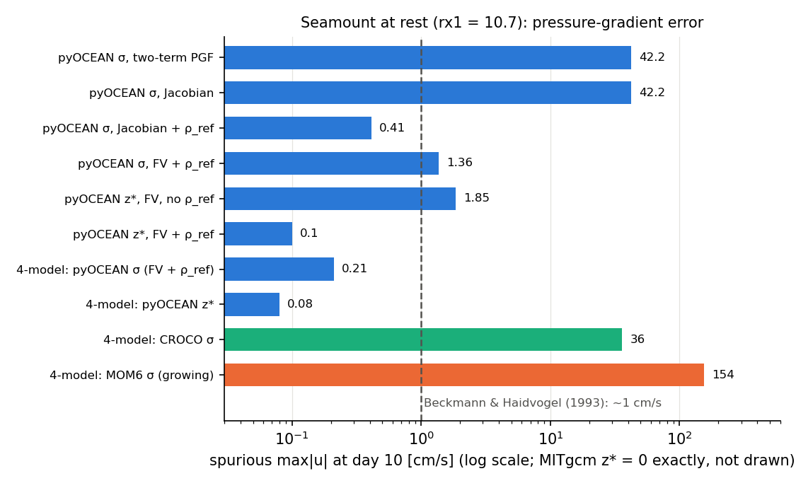

# Analytical and exact solutions

These are the cases where the answer is known exactly, so any difference is a model error. Most of them are
`pytest` tests and run in seconds or minutes; they are the first line of defence against regressions. Use
this page to see which part of the discretisation each test pins down, and how tight the check is.

Each case lists: **set-up**, **truth**, **metric**, **result**, **source**, **status** and how to
**reproduce** it. "Test" means a `pytest` node; run a single one with
`pytest tests/<file>.py::<test> -q`.

## Summary

| Case | Truth | Result | Status |
|---|---|---|---|
| Exact discrete seiche mode | amplification factor of the θ-method | agreement to 1e-9 for θ = ½, ¾, 1 and Courant 0.5 and 4 | ✅ |
| Merian seiche period | $T = 2L/\sqrt{gH}$ | within 0.2 % | ✅ |
| Seiche with scalar SAL | $\omega$ with $g(1-\beta)$ | to 1e-9 | ✅ |
| Flather outgoing wave | no reflection | < 0.1 % of the energy left | ✅ |
| Standing tidal wave in a bay | $B\cos kx$ | within 2 % of $B$ | ✅ |
| Inertial oscillation | period $2\pi/f$ | current reversed to 0.01 m/s after half a period | ✅ |
| Ekman transport | $\tau/(\rho_0 f)$ | max error 0.045 % | ✅ |
| Linear internal seiche | $2L/c$; mode-1 period 26.18 h | +5 to +7 % (σ, converging); 26.18 h in ALE | 🔶 / ✅ |
| Analytic mode-1 internal wave | progressive wave with viscous decay | amplitude ±5 %, phase < 3.4° | ✅ |
| Benjamin front speed | $U = \tfrac12\sqrt{g'H}$ | ±10 %; 0.463/0.486 against 0.495 m/s | ✅ (= CROCO) |
| Seamount at rest | $u = 0$ | 0.10 cm/s (z\*), 0.41 cm/s (σ) at day 10; exact for linear $\rho(z)$ | 🔶 |
| Bay-mouth step at rest | $u = 0$ | z\* 5e-12 m/s against σ 7.3 cm/s | ✅ |
| Resting hybrid layers over the step | $u = 0$ | 3.3e-4 m/s (before 1.6 cm/s) | ✅ |
| Thacker parabolic basin | exact nonlinear solution | 4.6 cm rms (CROCO 2.0) | ❌ ([W/D page](wetting-drying.md)) |
| Restart | the continuous run | bit for bit | ✅ |

## Free surface: seiches

### Exact discrete seiche mode

**Set-up.** A closed 1-D basin of 40 cells, Δx = 1 km, H = 20 m, initial η = the first basin mode, no
friction; `ImplicitFreeSurface` (`core/dynamics/free_surface.py:109`) with θ = 0.5, 0.75 and 1 and Courant
numbers $c\,\Delta t/\Delta x$ = 0.5 and 4.

**Truth.** On the C-grid the mode has the discrete frequency
$\omega = (2c/\Delta x)\sin(k\Delta x/2)$, $k = \pi/L$, $c = \sqrt{gH}$. The θ-method multiplies the mode
by a complex factor $\lambda(\theta,\omega\Delta t)$ every step, so the amplitude after $n$ steps is
$\lvert\lambda\rvert^n\cos(n\arg\lambda)$ exactly.

**Metric / result.** η/η₀ at one point over 60 steps agrees with $\lvert\lambda\rvert^n\cos(n\arg\lambda)$ to
**1e-9** for all six combinations (`TestSeiche::test_mode_evolution_exact`,
`tests/test_free_surface.py:119`). The solver therefore implements exactly the intended time discretisation:
neutral for θ = ½, damped for θ > ½. `test_backward_euler_damps` and `test_stable_far_beyond_explicit_cfl`
(Courant 20) check the damping and the unconditional stability.

**Status ✅.** Reproduce: `pytest tests/test_free_surface.py -k Seiche`.

### Merian period

**Set-up.** The same basin with 200 cells, L = 40 km, H = 20 m, θ = ½, ~200 steps per period, 1200 steps.

**Truth.** Merian's formula for the gravest mode, $T = 2L/\sqrt{gH}$.

**Result.** The period from zero up-crossings is within **0.2 %** of $2L/\sqrt{gH}$
(`test_period_converges_to_merian`, `tests/test_free_surface.py:139`). `CLAUDE.md` (Phase 2 step 6)
summarises both tests as "matches the exact discrete seiche mode to 1e-9 and Merian's period".

**Status ✅.**

### Seiche with self-attraction and loading

**Set-up.** The 40-cell basin with the scalar SAL option `ImplicitFreeSurface(sal_beta=0.1)`, θ = ½.

**Truth.** The scalar SAL approximation replaces $g\nabla\eta$ by $g(1-\beta)\nabla\eta$, so the mode has
$\omega = 2\sqrt{g(1-\beta)H}/\Delta x\,\sin(k\Delta x/2)$ and the Crank–Nicolson factor gives the exact
phase per step.

**Result.** Agreement to **1e-9** over 50 steps (`TestScalarSAL::test_seiche_frequency_uses_reduced_gravity`,
`tests/test_tidal_potential.py:105`). **Status ✅.**

## Open boundaries

### Flather outgoing wave

**Set-up.** A 200-cell channel (Δx = 500 m, H = 10 m), Flather radiation on the east face (and in a mirror test
on the west face), a Gaussian hump of 0.1 m at x = 70 km, θ = ½, Courant 0.5. The hump splits; one half leaves
directly, the other reflects at the wall and leaves later.

**Truth.** A perfectly transparent boundary lets all the energy out.

**Result.** After 2.5 crossing times **less than 0.1 %** of the initial $\sum A\eta^2$ remains
(`TestFlather::test_outgoing_wave_leaves_the_domain` and `..._through_west_boundary`,
`tests/test_free_surface.py:291` and `:377`). Two more tests check the volume budget through the Flather face
to 1e-12 and the Flather relation $\bar u = \bar u_{ext} + \sqrt{g/H}(\eta - \eta_{ext})$ at the face.
The same tests exist for the wetting–drying solver (`tests/test_wetting_drying.py:171`). **Status ✅.**

### Standing (co-oscillating) tidal wave in a bay

**Set-up.** A 100 km channel (100 cells, H = 20 m), closed at x = 0 and open with Flather at x = L, forced at
the mouth with the exact co-oscillating solution
$\eta = B\cos kx\cos\omega t$, $u = (cB/H)\sin kx\sin\omega t$ for an M2 period (12.42 h), B = 0.5 m,
Δt = 60 s, θ = ½. Six periods, the last two recorded.

**Truth.** The interior amplitude $B\lvert\cos kx\rvert$ (Taylor's co-oscillating tide).

**Result.** Amplitude within **2 % of B** at every cell (`test_tidal_bay_reproduces_standing_wave`,
`tests/test_free_surface.py:345`; "tidal bay = analytic standing wave within 2 %", `CLAUDE.md` Phase 2
step 7). **Status ✅.**

### Mode-1 internal wave leaving a channel (σ and ALE)

This open-boundary test has no closed form; its truth is a 5× larger domain, so it is on the
[idealised page](idealised.md#open-boundaries-mode-1-internal-wave-leaving-a-channel).

### Analytic mode-1 internal wave through a prescribed boundary

**Set-up.** A flat 200 m channel, 100 cells of 100 m, 20 layers, $N^2 = 10^{-6}$ s⁻², f = 0, period
44 567 s (the MITgcm `internal_wave` forcing), u₀ = 0.024 m/s. The west edge is `'clamped'` (Dirichlet, no
sponge) to the exact wave, the east edge `'radiating'` (Flather + Orlanski) with a 20-cell sponge. ALE z\* or
hybrid, `ke_scheme="arakawa"`, ν = κ = 1e-3, A_h = K_h = 1e-2 m² s⁻¹, Δt = 250 s. Three periods of spin-up,
then one period recorded (`test_clamped_west_radiating_east_carries_the_analytic_mode1_wave`,
`tests/test_sigma_ale.py:1041`).

**Truth.** The progressive mode-1 wave $u = u_0\cos(\pi z/H)\sin(\omega t - kx)$, $k = \pi\omega/(NH)$
(λ ≈ 2.8 km), with linear viscous decay at rate
$\tfrac12[(\nu+\kappa)m^2 + (A_h+K_h)k^2]$ ($m = \pi/H$) travelling at the group speed $c_g = NH/\pi$.

**Metric.** Mode-1 projection of u at interior faces, fitted harmonically; amplitude divided by the decay
factor, phase against $kx$.

**Result.** Amplitude within **±5 %** and phase within **3.4°** in z\* and in the hybrid coordinate
(`validation/internal_wave/README.md`, "Prueba analítica previa"; the test asserts < 10°). The test found and
fixed two (a) errors: a sponge relaxing a prescribed edge towards the boundary profile copied along the normal
(160° phase error), and the sponge of an edge without data relaxing towards the profile of the *other* edge.
It also showed that the Godunov kinetic-energy scheme damps this wave by a further ~9 % over 5 km at
dx = 100 m (8 % at 50 m: first order in dx); this is why the test uses Arakawa, which is now the default.

**Status ✅.** Reproduce: `pytest tests/test_sigma_ale.py -k analytic_mode1`.

## Rotation and wind

### Inertial oscillation

**Set-up.** A closed 2000 km f-plane box (80 × 80 cells of 25 km), 10 m deep, two layers, f = 1e-4 s⁻¹,
uniform u = 0.1 m/s, Δt = 300 s, no stratification (`test_inertial_oscillation_has_period_two_pi_over_f`,
`tests/test_sigma_baroclinic.py:251`).

**Truth.** Far from the walls $u = U\cos ft$, $v = -U\sin ft$.

**Result.** After a quarter period u has turned into −v and after half a period u is reversed, both within
**0.01 m/s** of U = 0.1 m/s. A second test checks that the discrete Coriolis term does no work to 1e-12
(`test_coriolis_conserves_kinetic_energy_of_the_term`). **Status ✅.**

### Ekman transport

**Set-up.** The same box, 10 m deep, 5 σ-layers, constant viscosity 1e-3 m² s⁻¹, a uniform eastward stress
τ = 0.1 N m⁻² switched on at t = 0, one inertial period (`test_uniform_wind_gives_the_inertial_ekman_transport`,
`tests/test_sigma_baroclinic.py:285`).

**Truth.** The depth-integrated transport of a stress switched on impulsively,
$M_x = (\tau/\rho_0 f)\sin ft$, $M_y = (\tau/\rho_0 f)(\cos ft - 1)$: on average $\tau/(\rho_0 f)$ to the
right of the wind (Ekman 1905; Gill 1982 §9.2).

**Result.** Maximum error **0.045 %** of $\tau/(\rho_0 f)$ over the period (test comment and scorecard
`docs/design/vision_roadmap.md` §7; `CLAUDE.md`: "Ekman 0.05 %"). The test also checks that the stress enters
at the top layer. **Status ✅.**

## Internal seiche period

Two results exist:

- **σ model (Eulerian, 2-layer seiche).** The scorecard (`docs/design/vision_roadmap.md` §7) lists the linear
    internal seiche with truth $T = 2L/\sqrt{g' h_1 h_2/H}$ and result **+5 to +7 %, converging** with
    resolution, status 🔶. No README or test in the repository documents this run in more detail; the number
    cannot be traced further.
- **Continuously stratified mode-1 seiche (KE-scheme study).** L = 60 km, H = 200 m, N = 0.02 s⁻¹, 20 layers,
    theoretical period 26.18 h. The Eulerian σ model gives 26.21 h; ALE-σ and ALE z\* give **26.18 h** with
    both KE schemes; the hybrid gives 26.21–26.22 h. Kinetic energy is kept to 0.9971 (Arakawa) and 0.9951
    (Godunov) per half period (`validation/mom6_ke_schemes/README.md`). Status ✅.

Reproduce the second: `NUMBA_NUM_THREADS=5 python validation/mom6_ke_schemes/seiche_pyocean.py`.

## Gravity-current front speed (Benjamin 1968)

**Set-up.** A 64 km × 20 m channel, 128 cells of 500 m, Δρ = 5 kg m⁻³ across a gate at 32 km, f = 0, closed,
no bottom friction. The test version uses 20 layers and Δt = 20 s
(`test_lock_exchange_front_moves_at_the_benjamin_speed_and_conserves_heat`,
`tests/test_sigma_baroclinic.py:52`; ALE-σ version `tests/test_sigma_ale.py:205`).

**Truth.** The energy-conserving front $U = \tfrac12\sqrt{g'H}$ = 0.495 m/s.

**Metric.** Front displacement between 2 and 6 h at the top and bottom layers.

**Result.** Both fronts within **±10 %** of U in the σ model and in ALE-σ; heat conserved to 1e-12; RPE never
decreases. With the full CROCO `GRAV_ADJ` configuration (40 levels, Δt = 10 s) pyOCEAN gives
**0.463 / 0.486 m/s** (dense / light), identical to CROCO (`validation/lock_exchange/README.md`). The advective
form of momentum advection gave a front 16 % too slow (0.42 m/s), which is why the σ model uses the flux form.
The full comparison, including spurious mixing, is on the [idealised page](idealised.md#lock-exchange-against-croco-grav_adj).

**Status ✅.**

## States of rest over topography

A resting, horizontally stratified ocean must stay at rest. Every spurious velocity measures the
pressure-gradient error.

### Seamount (Beckmann & Haidvogel 1993)

**Set-up.** Gaussian seamount $h = H_0 - H\exp(-(x^2+y^2)/L^2)$, $H_0$ = 4500 m, H = 4050 m (δ = 0.9),
L = 25 km (maximum slope 13.7 %), f₀ = 1e-4 s⁻¹, closed 384 × 288 km box, Δx = 6 km, 20 layers;
$\rho(z) = \rho_0 + 3(1 - e^{z/1000})$ kg m⁻³; rx0 = 0.27 and rx1 = 10.7, above the usual limits (0.2 and
3–7). 10 days (`validation/seamount/README.md`).

**Truth.** $u = 0$.

**Unit tests.** Both the density Jacobian (`tests/test_sigma_baroclinic.py:196`) and the finite-volume
pressure gradient (`test_fv_pgf_is_exact_for_linear_stratification_over_a_seamount`,
`tests/test_sigma_ale.py:108`, < 1e-13 m s⁻²) are exact for a linear stratification over the seamount.
Subtracting the model's own horizontal-mean profile ρ_ref cuts the exponential-profile error by more than 100×
(`tests/test_sigma_baroclinic.py:227`).

**Result** (max\|u\| at day 1 / 2 / 10, `validation/seamount/README.md`):

| Pressure gradient | max\|PGF\| at t = 0 [m s⁻²] | max\|u\| [cm/s] |
|---|---|---|
| Two terms, ρ′ = ρ − ρ₀ | 4.0e-5 | 49.9 / 60.2 / 42.2 |
| Density Jacobian (Song 1998) | 3.7e-5 | 49.9 / 60.2 / 42.2 |
| Jacobian + reference profile (`rho_ref="auto"`) | 1.1e-6 | 0.17 / 0.21 / **0.41** |
| Finite volume (Adcroft et al. 2008) + ρ_ref, σ | 1.1e-6 | 0.16 / 0.20 / 1.36 |
| **z\* (ALE) + finite volume + ρ_ref** | 1.5e-7 | 0.02 / 0.02 / **0.10** |
| z\* + finite volume, no ρ_ref | 2.5e-4 in 1 mm layers (zero velocity there); 5.1e-7 on faces ≥ 1 cm | 0.61 / 0.37 / 1.85 |
| Beckmann & Haidvogel (1993) spectral model | — | ~1 at 10 days |



*Spurious max\|u\| at day 10 for each pressure-gradient option and in the four-model benchmark (log scale).
The reference profile, not the Jacobian, removes the error; z\* is lowest. Drawn by
`docs/manual/figures/make_validation.py`.*

**Open problem.** Every configuration has a mode that grows exponentially, doubling every ~2 days,
independent of Δt (300 or 600 s): σ + Jacobian reaches 9.24 cm/s at day 20, σ + FV 12.0 cm/s. The finite
volume only seeds it ~4 days earlier. Its class is pending, probably (a) or (c) (a mode amplified with
Coriolis, A_h = 0 and a fixed reference profile). A 180-day test and an evolving ρ_ref are pending
(`validation/seamount/README.md`, "Pendiente"). The xfail
`test_fv_pgf_error_over_the_seamount_is_not_larger_than_the_jacobian` (`tests/test_sigma_ale.py:115`)
records a tie: 7.888e-8 (FV) against 7.876e-8 m s⁻² (Jacobian) with the binned reference profile.

**Status 🔶** (z\* ahead of Beckmann & Haidvogel; growing mode open).

Reproduce (one at a time, `NUMBA_NUM_THREADS=5`):

```bash
python validation/seamount/run_seamount.py --pgf jacobian --ref
python validation/seamount/run_seamount.py --pgf fv --ref --coord zstar
```

### BayIW bay-mouth step

**Set-up.** A 2-D section, 40 cells of 1 km, depth 600 m in the west half and 164 m in the east half (the
BayIW bay mouth: rx0 = 0.57 in σ), 30 layers, f = 0, a tanh pycnocline at 80 m
($T = 15 + 5\tanh((z+80)/30)$), constant viscosity 1e-4, `rho_ref="auto"`, Δt = 60 s, 12 h
(`test_bay_mouth_step_spurious_flow_sigma_vs_zstar`, `tests/test_sigma_ale.py:421`).

**Truth.** $u = 0$.

**Result.** σ-layers + Jacobian + ρ_ref: **7.3 cm/s**; ALE z\* + finite volume: **5e-12 m/s**
(`CLAUDE.md`; scorecard). The vector-invariant momentum and PPM thickness flux keep the step at rest too
(3.5e-12 m/s, `validation/mom6_lock_exchange/README.md`; `tests/test_sigma_ale.py:534`). This is the
idealised version of the problem that spoiled the 2026-10-11 σ run of BayIW (rx1 = 684 at the mouth,
[BayIW page](bayiw.md#the-sigma-run-of-2026-10-11-and-the-mouth-step)).

**Status ✅** (z\* at round-off).

### Hybrid layers over the step

**Set-up.** The BayIW step with 25 hybrid layers, linear stratification, 6 h, no wind.

**Result.** 1.6 cm/s when the hybrid grid was built from σ-layers; **3.3e-4 m/s** with
`initial_state(eta, T, h_src=...)` (T remapped from the source levels at every regrid pass, as MOM6
`Z_INIT_ALE_REMAPPING`) and MITgcm's effective depth; a channel with a step stays below **1e-6 m/s** after 1 h
(scorecard; `validation/bayiw_2d/README.md`; `test_hybrid_step_stays_at_rest_from_a_fine_source`,
`tests/test_sigma_ale.py:915`). **Status ✅.**

## Thacker (1981) parabolic basin

The exact nonlinear wetting–drying solution is the strictest test of the moving shoreline. pyOCEAN reaches
4.6 cm rms (CROCO 2.0 cm) and loses ~1 % amplitude per period at the front; the test
`test_front_dissipation_as_low_as_croco` is a strict `xfail`. Full description:
[Wetting and drying](wetting-drying.md#thacker-1981-parabolic-basin).

## Bit-for-bit restart

**Set-up.** Run N steps continuously; run M < N steps, `write_restart` (`core/restart.py:89`), create a
*new* model instance, `read_restart` (`core/restart.py:134`), run N − M steps.

**Truth.** The continuous run.

**Result.** Identical arrays (`np.array_equal`) for:

- the stratified σ model with GLS and with constant viscosity (`test_restart_is_bit_for_bit`,
    `tests/test_restart.py:43`), including the AB3 start-up, open boundaries, stretched layers and the automatic
    reference profile;
- ALE z\*, σ and hybrid, closed and open (`test_ale_restart_is_bit_for_bit`, `tests/test_restart.py:181`),
    including the lagged-LU preconditioner, the outflow-limiter count, and refusal of a restart written with
    other regrid parameters, θ_bc, thin-layer coupling, cutoff or tracer limiter (17 tests in
    `tests/test_restart.py`);
- the BayIW 3-D cut, two-layer with bay, wind and open boundaries: 60 h continuous against 30 h + restart +
    30 h, η, u, v, T and h identical, zero truncations (11.5 min, 98 MB file;
    `validation/bayiw_cut/restart_check.py hybrid`, `validation/bayiw_cut/README.md`).

The restart file is CF NetCDF in float64. **Status ✅.** Not yet wired into the 2-DH tidal runners
(`docs/design/vision_roadmap.md` §8, stage A).

## Phase-1 (z-level model) analytical tests

The legacy phase-1 z-level model (`core/dynamics/pressure.py`, `momentum.py`, `physics/mixing/kpp.py`,
`forcing/surface.py`) has its own analytical checks:

| Test | Truth | Where |
|---|---|---|
| Hydrostatic pressure of two layers | $p_1 = \tfrac12\rho_1 g h$, $p_2 = \rho_1 g h + \tfrac12\rho_2 g h$ | `tests/test_pressure.py:151` |
| Uniform pressure gives zero gradient; sign convention | $\nabla p = 0$ | `tests/test_pressure.py:211`, `:226` |
| Wind-stress tendency of the top layer | $\tau/(\rho_0\Delta z_1)$ | `tests/test_surface_forcing.py:155` |
| Surface heating and salt tendency | $Q/(\rho_0 c_p \Delta z_1)$, $S(E-P)/\Delta z_1$ | `tests/test_surface_forcing.py:188`, `:257` |
| Bulk Richardson number of a single layer (KPP) | closed-form $Ri_b$ | `tests/test_kpp.py:210` |
| Nonlinear advection terms exact for linear and quadratic fields | finite-difference identities | `tests/test_nonlinear.py:88–189` |

These are unit-level checks; the phase-1 model is not used in the benchmarks of this chapter.

## References

- Adcroft, A., Hallberg, R., Harrison, M. (2008). A finite volume discretization of the pressure gradient force
    using analytic integration. *Ocean Modell.* 22, 106–113.
    [10.1016/j.ocemod.2008.02.001](https://doi.org/10.1016/j.ocemod.2008.02.001) **[verify]**
- Beckmann, A., Haidvogel, D. B. (1993). Numerical simulation of flow around a tall isolated seamount. Part I.
    *J. Phys. Oceanogr.* 23, 1736–1753. **[verify]**
- Benjamin, T. B. (1968). Gravity currents and related phenomena. *J. Fluid Mech.* 31, 209–248.
    **[verify]**
- Gill, A. E. (1982). *Atmosphere–Ocean Dynamics*. Academic Press.
- Song, Y. T. (1998). A general pressure gradient formulation for ocean models. Part I. *Mon. Weather Rev.*
    126, 3213–3230. **[verify]**
- Thacker, W. C. (1981). Some exact solutions to the nonlinear shallow-water wave equations. *J. Fluid Mech.*
    107, 499–508. **[verify]**
