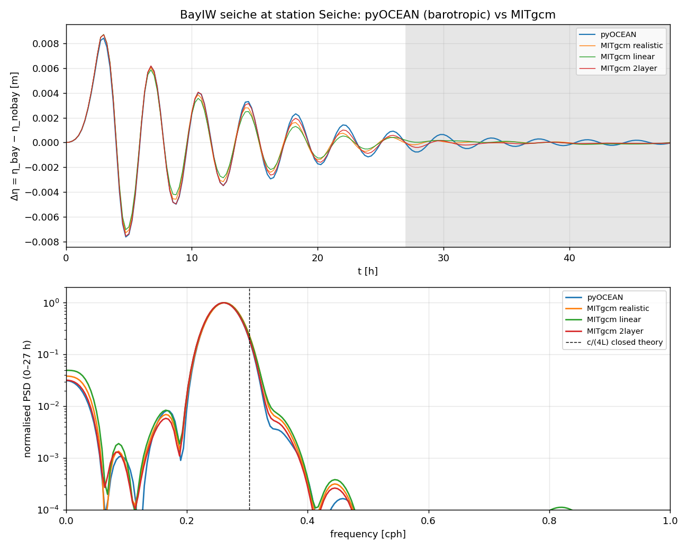
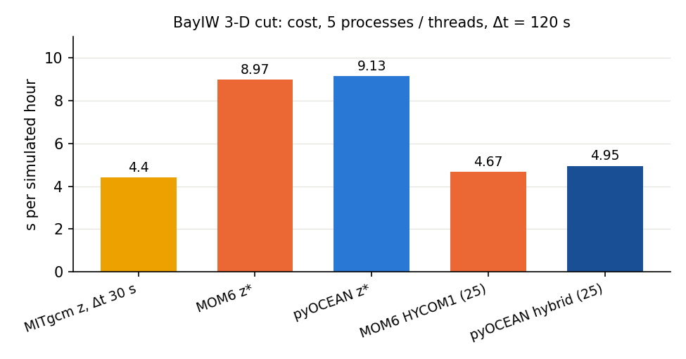

# BayIW: bay internal waves and seiches against MITgcm and MOM6

BayIW is the idealised experiment of the developer's M.Sc. thesis (MITgcm `BayIW_Rectan`): a wind pulse over
a flat 600 m ocean with a shallow rectangular bay excites a barotropic seiche in the bay, and the seiche and
the wind generate internal waves over the bay-mouth step. It is the main realistic-geometry benchmark of the
stratified core, because it combines a steep step (600 → 164 m), open boundaries, rotation, wind forcing and
three stratifications. Read this page to know how well pyOCEAN reproduces MITgcm (the reference) and MOM6 in
z\* and hybrid coordinates, and what each comparison taught.

The work went through five stages, each with its own folder in `validation/`:

| Stage | Folder | Domain | Main result |
|---|---|---|---|
| Barotropic seiche | `bayiw_seiche/` | full 560 × 352, one layer | period 3.83 h (MITgcm 3.81–3.83) |
| σ baroclinic run (2026-10-11) | `bayiw_iw/` | full, 50 σ-layers | seiche OK; spurious variance at the mouth step (rx1 = 684) |
| ALE step performance | `bayiw_baroclinic/` | full, z\*/hybrid | 8.48 → 3.32 s/step (z\*) |
| 2-D section | `bayiw_2d/` | bay axis, 1 × 352 × 50 | seiche ±3 %, linear IW 0.97–1.05 |
| 3-D cut, phase 1 and 2 | `bayiw_cut/` | 198 × 159 × 50 | z\* = MITgcm; nesting works |
| MOM6 comparison | `mom6_bayiw/` | section and cut | pyOCEAN z\* = MOM6 z\*; same cost |

## Configuration

**MITgcm reference** (Esteban's runs on `/Volumes/ESTEBAN_MIT/MITgcm/verification/BayIW_Rectan{,_2layer}`,
`run_expand{,_nobay}`; `validation/bayiw_seiche/run_pyocean.py`, `validation/bayiw_baroclinic/bayiw.py`):

| Item | Value |
|---|---|
| Horizontal grid | 560 × 352 telescopic Cartesian grid, 5 km in the core, stretched to 13.3 km at the margins (`delX`/`delY` files) |
| Vertical | 50 z-levels `delR` from 1.0 to 45.8 m, Σ = 599.9 m |
| Bathymetry | flat ocean (1000 m in the file, 599.9 m effective because MITgcm clips at Σ delR); rectangular bay 164 m deep and 119 km long; with `hFacMin = 1` MITgcm rounds the bed to the nearest level interface, so the bay is 163.3 m and its head 126.6 m (`bayiw.mitgcm_depth`) |
| Rotation | f-plane, f₀ = 6.97e-5 s⁻¹ |
| EOS | linear, ρ₀ = 999.8, α = 2e-4 (β = 7.4e-4 in the realistic case) |
| Wind | meridional pulse τ_y ≤ 0.099 N m⁻², 8 records of 1200 s; stage 1 (0–60 h) with the wind file, stage 2 (60–120 h) without forcing |
| Mixing | A_h = K_h = 100 m² s⁻¹, ν = K_v = 1e-5 m² s⁻¹ |
| Open boundaries | south, west, east open (Orlanski + 30-cell sponge, 1200 → 60 s, on the total velocity, `OBCS_balanceFacS = -1`); north is the coast |
| Δt | 30 s |
| Runs | with bay (`bay`) and without bay (`nobay`); the seiche is Δη = η_bay − η_nobay |

**Stratifications** (`bayiw.CASES`):

| Case | Profile |
|---|---|
| `2layer` | 22.77 / 18.52 °C, interface at ≈116 m |
| `linear` | 33.6 → 3.5 °C |
| `real` | February climatology T and S; run in pyOCEAN as the density-equivalent temperature $T - (\beta/\alpha)(S - 33.6)$, exact with a linear EOS and equal T/S diffusivities |

**Stations** (`bayiw.STATIONS`, (i, j) on the 560 × 352 grid): Seiche (280, 345) at the bay head;
Seiche2 (280, 325), the first row inside the bay; Omega (280, 315) just outside the mouth; A (230, 315) and
B (330, 315) on either side of the mouth; C (280, 265); Gamma (280, 215) in the open ocean.

**Metrics** (`validation/bayiw_baroclinic/compare.py`, `validation/bayiw_cut/compare.py`):

| Metric | Definition |
|---|---|
| Δη, seiche | η_bay − η_nobay at Seiche and Seiche2, 0–27 h: range, correlation, and the period of the spectral peak (`dominant_period`: linear detrend, Hann window, 8× zero padding; the BayIW seiche script refines the peak parabolically) |
| T110, T250 | temperature at the MITgcm level centres z = −111.4 m (level 30) and −257.75 m (level 40), as change from t = 0 |
| V110, U110 | meridional / zonal velocity at −111.4 m |
| Amplitude ratio | rms(pyOCEAN)/rms(MITgcm) of the series (departure from the mean), with the zero-lag correlation; `corr_lag` also gives the best correlation within ±3 h |
| Bay effect ΔT110 | $(T110 - T110_0)_{bay} - (T110 - T110_0)_{nobay}$; criterion: same sign and order of magnitude |
| Isotherm | height of the central isotherm of the two-layer case (first crossing from the top, linear between level centres) |
| ζ, heat displacement | $\zeta = -\sum_k (T_k - T_k(0))\Delta z_k/(T_{up} - T_{low})$: the interface rise from the column heat; it ignores symmetric smearing of the interface (diffusion conserves heat) |
| Section / map error | relative rms of the T anomaly on the bay-axis section, or on the 110 m map, each model on its own initial field |
| Interface thickness | mean distance between the 10 % and 90 % isotherms of the two-layer jump on the section |

Criteria used (from the specs quoted in the READMEs): seiche period ±2 %, range and correlation; T110 ±20 %
and correlation ≥ 0.8 (linear case); isotherm ±20 % and correlation ≥ 0.8 (two-layer case); in phase 2,
pyOCEAN's nested error ≤ 1.5× nested MITgcm's.

## Barotropic seiche

**Set-up** (`validation/bayiw_seiche/run_pyocean.py`): the full grid, one layer as deep as MITgcm's clipped
bathymetry with partial cells, linear momentum with Coriolis and wind,
$\partial_t u = fv - g\partial_x\eta - u/\tau_{sp}$, $\partial_t v = -fu - g\partial_y\eta + \tau_y/(\rho_0H) - v/\tau_{sp}$,
implicit free surface θ = 1, Δt = 30 s, closed walls + a 30-cell velocity sponge (60 s at the wall to 1200 s)
as MITgcm's OBCS sponge. No stratification, advection, viscosity or Orlanski radiation (by design).

**Truth.** MITgcm (three stratifications); the closed quarter-wave estimate $c/(4L)$ with $c = \sqrt{g\cdot 164}$,
L = 119 km gives 0.3034 cph (3.3 h), against the 0.2495 cph (4.0 h) of the thesis documentation
(`validation/bayiw_seiche/compare.py`).

**Result** (`CLAUDE.md`, Phase 2 step 6b; scorecard): Δη at Seiche, 0–27 h: period **3.83 h** (MITgcm
3.81–3.83), range 16.0 mm (15.7–16.2), correlation 0.990–0.998, RMSE 0.18–0.48 mm. pyOCEAN decays more
slowly (e-folding 17.5 h against 11.4–14.5 h): expected, there is no baroclinic conversion, viscosity or
radiation. **Status ✅.**



*Δη = η_bay − η_nobay at station Seiche and its spectrum (0–27 h, grey band excluded). The one-layer pyOCEAN
run sits on the three MITgcm runs; the peak is well below the closed quarter-wave frequency (dashed).*

Reproduce: `python validation/bayiw_seiche/run_pyocean.py bay` (and `nobay`), then
`python validation/bayiw_seiche/compare.py`.

## The sigma run of 2026-10-11 and the mouth step

The first baroclinic replica (`validation/bayiw_iw/README.md`) ran the realistic February case for 120 h on
the full grid with **50 σ-layers** (fractions of `delR`), density-Jacobian PGF with the initial profile as
ρ_ref, WENO5-Z tracers with K_h = 100 along σ on T − T_ref(z), flux-form WENO5 momentum, Flather + Orlanski +
the MITgcm sponge on the baroclinic part only, Δt = 300 s.

| Seiche amplitude at Seiche, 8 h blocks | MITgcm | pyOCEAN |
|---|---|---|
| 0–8 h | 6.30 mm | 6.25 mm |
| 8–16 h | 3.41 mm | 3.08 mm |
| 16–24 h | 1.50 mm | 1.19 mm |
| 24–32 h | 0.33 mm | 0.41 mm |
| 32–120 h | 0.004–0.05 mm | 0.06–0.14 mm |

The seiche decays alike until ~32 h (e-folding 0–60 h: 7.5 h MITgcm, 9.7 h pyOCEAN), but then pyOCEAN stalls
at ~0.1 mm with an ~8 h peak. At the bay head the internal response is good (T at 110 m: rms 4.3 against
3.9 mK, correlation 0.92; W correlation 0.82). At **Seiche2** T rms is 59 against 3 mK and the seiche-band
variance ~10⁴× MITgcm's, growing in time; it sits on the mouth step, where σ-layers have **rx0 = 0.57 and
rx1 = 684** (ROMS recommends rx0 < 0.2, rx1 < 3–7). Class (c): the classic σ problem over abrupt topography,
which MITgcm avoids with z-levels. This finding motivated the ALE coordinate (stage C of the roadmap), the
idealised bay-mouth step test ([analytical page](analytical.md#bayiw-bay-mouth-step)) and the rx1 warning of
the domain checker. The validation script also had four (a) errors, all fixed: a second wind pulse at 60 h, a
gap of 84–96 h in a series, MITgcm's W level (W[k] is at the face RF[k], so "W at 110 m" is at −106.6 m) and
land stations in the nobay run.

## Performance of the ALE step on the full grid

`validation/bayiw_baroclinic/README.md` (plan 2026-10-12-ale-step-performance; M3 Pro, 5 P-cores,
`scripts/profile_ale_step.py`; two-layer case with bay, 560 × 352, Δt = 120 s, open boundaries with a 30-cell
sponge). Seconds per step:

| Step | z\* (50 layers) | hybrid (25 layers) | box 200 × 120 × 30 |
|---|---|---|---|
| Baseline (NumPy, direct free surface) | 8.48 | 4.77 | 0.59 |
| After all kernels (CG + lagged LU, PPM kernels, Numba PV/KE, cached Laplacian, …) | **3.32** | **1.58** | **0.19** |
| The same without the spurious-mixing diagnostic (`mix_diagnostic=False`) | **2.72** | **1.44** | |

Each kernel matches its NumPy version bit for bit (PPM to 1e-12); σ is bit-identical; ALE agrees to 1e-10
after 100 steps; the CG free surface differs from the direct solve by ≤ 1e-9 m and conserves volume and heat
to round-off. Against MITgcm (0.29 s/step on 8 MPI processes at Δt = 30 s → 35 s per simulated hour),
pyOCEAN z\* takes 82 s per simulated hour (2.3× slower, before 7×) and the hybrid 43 s (1.2×).

## 2-D section along the bay axis

**Set-up** (`validation/bayiw_2d/README.md`): column i = 280 of the MITgcm grid (352 cells of 5–13.3 km along
the bay axis, 50 `delR` levels, 599.9 m), the stage-1 wind pulse, 60 h, south open and north closed,
Ah = Kh = 100, ν = Kv = 1e-5, f₀ = 6.97e-5, linear EOS, Δt = 30 s in both models. pyOCEAN: z\* (50 layers),
hybrid with 25 layers (as the 3-D runs) and 50 layers, all with 10 light z-layers on top (14.7 m),
Flather + Orlanski 0.45 + 30-cell sponge on u′. MITgcm compiled without MPI with sNx = 3 (land in columns 0 and
2). Each MITgcm run takes ≈75 s, each pyOCEAN run 0.5–0.7 min.

**Rulings.**

1. *Walls in x in both models.* A single MITgcm column is periodic in x (a rotating section); pyOCEAN has no
    periodic boundary, so both use walls. The `periodic` variant shows that rotation changes the low-frequency
    baroclinic response a lot (amplitude periodic/walls 0.08–0.75) but not the seiche (correlation
    0.96–0.97). (b): no periodic boundaries in pyOCEAN.
2. *MITgcm reference "Orlanski only" (`orl`).* Esteban's `data.obcs` reflects the barotropic pulse: the sponge
    relaxes the *total* velocity towards 0 and `OBCS_balanceFacS = -1` removes the net transport
    (`pkg/obcs/obcs_balance_flow.F:76`). Reflection index (rms η at j = 280, 12–27 h over 0–8 h, two-layer with
    bay): **0.57** (Esteban's), 0.41 (no balance), **0.02** (Orlanski only), **0.02** (pyOCEAN Flather). Class
    (d); it may affect the 3-D thesis runs too.
3. *Identical sampling.* pyOCEAN is remapped conservatively (PPM_H4) to MITgcm's fixed levels, with η in the
    top level, and sampled at 110/250 m like MITgcm (`section.to_mitgcm_levels`).

**Two (a) errors found and fixed.** (1) The hybrid initial state sampled T on σ-layers and lost the top 20 m
of deep columns (a spurious 0.5 °C step across the mouth slope, 1–4 cm/s from rest); `initial_state(...,
h_src=...)` now remaps from the source grid at each regrid pass, as MOM6 `Z_INIT_ALE_REMAPPING`
(`MOM_state_initialization.F90:2928-2935`); a resting step channel went from 2.4e-3 to < 1e-6 m/s after 1 h.
(2) `load_inputs` used the raw depth instead of MITgcm's effective depth (also in the 3-D runs).

**Results against MITgcm `orl`.**

| Seiche Δη, 0–27 h | MITgcm | z\* | hybrid 25 | hybrid 50 |
|---|---|---|---|---|
| Linear: range [mm] / correlation | 9.05 / — | 9.18 / 1.00 | 9.20 / 1.00 | 9.19 / 1.00 |
| Two-layer: range [mm] / correlation | 9.34 / — | 9.48 / 1.00 | 9.60 / 1.00 | 9.49 / 1.00 |

The spectral period fails its criterion (3.79 against 3.66 h at Seiche) although the correlation is 1.00: 27 h
hold only ~2 damped cycles, so the peak is not resolved (metric defect, (c)).

| Linear case | T110 (amplitude / corr.) | T250 | V110 | Section T error (6/24/60 h) |
|---|---|---|---|---|
| z\* | 0.97–1.00 / 1.00 | 0.99–1.00 / 1.00 | 0.99–1.01 / 1.00 | 0.06 / 0.11 / 0.04 |
| hybrid 50 | 0.97–1.05 / 1.00 | 1.00 / 1.00 | 0.98–1.00 / 0.99–1.00 | 0.44 / 0.24 / 0.11 |
| hybrid 25 | Gamma–Omega 0.91–1.00 / 1.00; Seiche2 5.6 / 0.66; Seiche 3.1 / 0.74 | 0.96–1.00 / 1.00 | 1.00–1.24 / 0.83–1.00 | 4.9 / 1.6 / 0.8 |

In the two-layer case the 110 m series sit 4.6 m from the interface and measure mostly its diffusion: z\* T110
is 1.3–2.3× MITgcm's (MITgcm uses 2nd-order centred advection, pyOCEAN WENO5 + remap; (c)). The hybrid
interface fix of 2026-10-13 (below) brought the heat displacement ζ of the 25-layer hybrid to 0.94–1.29 of
MITgcm's (before 0.05–1.70), with an interface 8.0 m thick (MITgcm 8.1–9.3 m). In the realistic case z\* gives
T110, T250, V110 0.99–1.09 (corr. ≥ 0.99) and the corrected hybrid T110 0.86–1.06 (corr. ≥ 0.95). Status 🔶:
linear and realistic ✅; two-layer V110 (0.71–2.10) and the linear hybrid in the shallow bay (T110 3–5.6) open.
No truncations in 24 runs; heat content changes < 2e-8 in 60 h.

Reproduce:

```bash
bash validation/bayiw_2d/run_mitgcm.sh build
bash validation/bayiw_2d/run_mitgcm.sh run 2layer bay orl
NUMBA_NUM_THREADS=5 python validation/bayiw_2d/run_pyocean.py 2layer bay --coord hybrid
python validation/bayiw_2d/compare.py 2layer hybrid orl
```

## 3-D cut, phase 1: radiating to a resting exterior

**Set-up** (`validation/bayiw_cut/README.md`): a 200 × 160 cut (~5 km), i = 180–379, j = 192–351, 50 `delR`
levels, containing the bay, the wind and the 7 stations; two-layer and linear, with and without bay, 60 h.
pyOCEAN's domain is MITgcm's interior, 198 × 159 (MITgcm imposes T in its OB cell, `obcs_apply_ts.F:205`, and
u/v on the face next to the interior, `obcs_apply_uv.F:205`). MITgcm: Esteban's code with 5 MPI processes,
`data.stage1`, Δt = 30 s, Orlanski only on west, east, south (no balance, no sponge). pyOCEAN: z\* (50 layers)
and hybrid (25 layers, 10 light targets), Δt = 120 s, Arakawa KE, Flather + Orlanski 0.45 + 30-cell sponge on
u′, start from MITgcm's levels (`initial_state(..., h_src=bayiw.mitgcm_source(...))`). MITgcm diagnostics are
900 s averages dated at mid-interval; pyOCEAN saves snapshots every 900 s remapped to MITgcm's levels.

Cost per 60 h run: MITgcm 4.4 min (5 MPI), pyOCEAN z\* 11.2–11.9 min, hybrid 5.4–5.6 min. All runs: zero
truncations, max\|Σh − H − η\| ≤ 8e-13 m, heat change ≤ 3e-9.

| Seiche Δη, 0–27 h | Period MITgcm / py [h] | Range Seiche [mm] | Range Seiche2 [mm] | Correlation |
|---|---|---|---|---|
| two-layer z\* | 3.86 / 3.79 | 16.19 / 16.17 | 5.55 / 5.48 | 0.99–1.00 ✅ |
| two-layer hybrid | 3.86 / 3.79 | 16.19 / 16.40 | 5.55 / 5.64 | 1.00 ✅ |
| linear z\* | 3.86 / 3.79 | 15.67 / 15.65 | 5.32 / 5.26 | 1.00 ✅ |
| linear hybrid | 3.86 / 3.79 | 15.67 / 15.67 | 5.32 / 5.27 | 1.00 ✅ |

The −1.8 % period difference is exactly one spectral bin (3.857 and 3.789 h with 27 h and 8× padding).

**Linear case** (amplitude · correlation, with bay): z\* T110 0.98–1.07 at Seiche, Seiche2, Omega, C, A, B
(correlation ≥ 0.99) and V110 1.01–1.05; hybrid ✅ outside the bay but T110 2.53 / 3.04 at Seiche / Seiche2.
Gamma gives 0.60 for both coordinates because it lies 22 cells from the south edge, inside pyOCEAN's sponge
(MITgcm has no sponge here; (c)). Bay effect ΔT110: z\* 0.87–1.02, hybrid 0.83–1.00.

**Two-layer case** (isotherm and ζ): z\* isotherm 1.01–1.21, ζ 1.03–1.10 (correlation ≥ 0.99), but T110
1.4–3.5× because z\* diffuses the interface about twice as much as MITgcm (c). The hybrid with the old
75 m z\* floor left the interface almost still at Omega (0.07–0.08) and moved it 4–6× too much in the bay;
diagnosed as (a) and fixed (next section).

**Δt sensitivity.** z\* with Δt = 30 s instead of 120 s changes amplitude ratios by ≤ 0.03 and correlations by
≤ 0.01.

## Hybrid with a sharp interface and the realistic case (2026-10-13)

Three problems were found (`validation/bayiw_2d/README.md`, "Corrección de la híbrida"):

1. **Configuration: the z\* floor reached only 74.8 m** (`dz_top = delR[:25]` on a 600 m ocean). The floor is
    what gives thickness to layers whose target density is absent (MOM6 `coord_hycom.F90:253-267`; OM4's floor
    reaches the bed). Without it all the cold water was one 484 m layer with one velocity. Fix:
    `bayiw.hybrid_dz_top(25)` reaches the bed; **`SigmaBaroclinic` now warns when a hybrid floor stops above
    the deepest bed**.
2. **(a) The hybrid initialisation did not follow MOM6.** It iterated "regrid on the model grid → remap from
    the data" and oscillated around the jump. Now it regrids once on the source levels
    (`regrid_columns(..., n_out=...)`) and `snap_to_jumps` moves to the jump the interface that P1M leaves
    inside a cell (beyond MOM6).
3. **(a) `keep_isopycnal` did not keep the interface at the jump.** Now an interface whose target density lies
    between the densities of its two layers is isopycnal and kept (hybgen principle).

| ζ hybrid 25 / MITgcm `orl`, 2-D two-layer with bay, 24 h | Seiche | Seiche2 | Omega | shelf (j = 300) | C |
|---|---|---|---|---|---|
| z\* | 0.90 · 0.99 | 0.92 · 0.99 | 1.20 · 0.96 | 1.04 · 0.99 | 1.01 · 0.99 |
| hybrid, floor at 75 m | 1.70 · 0.85 | 0.06 · 0.08 | 0.05 · −0.13 | 1.11 · 0.99 | 1.03 · 0.99 |
| hybrid, corrected | 1.18 · 0.97 | 1.29 · 0.96 | 0.94 · 0.78 | 1.07 · 0.99 | 1.01 · 0.99 |

**Realistic February case on the 3-D cut** (`validation/bayiw_cut/README.md`):

| Metric | z\* | hybrid |
|---|---|---|
| Seiche (period / range / correlation) | −1.8 % / ±1 % / 1.00 ✅ | the same ✅ |
| T110 at Seiche, Seiche2, Omega, C | 0.99–1.12, corr. ≥ 0.98 ✅ | 0.93–1.04, corr. ≥ 0.93 ✅ |
| V110, U110 (without Gamma) | 1.01–1.04, corr. ≥ 0.96 | 1.01–1.03, corr. ≥ 0.96 |
| Bay effect ΔT110 | 0.79–1.02 ✅ | 0.77–0.96 ✅ |
| T map at 110 m (6 / 24 / 60 h) | 0.02 / 0.14 / 0.15 | 0.12 / 0.29 / 0.35 |

**In the realistic stratification of the thesis, z\* and the corrected hybrid reproduce MITgcm.** In the 3-D
two-layer case the corrected hybrid has the right amplitude (ζ 0.87–1.36) but lags 1.25–3 h at the shelf-edge
stations (correlation 0.19–0.84): open. In the linear case inside the shallow bay T110 stays 2.5–3.1 (few
active layers plus the drifting T of empty layers, which contaminates any vertical reconstruction): open.

## 3-D cut, phase 2: nested in the full runs (z\*)

**Set-up.** pyOCEAN uses `open_boundary_state` in `'radiating'` mode with the edges of the full MITgcm run
every 900 s, interpolated in time: Flather towards the exterior (η, ū), Orlanski with CROCO-style nudging
(τ_in 1 day, τ_out 10 days) and the same 30-cell sponge towards that exterior
(`core/dynamics/open_boundary.py`). Nested MITgcm prescribes u, v and T but **not η**: with the linear free
surface `obcs_check.F:561-569` rejects `OB*etaFile`. Window 0–59.5 h. Nested pyOCEAN costs 0.52–0.54 s/step
(+35 %, the exterior evaluated each step).

The error floor of nesting is measured by nesting MITgcm in itself (same code, grid and Δt):

| Metric | Nested MITgcm | Nested pyOCEAN | Criterion 1.5× |
|---|---|---|---|
| η at the stations | 0.05–0.17 | **0.03–0.11** | ✅ everywhere |
| Seiche Δη: period / range / 1 − corr | 0 / 0.023–0.035 / ≤ 0.001 | 0–0.018 / 0.004–0.009 / ≤ 0.001 | ✅ (except the linear period at Seiche, one spectral bin) |
| V110, isotherm, ζ, T110 | ≤ 0.02 (Gamma 0.07–0.17) | 0.04–0.55 | ❌, floor ~0 |
| Bay effect ΔT110 | two-layer 0.13–0.19; linear 0.02–0.26 | two-layer 0.68–0.75; linear 0.08–0.21 | ❌ two-layer |
| T map at 110 m | 0.00 | two-layer 0.30 / 0.58 / 0.56; linear 0.02 / 0.16 / 0.20 | ❌, floor 0 |

Reading: nesting works and reaches the stations (η error falls from 0.27–1.00 in phase 1 to 0.03–0.11,
better than nested MITgcm because Flather uses the full run's η). In the baroclinic metrics the nested
MITgcm floor is ~0, so the criterion degenerates (class (d) of the benchmark design), and pyOCEAN's error
equals its phase-1 model difference (z\* interface diffusion, (c)). Gamma in the linear case stays at
V110 0.74 / T110 0.54 because the sponge relaxes u′ towards the boundary profile copied along the normal,
which is not the local exterior of a propagating wave: a 3-D exterior in the whole sponge band is missing
(b). Status 🔶 (nesting ✅).

Reproduce:

```bash
bash validation/bayiw_cut/run_mitgcm.sh build
bash validation/bayiw_cut/run_mitgcm.sh run 2layer bay radiate
NUMBA_NUM_THREADS=5 python validation/bayiw_cut/run_pyocean.py 2layer bay --coord zstar
python validation/bayiw_cut/compare.py 2layer zstar radiate
python validation/bayiw_cut/compare.py 2layer zstar phases      # phase 1 / phase 2 table
```

## MOM6 in BayIW

**Set-up** (`validation/mom6_bayiw/README.md`): MOM6 + FMS (`.testing/build/repro`, `-g -O2`), 5 MPI
processes, inputs from `bayiw` (mosaic supergrid of the stretched grid, MITgcm's effective depth, T on
z-levels whose midpoints are MITgcm's interfaces, wind on the north face of each row, the same density
targets), linear EOS, Laplacian 100 m² s⁻¹, vertical 1e-5, Arakawa KE, no bottom drag law, PPM_H4 remapping,
Flather + Orlanski to rest, split-explicit barotropic mode, Δt = 120 s. MOM6 defaults kept as class (c): PLM
tracer advection, `KHTR` along model layers, viscous bed, `OBC_RADIATION_MAX = 1`, `BOUND_CORIOLIS = False`.
MOM6's HYBGEN does not run in this build (FMS I/O error writing its coordinate file), so MOM6 runs HYCOM1.

**2-D section, 60 h, against MITgcm `orl`** (rms ratio · zero-lag correlation):

| Two-layer | pyOCEAN z\* | pyOCEAN hybrid | MOM6 z\* | MOM6 HYCOM1 |
|---|---|---|---|---|
| V110 Seiche2 | 1.77 · −0.36 | 0.71 · 0.86 | 1.21 · −0.19 | 0.80 · 0.46 |
| V110 Seiche | 1.43 · 0.97 | 2.10 · 0.91 | 1.63 · 0.96 | 13.89 · −0.70 |
| T110 Omega | 2.26 · 0.91 | 0.07 · 0.92 | 2.30 · 0.91 | 0.37 · 0.82 |
| ζ Omega / Seiche2 / Seiche | 1.12 / 0.99 / 1.00 | 1.65 / 1.54 / 1.37 | 1.10 / 0.99 / 0.97 | 1.15 / 1.08 / 1.06 |
| T section error at 24 h; interface thickness (MITgcm 8.1 m) | 0.43; 8.2 m | 0.72; 8.0 m | 0.44; 8.2 m | 0.91; 28.3 m |

| Realistic | pyOCEAN z\* | pyOCEAN hybrid | MOM6 z\* | MOM6 HYCOM1 |
|---|---|---|---|---|
| V110 Seiche2 | 1.00 · 1.00 | 0.99 · 1.00 | 0.95 · 0.98 | 2.60 · 0.17 |
| T110 Seiche2 | 0.99 · 1.00 | 1.06 · 0.99 | 0.92 · 0.99 | 3.21 · 0.36 |
| T section error at 24 h | 0.04 | 6.71 | 0.27 | 14.50 |

(Full tables in `validation/mom6_bayiw/README.md`.) **pyOCEAN z\* = MOM6 z\* in every metric**, including the
inflated T110 and the anticorrelated Seiche2 V110, which therefore belong to the z\* coordinate, not to
pyOCEAN (c). MOM6 HYCOM1 smears the two-layer interface to 28 m (P1M without preserving isopycnal interfaces,
the mechanism pyOCEAN fixed with `keep_isopycnal`). pyOCEAN's hybrid keeps the interface (8 m) but displaces
it 17–65 % too much (MOM6 HYCOM1 2–15 %): candidate (a), deferred to the hybrid plan. Both hybrids have a
local error near the bed at the shallow bay head (0.25 / 0.57 °C against an MITgcm anomaly of 1.8e-3 °C).

**Cost on the cut** (198 × 159, two-layer with bay, 5 processes/threads; MOM6 includes output every 900 s,
pyOCEAN none):

| s per simulated hour | Δt 120 s | Δt 240 s | Δt 360 s | Δt 600 s |
|---|---|---|---|---|
| MOM6 z\* (50 layers) | 8.97 | 4.51 | 3.06 | 1.94 (6 h) |
| pyOCEAN z\* (50 layers) | 9.13 | — | — | 1.82 (5.8 h) |
| MOM6 HYCOM1 (25 layers) | 4.67 | 2.37 | 1.62 | 1.02 (6 h) |
| pyOCEAN hybrid (25 layers) | 4.95 | — | — | 0.99 (5.8 h) |
| MITgcm z (50 levels, Δt 30 s) | 4.4 | | | |



*Cost per simulated hour on the BayIW cut at Δt = 120 s, 5 processes or threads (MITgcm at its own 30 s).
pyOCEAN costs the same as MOM6 to ±10 %; the gap to MITgcm is the remapping of the ALE step.*

At equal Δt pyOCEAN costs the same as MOM6 (±10 %). Both are stable ~6 h at Δt = 600 s; **accuracy at
Δt > 120 s has not been evaluated**. MOM6's ALE takes 18.6–22.8 % of its step against ~13.5 % for pyOCEAN's
remap; pyOCEAN's WENO5 + SSP-RK3 T advection (~11 %) costs more than twice MOM6's one-stage PLM (4.8 %).

**Serial-glue performance on the cut** (`validation/bayiw_cut/README.md`, plan
2026-10-13-ale-serial-glue-performance; s/step without profiler, 1 / 5 threads): z\* radiating
0.749 / 0.385 → 0.740 / 0.303–0.305; hybrid 0.379 / 0.197 → 0.368 / 0.160; z\* nested 0.958 / 0.539 →
0.784 / 0.328–0.338. Per simulated hour: z\* 9.1 s (0.304 × 30), hybrid 4.8 s, MITgcm 4.4 s on 5 processes.
The remaining time is in memory-bound parallel kernels (remap ~41 ms, T advection ~26 ms, FV PGF ~26 ms, PPM
flux ~21 ms, scaling 3.1–3.9× on 5 threads); the floor with these kernels is ~0.2 s/step in z\*.

## What pyOCEAN should improve (from BayIW)

1. The 3-D phase lag of the hybrid interface at the shelf edge (1.5–3 h) and its over-displacement in 2-D
    (ζ 1.17–1.65 against MOM6's 1.02–1.15).
2. A 3-D exterior in the whole sponge band for nesting (`OBData` in the band, or a narrower sponge).
3. The drifting T of empty layers (no heat change, but it enters reconstructions and sampling).
4. z\* interface diffusion (~2× MITgcm) and a one-stage PPM/PLM tracer option for long runs.
5. Periodic boundaries in x/y; more isopycnal layers in shallow water (depth-dependent targets).
6. The period metric: interpolate the spectral peak in `validation/bayiw_baroclinic/compare.dominant_period`.
7. Accuracy with Δt > 120 s before recommending it.
8. For Esteban (MITgcm): the original `data.obcs` reflects the barotropic pulse; apply the sponge to the
    baroclinic part only or remove `balanceFacS = -1`.

## References

- Haney, R. L. (1991). On the pressure gradient force over steep topography in sigma coordinate ocean models.
    *J. Phys. Oceanogr.* 21. **[verify]**
- Mellor, G. L., Ezer, T., Oey, L.-Y. (1994). The pressure gradient conundrum of sigma coordinate ocean
    models. *J. Atmos. Oceanic Technol.* 11. **[verify]**
- Adcroft, A. et al. (2019). The GFDL global ocean and sea ice model OM4.0. *J. Adv. Model. Earth Syst.* 11.
    **[verify]**
