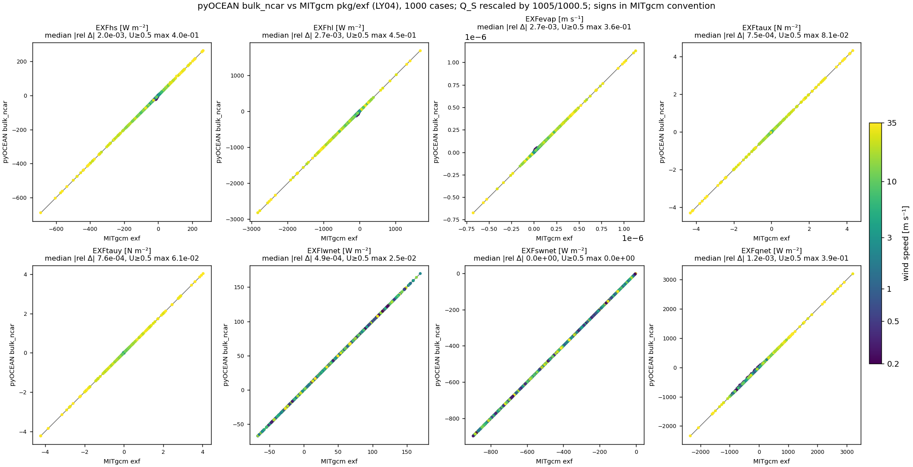

# Component checks: forcing, tides tools, ALE columns, solvers

Before a full model is compared with another, its building blocks are compared one by one with the reference
implementation: the bulk formulae with MITgcm and HYCOM, the tide prediction and atlas reader with OTPS/pyTMD,
the ALE column routines with MOM6's Fortran, the hybrid rule with HYCOM's hybgen. These checks reach
round-off where the algorithms are the same, so they isolate bugs from numerical choices. Read this page to
know which pyOCEAN routine is equivalent to which routine of another model, and how closely.

| Component | Reference | Agreement | Status |
|---|---|---|---|
| `bulk_ncar` (LY04/LY09) | MITgcm `pkg/exf`, 1000 cases | median 0.2–0.3 % for U ≥ 0.5 m/s; every larger difference explained | ✅ |
| `bulk_kara` (HYCOM flxflg = 6) | compiled HYCOM source, 616 cases | 1e-10 | ✅ |
| Tide prediction (nodal corrections, arguments) | OTPS via pyTMD | round-off | ✅ |
| TPXO10-atlas-v2 reader | pyTMD on the real atlas | 9e-8 m, 7e-5° | ✅ |
| SAL file sign and size | TPXO10 ocean tide | F ≈ −0.10 η (semidiurnal), corr. 0.95–0.99 | ✅ |
| JSL `tidal.rh` | HYCOM-tools product | 4e-8 median relative | ✅ |
| ALE remapping PCM/PLM/PPM_H4 | MOM6 `remapping_core_h` | ≤ 5e-12 on 120 columns | ✅ |
| ALE z\*, σ, P1M_H2 | MOM6 `coord_zlike`, `coord_sigma`, `regrid_interp` | ≤ 3e-14 m; P1M bit for bit | ✅ |
| HYCOM1 hybrid rule | HYCOM `hybgen` (MOM6 port) | different algorithms; ≤ 0.4 layers in the interior with OM4-style targets | ✅ (hybgen not ported) |
| Domain checker | manual inspection of raw GEBCO | finds the Guaymas pit by itself | ✅ |
| Free-surface solvers | direct solve | CG + lagged LU ≤ 1e-9 m; 1–3 iterations with W/D | ✅ |

## Bulk air–sea fluxes

### `bulk_ncar` against MITgcm `exf`

**Set-up** (`validation/mitgcm_exf/make_inputs.py`, `compare.py`): every grid point of a 40 × 25 MITgcm run is
an independent, time-constant air–sea case (1000 cases): wind speed log-spaced from 0.2 to 35 m/s along x;
ΔT = T_air(2 m) − SST from −8 to +6 K, relative humidity 40–100 %, SST 5–30 °C and wind direction from a seeded
generator, with rows forced to ΔT = 0, RH = 100 % and RH = 40 %. MITgcm `exf_bulkformulae.F` with
`ALLOW_BULK_LARGEYEAGER04` (and a variant with `ALLOW_DRAG_LARGEYEAGER09`) computes the fluxes at step 0;
pyOCEAN `bulk_ncar` (`forcing/bulk.py:236`) gets the identical inputs. Signs are mapped to MITgcm's (e.g.
`EXFqnet` positive upward).

**Result** (`docs/design/validation_suite.md` §4): **median relative difference 0.2–0.3 % for U ≥ 0.5 m/s**
in both variants. Every larger difference has a documented cause, found by a scratch NumPy port of
`exf_bulkformulae.F` and an attribution chain from exact MITgcm to exact pyOCEAN one change at a time
(`compare.py` sections [D]–[F]):

- the air heat capacity c_pa: 1005 (pyOCEAN) against 1000.5 J kg⁻¹ K⁻¹ (MITgcm); the figure rescales Q_S by
    1005/1000.5 to remove this constant difference;
- for U < 0.5 m/s MITgcm uses the unclipped wind speed;
- two fixed iterations do not converge with weak wind and stable stratification.

*pyOCEAN `bulk_ncar` against MITgcm `exf` for the 1000 cases (LY04, Q_S rescaled by 1005/1000.5), coloured by
wind speed. The panel titles give the median relative difference and the maximum for U ≥ 0.5 m/s.*

**Iterations.** A convergence tolerance was evaluated and rejected (`docs/design/era5_bulk_comparison.md` §7):
on 297 cases, 18 (6 %) have no fixed point (warm, dry air over the sea: $C_{hN}$ jumps between 18.0 and
32.7 × 10⁻³ √C_dN at ζ = 0, so the iteration alternates between branches at any wind speed, e.g. Q_S = 21 or
37 W m⁻² depending on the parity of n_iter at U = 20 m/s, ΔT = +1 K, RH 0.8); two fixed iterations are part of
the operational definition (CORE/OMIP, CESM, MITgcm). `bulk_ncar` keeps `n_iter = 2`; the weak-wind/stable
regime calls for COARE 3.0 (to implement).

Reproduce: `cd validation/mitgcm_exf && ./build_and_run.sh all && /opt/anaconda3/bin/python compare.py all`.

### `bulk_kara` against compiled HYCOM

`validation/hycom_kara/make_reference.sh` extracts **verbatim** at build time the HYCOM fragments
(`mod_momtum.F90` function `cd_coarep`; `thermf.F90` flxflg = 4/6 parameter block, `satvpr`/`qsatur6` and the
flxflg = 6 block), compiles them with a small driver that applies the flux lines of `thermf.F90` and
`mod_momtum.F90` with absolute wind (amoflg = 0), and writes `tests/data/hycom_kara6_reference.csv`.
`bulk_kara` (`forcing/bulk.py:560`) matches C_d, C_l, C_s, air density and the fluxes to **rtol 1e-10** on
**616 cases** (`tests/test_bulk_kara.py`, 17 tests; `docs/design/validation_suite.md` §4). This is HYCOM-IOA's
configuration (flxflg = 6, wndflg = 4). Status ✅.

## Tide tools

### Tide prediction against OTPS (pyTMD)

`validation/tides/make_reference.py` uses pyTMD (an independent reproduction of the OSU Tidal Prediction
Software, OTPS, used with TPXO; Egbert & Erofeeva 2002) as a test oracle — pyOCEAN does not depend on it — and
writes `tests/data/tide_otps_reference.npz`. `tests/test_tides.py` (12 tests) checks the HYCOM constituent
order and periods, the MJD epoch, nodal corrections f, u against OTPS and full predicted time series against
OTPS (`forcing/tides.py:84`, `nodal_corrections`; `:139`, `predict`). `CLAUDE.md`: "matches pyTMD to
round-off". Status ✅.

### TPXO10-atlas-v2 reader

`read_tpxo` (`forcing/sources/tpxo.py:93`) and `boundary_tides` (`forcing/tides.py:209`) were checked on the
**real** atlas (`~/pyOCEAN_refs/TPXO10_atlas_v2_nc`) against a pyTMD extraction at 5 Mexican Pacific points
including coastal Manzanillo and Acapulco, 8 constituents: max \|Δamp\| = **9e-8 m**, max \|Δphase\| = **7e-5°**
(`validation/tides/check_tpxo_real.py`, result of 2026-10-10). The real files use lowercase `uRe…vIm` and
land = 0, which the reader masks and excludes from the bilinear weights (`tests/test_tpxo.py`,
`TestCoastalInterpolation`). Status ✅.

Reproduce: `python validation/tides/tpxo_real_oracle.py` (in a venv with pyTMD), then
`python validation/tides/check_tpxo_real.py`.

### SAL file and JSL drag

The HYCOM-IOA SAL file and the regenerated `tidal.rh` are described on the
[tides page](tides-sealevel.md#sal-file-and-internal-tide-drag): F ≈ −0.10 η semidiurnal / −0.14 η diurnal
(correlation 0.95–0.99, `validation/tides/check_sal_real.py`) and tidal.rh equal to HYCOM-tools to 4e-8 median
relative (`validation/tides/make_tidal_rh.py`).

### HYCOM file readers

The native `.a/.b` reader, the archive (archv/archm → z) reader and the ESPC/GOFS z-level adapter are covered
by unit tests (`tests/test_hycom_ab.py`, `test_hycom_archive.py`, `test_hycom_z.py`). The archive reader is
validated only on synthetic files: no archv was available locally (`CLAUDE.md`, Phase 2 step 5).

## ALE column kit against MOM6 Fortran

**Set-up** (`validation/mom6_column/README.md`): MOM6 (commit 0e9a561) and FMS 2025.02.01 are built from
`~/pyOCEAN_refs` with the `.testing` Makefile; small Fortran drivers (`remap_driver.F90`,
`regrid_driver.F90`) link the original MOM6 objects and read test columns written by `columns.py` (seed 2026;
15 % vanished source layers; equal Σh in source and target; sizes 10→10, 25→40, 50→50, 4→7). The pytest
`tests/test_vertical_vs_mom6.py` skips when an executable is missing.

| Driver | MOM6 routine | pyOCEAN routine | Tolerance |
|---|---|---|---|
| `remap_driver` | `MOM_remapping::remapping_core_h` (no boundary extrapolation, no sub-cells, `answer_date = 99991231`, h_neglect 1e-30, h_neglect_edge 1e-10) | `remap.remap_column` (`core/vertical/remap.py:307`) | 1e-11 |
| `regrid_driver` | `coord_zlike::build_zstar_column`, `coord_sigma::build_sigma_column` (min thickness 1e-3), `regrid_interp::build_and_interpolate_grid` (`P1M_H2`) | `regrid.zstar_column`, `regrid.sigma_column` (`core/vertical/regrid.py:45`, `:64`), `regrid._p1m_h2_positions` | 1e-10 (z\*, σ), 1e-9 (P1M) |

**Remapping**, max \|u_pyOCEAN − u_MOM6\| for values of order 10:

| Scheme | 10→10 | 25→40 | 50→50 | 4→7 |
|---|---|---|---|---|
| PCM | 1.2e-14 | 9.6e-14 | 1.2e-12 | 1.6e-14 |
| PLM | 1.4e-13 | 6.0e-14 | 4.7e-12 | 1.1e-14 |
| PPM_H4 | 5.2e-14 | 1.6e-13 | 8.5e-13 | 5.3e-15 |

Degenerate end stencils (108 columns of 12 layers with vanished, 1e-10 m and 1 mm layers next to a thick
one): 1.3e-13 (PCM), 5.5e-14 (PLM), 9.1e-14 (PPM_H4). The first version solved the 4×4 H4 end-value system by
elimination and failed here (division by zero or errors up to 0.3); it now uses MOM6's closed form
`end_value_h4` (`regrid_edge_values.F90:636-749`) with its `min_frac` guards. **Design difference, not
compared:** pyOCEAN lowers the order by the number of *active* layers (1 → PCM, ≤ 3 → PLM), MOM6 by all layers
(`MOM_remapping.F90:453-460`); a z\* column with ≤ 3 active layers among vanished ones can differ by up to
~0.4 in values of order 10. A dry column keeps its values in pyOCEAN.

**Grid rules**, max \|Δz\| [m]:

| Case | max \|Δz\| |
|---|---|
| z\*, H = 201 / 164 / 40 / 11 m | 1.1e-14 / 2.8e-14 / 0 / 2.2e-16 |
| σ, H = 201 / 164 / 40 / 11 m | 1.7e-14 / 1.7e-14 / 0 / 2.0e-15 |
| P1M_H2, 6 profiles of 12 layers with 13 targets | 0 (bit for bit) |

Design differences: pyOCEAN's `sigma_column` uses min(h_min, D/N) like `build_zstar_column` (MOM6's σ uses
h_min as is, `coord_sigma.F90:76-81`), and pyOCEAN pins the top interface at η and separates interfaces from
the top and the bottom (`enforce_min_thickness`), while MOM6 inflates from the bottom only (the earlier
bottom-up order left a −2.3 cm top layer with stretched σ in 5 cm of water). The full `build_hycom1_column`
(z\* floor and maximum thickness) has not been compared yet. Status ✅.

Reproduce: `bash validation/mom6_column/build_reference.sh`, then `pytest tests/test_vertical_vs_mom6.py`.

## Hybrid rule against HYCOM hybgen

This comparison is quantitative but not to round-off: HYCOM1 (`regrid.hycom1_column`,
`core/vertical/regrid.py:204`) inverts a P1M density reconstruction for each target density with a z\* floor;
hybgen moves interfaces by entraining from neighbouring layers with cushion-function minimum thicknesses
(Bleck 2002). `build_reference.sh` extracts hybgen's private column routines from MOM6's
`MOM_hybgen_regrid.F90` into a driver; `compare_hybgen.py` runs both rules on 50 layers, a z\* start on the
BayIW `delR`, BayIW densities (linear EOS) or idealised profiles, minimum thickness 1 mm, hybgen with
nsigma = 0, isotop = 0, thkbot = 0, qhybrlx = 1; one regrid step and 10 cycles of regrid + PPM_H4 remap.

| Configuration | dz (hybgen dp0k = HYCOM1 floor) | Targets |
|---|---|---|
| A | `delR` (Σ = 599.9 m) | uniform over the BayIW range |
| B | `delR` in the top 15 layers (31 m), 1 mm below (HYCOM-like) | as A |
| C | as B | top 15 targets lighter than any water (OM4 style), the rest uniform |

Results after 10 cycles (mean \|Δz\| / max \|Δz\| in local layer thicknesses, `validation/mom6_column/hybgen_comparison.txt`):

| Column | A | B | C |
|---|---|---|---|
| Stratified 600 m | 62.8 m / 4.51 | 12.4 m / 0.86 | **1.5 m / 0.19** |
| Mixed 600 m | 169.5 m / 68.15 | 73.5 m / 3.44 | 28.8 m / 2.04 |
| Shallow 30 m | 9.5 m / 8.99 | 9.5 m / 8.99 | 9.5 m / 8.99 |
| 164 m, light bed | 51.6 m / 30.68 | 28.7 m / 32.65 | 3.5 m / 3.60 |
| BayIW boundary 600 m | 61.5 m / 25.28 | 30.2 m / 1.63 | **4.1 m / 0.38** |

Interpretation: **A** is not a fair comparison (with dp0k = delR every hybgen layer sits at its minimum thickness
and no interface can move, `MOM_hybgen_regrid.F90:775-790`). **B** differs by 13–25 local layers because of a
design choice: hybgen keeps the top `fixlay` layers as fixed z, while HYCOM1's floor only prevents interfaces
from rising, so with targets starting at the surface density the first interface drops to 39 m; hybgen also
leaves alternating empty layers (its known thin-thick-thin null mode, `MOM_hybgen_regrid.F90:806-813`).
**C** agrees in the interior (≤ 0.4 local layers). The mixed column has no unique answer; the shallow column
switches to σ in pyOCEAN by design. Since Plan B2, massless layers take the density of the layer with mass
above (hybgen's fill, `hybgen.F90:904-925`) and `keep_isopycnal` keeps interfaces already in their density
bracket. **Decision (2026-10-11): hybgen is not ported**; the hybrid rule needs OM4-style light top targets
(`target_densities(n_light)`, `core/vertical/regrid.py:292`) or maximum top thicknesses. Status ✅.

## Domain checker on raw GEBCO

`check_domain` (`diagnostics/domain_check.py:178`) reports rx0 and rx1, isolated water bodies, pits and
isolated cells, and gives CFL advice. Applied to the raw GEBCO bathymetry of the Upper Gulf of California, it
found by itself the **Guaymas pit** that had been found by hand (an isolated 6-cell water body, 189 m deep),
plus one more isolated body and 9 pits as artefact candidates (scorecard, `docs/design/vision_roadmap.md` §7).
Unit tests: `tests/test_domain_check.py` (7). Status ✅.

## Free-surface solver performance

| Solver and case | Result | Source |
|---|---|---|
| `ImplicitFreeSurface`, BayIW 560 × 352 (direct SuperLU, factorisation reused) | 0.14 s/step | `CLAUDE.md`, Phase 2 step 6 |
| PAC_MEX 650 × 500 tidal step | SuperLU = 65 % of the step; Numba on the rest ≤ 1.35× overall | `CLAUDE.md`, step 8 |
| Wetting–drying, Upper Gulf (96 273 cells) | CG + lagged-LU preconditioner: 1–3 iterations, 0.053 s/step (Jacobi: ~110 iterations, 0.079 s/step) | scorecard |
| ALE, BayIW: CG + lagged LU with exact conservation (MITgcm `exactConserv`) against the direct solve | ≤ 1e-9 m difference; volume and heat conserved to round-off; 8.48 → 7.75 s/step from this change | `validation/bayiw_baroclinic/README.md` |

Tests: `test_cg_solver_matches_direct`, `test_lagged_lu_preconditioner_matches_direct_with_few_iterations`
(`tests/test_wetting_drying.py:252`, `:267`). Status ✅.

## References

- Bleck, R. (2002). An oceanic general circulation model framed in hybrid isopycnic-Cartesian coordinates.
    *Ocean Modell.* 4, 55–88. **[verify]**
- Egbert, G. D., Erofeeva, S. Y. (2002). Efficient inverse modeling of barotropic ocean tides. *J. Atmos.
    Oceanic Technol.* 19, 183–204. **[verify]**
- Kara, A. B., Hurlburt, H. E., Wallcraft, A. J. (2005). Stability-dependent exchange coefficients for air–sea
    fluxes. *J. Atmos. Oceanic Technol.* 22. **[verify]**
- Large, W. G., Yeager, S. G. (2004). Diurnal to decadal global forcing for ocean and sea-ice models: the data
    sets and flux climatologies. NCAR Tech. Note TN-460+STR. **[verify]**
- Large, W. G., Yeager, S. G. (2009). The global climatology of an interannually varying air–sea flux data set.
    *Clim. Dyn.* 33. **[verify]**
- Fairall, C. W. et al. (2003). Bulk parameterization of air–sea fluxes: updates and verification for the
    COARE algorithm. *J. Climate* 16. **[verify]**
