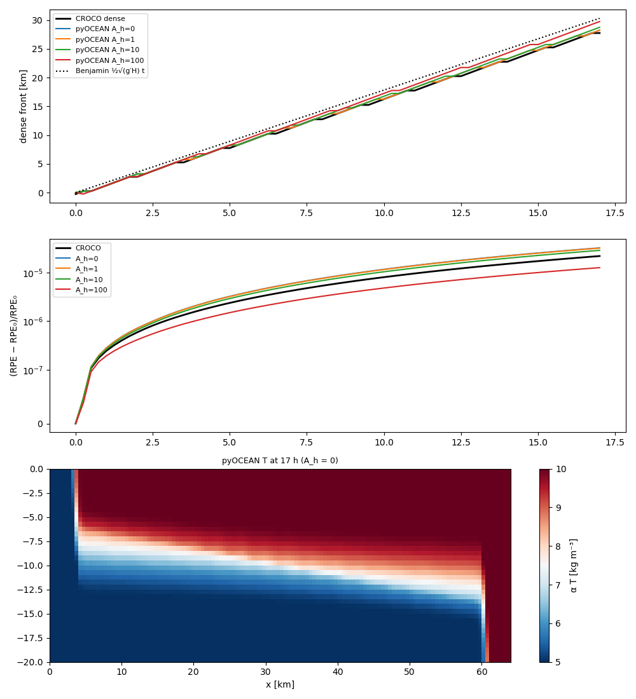
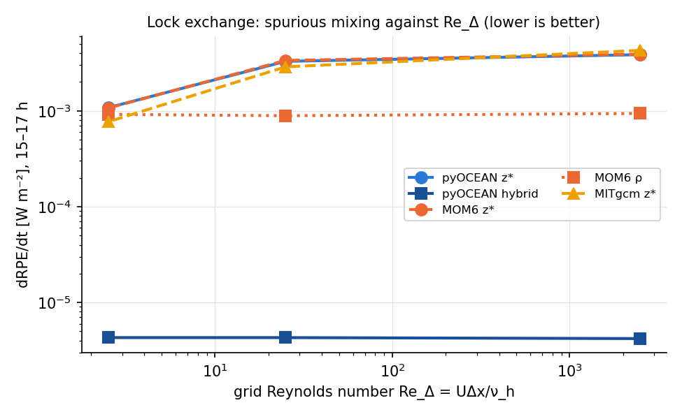
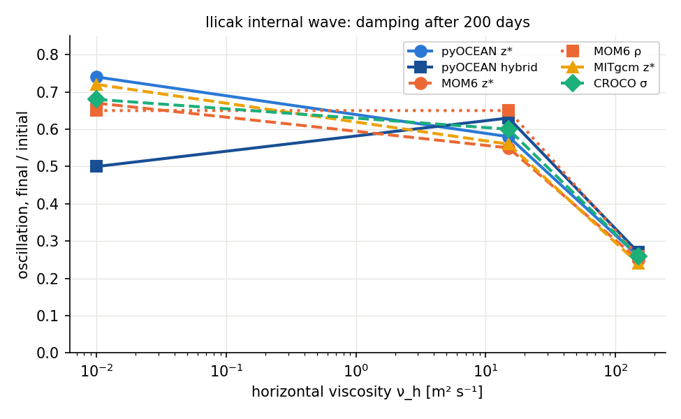
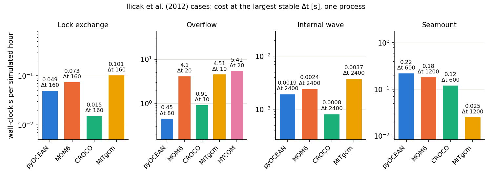

# Idealised benchmarks

These are the classic test problems of ocean-model development: gravity currents, overflows, internal
waves, flow over a seamount. They have no complete analytical solution, so pyOCEAN is compared with theory
where it exists (Benjamin's front speed, rest) and with MOM6, CROCO, MITgcm and HYCOM run on **the same case
definition**. Read this page to know how pyOCEAN's coordinates (z\*, σ, hybrid) compare in spurious mixing,
robustness and cost, and which numerical choices matter.

All runs use the stratified core `SigmaBaroclinic` (`core/dynamics/sigma_baroclinic.py:933`), Eulerian σ or
ALE (`vertical_coordinate="ale"`).

!!! note "Defaults changed during the benchmarks"
    Several READMEs were written before a default changed. The code today
    (`SigmaBaroclinic.__init__`, `core/dynamics/sigma_baroclinic.py:1005`) uses `ke_scheme="arakawa"`,
    `thickness_flux="ppm"`, `theta_bc=None` (= ½), and in ALE `thin_layer_coupling="mom6"` and
    `tracer_limiter="fct"` (with SSP-RK3 WENO5). Where a result below was obtained with another setting, it
    is said.

## Lock exchange against CROCO `GRAV_ADJ`

**Set-up** (`validation/lock_exchange/README.md`; Ilicak et al. 2012 as configured in CROCO `GRAV_ADJ`):
64 km × 20 m channel, 128 × 40 cells (Δx = 500 m), f = 0, closed, no bottom friction;
T = 5/α left and 10/α right (Δρ = 5 kg m⁻³, linear EOS ρ = ρ₀ − αT, α = 0.28); Δt = 10 s, 17 h; vertical
viscosity 1e-6 m² s⁻¹; no explicit tracer diffusion. pyOCEAN: Eulerian σ, flux-form momentum and tracers with
WENO5-Z, SSP-RK3 tracers, AB3 momentum. CROCO: WENO5-Z for tracers and momentum, no explicit viscosity.

**Truth.** Benjamin (1968) front $U = \tfrac12\sqrt{g'H}$ = 0.495 m/s; spurious mixing measured by the
reference potential energy, RPE (Winters et al. 1995; Ilicak et al. 2012), and the online variance decay
(Burchard & Rennau 2008), both in `diagnostics/mixing.py`.

**Results (17 h)** (`validation/lock_exchange/README.md`, `validation/lock_exchange/out/summary.txt`):

| Run | Front 2–8 h, dense / light [m/s] | ΔRPE/RPE₀ | T range |
|---|---|---|---|
| Benjamin | 0.495 | — | — |
| CROCO (WENO5-Z) | 0.463 / 0.486 | 2.19e-5 | 5–10 |
| **pyOCEAN flux form + WENO5-Z, A_h = 0** | **0.463 / 0.486** | 3.22e-5 | 5–10 |
| pyOCEAN WENO5-JS, A_h = 0 | 0.463 / 0.486 | 2.92e-5 | 5–10 |
| pyOCEAN A_h = 1 (Re_Δ = 248) | 0.463 / 0.486 | 3.18e-5 | 5–10 |
| pyOCEAN A_h = 10 (Re_Δ = 25) | 0.463 / 0.486 | 2.86e-5 | 5–10 |
| pyOCEAN A_h = 100 (Re_Δ = 2.5) | 0.509 / 0.509 | 1.26e-5 | 5–10 |
| pyOCEAN, advective upwind3 momentum (earlier) | 0.42 | — | — |
| pyOCEAN, UP3 tracers (earlier) | — | 9.2e-6 (includes "unmixing" by overshoots) | 1.95–13.2 |

Front positions agree with CROCO within one cell (3.25 / 6.25 / 9.75 / 13.25 km at 2 / 4 / 6 / 8 h against
2.75 / 6.25 / 9.75 / 12.75 km).



*Top: dense front position against CROCO and Benjamin. Middle: normalised RPE gain; pyOCEAN at A_h = 0–10 lies
1.3–1.5× above CROCO, A_h = 100 below. Bottom: pyOCEAN T at 17 h (A_h = 0). From
`validation/lock_exchange/out/lock_exchange.png`.*

**What the case changed in pyOCEAN.** The RPE and variance-decay diagnostics (checked to sum exactly to the
global variance loss); flux-form tracers whose layer transports add up exactly to the free-surface transport;
WENO5 tracers (UP3 overshot by ~50 % of the range at the nose, creating new water masses and *lowering* the
RPE, the effect described by Ilicak et al. 2012 §3.5); flux-form momentum advection (the advective form gave a
front 16 % too slow).

**Open: pyOCEAN mixes 1.3–1.5× more than CROCO** (status 🔶). Ruled out, with almost the same RPE each time:
CROCO's vertical stretching (θ_s = 0 gives 2.19e-5 too), θ = 0.5/0.6/1 and Δt = 5/10 s, the WENO variant,
the boundary treatment, and a CROCO-style predictor–corrector for tracers (`tracer_time="pc"`, 3.21e-5). What
differs: w rms is 12 % higher (4.6e-4 against 4.1e-4 m/s), w is rougher at grid scale (1.42 against 1.32),
the interface is thicker at 17 h (4.5–5 against 3.5–4 m) and 27 % against 23 % of the water is mixed. The
candidates are on the momentum side: AB3 against CROCO's LF-AM3, the θ-implicit free surface against
CROCO's filtered split-explicit mode, and ω at u-faces as a cell average. This matches Ilicak et al. (2012,
§3.4): grid-scale velocity noise enhances numerical mixing.

Reproduce:

```bash
python validation/lock_exchange/run_lock_exchange.py \
    --croco ~/pyOCEAN_refs/croco_runs/grav_adj/gravadj_his.nc --ah 0 1 10 100
```

## The four-model benchmark (Ilicak et al. 2012 and the seamount)

`validation/ilicak_benchmark/` runs four cheap cases, defined once in `cases.py`, in every model, and
measures them with the same code (`metrics.py`, `series.py`). It answers two questions: does pyOCEAN mix as
much as other models in the same coordinate, and how much does the hybrid coordinate gain?

### Case definitions

| Case | Definition (`validation/ilicak_benchmark/cases.py`) | Grid | Δt of the results | Length | ν_h [m² s⁻¹] |
|---|---|---|---|---|---|
| Lock exchange | Ilicak §3.1; 64 km × 20 m; T = 5 °C for x < 32 km, 30 °C elsewhere (Petersen et al. 2015 and MOM6; Ilicak's 35 °C is inconsistent with Δρ = 5 at α = 0.2) | 128 × 20 (Δx 500 m, Δz 1 m) | 10 s | 17 h | 0.1, 10, 100 |
| Overflow | Ilicak §4 with Petersen's shelf: $H = d_1 + \tfrac12(d_2-d_1)(1+\tanh((x-x_0)/r))$, d₁ = 500 m, d₂ = 2000 m, x₀ = 40 km, r = 7 km; T = 10 °C for x < 20 km, 20 °C elsewhere | 200 × 100 (Δx 1 km, Δz 20 m) | 10 s | 40 h | 1, 100, 1000 |
| Internal wave | Petersen eq. 26–27: linear T from 10.1 °C (bed, 500 m) to 20.1 °C, a mode-1 bump of amplitude A = 2 °C and half-width 50 km at x₀ = 125 km | 50 × 20 (Δx 5 km, Δz 25 m) | 300 s | 200 days | 0.01, 15, 150 |
| Seamount | Beckmann & Haidvogel (1993), as `validation/seamount` | 64 × 48 × 20 (Δx 6 km) | 600 s | 10 days | 0 |

Common physics: linear EOS ρ = 1000 − 0.2 T, g = 9.81, no explicit tracer diffusion, ν_v = 1e-4, no bottom
friction, free slip, closed walls.

| Model | Coordinates | Schemes |
|---|---|---|
| pyOCEAN | z\*, σ, hybrid | vector-invariant momentum with Arakawa KE, WENO5-Z, PPM_H4 remap, PPM continuity, finite-volume PGF, θ_bc = ½; in ALE the outflow limiter, thin-layer viscous coupling and Zalesak FCT around WENO5 |
| MOM6 (`repro -O2`, 1 process) | z\*, ρ (`layer_ref` with the hybrid's targets); σ in the seamount | PPM:H3, KE_ARAKAWA, PPM_H4 |
| CROCO 2.1.3 (serial) | uniform σ (`NEW_S_COORD`, hc = 1e16) | REGIONAL defaults: UV_HADV_UP3, UV_VADV_SPLINES, TS_HADV_RSUP3, TS_VADV_SPLINES |
| MITgcm (serial) | z\* with partial cells (hFacMin 0.1) | OS7MP tracers, flux-form momentum |
| HYCOM 2.3 (cost only, overflow) | 100 hybgen layers, dp0k = 20 m (almost all z) | own EOS (σ₀, 7 terms), no vertical mixing |

Configuration differences, all class (c): CROCO's RSUP3 carries an explicit biharmonic diffusion
$\lvert u\rvert\Delta x^3/12$ with rotated mixing, and `RESET_RHO0` is forced; MITgcm uses flux-form momentum and
partial cells; pyOCEAN's seamount uses `rho_ref="auto"`; MOM6, CROCO and MITgcm run on one process and
pyOCEAN on 5 threads (also measured on 1).

### Metrics (`validation/ilicak_benchmark/metrics.py`)

- **RPE** (Winters et al. 1995; Ilicak eq. 1–2) with `diagnostics.mixing.reference_potential_energy`
    (`diagnostics/mixing.py:52`) on each cell's true volume and the exact bed hypsometry of each model.
- **dRPE/dt** per unit area: mean of 15–17 h (lock), 13–37 h (overflow), days 10–100 (internal wave).
- **T range** on cells thicker than 1 mm, and **new extrema** (`t_excess`): the largest excursion outside the
    initial range on cells ≥ 1 m, and the volume fraction outside by more than 0.01 °C.
- **Fronts** (lock): where the dense or light column exceeds 1 m (nose) and 5 m (body), fitted between 2 and
    8 h, divided by U = 0.496 m/s.
- **Overflow**: centroid of water colder than 15 °C, and centroid of the heat deficit $(20-T)^+$.
- **Internal-wave damping** (`oscillation_ratio`): standard deviation of the height of the 15.1 °C isotherm at
    x₀ over the last 20 days divided by that of the first 20 days.
- **max\|u\|** on faces ≥ 1 cm.
- Grid Reynolds number $Re_\Delta = U\Delta x/\nu_h$: lock 2480, 25, 2.5; overflow 1570, 16, 1.6; internal
    wave 1.9e5, 120, 12.

### Lock exchange (17 h)

| ν_h | Model | ΔRPE/RPE₀ | dRPE/dt [W m⁻²] | T range | Fronts / U (dense nose, light nose, dense body, light body) |
|---|---|---|---|---|---|
| 0.1 | pyOCEAN z\* (= σ) | 6.67e-5 | 3.86e-3 | 5–30 | 0.88, 0.87, 0.88, 0.86 |
| 0.1 | pyOCEAN hybrid | 6.2e-8 | 4.2e-6 | 5–30 | 0.95, 0.96, 0.94, 0.96 |
| 0.1 | MOM6 z\* | 6.75e-5 | 3.91e-3 | 5–30 | 0.87, 0.87, 0.88, 0.86 |
| 0.1 | MOM6 ρ | 1.46e-5 | 9.4e-4 | 5–30 | 0.85, 0.96, 0.68, 0.94 |
| 0.1 | CROCO σ | 1.91e-5 | 2.13e-3 | **−9.3–39.1** | 0.95, 0.96, 0.96, 0.95 |
| 0.1 | MITgcm z\* | 6.89e-5 | 4.28e-3 | 4.93–30.1 | 0.92, 0.91, 0.91, 0.90 |
| 10 | pyOCEAN z\* (= σ) | 5.73e-5 | 3.29e-3 | 5–30 | 0.89, 0.89, 0.89, 0.89 |
| 10 | pyOCEAN hybrid | 6.8e-8 | 4.3e-6 | 5–30 | 1.01, 0.97, 1.00, 0.98 |
| 10 | MOM6 z\* | 5.81e-5 | 3.36e-3 | 5–30 | 0.88, 0.89, 0.89, 0.89 |
| 10 | MOM6 ρ | 1.57e-5 | 8.9e-4 | 5–30 | 0.96, 0.88, 0.90, 0.71 |
| 10 | CROCO σ | 1.71e-5 | 1.71e-3 | **−8.8–38.9** | 0.96, 0.96, 0.96, 0.96 |
| 10 | MITgcm z\* | 5.14e-5 | 2.88e-3 | 4.99–30.0 | 0.93, 0.93, 0.93, 0.93 |
| 100 | pyOCEAN z\* (= σ) | 1.90e-5 | 1.08e-3 | 5–30 | 0.95, 0.95, 0.94, 0.96 |
| 100 | pyOCEAN hybrid | 7.5e-8 | 4.3e-6 | 5–30 | 1.04, 1.06, 1.03, 1.03 |
| 100 | MOM6 z\* | 1.87e-5 | 1.07e-3 | 5–30 | 0.95, 0.95, 0.95, 0.96 |
| 100 | MOM6 ρ | 1.41e-5 | 9.2e-4 | 5–30 | 0.96, 0.84, 0.44, 0.53 |
| 100 | CROCO σ | 4.0e-6 | 4.8e-4 | **−7.3–37.0** | 0.99, 0.99, 0.98, 0.98 |
| 100 | MITgcm z\* | 1.37e-5 | 7.7e-4 | 4.99–30.0 | 0.98, 0.99, 0.99, 0.99 |



*dRPE/dt against the grid Reynolds number (from the table above). pyOCEAN z\* lies on MOM6 z\*; the hybrid
mixes about three orders of magnitude less. CROCO is not drawn because its schemes leave the initial T
range.*

### Overflow (40 h)

| ν_h | Model | ΔRPE/RPE₀ | dRPE/dt [W m⁻²] | T range | Cold centroid: x [km], depth [m] |
|---|---|---|---|---|---|
| 1 | pyOCEAN z\* | 3.48e-5 | 5.02 | 10–20 | 118, 1290 |
| 1 | pyOCEAN σ | 3.44e-5 | 4.64 | 10–20 | 135, 1180 |
| 1 | pyOCEAN hybrid | stops at 20–23 h in 4 of 5 trajectories (vanished layers at the east wall) | | | |
| 1 | MOM6 z\* | 3.14e-5 | 2.12 | 10–20 | 83, 980 |
| 1 | MOM6 ρ | stops: velocity truncated too often (~16 h) | | | |
| 1 | CROCO σ | 3.0e-6 | 0.94 | **3.2–25.8** | 146, 1600 |
| 1 | MITgcm z\* | stops: `CALC_R_STAR`, rStarFac too small (~11 h, u up to 13 m/s) | | | |
| 100 | pyOCEAN z\* | 1.44e-5 | 1.86 | 10–20 | 154, 1450 |
| 100 | pyOCEAN σ | 1.48e-5 | 1.66 | 10–20 | 155, 1400 |
| 100 | pyOCEAN hybrid | 1.0e-10 | 1.3e-5 | 10–20 | 117, 1920 |
| 100 | MOM6 z\* | 3.24e-5 | 4.36 | 10–20 | 137, 944 |
| 100 | MOM6 ρ | stops: velocity truncated too often | | | |
| 100 | CROCO σ | 8.1e-7 | 0.59 | **1.3–25.4** | 148, 1670 |
| 100 | MITgcm z\* | 1.34e-5 | 1.44 | 9.59–20.1 | 124, 1370 |
| 1000 | pyOCEAN z\* | 5.3e-6 | 0.61 | 10–20 | 150, 1760 |
| 1000 | pyOCEAN σ | 5.8e-6 | 0.68 | 10–20 | 153, 1740 |
| 1000 | pyOCEAN hybrid | 6.7e-11 | 8.7e-6 | 10–20 (max\|u\| 17 m/s) | 112, 1940 |
| 1000 | MOM6 z\* | 1.34e-5 | 1.66 | 10–20 | 154, 1330 |
| 1000 | MOM6 ρ | 1.2e-6 | 0.19 | 10–20 | 101, 1770 |
| 1000 | CROCO σ | −5.3e-6 | −0.25 | **2.9–25.7** | 150, 1800 |
| 1000 | MITgcm z\* | 4.8e-6 | 0.52 | 9.63–20.1 | 148, 1720 |

In the first 3 h the three z\* models agree almost exactly (dense-water thickness, η, max\|u\| ~2.3 m/s).
Down the slope every model reaches 3–10 m/s; free fall $\sqrt{2g' \cdot 1500\,\mathrm{m}}$ gives ~8 m/s.

### Internal wave (200 days)

| ν_h | Model | ΔRPE/RPE₀ | dRPE/dt [W m⁻²] (days 10–100) | T range | Oscillation final / initial |
|---|---|---|---|---|---|
| 0.01 | pyOCEAN z\* (= σ) | 3.25e-6 | 3.14e-4 | 10.10–19.84 | 0.74 |
| 0.01 | pyOCEAN hybrid | 1.06e-7 | 3.1e-6 | 10.10–19.84 | **0.50** |
| 0.01 | MOM6 z\* | 3.70e-6 | 3.81e-4 | 10.10–19.84 | 0.67 |
| 0.01 | MOM6 ρ | 6.1e-7 | 4.0e-5 | 10.10–19.84 | 0.65 |
| 0.01 | CROCO σ | −8.5e-8 | 7.2e-6 | **10.01–19.96** | 0.68 |
| 0.01 | MITgcm z\* | 2.95e-6 | 3.41e-4 | 10.10–19.84 | 0.72 |
| 15 | pyOCEAN z\* (= σ) | 1.71e-6 | 1.85e-4 | 10.10–19.84 | 0.58 |
| 15 | pyOCEAN hybrid | 9.0e-8 | 2.4e-6 | 10.10–19.84 | 0.63 |
| 15 | MOM6 z\* | 2.21e-6 | 2.57e-4 | 10.10–19.84 | 0.55 |
| 15 | MOM6 ρ | 1.4e-7 | 1.1e-5 | 10.10–19.84 | 0.65 |
| 15 | CROCO σ | −7.4e-8 | 6.3e-6 | **10.01–19.96** | 0.60 |
| 15 | MITgcm z\* | 1.42e-6 | 1.76e-4 | 10.10–19.84 | 0.56 |
| 150 | pyOCEAN z\* (= σ) | 6.5e-7 | 6.2e-5 | 10.10–19.84 | 0.26 |
| 150 | pyOCEAN hybrid | 8.5e-8 | 1.9e-6 | 10.10–19.84 | 0.27 |
| 150 | MOM6 z\* | 7.0e-7 | 7.0e-5 | 10.10–19.84 | 0.25 |
| 150 | MOM6 ρ | 3.2e-8 | 2.8e-6 | 10.10–19.84 | 0.26 |
| 150 | CROCO σ | −5.6e-8 | 3.4e-5 | **10.01–19.96** | 0.26 |
| 150 | MITgcm z\* | 8.6e-7 | 8.4e-5 | 10.10–19.84 | 0.24 |



*Oscillation ratio after 200 days against ν_h (table above). After the θ_bc fix pyOCEAN z\* lies in the band of
the other models; the hybrid at ν = 0.01 is the remaining outlier.*

### Seamount (10 days, no viscosity)

| Model | max\|u\| at 1 / 2 / 10 days [cm/s] |
|---|---|
| pyOCEAN σ (finite-volume PGF + ρ_ref) | 0.17 / 0.19 / 0.21 |
| pyOCEAN z\* | 0.02 / 0.02 / 0.08 |
| MOM6 σ | 79 / 83 / 154, growing |
| MOM6 z\* | stops: velocity truncated from day 1, also at Δt 300 s and with `BOUND_CORIOLIS` + `CORIOLIS_EN_DIS` + `MIN_THICKNESS` 0.1 |
| CROCO σ | 3.6 / 6.5 / 36, growing |
| MITgcm z\* | 0.00 (exact: flat isopycnals on z-levels) |

Beckmann & Haidvogel (1993) obtained ~1 cm/s at 10 days. pyOCEAN's advantage in σ comes from the reference
profile option, which neither CROCO nor MOM6 uses here (class (c)). MOM6 z\* truncating from rest is
unexplained and is treated as a configuration problem; the MOM6 σ number is therefore not taken as its
pressure-gradient error.

### Cost

Wall-clock seconds per simulated hour in the main loop, without initialisation (pyOCEAN after the first 5
steps, which include Numba compilation; MOM6 "Main loop"; MITgcm `MAIN_DO_LOOP`; CROCO `/usr/bin/time` of
the whole run, ±50 % below ~0.05 s/h). **Main comparison: at each model's largest stable Δt, one process.**
A rung of the Δt ladder (×1, 2, 4, 8, 16) is stable when T and u stay finite and max\|u\| stays below twice
that of the results run; "≥" means the top of the ladder was reached. Repeated on 2026-10-14 on an idle
machine (an earlier ladder was contaminated by three orphaned MOM6 MPI processes).

| Case | pyOCEAN z\* | MOM6 z\* | CROCO σ | MITgcm z\* | HYCOM (cost only) |
|---|---|---|---|---|---|
| Lock exchange: Δt max [s] / s per hour | ≥ 160 / 0.049 | ≥ 160 / 0.073 | ≥ 160 / 0.015 | ≥ 160 / 0.101 | — |
| Overflow | **80 / 0.45** | 20 / 4.10 | 10 / 0.91 | 10 / 4.51 | 20 / 5.41 (ν = 1000) |
| Internal wave | 2400 / 0.0019 | 2400 / 0.0024 | 2400 / 0.0008 | 2400 / 0.0037 | — |
| Seamount (MOM6: σ) | 600 / 0.22 | 1200 / 0.18 | 600 / 0.12 | 1200 / 0.025 | — |

At the results Δt (10, 10, 300 and 600 s), pyOCEAN z\* with 5 threads / 1 thread: lock 0.81 / 0.71, overflow
2.47 / 3.13, internal wave 0.021 / 0.013, seamount 0.11 / 0.20 s/h; MOM6 1.16 / 10.3 / 0.017 / 0.39 (σ);
CROCO 0.13 / 1.05 / 0.0024 / 0.13; MITgcm 0.75 / 5.06 / 0.013 / 0.051; HYCOM overflow 10.9 (ν = 1000). The
pyOCEAN hybrid in the overflow costs 1.01 s/h at Δt max 40 s (σ 0.90 at 40 s).



*Cost per simulated hour at the largest stable Δt, one process. pyOCEAN is cheaper than MOM6, MITgcm and
HYCOM in 2-D; CROCO is 1.9–3.3× cheaper except in the overflow, and MITgcm 8.8× cheaper on the seamount.*

**HYCOM** (`validation/ilicak_benchmark/hycom/README.md`): 202 × 5 cells (200 × 3 ocean), 100 hybrid layers
with dp0k = 20 m (almost all z), no vertical mixing or viscosity, no interface diffusion or bottom friction.
At ν = 100 it stops with negative layer thickness (`neg. dp`) on the slope at 6.2–6.8 h, also with Δt = 5 s
(cause undiagnosed), so the ladder uses ν = 1000. Δt 20 s is a marginal pass (one `neg. dp` of −8 cm at
10.2 h, corrected by HYCOM); without any, the largest Δt is 10 s (10.9 s/h). 5 processes: 1.43 s/h. Momentum
takes more than half of the 1-process time (34.3 of 64.9 s per 12 h). Two unallocated arrays crash any HYCOM
2.3 run without tides (`mod_hycom.F90:1656`, `:1674`; class (d), guarded only in the build copy).

### Reading and classification (`validation/ilicak_benchmark/README.md`)

1. **pyOCEAN z\* = MOM6 z\* in the lock exchange** at all three viscosities: RPE within 1.6 %, equal fronts.
    MITgcm is within ±30 % in RPE. None of the three creates appreciable extrema (≤ 2e-4 °C in pyOCEAN,
    ≤ 0.09 °C in MITgcm).
2. **Front speed against Benjamin.** pyOCEAN z\* is within ±10 % at ν = 10 and 100 (0.89–0.96 U); at ν = 0.1
    0.86–0.88 U, as MOM6 z\*. Ilicak (Fig. 3) also sees slow fronts in hydrostatic models at this resolution.
    (c)
3. **Re_Δ.** The z\* models reduce dRPE/dt by 3.6–5.6× from Re_Δ 2480 to 2.5 (pyOCEAN 3.6, MOM6 3.7, MITgcm
    5.6). (c)
4. **pyOCEAN against CROCO at high Re_Δ cannot be answered with this CROCO:** its REGIONAL schemes create new
    T extrema (up to 14 °C out of range in 11–18 % of the volume in the lock exchange, 6.8–8.7 °C in 25–40 % in
    the overflow), and its RPE falls (negative in the internal wave and the ν = 1000 overflow), so it is not
    comparable (Ilicak Fig. 7). A WENO5 CROCO run is needed. (c), pending.
5. **The hybrid mixes much less than z\*: confirmed.** Lock exchange 250–1200× less than z\* and ~200× less
    than MOM6 ρ, fronts 0.94–1.06 U (MOM6 ρ light body 0.44–0.94 U); at ν = 0.1 the thin-layer coupling slows
    the fronts by 2–5 % (0.96–0.99 U without it). Internal wave: 7.6–31× less than z\*.
6. **T out of range in the hybrid: (a), fixed 2026-10-14.** Before: 3.2–31 °C in ~1 mm layers (lock) and
    33.1 °C (overflow, ν = 1000). Now the initial range exactly in all four cases (excursion ≤ 1.5e-8 °C), by
    the **Zalesak (1979) FCT** around the three SSP-RK3 WENO5 stages (`tracer_limiter="fct"`), with bounds over
    x, y and k ± 1 (bounds along the layer only clipped legitimate maxima: seamount σ 0.22 → 0.71 cm/s, hybrid
    internal wave 0.50 → 0.31). HYCOM does the same (`mod_tsadvc.F90:877-905`).
7. **Hybrid robustness in the overflow: (a), fixed 2026-10-14** with the **outflow limiter**
    (`limit_outflow`: outgoing fluxes of a layer cut to its content, the cut flux moved to the other layers of
    the same face so that Σ_k Q_k is unchanged) and the **thin-layer viscous coupling**
    (`thin_layer_coupling="mom6"`: MOM6's upwind-biased face thickness in the vertical viscosity,
    `MOM_vert_friction.F90:1519-1533`; Hallberg & Rhines 1996). On faces with one side under 1 cm, max\|u\|
    fell from 24 to 2 m/s at ν = 100. A depth-mean correction δ keeps the coupled viscous step from moving the
    depth mean. **Remaining:** thin faces up to 1.9× the speed of thick ones at ν = 1000 (17.0 against
    10.9 m/s; before the plan 47 m/s), 2.0× at ν = 100; at ν = 1 the run stops at 20–23 h in 4 of 5
    trajectories (T perturbed by 1e-10), always at the east-wall face, where ~98 layers of ~1 mm move as a
    slab accelerated by a ~600 m interface jump. HYCOM's thin-layer blending (`mod_momtum.F90:3055-3065`) was
    tried and left off (`thin_layer_cutoff`): it slows the lock-exchange nose to 0.70 U. The dense water
    descends almost unmixed (ΔRPE/RPE₀ ≤ 1e-10) to 1920–1940 m; its centroid stays behind in x (112–117 km)
    because unmixed dense water piles in a thick layer at the foot of the slope (c).
8. **Overflow in z\*:** pyOCEAN ≈ MITgcm (dRPE/dt 1.86 against 1.44 at ν = 100; 0.61 against 0.52 and centroid
    150 km / 1760 m against 148 km / 1720 m at ν = 1000). MOM6 z\* mixes 2.3–2.7× more at ν = 100 and 1000
    ((c)/(d), unexplained). **New T extrema with WENO5-Z: (a), fixed 2026-10-14** by the FCT (before up to
    5.26 °C below the 10 °C minimum; 2.9–4.7 °C on cells ≥ 1 m in 0.1–0.25 % of the volume); dRPE/dt changed
    +5 % at ν = 1000.
9. **Internal-wave damping: (a), fixed 2026-10-14.** pyOCEAN damped the oscillation more than every model at
    low viscosity (0.45 at ν = 0.01, 0.39 at ν = 15). Cause: the layer transport velocity
    $u^\theta = \theta u^{n+1} + (1-\theta)u^n$ applied the free-surface θ = 0.6 to the baroclinic part too,
    which with AB3 momentum centred at n + ½ damps internal waves at ~$(\theta-\tfrac12)\omega^2\Delta t$.
    Diagnosed one variant at a time (only θ and Δt mattered). Fix: `theta_bc` (½) weights the baroclinic
    part u′; the depth mean keeps θ so that layer fluxes still add up to the free-surface flux. Test:
    `test_internal_wave_is_not_damped_by_the_free_surface_theta` (`tests/test_sigma_ale.py:1218`). The hybrid at
    ν = 0.01 still damps (0.50 against 0.65–0.72): (a), pending; a thin layer drains after day 120. With the
    wave undamped, pyOCEAN z\* mixes like MITgcm and slightly less than MOM6 z\*.
10. **Seamount:** see above.
11. **Cost:** what pyOCEAN loses is fixed cost per step (performance, no missing physics). The new hybrid
    pieces cost −1 to +5.5 % per step on BayIW.
12. **RPE diagnostic: (a).** `reference_potential_energy` interpolates the moment linearly in volume; with a
    coarse hypsometry it is wrong (1.5× the exact value with two points on a flat bed). Avoided here by
    refining the hypsometry to H/50000; an exact piecewise integral is pending.

**What pyOCEAN should improve** (open items): (4a) hybrid internal wave at ν = 0.01; (4b) thin-layer speed in
the overflow, candidate: distribute δ and the barotropic correction ∝ `visc_rem` as MOM6 and Hallberg &
Adcroft (2009); (4c) coupling only near the bed (MOM6 default, `MOM_vert_friction.F90:1446-1535`) to recover
the 2–5 % front speed at ν = 0.1; (4d) the vanished-layer slab at ν = 1 (needs its own design: PGF in
vanished layers); (5) exact RPE integral; (6) fixed cost per step and thread count by grid size; why the
seamount Δt max is half that of MITgcm and MOM6 σ. For Esteban, outside pyOCEAN: a WENO5 CROCO run, the MOM6
z\* seamount configuration, and reporting the HYCOM 2.3 allocation bug.

Reproduce:

```bash
for c in lock overflow iw seamount; do
  validation/ilicak_benchmark/run_croco.sh build $c; validation/ilicak_benchmark/run_mitgcm.sh build $c
done
python validation/ilicak_benchmark/campaign.py results [case]   # 69 runs, one at a time
python validation/ilicak_benchmark/campaign.py cost [case]      # Δt ladder ×1, 2, 4, 8, 16
python validation/ilicak_benchmark/compare.py [case]           # tables
```

Outputs go to `/Volumes/ESTEBAN_MIT/pyOCEAN_runs/ilicak_benchmark/<case>/<model>_<coord>_nu<ν>/series.npz`.
A complete run takes from 2 s (CROCO, lock) to 7 min (MOM6, overflow).

## Hybrid (isopycnal) lock exchange against MOM6

**Set-up** (`validation/mom6_lock_exchange/README.md`; MOM6-examples `ocean_only/lock_exchange`):
64 km × 20 m, Δx = 500 m, Δρ = 5 kg m⁻³ with the gate at 32 km, f = 0, 6 h, U = 0.495 m/s. MOM6 uses 21
layers (19 vanished in between), KV = 1e-4, KH = 0.01 m² s⁻¹, in pure layer mode and in continuous
isopycnal mode (RHO, P1M_H4 + PPM_H4). Fronts measured between 2 and 6 h where the dense (light) column
exceeds 1 m (nose) and 5 m (body).

| Case | Front 1 m (dense, light) | Body 5 m (dense, light) | RPE gain in 6 h [J per 500 m width] | max\|u\| [m/s] |
|---|---|---|---|---|
| MOM6, layers (21) | 1.05, 1.05 U | 1.05, 1.05 U | 0.04 | 0.56 |
| MOM6, RHO (21) | 1.05, 0.98 U | 0.98, 0.98 U | 4.5e7 | 0.56 |
| pyOCEAN hybrid, flux-form momentum, `keep_isopycnal` (10) — first version | 1.96, 1.61 U | 0.84, 0.14 U | 9.0e6 | 2.06 |
| pyOCEAN hybrid, vector-invariant, `keep_isopycnal` (10) | 1.12, 1.05 U | 1.05, 1.05 U | 3.0e6 | 0.94 |
| **pyOCEAN hybrid, `thickness_flux='ppm'`, Godunov KE (21)** | **1.05, 0.98 U** | **1.05, 0.98 U** | **8.8e5** | **0.74** |
| pyOCEAN hybrid, P1M in all layers (10) | 0.77, 1.05 U | 0.84, 1.05 U | 8.4e7 | 0.56 |
| pyOCEAN ALE-σ (10) | 0.91, 0.91 U | 0.91, 0.84 U | 2.1e8 | 0.67 |

The first version had a supercritical dense film of 0.4–2 m moving at 1.1–1.8 m/s; the momentum budget saved
by `run_mom6.sh budget` showed that **flux-form momentum advection with thinning layers** pushed the nose
(+3 to +14 × 10⁻⁴ m s⁻²) while the pressure gradient was reasonable — the problem described by Bleck & Smith
(1990, app. B) and Higdon (2005), and the reason MOM6 and HYCOM use the vector-invariant form. pyOCEAN's ALE
mode now uses MOM6's form by default (`core/dynamics/vector_invariant.py`). With 21 layers and the PPM
thickness flux pyOCEAN reproduces MOM6 (max\|u\| criterion ≤ 0.84 m/s) and mixes ~50× less than MOM6 RHO.
Status ✅ (scorecard).

Reproduce:

```bash
validation/mom6_lock_exchange/run_mom6.sh layer
validation/mom6_lock_exchange/run_mom6.sh rho
NUMBA_NUM_THREADS=5 python validation/mom6_lock_exchange/compare.py
```

## Kinetic-energy scheme study (Arakawa or Godunov)

`validation/mom6_ke_schemes/README.md` asks which KE discretisation the vector-invariant momentum should use
by default: `KE_ARAKAWA` (energy conserving, MOM6 production) or `KE_GUDONOV` (upwind, MOM6
`lock_exchange`; MOM6 spells it this way and so does the pyOCEAN option `ke_scheme="gudonov"`).

**MOM6 with both schemes** (energy from `ocean.stats.nc`):

| Case | Final / initial energy (Arakawa, Godunov) | Final KE, Godunov / Arakawa |
|---|---|---|
| `lock_exchange` (layers) | 0.968, 0.911 | 0.88 |
| `sloshing/rho` (5 days) | 0.998, 0.971 | 0.97 |
| `adjustment2d/rho` | 0.955, 0.939 | 0.75 |
| `flow_downslope` layer / ρ / z / σ | 0.970 / 0.942 / – / 1.050; 0.968 / 0.948 / – / 1.047 | 0.92 / 1.42 / 0.93 / 0.93 |

In `sloshing` KE falls 0.2 % per period with Arakawa and 1.1 % with Godunov; the period is the same.

**pyOCEAN**: in the mode-1 internal seiche (L = 60 km, H = 200 m, N = 0.02 s⁻¹, 20 layers, theory 26.18 h)
the period is 26.18 h with both, and KE is kept to 0.9971 (Arakawa) / 0.9951 (Godunov) per half period in
ALE-σ and z\*. In the lock exchange (6 h, rows of the table in the README) Godunov gives fronts closer to
Benjamin, lower max\|u\| and in ALE-σ three times less spurious mixing (2e8 against 6e8 J); 21 layers + PPM +
Godunov reproduces MOM6 (see above); with 10 layers PPM gives a dense body of 1.26 U, so density currents
need ~20 layers or more.

**Decision.** The README (and `validation/mom6_lock_exchange/README.md`) record Godunov as the default
(Esteban, 2026-10-12). The default was later switched to **Arakawa** (`CLAUDE.md`: "default since 2026-10-12";
code `ke_scheme: str = "arakawa"`, `core/dynamics/sigma_baroclinic.py:1016`), because Godunov damps progressive
internal waves ~9 % per 5 km at dx = 100 m (`validation/internal_wave/README.md`). Use
`ke_scheme="gudonov"` for density-current studies.

## MITgcm `internal_wave`

**Set-up** (`validation/internal_wave/README.md`): MITgcm `verification/internal_wave`, unchanged code and
inputs, run 10 periods (5.2 days). x–z section of 60 columns of 218 m (Lx = 13.1 km), 20 levels of 10 m;
bed at 200 m with a slope of 0.03 from x = 2.5 km up to 40 m depth; $N^2$ = 1e-6, f = 0. MITgcm's
`obcs_calc.F` forces at the west a mode-1 wave (u₀ = 0.024 m/s, period 44 567 s, zero depth mean) with the
matching T. The slope is subcritical (0.03 against ω/N = 0.14), so the wave climbs it, steepens and
dissipates. pyOCEAN: west edge `'clamped'` to the same time-varying exterior (`open_boundary_state`;
`case.obcs_west` reproduces `obcs_calc.F` line by line), east edge a wall; z\*, hybrid and σ with 20 layers,
Δt = 500 s, the same viscosities and diffusivities and MITgcm's partial-cell depth (`hFacMin` 0.2). pyOCEAN's
domain is MITgcm's columns 2–60, because MITgcm imposes T in its boundary cell and u on the face east of it.

**Metrics.** Mode-1 projection of u on cos(πz/H) and of T′ on sin(πz/H) over the flat part (x < 2.5 km) in
the last 4 periods (criterion ±10 % and ±10°); baroclinic energy flux
$\langle\int(u-\bar u)(p'-\bar p')\,dz\rangle$ [W/m] with p′ from T and η computed identically in both.

| | u: amplitude py/MIT · phase | T′: amplitude · phase |
|---|---|---|
| z\* (Godunov) | 0.84–0.99 · −2 to −9° ❌ | 0.94–1.07 · −1 to −9° ✅ |
| hybrid (Godunov) | 0.83–0.99 · −2 to −6° ❌ | 0.96–1.04 · 0 to −5° ✅ |
| σ (Godunov) | 0.84–0.98 · −2 to −8° ❌ | 0.98–1.05 · −1 to −8° ✅ |
| z\* (Arakawa) | 0.93–1.01 · −2 to −7° ✅ | 0.98–1.08 · −2 to −8° ✅ |
| hybrid (Arakawa) | 0.91–1.01 · +1 to −4° ✅ | 0.98–1.07 · +1 to −3° ✅ |
| σ (Arakawa) | 0.92–0.99 · −2 to −7° ✅ | 0.99–1.10 · −2 to −8° ❌ (1.10 at the limit) |

| x [km] (H [m]) | 1 (200) | 2 (200) | 3 (177) | 4 (144) | 4.5 (132) | 5 (118) | 6 (85) | x of 50 % [km] |
|---|---|---|---|---|---|---|---|---|
| MITgcm | 1.60 | 1.52 | 1.56 | 1.42 | 0.84 | 0.52 | 0.06 | 4.61 |
| z\* | 1.52 | 1.40 | 1.27 | 0.95 | 0.75 | 0.49 | 0.08 | 4.53 |
| hybrid | 1.53 | 1.43 | 1.25 | 0.95 | 0.77 | 0.48 | 0.05 | 4.53 |
| σ | 1.54 | 1.41 | 1.28 | 1.10 | 0.92 | 0.62 | 0.11 | 4.74 |
| z\* Arakawa | 1.63 | 1.58 | 1.55 | 1.51 | 1.31 | 0.71 | 0.17 | 4.83 |
| hybrid Arakawa | 1.64 | 1.56 | 1.50 | 1.50 | 1.16 | 0.55 | 0.01 | 4.67 |
| σ Arakawa | 1.64 | 1.56 | 1.48 | 1.68 | 1.39 | 0.73 | 0.30 | 4.85 |

At 2 km the flux is 0.92–0.94 of MITgcm's with Godunov and 1.02–1.04 with Arakawa (criterion ±15 %). Both
models lose the flux on the slope in the same place (50 % at 4.53–4.85 km against 4.61 km). Zero truncations;
max\|Σh − H − η\| ≤ 1e-13 m. No class (a) error was found; the Godunov damping is (c). Cost: MITgcm ~1 s,
pyOCEAN 0.1 min per run. Status ✅ with Arakawa (the default).

Reproduce:

```bash
bash validation/internal_wave/run_mitgcm.sh build && bash validation/internal_wave/run_mitgcm.sh run
NUMBA_NUM_THREADS=5 python validation/internal_wave/run_pyocean.py zstar --ke arakawa
python validation/internal_wave/compare.py zstar_arakawa
```

## Open boundaries: mode-1 internal wave leaving a channel

**Set-up** (`tests/test_sigma_baroclinic.py:340–380`): a channel 200 m deep with linear stratification
N = 0.02 s⁻¹ (c₁ = NH/π = 1.27 m/s), 10 layers, Δx = 1 km, Δt = 120 s, ν = 1e-5; a mode-1 isopycnal bump of 5 m
(Gaussian, 5 km) in the middle of a 60 km channel, 16 h.

**Truth.** The same bump in a 300 km channel (5× larger): its interior is free of reflections for 16 h.

**Metric.** rms of the interior T difference from the large domain, relative to the initial anomaly.

| Boundary | σ model | ALE z\* | ALE hybrid |
|---|---|---|---|
| Closed walls | 0.82 | 0.79 | 0.77 |
| Flather (depth mean) + Orlanski (baroclinic) | 0.16 | 0.16 | 0.198 |
| + 10-cell sponge on u′ and the T anomaly | **0.015** | **0.016** | **0.024** |

(σ numbers: test comments and scorecard; ALE: `CLAUDE.md` and scorecard, error on z-levels, σ with that
metric 0.80 / 0.149.) Radiation alone cannot fit the mode-1 + mode-2 mixture of the pulse with one phase speed
per layer (Jensen 1998; Palma & Matano 1998); sponge + radiation is the most transparent combination
(Chapman 1985), as in the MITgcm BayIW runs. In the hybrid, inflow from the z exterior puts water of another
density class into displaced isopycnal layers (0.180 by layer index). Status ✅ with sponge; a radiation
condition without sponge (Marsaleix et al. 2009 PRM) and a public reflection benchmark are pending.

## References

- Benjamin, T. B. (1968). Gravity currents and related phenomena. *J. Fluid Mech.* 31. **[verify]**
- Beckmann, A., Haidvogel, D. B. (1993). Numerical simulation of flow around a tall isolated seamount.
    *J. Phys. Oceanogr.* 23.
- Bleck, R., Smith, L. T. (1990). A wind-driven isopycnic coordinate model of the north and equatorial
    Atlantic Ocean. *J. Geophys. Res.* 95. **[verify]**
- Burchard, H., Rennau, H. (2008). Comparative quantification of physically and numerically induced mixing in
    ocean models. *Ocean Modell.* 20, 293–311. **[verify]**
- Chapman, D. C. (1985). Numerical treatment of cross-shelf open boundaries in a barotropic coastal ocean
    model. *J. Phys. Oceanogr.* 15. **[verify]**
- Hallberg, R., Adcroft, A. (2009). *Ocean Modell.* 29.
    [10.1016/j.ocemod.2009.02.008](https://doi.org/10.1016/j.ocemod.2009.02.008)
- Hallberg, R., Rhines, P. (1996). Buoyancy-driven circulation in an ocean basin with isopycnals intersecting
    the sloping boundary. *J. Phys. Oceanogr.* 26. **[verify]**
- Higdon, R. L. (2005). *J. Comput. Phys.* 206. [10.1016/j.jcp.2004.12.011](https://doi.org/10.1016/j.jcp.2004.12.011)
- Ilicak, M., Adcroft, A. J., Griffies, S. M., Hallberg, R. W. (2012). Spurious dianeutral mixing and the role
    of momentum closure. *Ocean Modell.* 45–46, 37–58.
    [10.1016/j.ocemod.2011.10.003](https://doi.org/10.1016/j.ocemod.2011.10.003)
- Jensen, T. G. (1998). Open boundary conditions in stratified ocean models. *J. Mar. Syst.* 16. **[verify]**
- Marsaleix, P., Auclair, F., Estournel, C. (2009). Low-order pressure gradient schemes in sigma coordinate
    models: the seamount test revisited. *Ocean Modell.* 30. **[verify]**
- Palma, E. D., Matano, R. P. (1998). On the implementation of passive open boundary conditions for a general
    circulation model. *J. Geophys. Res.* 103. **[verify]**
- Petersen, M. R. et al. (2015). Evaluation of the ALE vertical coordinate method in MPAS-Ocean.
    *Ocean Modell.* 86, 93–113. [10.1016/j.ocemod.2014.12.004](https://doi.org/10.1016/j.ocemod.2014.12.004)
- Winters, K. B., Lombard, P. N., Riley, J. J., D'Asaro, E. A. (1995). Available potential energy and mixing in
    density-stratified fluids. *J. Fluid Mech.* 289. **[verify]**
- Zalesak, S. T. (1979). Fully multidimensional flux-corrected transport algorithms for fluids.
    *J. Comput. Phys.* 31, 335–362. [10.1016/0021-9991(79)90051-2](https://doi.org/10.1016/0021-9991(79)90051-2)
