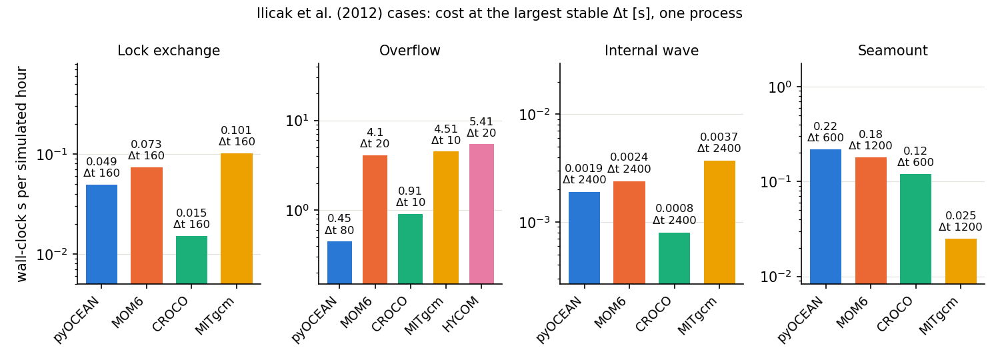
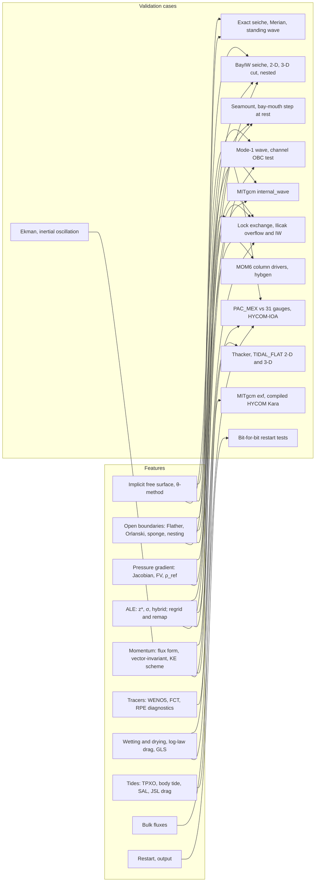

# Validation: strategy and scorecard

This chapter says how far each part of pyOCEAN has been tested, against what, and with which result. Read it
before you trust a feature for a new application. Every number on these pages comes from a README in
`validation/`, a test in `tests/`, a summary file in `validation/*/out/`, `CLAUDE.md` or a design document in
`docs/design/`; the source is named next to the number.

| Page | Content |
|---|---|
| [Analytical and exact solutions](analytical.md) | Cases with a known answer: seiches, Ekman, Flather, mode-1 wave, rest states, Thacker, restart |
| [Idealised benchmarks](idealised.md) | Lock exchange, Ilicak et al. (2012) four-model benchmark, seamount, MITgcm `internal_wave`, KE schemes |
| [BayIW](bayiw.md) | The bay internal-wave and seiche case of the developer's M.Sc. thesis, against MITgcm and MOM6 |
| [Tides and sea level](tides-sealevel.md) | PAC_MEX barotropic tides against 31 gauges and TPXO10, HYCOM-IOA, gauge quality control |
| [Wetting and drying](wetting-drying.md) | Thacker (1981) and CROCO `TIDAL_FLAT` (2-DH and 3-D with GLS) |
| [Components](components.md) | Bulk fluxes, tide tools, ALE column kit against MOM6 Fortran, hybgen, domain checker, solvers |

## Validation philosophy

### The truth hierarchy

pyOCEAN is validated in this order (`CLAUDE.md`, "Validation Strategy"):

1. **Analytical or exact solution**, when one exists: a discrete seiche mode, Ekman transport, a progressive
    mode-1 internal wave, a state of rest over topography, the Thacker (1981) basin.
2. **Laboratory and observations**: tide gauges (TICON-3, IOC/SMN raw data), and later ADCP and CTD. This is
    the real "truth".
3. **Cross-model comparison**: MITgcm (the BayIW runs), CROCO/ROMS, MOM6 and HYCOM (HYCOM-IOA). Agreement with
    another model is necessary but not sufficient; the roadmap states that "looking like other models is not
    enough" (`docs/design/vision_roadmap.md` §1).

When a reference model is used, its own error is part of the result. Several benchmarks below found errors in
the reference configuration (class (d)), for example the reflecting south boundary of the original BayIW
MITgcm set-up (`validation/bayiw_2d/README.md`) and two unallocated arrays in HYCOM 2.3
(`validation/ilicak_benchmark/hycom/README.md`).

### Classifying every difference

Every difference found in a benchmark is put in one of four classes (`CLAUDE.md`;
`docs/design/vision_roadmap.md` §1):

| Class | Meaning | Does it change pyOCEAN? |
|---|---|---|
| **(a)** | A bug in pyOCEAN | Yes, fix it and add a test |
| **(b)** | Physics that pyOCEAN does not have yet | Yes, add it (as a general feature) |
| **(c)** | A different numerical choice (scheme, coordinate, metric) | No; document it |
| **(d)** | An error in the reference model or in its configuration | No; document it and, if possible, report it |

Two further rules:

- **Never tune to a single case.** An improvement counts only if it is general physics and improves more than
    one case (`docs/design/vision_roadmap.md` §1). For example, the log-law drag that closed the TIDAL_FLAT 3-D
    gap was not tuned: $z_0 = 10^{-4}$ m is CROCO's value, and the README states that a smaller $z_0$ would fit
    better but was not adopted (`validation/tidal_flat/README.md`).
- **Every benchmark ends with a "what pyOCEAN should improve" list** and an update of the scorecard below. The
    reference case is also run in its full configuration (e.g. CROCO `TIDAL_FLAT` in 3-D), not only in a reduced
    one.

### Literature and reference source code

Before a scheme is implemented, and whenever a benchmark shows an unexplained difference, the local library
and then the literature are searched (`scripts/litsearch.py`), and the source code of the production model
that has the scheme (MOM6, CROCO, MITgcm, HYCOM) is read and cited as `file:line`. The validation READMEs cite
these lines; they are reproduced on the pages of this chapter where they explain a result.

## The test suite

All unit, regression and fast validation tests run with

```bash
pytest tests/
```

`pytest --collect-only -q tests/` collects **1350 tests** (run for this page on 2026-10-14). `CLAUDE.md`
reports 1348 passing plus one strict `xfail` (Thacker front dissipation, `tests/test_wetting_drying.py:118`)
and one non-strict `xfail` (finite-volume against Jacobian pressure gradient over the seamount,
`tests/test_sigma_ale.py:115`), which adds up to the same 1350. Some tests are skipped when an external
reference is missing (the compiled MOM6 column drivers, CROCO output files or the BayIW MITgcm runs on the
external disk).

??? note "Tests per file (collected 2026-10-14)"

    | Area | Test file | Tests |
    |---|---|---|
    | Grids | `test_grid_horizontal.py` / `test_grid_vertical.py` / `test_sigma_levels.py` / `test_bathymetry.py` | 36 / 37 / 6 / 38 |
    | Phase-1 z-level model | `test_state.py` / `test_eos.py` / `test_pressure.py` / `test_momentum.py` / `test_timestepping.py` / `test_advection.py` / `test_kpp.py` / `test_surface_forcing.py` / `test_io.py` | 52 / 36 / 34 / 44 / 19 / 37 / 32 / 39 / 22 |
    | Forcing | `test_forcing_canonical.py` / `test_forcing_interp.py` / `test_forcing_sources_base.py` / `test_bulk.py` / `test_bulk_kara.py` / `test_era5.py` / `test_wrf.py` | 18 / 24 / 13 / 48 / 17 / 17 / 13 |
    | HYCOM readers and initial state | `test_hycom_z.py` / `test_hycom_ab.py` / `test_hycom_archive.py` / `test_ocean_init.py` / `test_extract_archs_ssh.py` | 16 / 23 / 16 / 13 / 4 |
    | Free surface, tides | `test_free_surface.py` / `test_tides.py` / `test_tpxo.py` / `test_tidal_potential.py` / `test_tidal_drag.py` | 26 / 12 / 13 / 13 / 8 |
    | Sea level | `test_tide_gauges.py` / `test_sealevel_qc.py` | 19 / 37 |
    | 2-D shallow water, wetting and drying | `test_nonlinear.py` / `test_wetting_drying.py` / `test_sigma_wd.py` / `test_bottom_friction.py` / `test_gls.py` | 19 / 26 / 18 / 4 / 3 |
    | Stratified σ and ALE core | `test_sigma_baroclinic.py` / `test_sigma_ale.py` / `test_open_boundary_state.py` / `test_vector_invariant.py` | 44 / 118 / 15 / 20 |
    | ALE column kit | `test_vertical_remap.py` / `test_vertical_regrid.py` / `test_vertical_ale.py` / `test_vertical_pgf.py` / `test_vertical_vs_mom6.py` | 23 / 47 / 54 / 5 / 2 |
    | Diagnostics, I/O | `test_mixing_diagnostics.py` / `test_restart.py` / `test_output.py` / `test_domain_check.py` / `test_postmortem.py` | 8 / 17 / 5 / 7 / 4 |
    | Validation harnesses | `test_ilicak_benchmark.py` / `test_bayiw_2d.py` / `test_bayiw_baroclinic.py` / `test_bayiw_cut.py` / `test_bayiw_iw_output.py` / `test_bayiw_wind.py` / `test_mom6_bayiw.py` / `test_internal_wave.py` | 50 / 13 / 20 / 16 / 4 / 3 / 10 / 8 |
    | Tools | `test_litsearch.py` / `test_threads.py` | 4 / 1 |

    Several counts differ from the status tables of `CLAUDE.md` (for example `test_sigma_baroclinic.py` 44
    against 37, `test_vertical_regrid.py` 47 against 44, `test_hycom_ab.py` 23 against 20,
    `test_tpxo.py` 13 against 11): the tables were not updated when tests were added.

The long benchmarks (Ilicak four-model campaign, BayIW 3-D, PAC_MEX tides) are **not** part of `pytest`; their
scripts live in `validation/<case>/` and each page of this chapter gives the command to reproduce them. Their
harnesses (case definitions, metrics, readers) are unit-tested.

## Scorecard

The scorecard is maintained in `docs/design/vision_roadmap.md` §7 (in Spanish) and updated after every
benchmark. It is translated here; the source README of each row is linked in the last column.

Status: ✅ pyOCEAN matches the truth or is ahead · 🔶 close, or open items remain · ❌ behind · ⬜ not measured.

| Case | Truth | pyOCEAN | References | Status |
|---|---|---|---|---|
| BayIW barotropic seiche | MITgcm (no exact solution) | period 3.83 h, RMSE 0.18–0.48 mm | MITgcm 3.81–3.83 h | ✅ equal to MITgcm ([BayIW](bayiw.md#barotropic-seiche)) |
| Thacker (wetting and drying) | Exact | 4.6 cm, shoreline 0.8 km | CROCO 2.0 cm, 0.6 km | ❌ behind (front; `xfail`) ([W/D](wetting-drying.md#thacker-1981-parabolic-basin)) |
| TIDAL_FLAT 2-DH | CROCO | 1.1 cm | — | ✅ equal ([W/D](wetting-drying.md#croco-tidal_flat-2-dh)) |
| TIDAL_FLAT 3-D | CROCO (GLS) | 1.2 cm with 3-D σ + GLS | — | ✅ equal ([W/D](wetting-drying.md#croco-tidal_flat-3-d-gls)) |
| Mexican Pacific tides | 31 TICON gauges | median RSS 1.44 cm | TPXO10 1.79 cm | ✅ ahead ([tides](tides-sealevel.md)) |
| Acapulco M2 | TICON | 0.6 cm | TPXO10 5–6 cm | ✅ ahead |
| Upper Gulf of California M2 | TPXO10 and TICON | amplitude rms 3.8 cm (log-law, $z_0$ = 1e-3), phase 12.7° (−7 to −9° along the axis, inherited from the boundary) | TPXO10 = reference | 🔶 close; phase missing |
| Tidal band, HYCOM-IOA | IOC | 5.1 cm | HYCOM-IOA 4.9 cm | 🔶 similar |
| Lock exchange: front | Benjamin ½√(g′H) = 0.495 m/s | 0.463 / 0.486 m/s | CROCO 0.463 / 0.486 | ✅ equal to CROCO ([idealised](idealised.md#lock-exchange-against-croco-grav_adj)) |
| Lock exchange: spurious mixing (ΔRPE/RPE₀, 17 h) | Ilicak 2012 | 3.2e-5 (WENO-Z), 2.9e-5 (JS) | CROCO 2.2e-5 | 🔶 1.3–1.5× CROCO (tracer time step) |
| Linear internal seiche (period) | 2L/√(g′h₁h₂/H) | +5 to +7 % (converges) | — | 🔶 |
| Seamount (pressure gradient, rx1 = 10.7) | Exact rest | max\|u\| at 10 d: σ Jacobian + ρ_ref 0.41 cm/s; σ finite volume + ρ_ref 1.36; **z\* (ALE) + finite volume + ρ_ref 0.10**; σ without ρ_ref 42–60 | Beckmann & Haidvogel 1993: ~1 cm/s | 🔶 z\* ahead; every configuration has a mode that doubles every ~2 days (σ Jacobian 9 cm/s at 20 d), to be investigated |
| BayIW bay-mouth step 600 → 164 m (rest, pycnocline at 80 m, 12 h) | Exact rest | σ + Jacobian + ρ_ref 7.3 cm/s; z\* + finite volume 5e-12 m/s | — | ✅ z\* at round-off (`tests/test_sigma_ale.py`) |
| Analytic mode-1 internal wave (flat 200 m channel, west `'clamped'`, east radiating + sponge) | u = u₀ cos(πz/H) sin(ωt − kx) with viscous decay | z\* and hybrid: amplitude ±5 %, phase < 3.4° (Arakawa KE); Godunov KE damps ~9 % more over 5 km at dx = 100 m (first order in dx) | — | ✅ (`tests/test_sigma_ale.py`; found and fixed a sponge on a prescribed edge and the exterior of an edge without data) |
| MITgcm `internal_wave` (prescribed mode-1 wave, subcritical slope 0.03, 10 periods) | MITgcm with the same configuration | mode 1 on the flat part: Arakawa z\*/hybrid u 0.91–1.01, T′ 0.98–1.08, phase ≤ 7°; Godunov u 0.83–0.99; energy flux at 2 km 0.92–1.04; 50 % of the flux at 4.53–4.85 km (MITgcm 4.61) | MITgcm = reference | ✅ with Arakawa; 🔶 with Godunov (c) |
| BayIW 2-D section (bay axis, 1 × 352 × 50, 60 h; two-layer and linear, with and without bay) | MITgcm on the same section, walls in x, south boundary Orlanski only (the original one reflects the barotropic pulse: index 0.57 against 0.02) | seiche Δη: range ±3 %, correlation 1.00 (z\*, hybrid 25 and 50); linear: z\* T110/T250/V110 0.97–1.01 (corr. 1.00), hybrid 50 0.97–1.05 (corr. ≥ 0.99), hybrid 25 the same except T110 in the shallow bay (3–6×); two-layer: z\* T110 1.3–2.3× near the interface (diffusion, c), hybrid 25 V110 in the bay 0.90–0.93 (corr. ≥ 0.96) but 0.27–0.61 at the mouth, hybrid 50 noise of ~1 mm/s in nearly vanished layers | MITgcm = reference | 🔶 linear ✅; two-layer open (vanished layers, mouth). Fixed two (a) errors: hybrid initial state from the source grid, and MITgcm's effective depth |
| BayIW 3-D cut, phase 1 (200 × 160 × 50, ~5 km, 60 h; radiating to a resting exterior) | MITgcm on the same cut, 5 MPI, Orlanski only | z\*: seiche period −1.8 %, range ±1 %, corr. 1.00; linear T110/V110 0.98–1.07 (corr. ≥ 0.97); two-layer isotherm 1.01–1.21, heat displacement 1.03–1.10 (corr. ≥ 0.99), T110 1.4–3.5× (interface diffusion, c); Δt 30 = 120 s (≤ 2 %). Hybrid 25: seiche the same; linear ✅ outside the bay, T110 2.5–3× inside; two-layer: interface nearly still at Omega (0.08×), 3–6× in the bay, U110 0.5× at A and B, the same with Godunov | MITgcm = reference | 🔶 z\* ✅; hybrid two-layer: candidate (a), under diagnosis (later fixed in amplitude, see next rows) |
| BayIW 3-D cut, phase 2 (nested in the full runs, z\*) | Nested MITgcm (OBCS prescribes u, v, T; η impossible with the linear free surface) | η at the stations: pyOCEAN 0.03–0.11 against nested MITgcm 0.05–0.17 (phase 1: 0.27–1.00), so nesting works; in V110/isotherm/ζ/T110/map nested MITgcm is almost exact (≤ 0.02 outside Gamma), so the 1.5× criterion degenerates there, and pyOCEAN's error equals that of phase 1; two-layer bay effect 0.68–0.75 against 0.13–0.19 (z\* interface diffusion, c); Gamma linear 0.74 inside the sponge | Esteban's full run | 🔶 nesting ✅ (η better than nested MITgcm); 3-D exterior in the sponge band missing (b) |
| Hybrid with a sharp interface and realistic case (2-D section and 3-D cut, 2026-10-13) | MITgcm on the same section/cut | three fixes: z\* floor to the bed (`bayiw.hybrid_dz_top`, model warning if it does not reach), initialisation regridded on the source levels as MOM6 + `snap_to_jumps` (a), `keep_isopycnal` keeps interfaces whose target lies between their two layers (a); 2-D two-layer ζ 0.94–1.29 (before 0.05–1.70), interface 8 m (MITgcm 8–9); realistic (density-equivalent T) z\* and hybrid = MITgcm in 2-D and 3-D (T110 0.93–1.12, V110 1.01–1.04); 3-D two-layer: amplitude 0.87–1.36 but 1.5–3 h lag at the shelf edge; linear: shallow bay T110 2.5–5.6 | MITgcm = reference | 🔶 realistic ✅; two-layer: amplitude ✅, 3-D phase open; linear in the bay open |
| MOM6 in BayIW (2-D section, 60 h; cost on the cut) | MOM6 z\*/HYCOM1 (`-O2`, same physics; HYBGEN does not run in this build) and MITgcm | z\*: pyOCEAN = MOM6 in every metric (including the inflated T110 and Seiche2 V110, which belong to z\*); realistic: pyOCEAN hybrid better than MOM6 HYCOM1 in the bay (Seiche2 V110 0.99 against 2.60), though both hybrids have a local error near the bed at the bay head (section error 6.7 against 14.5; z\* 0.04); two-layer: pyOCEAN keeps the interface (8 m; MOM6 HYCOM1 28 m) but displaces it too much (ζ 1.17–1.65; MOM6 1.02–1.15); cost equal at equal Δt, ±10 % (z\* 9.1 against 9.0 s/h, hybrid 5.0 against 4.7; with Δt 600 s 1.8/1.9 and 1.0/1.0); MOM6 ALE 18.6–22.8 % of the step against ~13.5 % for pyOCEAN's remap; pyOCEAN T advection (WENO5, 3 stages) ~11 % against 4.8 % in MOM6 | MITgcm = reference; MOM6 = second remapping model | 🔶 z\* ✅ (= MOM6); cost ✅ (= MOM6); hybrid two-layer ζ: candidate (a), pending |
| Spurious mixing against Re_Δ: Ilicak (2012) lock exchange, overflow and internal wave, 3 ν_h each | Benjamin (front); cross-model comparison with the same coordinate | z\*: = MOM6 z\* in the lock exchange (RPE ±1.6 %, equal fronts, 0.86–0.96 U), ≈ MITgcm in the overflow (dRPE/dt 0.61 against 0.52 at ν = 1000), no new T extrema since the Zalesak FCT of 2026-10-14 (before ≤ 4.7 °C with WENO5-Z; now ≤ 1.5e-8 °C), in the internal wave mixes like MITgcm and damps like the others (0.74 / 0.58 / 0.26 against 0.65–0.72 / 0.55–0.65 / 0.24–0.26) since the 2026-10-14 fix (`theta_bc` = ½; before, the free-surface θ = 0.6 damped the baroclinic layer transport, 0.39–0.45); dRPE/dt drops 3.6× from Re_Δ 2480 to 2.5 (MOM6 3.7, MITgcm 5.6); hybrid (robustness plan, 2026-10-14: outflow limiter, MOM6-like upwind-biased thin-layer viscous coupling, FCT with 3-D bounds, θ_bc = ½): 250–1200× less mixing than z\*, T exactly in range (before 3.2–33 °C), completes the overflow at ν = 100 and 1000 (MOM6 ρ stops at ν ≤ 100, HYCOM at 100; max\|u\| 17 m/s, before 47); at ν = 1 only 1 of 5 trajectories (vanished-layer slab at the wall, pre-existing: 3 of 5 without the depth-mean correction δ), internal wave 0.50 / 0.63 / 0.27 (before 0.45 / 0.43 / 0.25), fronts 0.94–1.06 U (the coupling slows them 2–5 % at ν = 0.1) | MOM6 z\*/ρ, CROCO σ (REGIONAL schemes: extrema up to 14 °C, RPE not comparable), MITgcm z\* | 🔶 z\* ✅; hybrid ✅ in T range and robustness; open (a): internal wave at ν = 0.01 (0.50 against 0.65–0.72), thin overflow faces up to 1.9× the thick ones (2.0× at ν = 100; δ uniform in the column), vanished-layer slab at ν = 1 ([idealised](idealised.md)) |
| Beckmann & Haidvogel seamount in four models (10 days, no viscosity) | Zero velocity | σ with finite-volume PGF + ρ_ref 0.22 cm/s; z\* 0.08 cm/s | CROCO σ 36 cm/s, MOM6 σ 154 cm/s (growing), MITgcm z\* exactly 0; MOM6 z\* truncates from day 1 (configuration unexplained) | ✅ (MOM6 pending) |
| Cost in the Ilicak cases (largest stable Δt, 1 process, s per simulated hour) | — | lock exchange 0.049, overflow 0.45 (Δt 80 s, the largest; hybrid 1.01 at Δt 40 s), internal wave 0.0019, seamount 0.22 (repeated 2026-10-14 on an idle machine) | MOM6 0.073 / 4.1 / 0.0024 / 0.18 (σ); CROCO 0.015 / 0.91 / 0.0008 / 0.12; MITgcm 0.101 / 4.5 / 0.0037 / 0.025; HYCOM, overflow only, 5.41 (Δt 20 s, marginal, at ν = 1000; 1.43 on 5 processes; at ν = 100 it stops with `neg. dp`, undiagnosed) | ✅ against MOM6, MITgcm and HYCOM in 2-D; 🔶 CROCO 1.9–3.3× cheaper except in the overflow, MITgcm 8.8× in the seamount |
| BayIW bay-mouth step, rest in hybrid layers (25 layers, linear stratification, 6 h, no wind) | Exact rest | before 1.6 cm/s (start on σ-layers); with `initial_state(h_src=...)` and MITgcm's depth 3.3e-4 m/s; channel with a step < 1e-6 m/s in 1 h | — | ✅ (`tests/test_sigma_ale.py`) |
| Isopycnal hybrid lock exchange (ALE, 21 layers as MOM6, 6 h; each water mass in a vanished layer on the other side) | Benjamin ½√(g′H); MOM6 1.05 U, max\|u\| 0.56 m/s | vector-invariant momentum + `keep_isopycnal` + MOM6 viscosity; with 10 layers and upwind: body 1.05 / 1.05 U, RPE gain 3.0e6 J (MOM6 RHO 4.5e7, ALE-σ 2.1e8); dense 1 m nose 1.12 U, max\|u\| 0.94 m/s (before, with flux form: body 0.84 / 0.14 U). With 21 layers and `thickness_flux='ppm'` (MOM6's configuration, default since 2026-10-12): nose and body 1.05 / 0.98 U, max\|u\| 0.74 m/s, RPE 8.8e5 J | MOM6 (`validation/mom6_lock_exchange/`) | ✅ with 21 layers + PPM (= MOM6); with 10 layers PPM gives a dense body of 1.26 U |
| Ekman transport (uniform wind, f-plane) | Exact inertial τ/(ρ₀f) | max error 0.045 % over one inertial period | — | ✅ ([analytical](analytical.md#ekman-transport)) |
| Open boundaries: mode-1 internal wave leaving a channel (interior error against a 5× larger domain, 16 h) | Large domain | closed 0.82; Flather + Orlanski 0.16; + 10-cell sponge 0.015. ALE (Plan C, 2026-10-12; error on z-levels, σ with that metric 0.80 / 0.149): z\* 0.79 / 0.16 / 0.016, hybrid 0.77 / 0.198 / 0.024 (inflow from the z exterior puts water of another density class in the displaced isopycnal layers; by layer index it would be 0.180) | Jensen 1998, Chapman 1985: radiation alone reflects | ✅ with sponge (pending: Marsaleix 2009 PRM for radiation without sponge; public reflection benchmark) |
| Bit-for-bit restart (stratified σ + GLS, including the AB3 start-up) | Continuous run | identical (`np.array_equal`), in CI | MOM6 and SCHISM fail | ✅ (pending: 2-DH tidal runs) |
| Domain checker (raw GEBCO Upper Gulf) | Guaymas pit found by hand | finds it by itself (isolated 6-cell body, 189 m) + 1 more body and 9 pits as artefact candidates | — | ✅ ([components](components.md#domain-checker-on-raw-gebco)) |
| Free-surface solver with wetting and drying (Upper Gulf, 96 273 cells) | — | CG + lagged LU: 1–3 iterations, 0.053 s/step (before Jacobi ~110 it, 0.079 s/step) | — | ✅ 1.5× |
| Performance | — | 33 days of PAC_MEX 650×500 in 11 min, 1 core | — | ⬜ HYCOM with the same configuration still to be measured |
| ALE column kit: PCM/PLM/PPM_H4 remapping (level 1) | MOM6 Fortran `remapping_core_h` | max\|Δ\| ≤ 5e-12 on 120 columns, including vanished layers and layers of 1e-10 m and 1 mm at the ends (out of scope: order reduction counts active layers, MOM6 all) | MOM6 = reference | ✅ equal to MOM6 ([components](components.md#ale-column-kit-against-mom6-fortran)) |
| ALE column kit: z\*, σ rules and P1M_H2 interpolation (level 1) | MOM6 Fortran `coord_zlike`, `coord_sigma`, `regrid_interp` | z\*/σ ≤ 3e-14 m; P1M bit for bit (pending: full `build_hycom1_column`) | MOM6 = reference | ✅ equal to MOM6 |
| HYCOM1 hybrid rule against HYCOM `hybgen` (MOM6 port), 10 cycles | — (different algorithms) | OM4-style targets: mean Δz 4.0 m in BayIW and 0.8 m stratified (≤ 0.4 layers in the interior); targets from the surface: 13–25 layers because of hybgen's fixed z-layers and its null mode | hybgen | ✅ hybgen is not ported (decision of 2026-10-11) ([components](components.md#hybrid-rule-against-hycom-hybgen)) |

Rows that are on later pages but not (yet) in the roadmap scorecard: the exact discrete seiche and Merian
period, the Flather outgoing wave, the standing tidal wave in a bay, the inertial oscillation, the KE-scheme
study, the BayIW σ run of 2026-10-11 and the component checks (bulk fluxes, TPXO, OTPS, SAL, JSL). Their
status is given on each page.



*Cost per simulated hour at each model's largest stable time step, one process (numbers from
`validation/ilicak_benchmark/README.md`, drawn by `docs/manual/figures/make_validation.py`). Look at the
overflow, where pyOCEAN's implicit free surface allows Δt = 80 s.*

## Which case validates which feature



The same map as a table:

| Feature | Cases (page) |
|---|---|
| `ImplicitFreeSurface` (θ-method), Flather | exact discrete seiche, Merian, outgoing wave, standing tidal wave ([analytical](analytical.md)); BayIW barotropic seiche ([BayIW](bayiw.md)); PAC_MEX ([tides](tides-sealevel.md)) |
| `WetDryFreeSurface`, `SigmaWetDry`, log-law drag, GLS | Thacker, TIDAL_FLAT 2-DH and 3-D ([W/D](wetting-drying.md)); Upper Gulf of California ([tides](tides-sealevel.md#upper-gulf-of-california-with-wetting-and-drying)) |
| Pressure gradient (Jacobian, finite volume, reference profile) | seamount, bay-mouth step ([analytical](analytical.md)); four-model seamount ([idealised](idealised.md)) |
| ALE z\*, σ, hybrid | bay-mouth step, mode-1 wave ([analytical](analytical.md)); Ilicak cases, hybrid lock exchange vs MOM6 ([idealised](idealised.md)); BayIW 2-D/3-D and MOM6 BayIW ([BayIW](bayiw.md)); MOM6 column drivers ([components](components.md)) |
| Momentum form and KE scheme | lock exchange vs CROCO, KE study, `internal_wave` ([idealised](idealised.md)) |
| Tracer advection, FCT, RPE diagnostic | lock exchange, Ilicak cases ([idealised](idealised.md)) |
| Open boundaries, time-varying exterior, nesting | channel test, mode-1 wave ([analytical](analytical.md), [idealised](idealised.md)); BayIW cut phase 2 ([BayIW](bayiw.md)) |
| Tide prediction, TPXO reader, SAL, JSL drag | OTPS reference, pyTMD, SAL file, tidal.rh ([components](components.md)); PAC_MEX ([tides](tides-sealevel.md)) |
| Bulk formulae | MITgcm `exf`, compiled HYCOM ([components](components.md)) |
| Restart | bit-for-bit tests, BayIW cut 60 h ([analytical](analytical.md#bit-for-bit-restart)) |

## References

- Benjamin, T. B. (1968). Gravity currents and related phenomena. *J. Fluid Mech.* 31, 209–248.
    [10.1017/S0022112068000133](https://doi.org/10.1017/S0022112068000133) **[verify]**
- Ilicak, M., Adcroft, A. J., Griffies, S. M., Hallberg, R. W. (2012). Spurious dianeutral mixing and the role
    of momentum closure. *Ocean Modell.* 45–46, 37–58.
    [10.1016/j.ocemod.2011.10.003](https://doi.org/10.1016/j.ocemod.2011.10.003)
- Thacker, W. C. (1981). Some exact solutions to the nonlinear shallow-water wave equations. *J. Fluid Mech.*
    107, 499–508. **[verify]**
