# Tides and sea level

This page validates pyOCEAN's tidal machinery against the real ocean: the barotropic tide of the Mexican
Pacific and the Gulf of California (PAC_MEX) against 31 tide-gauge records and the TPXO10 atlas, the
sensitivity to drag, self-attraction and loading (SAL) and resolution, the Upper Gulf with wetting and
drying, and a cross-check with the operational HYCOM-IOA forecast. It also documents the quality control of
the gauges themselves, because a model can only be judged against observations that are right. Read it
before using pyOCEAN for tidal studies in the region, or to reuse the gauge tools elsewhere.

The model is the 2-D tidal free-surface model (see [Tides and the 2-D tidal model](../user-guide/tidal-model.md)
and [Tides](../theory/tides.md)): `ImplicitFreeSurface` (`core/dynamics/free_surface.py:109`) with Flather
open boundaries, the body tide and SAL of `forcing/tides.py`, and the JSL internal-tide drag of
`physics/tides/drag.py`; the wetting–drying runs use `WetDryFreeSurface` (`core/dynamics/wetting_drying.py:51`).

## PAC_MEX barotropic tidal run

**Set-up** (`validation/pacmex_tides/run_tides.py` docstring; `CLAUDE.md` Phase 2 step 8):

| Item | Value |
|---|---|
| Grid | PAC_MEX `regional.grid` of HYCOM-IOA (uniform 0.04° ≈ 1/25°), subdomain 118–92°W, 12–32°N, 650 × 500 |
| Bathymetry | `regional.depth_final` (GLBy0.08 + GEBCO 1/25°), minimum depth 10 m, no wetting/drying, one layer with partial cells |
| Dynamics | linear shallow water on the sphere: $\partial_t\mathbf u = -f\hat z\times\mathbf u - g\nabla\eta + g\nabla\eta_{body} - C_d\lvert\mathbf u\rvert\mathbf u/H$, $\partial_t\eta = -\nabla\cdot(H\mathbf u)$; Coriolis and body force with AB2, quadratic drag semi-implicit, θ = 0.6 free surface |
| Drag | C_d = 2.5e-3 (reference) |
| Tides | 8 constituents (M2 S2 K1 O1 N2 P1 K2 Q1); Flather on all open edges with TPXO10-atlas-v2 elevation and transport (velocity = transport / model depth); body tide $\alpha\eta_{eq}$ minus the per-constituent SAL of HYCOM-IOA's `tidal.salReIm_tpxo10`; ramp $1 - e^{-5t/\tau}$, τ = 2 days |
| Time | Δt = 120 s, 2026-08-01 + 33 days, 3 days of spin-up; harmonic constants from online least squares (P1 and K2 inferred from K1 and S2 with TPXO ratios) |
| Cost | 33 days in 11 min on one P-core (boundary constants interpolated once, 8× faster) |

**Truth.** 31 coastal TICON-3 records in the box (Hart-Davis et al. 2022), with the records flagged as gauge
defects excluded ([gauge QC below](#tide-gauge-quality-control)); TPXO10 as a second reference.

**Metric** (`validation/pacmex_tides/compare_gauges.py`; `diagnostics/tide_gauges.py`): per constituent the
complex vector difference $\lvert h_{obs} - h_{mod}\rvert$ and the root-sum-square
$RSS = \sqrt{\tfrac12\sum_c\lvert\Delta h_c\rvert^2}$ over the 8 constituents, at the nearest wet cell.

**Results** (`validation/pacmex_tides/out/summary.txt`; `CLAUDE.md`):

| Run | Median RSS, all 31 [cm] | Pacific | Gulf of California | Better than TPXO at | M2 vs TPXO10, depth > 1000 m |
|---|---|---|---|---|---|
| Reference, C_d = 2.5e-3 | 1.95 | 1.60 | 12.54 | 9/31 | rms \|Δh\| 1.58 cm, amp. ratio 1.010, phase −0.6° |
| JSL drag ×0.25 | 1.82 | 1.56 | 12.39 | 11/31 | 1.51 cm, 1.006, −0.5° |
| JSL drag ×0.5 | 1.70 | 1.50 | 12.25 | 11/31 | 1.47 cm, 1.002, −0.3° |
| **JSL drag ×1.0** | **1.63** | **1.44** | 11.98 | 13/31 | 1.44 cm, 0.995, +0.1° |
| JSL ×0.5 + HYCOM-IOA spatial cb | 1.63 | 1.46 | **11.13** | 11/31 | 1.32 cm, 1.000, −0.3° |
| Without SAL (C_d = 2.5e-3) | 3.35 (`CLAUDE.md`) | | | | |
| **TPXO10** | **1.87** | **1.79** | **5.12** | | |

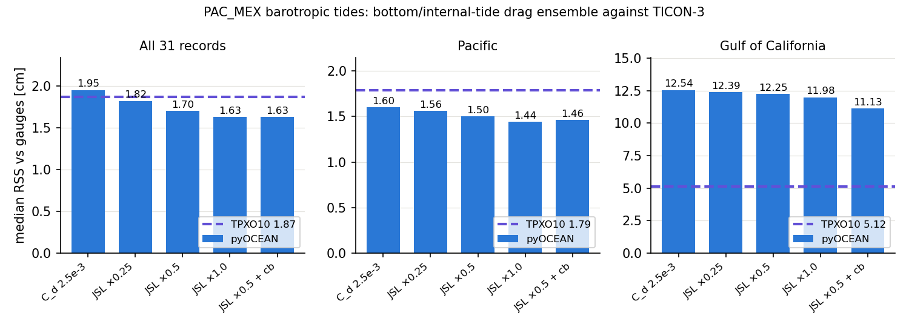

*Median 8-constituent RSS against TICON-3 for the drag ensemble (bars) and TPXO10 (dashed). In the Pacific
every JSL run beats TPXO10; in the Gulf of California no drag setting comes close.*

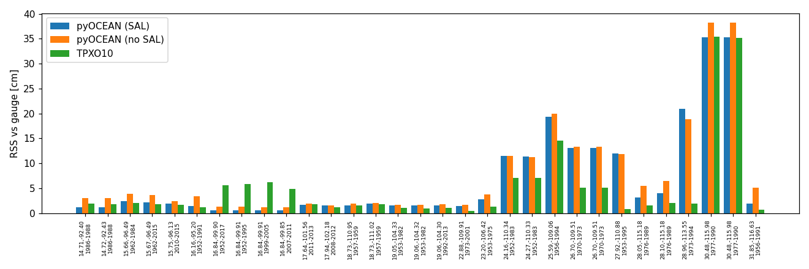

*RSS per gauge record (latitude, longitude, years) for the reference run with and without SAL and for TPXO10.
SAL halves the error at most Pacific gauges (14–23°N); the Gulf records (24–31°N) are where pyOCEAN is behind.
From `validation/pacmex_tides/out/rss_by_gauge.png`.*

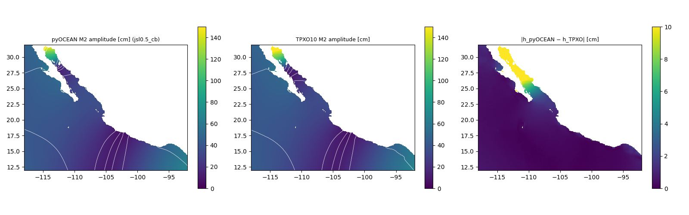

*M2 amplitude of the JSL ×0.5 + cb run (left), TPXO10 (middle) and their vector difference (right, saturated
at 10 cm). Outside the Gulf of California the difference is ~1 cm.*

**Highlights.**

- **Acapulco:** M2 error **0.6 cm** against TPXO10's 5–6 cm; TPXO10 underestimates M2 there by ~30 % (12.8
    against 18.5 cm in four gauge records 1952–2017, `validation/tide_gauges/README.md`). Scorecard ✅ ahead.
- **Mexican Pacific:** median RSS **1.44 cm** (JSL ×1.0) against TPXO10's 1.79 cm. Scorecard ✅ ahead.
- **SAL matters:** without it the median RSS is 3.35 cm (with it 1.95 cm, same drag) (`CLAUDE.md`).
- **Gulf of California amphidrome misplaced:** Guaymas M2 22 cm against 13.5 cm observed, −37° in phase
    (`CLAUDE.md`). Uniform C_d from 0.0015 to 0.006 and JSL drag (drgscl 0.25–1.0, with and without the
    HYCOM-IOA spatial cb) all leave the Gulf at 11–12.5 cm (TPXO 5.1): **the Gulf error is not a missing energy
    sink**. Candidates are the depth floor (see the Upper Gulf below), resolution and the boundary.

The M2 maps of every ensemble member are in `docs/manual/img/validation/pacmex_tides__m2_map_*.png`
(copied from `validation/pacmex_tides/out/`).

**Parallel performance** (`validation/pacmex_tides/bench_parallel.py`; `CLAUDE.md`): SuperLU is 65 % of the
step; Numba `prange` on the rest gives at most 1.35× overall, so cores are better used for concurrent runs.

Reproduce:

```bash
python validation/pacmex_tides/run_tides.py --start 2026-08-01 --days 33 --spinup 3
python validation/pacmex_tides/compare_gauges.py ref nosal
```

## Resolution, nonlinearity and boundary source in the northern Gulf

`validation/pacmex_tides/compare_nest.py` compares, at the 7 TICON records inside a northern-Gulf nest box
(all with JSL 0.5 + HYCOM-IOA cb, A_h = 100 m² s⁻¹, 2026-08-01 + 33 days): the 1/25° parent, linear (`p25_lin`)
and nonlinear (`p25_nl`), and a 1/100° GEBCO nest with a TPXO boundary (`n100_lin_tpxo`) or a boundary taken
from the parent (`n100_lin_par`) (`validation/pacmex_tides/out/nest_summary.txt`):

| Run | Median RSS [cm] | Mean RSS [cm] |
|---|---|---|
| p25_lin | 11.67 | 11.05 |
| p25_nl | 11.66 | 11.06 |
| n100_lin_tpxo | 5.00 | 5.64 |
| n100_lin_par | 9.15 | 11.32 |
| TPXO10 | 2.08 | 4.47 |

M2 at Guaymas (27.92°N, −110.88°): observed 13.5 cm; p25 22.1 cm (−31°); n100 with TPXO boundary 19.0 cm
(−1°); n100 with parent boundary 18.3 cm (−14°); TPXO10 14.0 cm. Nonlinearity changes nothing; resolution
with a good boundary halves the error; a nest inherits the parent's boundary error.

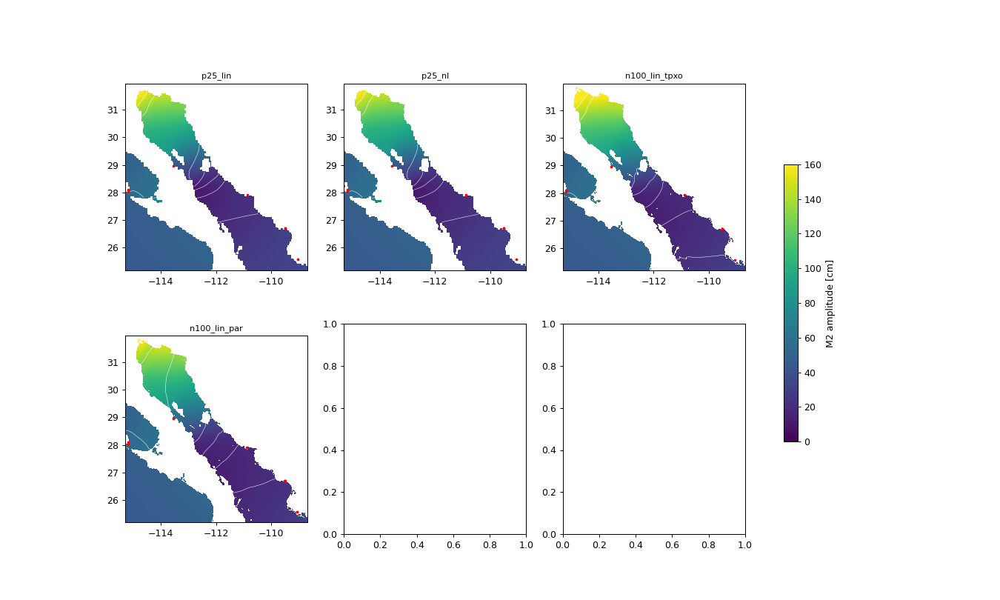

*M2 amplitude in the northern Gulf for the four nest experiments; red dots are the TICON gauges. The empty
panels are unused slots of the original figure.*

## Upper Gulf of California with wetting and drying

**Set-up** (`validation/pacmex_tides/run_tides_wd.py`): a 1/120° (~0.9 km) nest from a 2×2 block mean of GEBCO
2021 (15″), **raw**, with the intertidal flats of the Colorado delta (no depth floor); land above +8 m is a
wall; only the Gulf connected component is kept. Linear momentum, quadratic drag on the total depth + JSL,
continuity with the total depth and Casulli wetting–drying (CG solver), Flather on deep (> 20 m) edge faces
with the harmonic constants of a 1/25° parent (`run_s_min5`), body tide − SAL, 2-day ramp. Control
`--floor 5` floors the depth at 5 m as HYCOM-IOA does: same solver, no drying. Variants with the log-law
drag $C_d(D, z_0)$ (`physics/bottom_friction.py:31`).

**Truth.** TPXO10 along the Gulf axis (it assimilates altimetry and gauges and is accurate there, 2–3 cm RSS
against the gauges, `validation/pacmex_tides/gulf_axis.py`) and the TICON gauges north of 27.5°N.

**Results.**

| Experiment | M2 amplitude error | M2 phase error | Source |
|---|---|---|---|
| Before: depth floor, no drying (as stated in the source) | ~30 cm | 20–33° | `docs/design/validation_suite.md` §2 item 10 |
| Raw GEBCO with wetting and drying (HYCOM cb drag) | 8.7 cm | 13.6° | same |
| Raw GEBCO, W/D, log-law drag $z_0$ = 1e-3 m | rms **3.8 cm** | **12.7°** (−7 to −9° along the axis, inherited from the boundary) | scorecard, `docs/design/vision_roadmap.md` §7 |

The minimum depth controls the Gulf co-oscillation in PAC_MEX: phase rms 18.7° with a 5 m floor, 26° with
10 m and 34° with 20 m (`docs/design/validation_suite.md`). Each run takes ~63–65 min (logs
`validation/pacmex_tides/out/log_wd_*.txt`; the floored control keeps 96 273 wet cells, the raw runs about 91 000–91 600 at a time). Scorecard 🔶:
close; the phase error comes from the parent boundary.

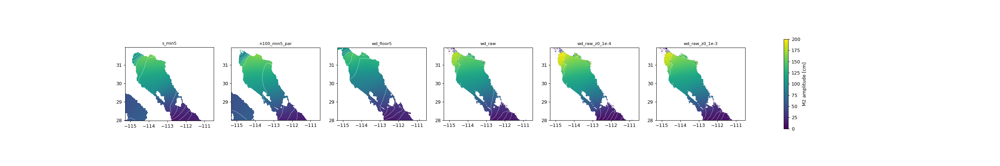

*M2 amplitude north of 28°N: 1/25° parent with a 5 m floor, 1/100° nest, 1/120° nest with the 5 m floor, and
raw intertidal topography with wetting and drying (HYCOM cb, log-law $z_0$ = 1e-4 and 1e-3 m). Only the
runs with drying reach the observed amplification at the head.*

Solver: with wetting and drying the CG solver with the lagged-LU preconditioner needs 1–3 iterations, 0.053
s/step on 96 273 cells, against ~110 Jacobi iterations and 0.079 s/step (scorecard; see
[components](components.md#free-surface-solver-performance)).

Reproduce:

```bash
python validation/pacmex_tides/run_tides_wd.py --bc parent:out/run_s_min5.npz --tag wd_raw
python validation/pacmex_tides/run_tides_wd.py --bc parent:out/run_s_min5.npz --floor 5 --tag wd_floor5
python validation/pacmex_tides/compare_wd.py
```

(`run_wd_raw*.npz` are not in the repository; only their logs are.)

## Comparison with HYCOM-IOA

**Set-up** (`validation/hycom_ioa/compare_hycom_pyocean.py`): the operational HYCOM-IOA PAC_MEX forecast
(expt_00.0: tiddrg = 1, drgscl = 0.25, full SAL, nonlinear, baroclinic), hourly archives 2026-09-26 13Z to
10-03 00Z, against pyOCEAN (barotropic, linear) and against TICON-3 predictions and raw IOC/SMN observations.
HYCOM's `srfhgt` contains the non-tidal SSH too, so every series is reduced to its tidal band by removing a
mean and a linear trend; at each point the model is fitted to the reference as
$h(t) \approx a + bt + \kappa\, r(t-\tau)$ (`diagnostics/sealevel_qc.py:343`, `clock_offsets`), giving the gain
κ, the lag τ and the residual rms.

**Results** (`validation/hycom_ioa/out/summary.txt`):

| Reference | HYCOM-IOA | pyOCEAN JSL 0.5 + cb | pyOCEAN C_d 2.5e-3 | TPXO10 |
|---|---|---|---|---|
| TICON gauges, Gulf of California (7): rms, κ | 6.3 cm, 1.03 | 7.0 cm, 1.05 | 7.6 cm, 1.07 | 2.8 cm, 0.98 |
| TICON gauges, Pacific (21) | 3.5 cm, 1.00 | **2.6 cm**, 1.01 | 2.7 cm, 1.02 | 2.6 cm, 0.99 |
| IOC observations (5: ptan2, sali, zihu, puer2, lpaz2) | **4.9 cm**, 1.03 | 5.1 cm, 1.03 | 5.1 cm, 1.04 | — |

pyOCEAN is similar to HYCOM-IOA overall (scorecard 🔶), better in the Pacific and slightly worse in the Gulf of
California, where both fail in the same way. The forecast cycles also show a start-up shock: in the 60 h
overlap of cycles 269 and 271 the rms difference is 10.4 cm in the first hour, 12.4 cm in hours 1–6 and 5.8 cm
in the last 24 h (tidal std 41 cm): each cycle re-ramps the tide.

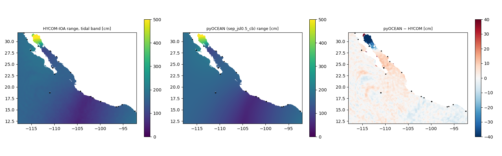

*Tidal-band range of HYCOM-IOA (left), pyOCEAN (middle) and their difference (right). The large differences
are in the Upper Gulf of California.*

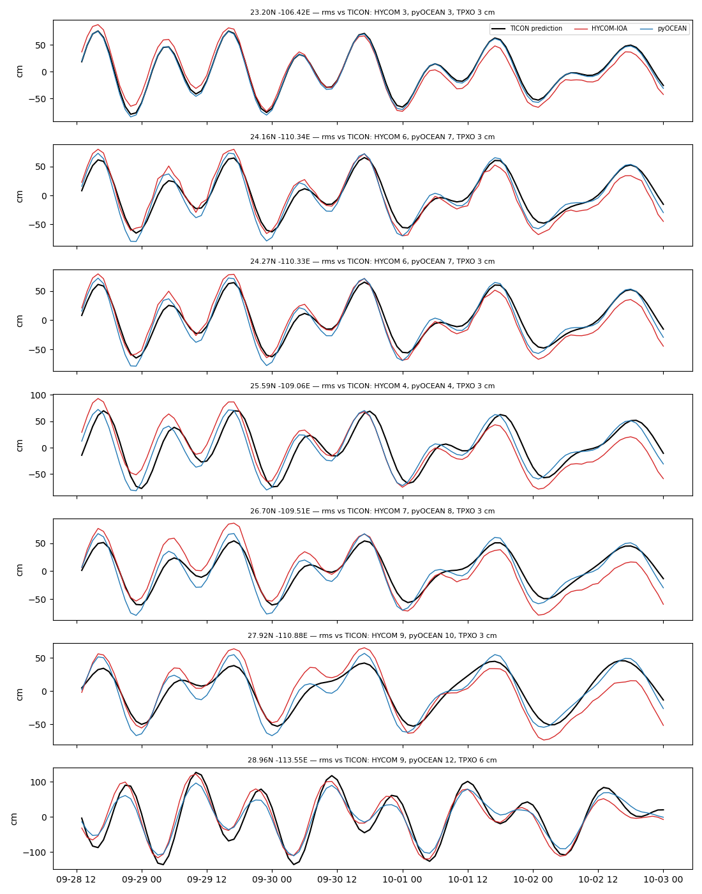

*Tidal-band series at the Gulf of California gauges: TICON prediction (black), HYCOM-IOA (red), pyOCEAN
(blue), with each model's rms in the panel titles.*

Reproduce: run `extract_archs_ssh.py` on the cluster next to the archives, copy the `.npz`, then
`python validation/hycom_ioa/compare_hycom_pyocean.py sep_jsl0.5_cb sep_cd0.0025`.

## SAL file and internal-tide drag

**SAL.** The real HYCOM-IOA file `tidal.salReIm_tpxo10` (PAC_MEX 1600 × 1125) was read
(`forcing/tides.py:437`, `read_sal_hycom`) and checked against TPXO10 (`validation/tides/check_sal_real.py`).
HYCOM (`mod_tides.F90`, tidein = 2) builds $\eta_{tide} = \alpha\eta_{eq} - F$, so the file must hold
$F \approx -\eta_{SAL} \approx -\beta\eta$. The complex regression over deep water gives $F \approx -0.10\eta$
(semidiurnal) and $-0.14\eta$ (diurnal), correlation 0.95–0.99: the sign is HYCOM-consistent, and the scalar
blkdat value `tidsal` = 0.06 underestimates SAL (`CLAUDE.md`).

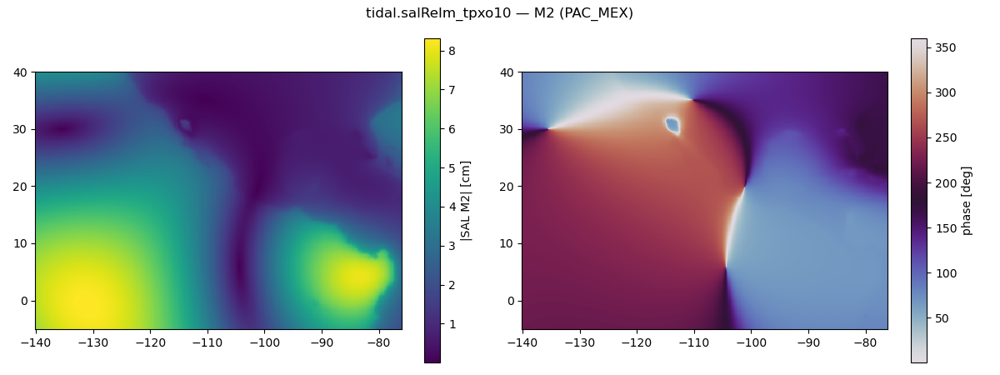

*M2 amplitude and phase of the SAL term in the HYCOM-IOA file over the PAC_MEX grid.*

**JSL drag.** `validation/tides/make_tidal_rh.py` regenerates HYCOM's `tidal.rh` from the global JSL field with
`physics/tides/drag.py`; it matches the HYCOM-tools product to a median relative difference of 4e-8
(`CLAUDE.md`). Its effect on the gauges is in the ensemble table above.

## Tide-gauge quality control

A model can only be validated against gauges that work. `validation/tide_gauges/README.md` documents two
analyses with `diagnostics/tide_gauges.py` and `diagnostics/sealevel_qc.py`.

### Historical constants (TICON-3 against TPXO10)

For each coastal record the 8 HYCOM constituents are compared with TPXO10 (land-excluding bilinear), and a
clock offset τ and a gain κ are fitted jointly, $h_{obs} \approx \kappa\, h_{TPXO}\, e^{-i\omega_c\tau}$
(`diagnose_station`, `diagnostics/tide_gauges.py:76`). Signatures: τ ≈ whole hours with κ ≈ 1 → time zone;
κ ≈ 10ⁿ → units; κ < 0 → inverted sensor; κ < 1 with tens of minutes → physical damping (lagoon, port).
Records of the same site are compared with each other (`compare_with_siblings`); a record that differs from
its siblings with an instrumental signature and is the worst against TPXO is a **confirmed defect**. Nodes
shallower than 5 m in TPXO are discarded (TPXO10 has spurious 1.5–2.4 m amplitudes at ~2 m nodes).

| Region | Records | Unflagged | Median RSS (unflagged) | Findings |
|---|---|---|---|---|
| Pacific | 34 | 20 | 1.5 cm (\|ΔG_M2\| 1.7°, \|ΔA_M2\| 0.6 cm) | Acapulco: TPXO −30 % M2; Topolobampo 60 min, La Paz 33 min, San Quintín 100 min lagoon lags |
| Gulf of Mexico and Caribbean | 18 | 5 | 1.3 cm (\|ΔG_M2\| 0.4°) | **Confirmed defects:** Progreso 1980–84 (M2 phase 175° off, 6.0 h offset) and Puerto Morelos 2007–14 (amplitude ×0.1, units); Tampico TPXO +14 %; Dos Bocas κ = 0.4 and 73 min (harbour basin) |

### Current state of the network (raw IOC/SMN data, 2026-07-12 to 10-10)

The IOC Sea Level Station Monitoring Facility relays the SMN-UNAM network without quality control. The QC
checks: reporting and coverage; gross errors (\|h − tide − median\| > 2.5 m); spikes (deviation from a 15-sample
running median > max(6σ, 5 cm), runs ≤ 3); stuck sensors; datum steps (the same change at 10 min, 1 h and one
tidal day, > 5σ); clock changes by 3-day windows against the record's own harmonic constants
(`clock_changes`, z > 5); comparison with the TICON history; and twin sensors
$h_2 \approx a + \kappa h_1(t-\tau)$ (`compare_twins`).

Of 58 IOC codes in Mexico, 17 had no data in the period and 34 series in 28 stations were active (median RSS
against their TICON history 2.3 cm). Sensor faults found:

| Station | Finding |
|---|---|
| Veracruz2 (`vera2`, float) | flat at ~0.07 m for 90 days while the tide swings ±0.4 m (stuck float; M2 = 0.0 cm, κ = −0.01) |
| Isla Clarión (`iclr`, radar) | tide recorded as exactly −0.10 × TPXO (scale ×0.1 and inverted sign); silent since 2026-09-21 |
| La Paz2 (float vs radar) | relative drift of ~9 cm since 2026-08-09, in steps (+3.7 cm/month); one sensor needs levelling |
| Celestún (`clst`, float) | repeated drops to −4 m; tide damped to 64 % and 15 min late against 2010–11 |
| Sánchez Magallanes (`smag`, float) | tide damped to 74 % against 2016–18 |
| Puerto Chiapas (`chia/flt`) | 10 % coverage, datum 7.6 m off, 20 cm rms against the radar: out of service |
| Lázaro Cárdenas2 radar | 13.7 spikes/day and 10 gross errors |
| Puerto Morelos (`pumo`) | 30 gross errors, 51 % coverage |

Seven pairs of codes are the same sensor relayed twice, with 0 or ±1 min offsets, and two carry the wrong
sensor label (`zihu/rad` is the float of `zihu2`; `tuxp2/rad` is the float of `tuxp`). Four stations have
conflicting duplicated time stamps. No active station shows a time-zone change, clock jump or drift. **Single-
sensor datum steps are only candidates:** all 8 that could be checked against an independent twin were
rejected by it.

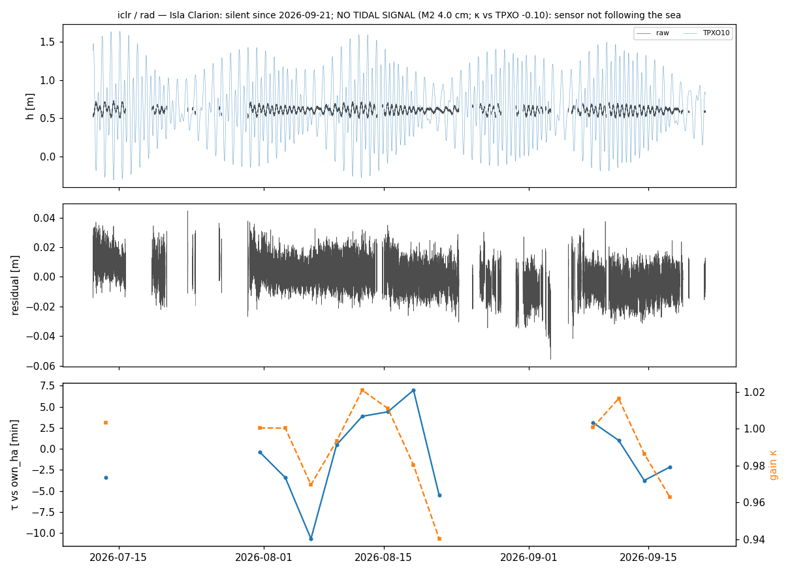

*Isla Clarión radar: the raw record (dark) has a tiny inverted tide against TPXO10 (light blue): a
mis-configured sensor, not the ocean.*

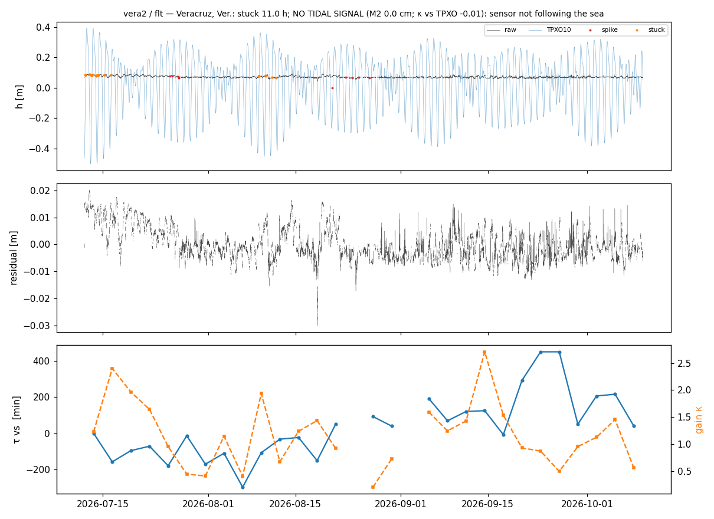

*Veracruz2 float: flat while the predicted tide oscillates ±0.4 m; the window gain κ (orange) is meaningless.*

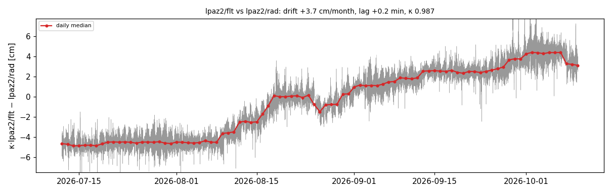

*La Paz2 float minus radar (after gain and lag fit): stable at −4.5 cm until 9 August, then a step-wise drift
of ~9 cm.*

Reproduce: `python validation/tide_gauges/compare_ticon_tpxo.py`; `python validation/tide_gauges/fetch_ioc.py`
then `python validation/tide_gauges/qc_ioc_mexico.py`.

## References

- Egbert, G. D., Erofeeva, S. Y. (2002). Efficient inverse modeling of barotropic ocean tides. *J. Atmos.
    Oceanic Technol.* 19, 183–204. **[verify]**
- Foreman, M. G. G., Henry, R. F., Walters, R. A., Ballantyne, V. A. (1993). A finite element model for tides
    and resonance along the north coast of British Columbia. *J. Geophys. Res.* 98. **[verify]**
- Haigh, I. D. et al. (2023). GESLA version 3. *Geosci. Data J.* **[verify]**
- Hart-Davis, M. G. et al. (2022). TICON-3: tidal constants based on GESLA-3 sea-level records. PANGAEA,
    [10.1594/PANGAEA.951610](https://doi.org/10.1594/PANGAEA.951610)
- Ray, R. D. (1998). Ocean self-attraction and loading in numerical tidal models. *Mar. Geod.* 21. **[verify]**
