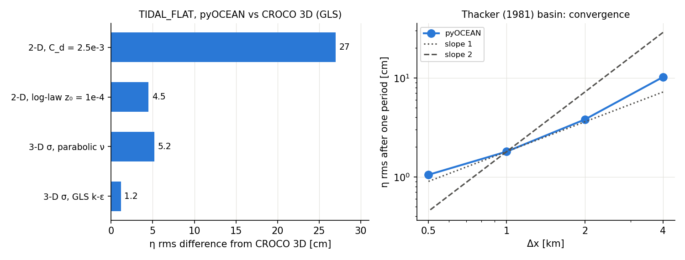
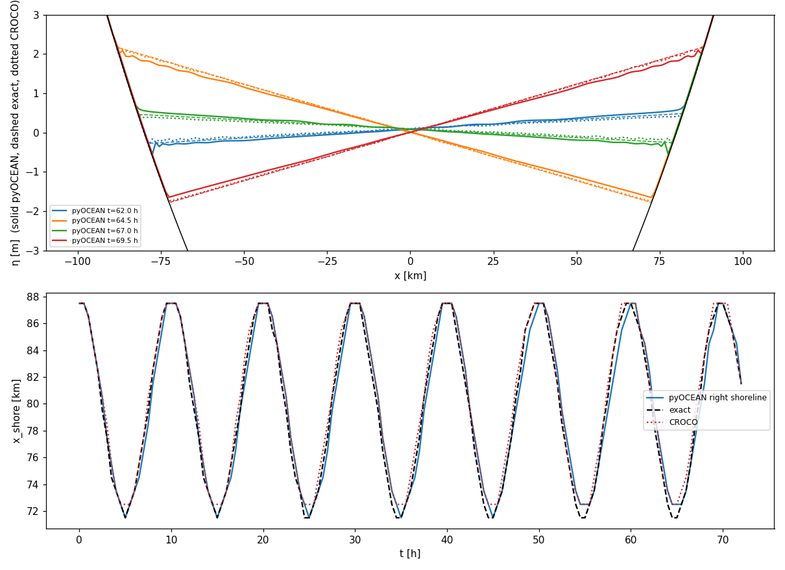
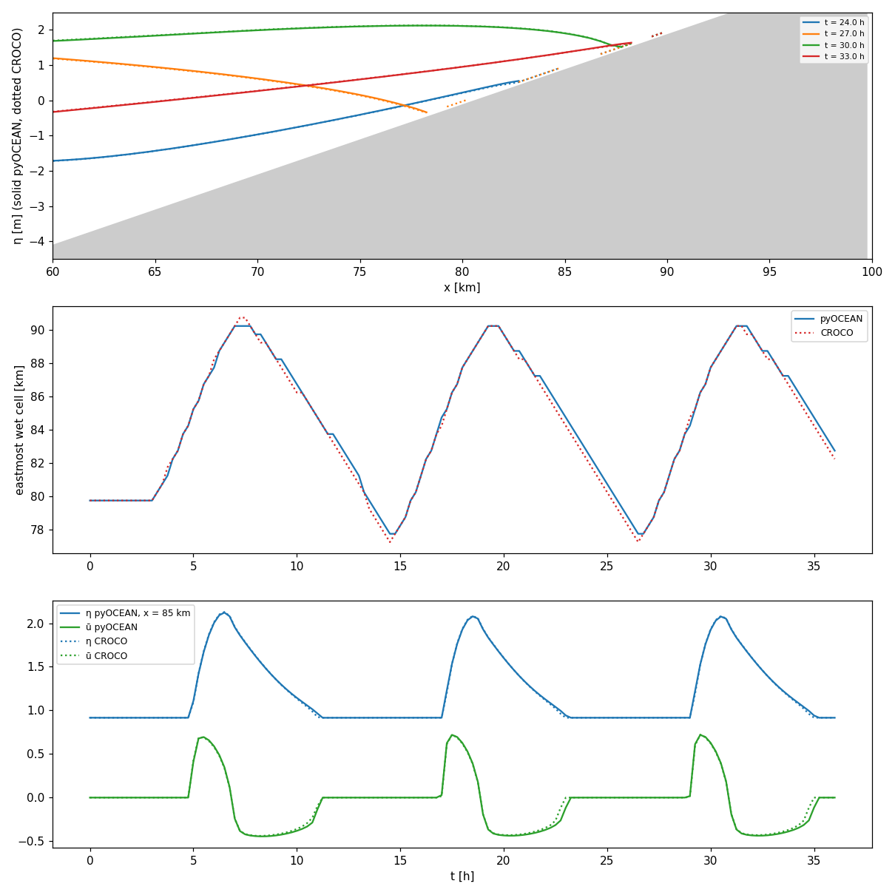
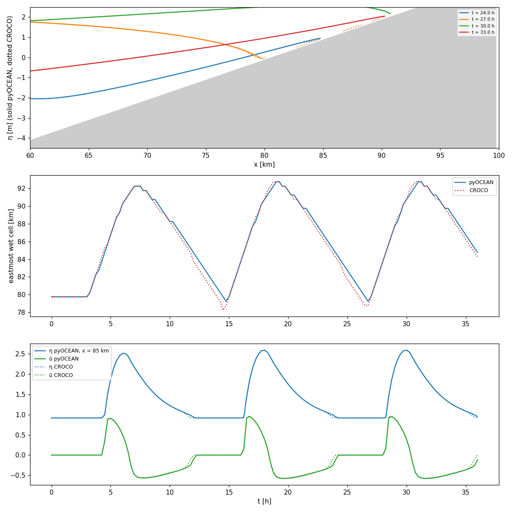
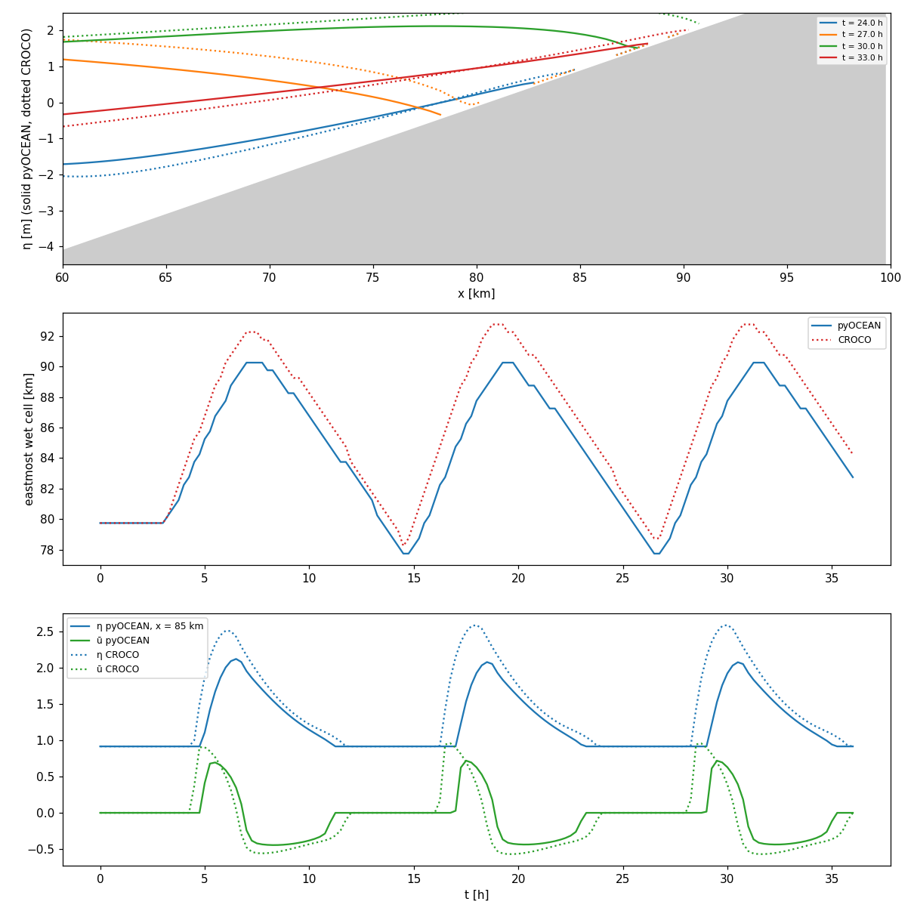

# Wetting and drying: Thacker and TIDAL_FLAT

pyOCEAN has a Casulli-type semi-implicit wetting–drying free surface for the 2-D tidal model
(`WetDryFreeSurface`, `core/dynamics/wetting_drying.py:51`) and a homogeneous 3-D σ-layer version with
turbulence closures (`SigmaWetDry`, `core/dynamics/sigma_wd.py:143`). This page validates both against the
exact Thacker (1981) solution and against CROCO's `THACKER` and `TIDAL_FLAT` test cases, the latter in its
reduced 2-DH form and in its original 3-D form with GLS. The theory is on
[Wetting and drying](../theory/wetting-drying.md); the regional application (Upper Gulf of California) is on
[Tides and sea level](tides-sealevel.md#upper-gulf-of-california-with-wetting-and-drying).

| Case | Truth | pyOCEAN | CROCO | Status |
|---|---|---|---|---|
| Thacker, 72 h | exact | η rms 4.6 cm, shoreline 0.8 km | 2.0 cm, 0.6 km | ❌ behind (front dissipation, `xfail`) |
| TIDAL_FLAT 2-DH | CROCO 2-DH | η rms 1.1 cm, shoreline within one cell | — | ✅ |
| TIDAL_FLAT 3-D | CROCO 3-D (GLS) | η rms 1.2 cm (3-D σ + GLS) | — | ✅ |



*Left: η rms difference from CROCO 3-D TIDAL_FLAT for the four pyOCEAN configurations. Right: Thacker error
after one period against Δx; the convergence is close to first order. Numbers from
`validation/tidal_flat/README.md` and `validation/thacker/README.md`.*

## Thacker (1981) parabolic basin

**Set-up** (`validation/thacker/README.md`; CROCO `THACKER_2DV`): a 200 km channel of 200 cells of 1 km;
bed $h = 10\,\mathrm{m}\,(1 - x^2/L^2)$, L = 80 km, land beyond ±80 km; initial flat surface η₀ = 0.1 m,
u = 0, no friction, f = 0; Δt = 60 s, 72 h (7.2 periods of 9.97 h). pyOCEAN θ = 0.5, dry threshold
D_min = 0.05 m; CROCO D_crit = 0.01 m.

**Truth.** $\eta = A_0 x\cos\omega t + \eta_0^2 D\sin^2\omega t$, $u = -\eta_0\omega L\sin\omega t$ (uniform),
$A_0 = 2\eta_0 D/L$, $\omega^2 = 2gD/L^2$ (D = 10 m).

**Results** (Δx = 1 km):

| | η rms (72 h) | rms of the last period | Shoreline (rms) | Volume |
|---|---|---|---|---|
| **pyOCEAN** (θ = 0.5, D_min = 0.05 m) | 4.6 cm | 6.9 cm | 0.8 km | exact (4e-16) |
| pyOCEAN (θ = 0.5, D_min = 0.01 m) | 9.7 cm | 15.4 cm | 1.4 km | exact |
| **CROCO** (D_crit = 0.01 m) | 2.0 cm | 2.9 cm | 0.6 km | exact |

Convergence of pyOCEAN (rms after one period): 10.2, 3.8, 1.8 and 1.05 cm at Δx = 4, 2, 1 and 0.5 km.



*Top: η across the basin at four times in the last period (solid pyOCEAN, dashed exact, dotted CROCO).
Bottom: position of the right shoreline; pyOCEAN follows the exact solution but its excursion shrinks slowly.*

**Known limitation: dissipation at the front.** pyOCEAN loses ~1 % of the planar amplitude per period
(A/A₀ = 0.936 after 7 periods), CROCO ~0.2 % (0.984); neither drifts in phase. A face that becomes wet starts
with u = 0, a momentum sink at the shoreline; CROCO does not zero the velocity at dry faces, it only masks the
flux. Extrapolating velocity to newly wet faces was tried and rejected (it pumps energy through faces that
flicker between wet and dry). Pending: a momentum-conserving front (Stelling & Duinmeijer 2003) or Casulli
(2009) subgrid bathymetry (`docs/design/vision_roadmap.md` §5).

**Tests** (`tests/test_wetting_drying.py:81`, `TestThacker`): one period against the exact solution (max
error < 0.10 m, rms < 0.02 m); shoreline within 2 km at mid-excursion; error decreasing with resolution;
front-dissipation regression (amplitude > 0.965 after 3 periods); **strict `xfail`**
`test_front_dissipation_as_low_as_croco` (> 0.99, CROCO's level) to keep the goal visible; mass conserved to
1e-9 and depth never negative.

Reproduce:

```bash
python validation/thacker/run_thacker.py --theta 0.5 --dmin 0.05 \
    --croco ~/pyOCEAN_refs/croco_runs/thacker/thacker_his.nc
```

CROCO was built with `create_config.bash`, `#define THACKER`, `#undef REGIONAL` and `ZETA_DRY_IO` (without it
`wrt_his.F` writes ζ + h in some dry cells); on arm64 `jobcomp` needs GCC's cpp, no `-mcmodel=medium`, and
`-L$(nc-config --libdir)`. CROCO runs in 1.7 s.

## CROCO TIDAL_FLAT, 2-DH

**Set-up** (`validation/tidal_flat/README.md`; CROCO `ana_grid.F`, `analytical.F`,
`TEST_CASES/croco.in.Tidal_flat`): a 100 km channel of 200 cells of 500 m, f = 0; bed h₁ = 16 m and
$h_i = 16 - 20(i-1)/201$ m for i ≥ 2, reaching −3.9 m at the east end (the last ~19 km are a flat that floods
and dries); west boundary $\eta_{ext} = 2\sin(2\pi t/12\,\mathrm h)$, walls elsewhere; quadratic drag
C_d = 2.5e-3 on the total depth, no viscosity; third-order upwind momentum advection (CROCO `UV_HADV_UP3`,
pyOCEAN `upwind3`); dry threshold 0.1 m; Δt = 15 s, 36 h (3 periods). CROCO's 3-D case was reduced to 2-DH by
undefining `SOLVE3D`, `SALINITY`, `GLS_MIXING`, `TS_*`, `UV_VIS2`, `SPONGE`, `T_FRC_BRY`, `MUSTANG` and
`NEW_S_COORD`.

**Boundary.** CROCO's `OBC_M2CHARACT` with `OBC_REDUCED_PHYSICS` ignores ū_ext = 0 and uses the extrapolated
interior velocity (`u2dbc.F`): a Flather $u_b = u_{int} - \sqrt{g/D}(\eta - \eta_{ext})$ that in practice
fixes η ≈ η_ext. pyOCEAN's equivalent is Flather with ū_ext = the velocity of the first interior face at the
previous step; with ū_ext = 0 pyOCEAN gives half the tidal range (2.5 against 4.1 m at 10 km).

**Results (last period, 24–36 h):**

| x [km] | η range py / CROCO [m] | η rms diff. [cm] | ū max py / CROCO [m/s] | ū rms diff. [m/s] |
|---|---|---|---|---|
| 10 | 4.06 / 4.06 | 1.2 | 1.21 / 1.21 | 0.007 |
| 50 | 4.04 / 4.05 | 1.1 | 1.03 / 1.02 | 0.006 |
| 80 | 2.19 / 2.20 | 1.1 | 0.87 / 0.86 | 0.033 |
| 85 | 1.16 / 1.17 | 0.9 | 0.72 / 0.72 | 0.029 |
| 90 | 0.14 / 0.15 | 0.4 | 0.21 / 0.18 | 0.019 |

η where both are wet: rms 1.1 cm, max 5.1 cm. Shoreline: pyOCEAN 77.75–90.25 km, CROCO 77.25–90.25 km (rms
0.35 km, max 0.5 km = one cell; on the ebb pyOCEAN dries one cell later). No volume clipped. Insensitive to θ
(0.5–0.6), centred against upwind3 advection and Δt = 60 s; without advection 1.5 cm.



*Top: η over the flat at four times (solid pyOCEAN, dotted CROCO). Middle: eastmost wet cell. Bottom: η and ū
at x = 85 km. The two models overlap except for the one-cell lag on the ebb.*

**Regression test:** `TestTidalFlatVsCroco` (`tests/test_wetting_drying.py:312`) against
`tests/data/tidal_flat_croco_reference.npz`: η at the stations rms < 2 cm and max < 6 cm, ū rms < 4 cm/s,
shoreline within one cell, no volume clipped.

## CROCO TIDAL_FLAT, 3-D (GLS)

The original CROCO case is 3-D: GLS k-ε, log-law bottom friction with $z_0$ = 1e-4 m, N = 10 levels (run
without MUSTANG sediments, which do not affect the hydrodynamics; a "matched" variant without `UV_VIS2` and
`SPONGE` and with `UV_HADV_UP3` differs by < 0.4 cm).

**The 3-D model brakes less than the 2-D one with C_d = 2.5e-3:** flooding reaches 92.75 km (against 90.25)
and the range at 50 km is 4.7 m (against 4.0). The effective C_d of CROCO 3-D, bustr/(ρ₀ū²), depends on the
depth like the log law $[\kappa/(\ln(D/z_0) - 1)]^2$:

| D [m] | 0.2–0.5 | 1–2 | 4–8 | 12–20 |
|---|---|---|---|---|
| CROCO 3-D | 2.8e-3 | 2.1e-3 | 1.6e-3 | 1.3e-3 |
| log law | 3.2e-3 | 2.3e-3 | 1.7e-3 | 1.4e-3 |

This led to `log_law_cd` (`physics/bottom_friction.py:31`, Soulsby 1997) in the 2-D model and to the 3-D
`SigmaWetDry`: N equal σ-layers on the total depth, implicit vertical viscosity, bed-layer log-law friction
$C_d = [\kappa/\ln(\Delta z_1/(2z_0))]^2$ as CROCO, η and ū from the same `WetDryFreeSurface` plus a uniform
barotropic correction (Casulli & Cheng 1992), and closures `gls` (k-ε Canuto-A, column port of CROCO
`gls_mixing.F`, `physics/mixing/gls.py:90`), `parabolic` ($\nu = \kappa u_* z(1 - z/D)$), `constant` and
`none`.

| Against CROCO 3-D (last period) | η rms (wet cells) | η max | ū rms (stations) | Shoreline max |
|---|---|---|---|---|
| 2-D, C_d = 2.5e-3 | 27.0 cm | 128 cm | 0.17–0.29 m/s | 3.5 km |
| 2-D, log law $z_0$ = 1e-4 m | 4.5 cm | 39 cm | 0.02–0.10 m/s | 1.5 km |
| 3-D σ, parabolic | 5.2 cm | 45 cm | 0.03–0.12 m/s | 2.0 km |
| **3-D σ, GLS k-ε** | **1.2 cm** | 8.7 cm | **0.01–0.05 m/s** | 1.0 km |

(A 2-D run with $z_0$ = 5e-5 m gives 2.2 cm; it is a diagnostic only, $z_0$ is not tuned.) With GLS the tidal
ranges agree to ≤ 2 cm at every station (4.72 / 4.72 m at 50 km) and the layer profiles to ~1 cm/s at 50 km
and ~4 cm/s at 85 km; the run takes ~14 s. The parabolic profile is not enough because it vanishes at the
surface and has no memory; GLS keeps ν ≈ 0.024 m² s⁻¹ at the surface and concentrates the shear near the bed,
so the bed-layer velocity is a smaller fraction of ū and the effective friction is 12 % lower.



*pyOCEAN 3-D σ + GLS against CROCO 3-D: η over the flat, eastmost wet cell and station series at 85 km.*



*The same comparison for the 2-D model with constant C_d = 2.5e-3: it floods 2.5 km less and its range is
~0.5 m too small, the gap that the log law and the 3-D model close.*

**Tests:** `TestTidalFlatVsCroco3D` (`tests/test_wetting_drying.py:337`, reference
`tests/data/tidal_flat_croco_3d_reference.npz`): constant C_d must be > 20 cm at the stations, log law < 8 cm;
`test_sigma_gls_model_matches_croco_3d`: η rms < 2.5 cm (gives 1.2) and ū < 5 cm/s (gives 3.1).
`tests/test_gls.py`: Canuto-A $c_\mu^0$ = 0.527, positive decay without shear, log-layer equilibrium
($\nu \approx \kappa u_* z$, $k \approx u_*^2/c_\mu^{0\,2}$). `tests/test_sigma_wd.py`: vertical solver against a
dense solve, momentum conservation, Chézy log-law ū (0.96–0.99), exact 2-D limit without friction, positive
GLS and mass conservation.

Reproduce:

```bash
python validation/tidal_flat/run_tidal_flat.py --croco ~/pyOCEAN_refs/croco_runs/tidal_flat/tidal_flat_his.nc
python validation/tidal_flat/run_tidal_flat.py --croco ~/pyOCEAN_refs/croco_runs/tidal_flat3d/tidal_flat_his.nc \
    --z0 1e-4 --layers 10 --closure gls
python validation/tidal_flat/make_reference.py ~/pyOCEAN_refs/croco_runs/tidal_flat/tidal_flat_his.nc   # → tests/data
```

## What pyOCEAN should improve (from these cases)

1. A momentum-conserving front (Stelling & Duinmeijer 2003) or Casulli (2009) subgrid bathymetry: the Thacker
    `xfail` and the one-cell drying lag of TIDAL_FLAT.
2. Use the log-law drag in `run_tides.py` and `run_tides_wd.py`, which still use constant C_d (the Upper Gulf
    log-law runs exist as variants).
3. Vertical advection $\omega\,\partial u/\partial\sigma$ in `SigmaWetDry` before adding stratification (it is
    absent and the result still matches).
4. Numba Thomas sweeps (10 layers on 200 columns cost 3× the 2-D model).
5. Pressure–friction coupling: with the fractional step the implicit friction does not see the pressure
    increment of the same step; to be measured with large Δt.

## References

- Casulli, V. (2009). A high-resolution wetting and drying algorithm for free-surface hydrodynamics.
    *Int. J. Numer. Methods Fluids* 60. **[verify]**
- Casulli, V., Cheng, R. T. (1992). Semi-implicit finite difference methods for three-dimensional shallow water
    flow. *Int. J. Numer. Methods Fluids* 15. **[verify]**
- Soulsby, R. (1997). *Dynamics of Marine Sands*. Thomas Telford. **[verify]**
- Stelling, G. S., Duinmeijer, S. P. A. (2003). A staggered conservative scheme for every Froude number in
    rapidly varied shallow water flows. *Int. J. Numer. Methods Fluids* 43. **[verify]**
- Thacker, W. C. (1981). Some exact solutions to the nonlinear shallow-water wave equations. *J. Fluid Mech.*
    107, 499–508. **[verify]**
